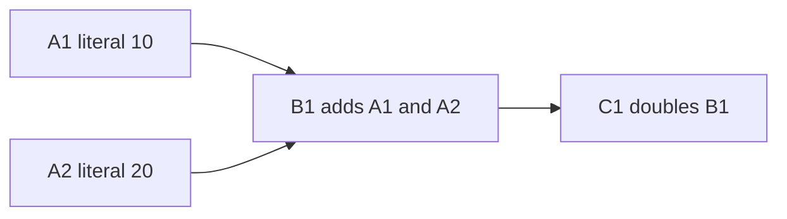

A spreadsheet is a useful test of functional design because it mixes several concerns: formula syntax, evaluation, dependency tracking, edits, and a UI that must display failures without corrupting prior state.

We can build the calculation engine from immutable formula values and pure functions. The UI then owns input and display, while the engine explains exactly which result follows from a sheet snapshot.

<!--more-->

This Swift 5.7 case study builds an integer spreadsheet engine and a small editable SwiftUI front end. The application supports literals, references, addition, and multiplication with defined failure behavior. It does not attempt Excel compatibility, a document format, or a full grid editor.

## Make formulas data before evaluating them

```swift
indirect enum Formula: Equatable {
    case integer(Int)
    case reference(String)
    case add(Formula, Formula)
    case multiply(Formula, Formula)
}

typealias Sheet = [String: Formula]

enum SheetFailure: Error, Equatable {
    case missingCell(String)
    case cycle([String])
    case overflow
}

let sheet: Sheet = [
    "A1": .integer(10),
    "A2": .integer(20),
    "B1": .add(.reference("A1"), .reference("A2")),
    "C1": .multiply(.reference("B1"), .integer(2))
]
```

A reference is distinct from a literal even if its current result happens to equal that literal. Keeping syntax preserves the dependency relationship and allows future reevaluation after an edit.

Cell identifiers are opaque case-sensitive strings in this version. A real grid needs a validated address type, including row and column bounds, normalization, and relative-reference semantics. Calling every string an address does not implement those rules.

Missing cells are errors rather than implicit zeros. Many spreadsheet products make different choices in different contexts; define the chosen language before trying to imitate them.

## Evaluate with a recursion path and a local cache

```swift
func evaluateCell(_ name: String, in sheet: Sheet) -> Result<Int, SheetFailure> {
    var memo: [String: Int] = [:]
    var path: [String] = []

    func cell(_ name: String) throws -> Int {
        if let cached = memo[name] { return cached }
        if let index = path.firstIndex(of: name) {
            throw SheetFailure.cycle(Array(path[index...]) + [name])
        }
        guard let formula = sheet[name] else { throw SheetFailure.missingCell(name) }
        path.append(name)
        defer { path.removeLast() }
        let value = try expression(formula)
        memo[name] = value
        return value
    }

    func expression(_ formula: Formula) throws -> Int {
        switch formula {
        case let .integer(value):
            return value
        case let .reference(name):
            return try cell(name)
        case let .add(left, right):
            let a = try expression(left)
            let b = try expression(right)
            let result = a.addingReportingOverflow(b)
            guard !result.overflow else { throw SheetFailure.overflow }
            return result.partialValue
        case let .multiply(left, right):
            let a = try expression(left)
            let b = try expression(right)
            let result = a.multipliedReportingOverflow(by: b)
            guard !result.overflow else { throw SheetFailure.overflow }
            return result.partialValue
        }
    }

    do {
        return .success(try cell(name))
    } catch let failure as SheetFailure {
        return .failure(failure)
    } catch {
        preconditionFailure("The evaluator throws only SheetFailure")
    }
}

assert(evaluateCell("B1", in: sheet) == .success(30))
assert(evaluateCell("C1", in: sheet) == .success(60))
assert(evaluateCell("Z9", in: sheet) == .failure(.missingCell("Z9")))
```

The cache and path mutate only within one evaluation call. The function's observable result still depends only on the name and sheet values supplied by the caller.

Successful cell results are memoized for that call, so a shared dependency need not be recalculated every time it appears in the formula graph. Errors are returned explicitly; fixed-width arithmetic overflow does not crash the engine.

The catch-all marks an internal assumption in this untyped-throws implementation. If new adapters can throw other errors, expand the error model and mapping deliberately rather than leaving that assumption silently false.

## A recursion path distinguishes cycles from shared dependencies

```swift
let cyclic: Sheet = [
    "A1": .reference("B1"),
    "B1": .reference("A1")
]
assert(evaluateCell("A1", in: cyclic) == .failure(.cycle(["A1", "B1", "A1"])))

let diamond: Sheet = [
    "A1": .integer(5),
    "B1": .add(.reference("A1"), .integer(1)),
    "C1": .add(.reference("A1"), .integer(2)),
    "D1": .add(.reference("B1"), .reference("C1"))
]
assert(evaluateCell("D1", in: diamond) == .success(13))

let overflowing: Sheet = ["A1": .add(.integer(Int.max), .integer(1))]
assert(evaluateCell("A1", in: overflowing) == .failure(.overflow))
```

Seeing a cell anywhere in the graph is not itself a cycle. A diamond legitimately reaches `A1` from two branches. A cycle occurs when a reference returns to a cell still on the active evaluation path.

The path is removed with `defer`, including when a descendant throws. Forgetting that cleanup can make a later branch look cyclic even after the earlier branch has finished.

The linear `firstIndex` check is simple but can add overhead in deep graphs. A separate active set can provide faster membership checks while the path array retains an ordered diagnostic. Keep both synchronized if making that optimization.

## Extract dependency facts without calculating values



These arrows point from a source to cells affected by its change. Evaluation follows the references in the opposite direction, from a requested result toward its inputs.

```swift
func dependencies(of formula: Formula) -> Set<String> {
    switch formula {
    case .integer:
        return []
    case let .reference(name):
        return [name]
    case let .add(left, right), let .multiply(left, right):
        return dependencies(of: left).union(dependencies(of: right))
    }
}

func affectedCells(changing name: String, in sheet: Sheet) -> Set<String> {
    var dependents: [String: Set<String>] = [:]
    for (cell, formula) in sheet {
        for dependency in dependencies(of: formula) {
            dependents[dependency, default: []].insert(cell)
        }
    }
    var affected: Set<String> = [name]
    var pending = [name]
    while let current = pending.popLast() {
        for dependent in dependents[current] ?? [] {
            if affected.insert(dependent).inserted { pending.append(dependent) }
        }
    }
    return affected
}

assert(dependencies(of: sheet["B1"]!) == ["A1", "A2"])
assert(affectedCells(changing: "A1", in: sheet) == ["A1", "B1", "C1"])
assert(affectedCells(changing: "A1", in: cyclic) == ["A1", "B1"])
```

Evaluation follows references from a formula to its dependencies. Invalidation follows reverse edges from a changed cell to its dependents. Confusing the two directions is a common source of stale results.

The visited set makes invalidation terminate even when the sheet contains a cycle. Finding affected cells is not the same as successfully evaluating them; a cyclic affected group still returns cycle errors.

This function rebuilds the reverse index on each call. A larger engine can store and update that index with sheet edits, but then must maintain a consistency invariant between formulas and dependency edges.

## An edit produces a new sheet snapshot

```swift
var edited = sheet
edited["A1"] = .integer(100)
assert(evaluateCell("C1", in: sheet) == .success(60))
assert(evaluateCell("C1", in: edited) == .success(240))
assert(evaluateCell("A2", in: edited) == .success(20))
```

The original sheet remains meaningful, which supports undo and side-by-side comparison. The dictionary's value semantics provide the observable independence; copy-on-write can avoid eagerly duplicating storage until mutation.

The local evaluator cache belongs to one snapshot. Reusing it across edits without invalidation would return stale results. A global cache keyed only by cell name is invalid because `A1` can mean a different formula in another sheet version.

For incremental evaluation, invalidate the changed cell and its transitive dependents, retain valid unaffected entries, and evaluate requested results against the new snapshot. Include formula edits that change dependencies and removal of referenced cells in the test plan.

## Keep parsing, evaluation, and display separate

A formula parser can produce this enum from text, using techniques from [Parser Combinators](/swift-parser-combinators/). The evaluator should not need to reparse text every time it follows a reference.

A presenter maps `.cycle`, `.missingCell`, and `.overflow` to cell display states. Preserve the structured reason so a UI can highlight a dependency path rather than merely show a generic string.

The editor owns effects: accepting keystrokes, saving files, scheduling recalculation, and publishing results. Background evaluation should carry a sheet version, and the UI should reject results from an obsolete version after a newer edit.

The pure engine makes calculation reproducible. It does not automatically solve task cancellation, version acceptance, or file durability.

## Parse a deliberately small editable formula language

The engine can support richer syntax than the first editor needs. Start with integer literals, a single reference prefixed by `=`, or two atoms joined by one `+` or `*`. An atom is an integer or one of the editor's known cell addresses.

```swift
import Foundation

func formulaFromText(_ source: String, addresses: Set<String>) -> Formula? {
    let text = source.trimmingCharacters(in: .whitespacesAndNewlines)
    if let value = Int(text) { return .integer(value) }
    guard text.hasPrefix("=") else { return nil }
    let body = text.dropFirst()

    func atom(_ text: Substring) -> Formula? {
        let token = text.trimmingCharacters(in: .whitespacesAndNewlines)
        if let value = Int(token) { return .integer(value) }
        guard addresses.contains(token) else { return nil }
        return .reference(token)
    }

    guard let separator = body.firstIndex(where: { $0 == "+" || $0 == "*" }) else {
        return atom(body)
    }
    let afterSeparator = body.index(after: separator)
    guard let left = atom(body[..<separator]),
          let right = atom(body[afterSeparator...]) else { return nil }
    return body[separator] == "+" ? .add(left, right) : .multiply(left, right)
}

let editorAddresses: Set<String> = ["A1", "A2", "B1", "C1"]
assert(formulaFromText("=A1 + A2", addresses: editorAddresses) == sheet["B1"])
assert(formulaFromText("=B1 * 2", addresses: editorAddresses) == sheet["C1"])
assert(formulaFromText("=A1+", addresses: editorAddresses) == nil)
assert(formulaFromText("=A1*2+3", addresses: editorAddresses) == nil)
assert(formulaFromText("=Z9", addresses: editorAddresses) == nil)
```

This parser rejects unsupported syntax rather than guessing precedence. The formula enum itself can represent nested expressions, so a later parser can expand the language without changing evaluation.

The editor's known-address restriction is a UI policy. The engine still handles missing references because other callers, removed cells, or future import formats can produce them. Validation at one boundary does not justify deleting errors from another boundary's contract.

## Add a SwiftUI owner for drafts and committed state

The editable text and committed formulas are different states. Typing an incomplete expression should not replace a valid formula before the user applies it.

```swift
import SwiftUI

let initialEditorSheet = sheet

@available(macOS 10.15, iOS 13.0, *)
struct SpreadsheetEditor: View {
    private let addresses = ["A1", "A2", "B1", "C1"]
    @State private var formulas: Sheet = initialEditorSheet
    @State private var drafts = [
        "A1": "10", "A2": "20", "B1": "=A1+A2", "C1": "=B1*2"
    ]
    @State private var inputError: String?

    var body: some View {
        VStack(alignment: .leading, spacing: 12) {
            Text("Functional Spreadsheet").font(.headline)
            ForEach(addresses, id: \.self) { name in
                HStack {
                    Text(name).frame(width: 32)
                    TextField("Formula", text: Binding(
                        get: { drafts[name] ?? "" },
                        set: { drafts[name] = $0 }
                    ))
                    Button("Apply") { commit(name) }
                    Text(displayValue(for: name)).frame(minWidth: 90, alignment: .trailing)
                }
            }
            if let message = inputError {
                Text(message).foregroundColor(.red)
            }
            Text("Integers, =A1, =A1+A2, or =B1*2")
                .font(.caption)
        }
        .padding()
    }

    private func commit(_ name: String) {
        guard let formula = formulaFromText(
            drafts[name] ?? "", addresses: Set(addresses)
        ) else {
            inputError = "Invalid formula in " + name
            return
        }
        formulas[name] = formula
        inputError = nil
    }

    private func displayValue(for name: String) -> String {
        switch evaluateCell(name, in: formulas) {
        case let .success(value): return String(value)
        case .failure(.cycle): return "#CYCLE"
        case .failure(.missingCell): return "#REF"
        case .failure(.overflow): return "#OVERFLOW"
        }
    }
}
```

In an Xcode SwiftUI application, put `SpreadsheetEditor()` inside the generated app's `WindowGroup`. Add the formula model, evaluator, and parser to the target. The pure engine also runs independently in a playground or command-line program; SwiftUI is required only for this front end.

Initially, `B1` shows 30 and `C1` shows 60. Change `A1` to 100 and apply: `B1` becomes 120 and `C1` becomes 240. Enter `=B1` into `A1` to create a cycle and see dependent cells display `#CYCLE`. Restore `A1` to a literal to recover without recreating the application.

Malformed draft text produces a validation message and preserves the last committed sheet. A syntactically valid formula containing a cycle is committed and displays a calculation error. Those are deliberately different policies: the editor rejects invalid syntax, while the spreadsheet can represent valid formulas whose evaluation fails.

The view owns state replacement. The parser and evaluator remain ordinary functions with no knowledge of text fields, buttons, or view lifetime. This is the functional boundary in an actual running feature, rather than a requirement to make the UI itself pure.

## Know the engine's limits

Recursive evaluation can exhaust the stack on a long dependency chain or deeply nested formula. An iterative topological evaluator can handle larger acyclic graphs, while cycle detection still needs a deliberate strategy.

The current cache is per requested root. Calling `evaluateCell` separately for every visible cell repeats shared work across calls. A batch evaluator can share one cache across roots within the same snapshot.

Real spreadsheet features add semantic choices: ranges, blank coercion, strings, dates, error propagation, volatile functions, and circular-iteration modes. Add each as a language feature with defined behavior rather than treating compatibility as a few more enum cases.

## Test dependency changes even when current values match

A formula can change its dependency graph without changing its current numeric result. Invalidation must follow the formula, not a comparison of displayed values:

```swift
var rewired = sheet
rewired["B1"] = .integer(30)
assert(evaluateCell("C1", in: rewired) == .success(60))
assert(affectedCells(changing: "A1", in: rewired) == ["A1"])
assert(affectedCells(changing: "B1", in: rewired) == ["B1", "C1"])

var removedDependency = sheet
removedDependency.removeValue(forKey: "A2")
assert(evaluateCell("C1", in: removedDependency) == .failure(.missingCell("A2")))
assert(evaluateCell("C1", in: sheet) == .success(60))
```

The first edit removes edges from `B1` to `A1` and `A2`, even though `B1` still displays 30. A dependency index updated only when a displayed result changes would retain obsolete edges.

The second edit removes a referenced cell and preserves the old snapshot. It establishes both missing-reference propagation and version independence.

For an incremental cache, test the reverse case too: a formula gaining a dependency must begin invalidating when that new source changes. Equal results at edit time are not sufficient evidence that the old cache relationships remain valid.

## Error precedence is observable behavior

Our evaluator visits the left operand before the right. If both contain failures, the left failure is returned first. This is a defined consequence of the implementation and should become an intentional language policy if users rely on it.

An alternative engine might collect multiple independent errors or prioritize a cycle over a missing reference. Those are valid choices, but a change of traversal strategy could otherwise change diagnostics unexpectedly.

Keep calculation order and dependency enumeration separate. `Set` iteration in the reverse index is intentionally unordered, while expression evaluation follows syntax order. Using the dependency set itself as an evaluation schedule would discard that order and require a new diagnostic policy.

## Recalculation should publish one coherent version

An editor may evaluate several visible cells after a user edit. Publishing each result immediately can briefly show a mixture of old and new sheet versions.

One approach evaluates a requested batch against an immutable snapshot, then publishes the results together with that snapshot's version. A newer edit can supersede the entire batch. Another approach permits incremental display but labels every result with its source version.

The correct UX depends on scale and responsiveness requirements. The important invariant is that a result can be traced to the sheet it evaluated. A plain dictionary keyed only by cell address is insufficient once several versions are in flight.

## Pure evaluation enables useful debugging tools

The formula tree and snapshot can be saved as a minimal reproduction without recording UI gestures or network timing. A debugger can show a reference chain, evaluate a subexpression, or compare two sheet versions.

Local memoization does not change those semantics because the cache is derived from one snapshot and discarded afterward. An external cache or volatile function such as “current time” would add dependencies that must be represented explicitly.

If the language later adds a time function, pass an evaluation environment containing a stable timestamp for the whole calculation. Reading the clock independently at each reference can make a single recalculation internally inconsistent.

## Exercise: support subtraction and batch evaluation

Add subtraction with checked overflow and tests involving negative results. Then implement a batch evaluator sharing successful results across several requested cells in one snapshot.

Test a diamond graph, a self-cycle, a multi-cell cycle, a missing reference, and an overflowing subexpression. Finally, change a formula so it no longer references a cell and verify the reverse dependency index drops the obsolete edge.

Swift's [Enumerations](https://docs.swift.org/swift-book/documentation/the-swift-programming-language/enumerations/) and [Error Handling](https://docs.swift.org/swift-book/documentation/the-swift-programming-language/errorhandling/) chapters cover the language mechanisms. Continue with [Functors, Applicatives, and Monads](/swift-functors-applicatives-monads/) or return to the [Functional Programming roadmap](/swift-functional-programming/).
