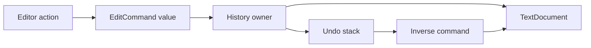

Command represents an action as a value or object that can be passed, recorded, queued, or executed by another owner. For local editing, reversible commands can support undo and redo without saving an entire document after every keystroke.

The difficult contract is what happens when the target changes independently. An old undo operation must not silently apply to a different document state merely because its offset still exists.

<!--more-->

These Swift 5.7 examples use character-array edits with expected removed content, replacement content, and a history owner that tracks document revision. External effects require a different compensation and idempotency model.

## Make the action and its inverse explicit

```swift
struct EditCommand {
    let offset: Int
    let removed: [Character]
    let inserted: [Character]
    var inverse: EditCommand {
        EditCommand(offset: offset, removed: inserted, inserted: removed)
    }
    static func insert(_ text: String, at offset: Int) -> EditCommand {
        EditCommand(offset: offset, removed: [], inserted: Array(text))
    }
}

enum EditFailure: Error { case invalidRange, contentMismatch, tooLong, revisionExhausted, externalChange }
final class TextDocument {
    private var characters: [Character]
    private(set) var revision = 0
    var text: String { String(characters) }
    private let limit = 100_000

    init(_ text: String) {
        characters = Array(text)
        precondition(characters.count <= limit)
    }
    func apply(_ command: EditCommand) throws {
        guard command.offset >= 0, command.offset <= characters.count,
              command.removed.count <= characters.count - command.offset else {
            throw EditFailure.invalidRange
        }
        let end = command.offset + command.removed.count
        guard characters[command.offset..<end].elementsEqual(command.removed) else {
            throw EditFailure.contentMismatch
        }
        guard command.inserted.count <= limit - (characters.count - command.removed.count) else {
            throw EditFailure.tooLong
        }
        guard revision < Int.max else { throw EditFailure.revisionExhausted }
        characters.replaceSubrange(command.offset..<end, with: command.inserted)
        revision += 1
    }
}
```

The command stores a patch, not a closure hiding mutable captured state. Its inverse swaps expected and replacement fragments at the same offset.

Offsets count Swift characters under this representation. They are not byte offsets or stable positions across arbitrary concurrent edits. Converting a string to characters is an explicit storage choice with linear construction cost.

## The history owner commits stack changes only after execution succeeds

```swift
final class EditorHistory {
    private let document: TextDocument
    private var knownRevision: Int
    private var undoStack: [EditCommand] = []
    private var redoStack: [EditCommand] = []
    init(document: TextDocument) {
        self.document = document
        knownRevision = document.revision
    }
    private func checkRevision() throws {
        guard document.revision == knownRevision else { throw EditFailure.externalChange }
    }
    func execute(_ command: EditCommand) throws {
        try checkRevision()
        try document.apply(command)
        knownRevision = document.revision
        undoStack.append(command)
        redoStack.removeAll()
    }
    func undo() throws -> Bool {
        guard let command = undoStack.last else { return false }
        try checkRevision()
        try document.apply(command.inverse)
        knownRevision = document.revision
        undoStack.removeLast()
        redoStack.append(command)
        return true
    }
    func redo() throws -> Bool {
        guard let command = redoStack.last else { return false }
        try checkRevision()
        try document.apply(command)
        knownRevision = document.revision
        redoStack.removeLast()
        undoStack.append(command)
        return true
    }
}

let document = TextDocument("Swift")
let history = EditorHistory(document: document)
try history.execute(.insert("!", at: 5))
assert(document.text == "Swift!")
let undone = try history.undo()
assert(undone && document.text == "Swift")
let redone = try history.redo()
assert(redone && document.text == "Swift!")
_ = try history.undo()
try history.execute(.insert("?", at: 5))
let abandonedRedo = try history.redo()
assert(!abandonedRedo && document.text == "Swift?")
```

A new edit after undo discards the abandoned future. Undo and redo still advance the document revision because they are new mutations, not a rewind of the monotonic version source.

A failed apply leaves both stacks unchanged. Popping first and then discovering an invalid target would lose the operation needed to diagnose or recover.

## Detect independent edits instead of guessing

```swift
try document.apply(.insert("#", at: 0))
do {
    _ = try history.undo()
    assertionFailure("An old history cannot overwrite an independently edited document")
} catch EditFailure.externalChange {}
assert(document.text == "#Swift?")
```

Checking expected fragment content alone is not enough: repeated text can make an old offset accidentally match another region. The revision guard rejects independent changes under this simple serialized-owner policy.

Collaborative editing needs a richer position and transformation model, such as rebasing operations against intervening edits. The command pattern does not supply that algorithm automatically.

## Separate description, receiver, and invoker

The command describes the operation. `TextDocument` is the receiver that validates and applies it. `EditorHistory` invokes operations and owns undo/redo policy.

A closure can also be a command when callers only need execution. A data command is easier to inspect, serialize, compare, and audit, but needs a stable schema if it is persisted.



## Undo is not universal rollback

A local character edit has a well-defined inverse under the expected state. Sending an email, charging a payment, or publishing a remote event cannot usually be undone by running the same method backward.

Those commands may need compensating actions, an idempotency key, and a durable outcome log. A timeout can leave execution uncertain, so blindly retrying a serialized command may duplicate an effect.

Likewise, grouping several local edits into a macro command needs atomic application or rollback if a later edit fails. A list of commands is not automatically one transaction.

## Bound retained history by what it stores

Patches retain removed and inserted fragments. A large paste can dominate memory even if history contains only a few commands. Set a count or byte budget appropriate to the editor and define how eviction affects undo availability.

Command coalescing can combine consecutive typing, but should preserve selection and grouping semantics. Merging edits across a cursor move may create a surprising undo unit even when the text result is correct.

## Undo is a conditional operation on a known state

The inverse edit records enough information to remove the inserted characters and restore the removed characters. It is valid only when the document still matches the expected editing history. External edits can shift positions or change the text that the inverse expects to remove.

The revision check rejects that situation before the history mutates the document. This is a deliberately conservative policy. A collaborative editor may instead transform operations against concurrent changes, but that requires a defined position and conflict model. An inverse command alone is not an operational transformation or a conflict-free replicated data type.

Notice that the edit uses arrays of `Character`. Its offsets are measured in the same unit as the stored text. Reusing those offsets with UTF-8 bytes, UTF-16 indices, or another independently edited string would be incorrect. Persisted commands need an explicit coordinate system and a versioned document reference.

## History branching has observable consequences

After undoing an edit, the user can redo it while the future history remains intact. Making a new edit creates a different future, so the example clears the redo stack only after the new edit succeeds.

Clearing first would lose redo history when validation rejects the new command. The same ordering rule applies when moving commands between undo and redo stacks: apply the operation successfully, then update history ownership.

For larger operations, command grouping can make several edits one undo step. A group that fails halfway needs atomic application or rollback of the edits already applied. Merely placing several commands in an array does not make the group atomic.

## External effects cannot always be undone

Deleting local draft text is reversible when the history retains the removed text. Sending an email or charging a payment cannot be reversed by replaying a negative local edit. Such systems may offer a compensating action, such as a refund, whose outcome is itself fallible and visible to other parties.

Keep local undo and remote compensation distinct in both API names and UI language. A successful compensation does not erase the original event from history.

History also consumes memory. A sequence of large deleted ranges can retain much more data than the visible document. Set an explicit policy for history depth or retained bytes, and decide whether saving or closing a document clears it. If commands are serialized for recovery, validate them as untrusted input and version their representation independently of the in-memory Swift types.

## Exercise: add deletion and macro commands

Create a deletion command carrying the exact removed characters. Then group two edits into one undo unit while ensuring a failure in the second cannot leave a partially committed macro. Test branch clearing, external revision changes, and document-size limits.

Compare [Memento](/swift-memento/), which captures opaque receiver state rather than storing an inverse operation.

Return to the [Design Patterns roadmap](/swift-design-patterns/).
