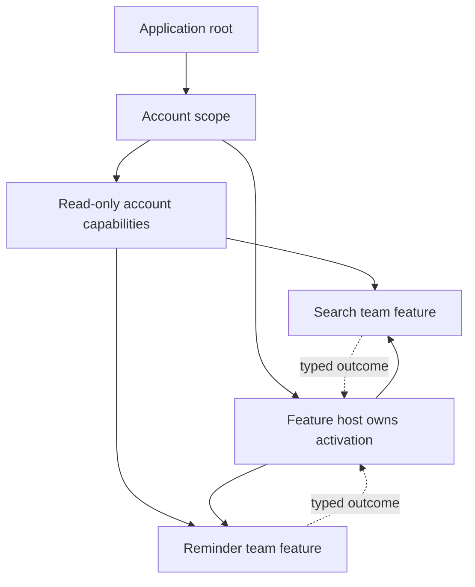

RIBs can be useful when independent teams need explicit feature boundaries and business lifetimes. The benefit comes from scoped dependencies, stable parent-child contracts, and predictable activation, not from having hundreds of routers.

A large graph can also increase review and tooling cost. Choosing it requires evidence that the organization actually needs the boundaries it introduces.

<!--more-->

This Swift 5.7 article examines feature construction at an account boundary. The code is a framework-independent plugin-host model, not Uber RIBs API usage. It demonstrates a contract a RIB builder graph might enforce: disabled features are not built, construction finishes before activation, and session teardown stops every owned feature.

## Identify an organizational seam with a runtime lifetime

Suppose a library team owns search and another team owns overdue reminders. Both features require an account-scoped reading capability, but neither should reach into the other's private state.

Their shared boundary can define the account facts each feature receives and the output each returns. The parent owns activation and decides which plugins are enabled. The feature owns its internal implementation. A flag that changes at runtime needs an explicit replacement policy rather than silently mutating an already active graph.

A feature boundary should be small enough to understand but large enough to own a coherent responsibility. One module per button creates assembly overhead; one module per whole app prevents independent change.

## Define the host contract without global discovery

```swift
struct AccountScope: Equatable { let accountID: Int }
enum FeatureID: Hashable { case search, reminders }
enum FeatureBuildFailure: Error { case alreadyActive, invalidAccount, unavailable }
protocol FeatureNode: AnyObject {
    func activate()
    func deactivate()
}
struct FeatureFactory {
    let id: FeatureID
    let build: (AccountScope) throws -> any FeatureNode
}

final class AccountFeatureHost {
    private let factories: [FeatureFactory]
    private var nodes: [any FeatureNode] = []
    private var active = false
    init(factories: [FeatureFactory]) {
        precondition(Set(factories.map(\.id)).count == factories.count)
        self.factories = factories
    }
    func start(scope: AccountScope, enabled: Set<FeatureID>) throws {
        guard !active else { throw FeatureBuildFailure.alreadyActive }
        guard scope.accountID > 0 else { throw FeatureBuildFailure.invalidAccount }
        let built = try factories.filter { enabled.contains($0.id) }.map { try $0.build(scope) }
        nodes = built
        active = true
        for node in nodes { node.activate() }
    }
    func stop() {
        guard active else { return }
        active = false
        let old = nodes
        nodes = []
        for node in old.reversed() { node.deactivate() }
    }
    deinit { stop() }
}
```

Construction must be free of external effects, and node activation/deactivation must not reenter host lifecycle methods in this minimal serialized model. Those are explicit restrictions. A reusable host that allows reentrancy needs transition identity and a more complete state machine.

All enabled nodes are built before any starts. If one builder throws, the host remains inactive and no node has begun work. This is not a rollback of arbitrary constructor effects; builders that start requests would violate the contract.

Activation is nonthrowing here. If a real feature can fail to activate, define partial activation cleanup and an observable outcome. Merely changing `activate` to `throws` would leave already started siblings running after a failure.

## Verify configuration and teardown

```swift
final class FeatureProbe: FeatureNode {
    let accountID: Int
    private(set) var starts = 0
    private(set) var stops = 0
    init(accountID: Int) { self.accountID = accountID }
    func activate() { starts += 1 }
    func deactivate() { stops += 1 }
}
var builtSearch: [FeatureProbe] = []
var reminderBuilds = 0
let search = FeatureFactory(id: .search) { scope in
    let node = FeatureProbe(accountID: scope.accountID)
    builtSearch.append(node)
    return node
}
let reminders = FeatureFactory(id: .reminders) { _ in
    reminderBuilds += 1
    throw FeatureBuildFailure.unavailable
}
let host = AccountFeatureHost(factories: [search, reminders])
try host.start(scope: AccountScope(accountID: 7), enabled: [.search])
assert(reminderBuilds == 0 && builtSearch[0].starts == 1)
host.stop()
host.stop()
assert(builtSearch[0].stops == 1)
do {
    try host.start(scope: AccountScope(accountID: 8), enabled: [.search, .reminders])
    assertionFailure("A failed builder must prevent activation")
} catch FeatureBuildFailure.unavailable {}
assert(builtSearch[1].starts == 0 && reminderBuilds == 1)
try host.start(scope: AccountScope(accountID: 9), enabled: [.search])
assert(builtSearch[2].accountID == 9 && builtSearch[2].starts == 1)
host.stop()
```

The test distinguishes construction from activation and checks that a later account receives a new feature node. It does not prove account isolation if the factory secretly returns a process-global service. Contract suites must inspect the relevant shared capabilities as well.

## Scope dependencies to the authority that owns them



A parent can own one authoritative profile stream and provide read-only access to children. Letting every child mutate a shared account object makes ownership ambiguous even when the dependency tree looks hierarchical.

Shared infrastructure and feature APIs also need separate owners. A networking client can be shared across features, while its credentials and request context remain account-scoped. Reusing a connection pool does not justify reusing “current account” mutable state.

## Make team independence a testable claim

Ask one feature team to implement a change without editing sibling internals. If the change requires a new shared fact, evolve the parent contract deliberately and review its meaning with consumers.

Use module boundaries and import rules to prevent accidental reverse dependencies. Templates and generated mocks can reduce repeated setup, but they do not enforce semantic compatibility. A protocol method whose meaning changes can break another team without producing a compiler error.

Record ownership of public contracts, expected lifecycle, and failure outcomes. A new engineer should be able to identify the parent, activation trigger, teardown trigger, and external capabilities without reading every child implementation.

## Manage feature flags as graph decisions

A disabled plugin should ideally not construct expensive dependencies or start subscriptions. Evaluating flags only after building the whole graph can undermine both resource savings and isolation.

For live flag changes, decide whether an active operation finishes, is cancelled, or remains available until the next session. Persisted navigation may reference a now-disabled feature, so restoration needs a defined fallback.

A plugin architecture is not a security sandbox. These factories run trusted application code. Loading arbitrary external executable code would introduce a different problem that this host neither implements nor makes safe.

## Know the costs before adopting the framework

RIBs adds lifecycle conventions, graph assembly, reactive communication, and tooling expectations. Those costs may be worthwhile for several teams owning nested business scopes. A small app with a handful of straightforward screens may get the same useful boundaries from direct factories and coordinators.

Uber's own [driver-app architecture account](https://www.uber.com/hr/en/blog/driver-app-ribs-architecture/) describes both its scale pressures and the review overhead of the chosen structure. Treat that as evidence about its constraints, not proof that every app should reproduce the organization.

## Case study: a shared contract evolves across teams

Suppose reminders need an account entitlement that search does not use. Adding a writable account object to every child's dependency interface is convenient, but it broadens authority unnecessarily.

Expose a narrow entitlement-reading capability to the feature that needs it. If the parent already owns an entitlement stream, provide a read interface while keeping updates under one authoritative owner. An immutable construction value is suitable only if entitlement is invariant for that node's lifetime.

When entitlement can change live, define whether the feature disables itself, finishes current work, or asks the parent to replace its scope. That policy affects active operations and navigation restoration, so it belongs in the public contract rather than a private callback convention.

A team-level compatibility test can build the feature against a minimal parent implementation. This reveals accidental dependencies on sibling services or concrete components. It is stronger than a mock generated from a very broad protocol that no consumer fully understands.

Also define who reviews contract changes. A shared interface can become a bottleneck if every minor feature request adds another global requirement. Prefer local extension points and scoped capabilities where they preserve independent ownership.

The organizational benefit is real only if a team can change its implementation without coordinating unrelated details with every sibling. A large hierarchy that still shares one mutable application object has the ceremony of modularity without the independence. Use actual change exercises and import enforcement to check the claim.

## Exercise: handle partial activation failure

Extend the host so activation can fail. Define whether already active siblings stop, in which order, and what outcome the parent receives. Add a live flag change during an operation, a cancelled child callback after logout, and an import rule preventing one feature from depending on another's implementation.

Return to the [App Architectures roadmap](/swift-architectures/).
