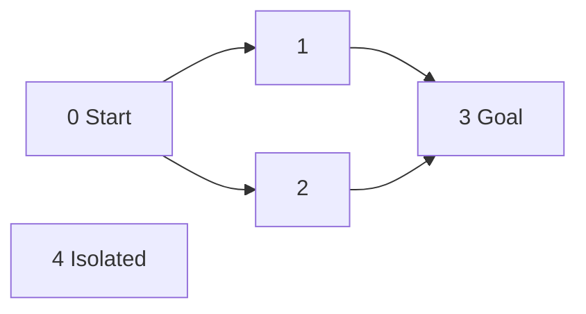

A graph represents relationships between entities. A route map, dependency system, social network, and state machine can all use vertices and edges, but they require different direction, identity, and weight semantics.

Choosing an adjacency list is only one part of the model. A useful graph API must also say what an absent vertex means, whether duplicate edges are allowed, and how isolated vertices are represented.

<!--more-->

The Swift 5.7 examples use stable integer vertex IDs and ordered adjacency arrays. Keeping topology separate from domain labels makes traversal examples small and avoids repeated linear searches for vertex objects.

## Define the graph before selecting an algorithm

Write `G = (V, E)` for vertices and edges. In a directed graph, `u → v` does not imply `v → u`. In an undirected graph, one logical edge permits travel both ways.

A weighted edge carries a cost whose meaning matters: distance, time, capacity, or preference. A minimum-hop route and a minimum-cost route can differ. Negative weights, self-loops, and parallel edges change which algorithms apply.



Vertex `4` exists even though no edge mentions it. An adjacency dictionary built only from edge sources can accidentally erase such vertices or make sinks look invalid.

## Build a small validated adjacency-list model

```swift
enum GraphFailure: Error, Equatable { case invalidVertex(Int) }

struct Graph {
    private var adjacency: [[Int]]
    var vertexCount: Int { adjacency.count }

    init(vertexCount: Int) {
        precondition(vertexCount >= 0)
        adjacency = Array(repeating: [], count: vertexCount)
    }

    mutating func addVertex() -> Int {
        adjacency.append([])
        return adjacency.count - 1
    }

    private func validate(_ vertex: Int) throws {
        guard adjacency.indices.contains(vertex) else {
            throw GraphFailure.invalidVertex(vertex)
        }
    }

    mutating func addEdge(from: Int, to: Int, directed: Bool) throws {
        try validate(from)
        try validate(to)
        adjacency[from].append(to)
        if !directed && from != to { adjacency[to].append(from) }
    }

    func neighbors(of vertex: Int) throws -> [Int] {
        try validate(vertex)
        return adjacency[vertex]
    }
}

var graph = Graph(vertexCount: 5)
try graph.addEdge(from: 0, to: 1, directed: true)
try graph.addEdge(from: 0, to: 2, directed: true)
try graph.addEdge(from: 1, to: 3, directed: true)
let neighbors = try graph.neighbors(of: 0)
let isolated = try graph.neighbors(of: 4)
assert(neighbors == [1, 2] && isolated.isEmpty)
do {
    try graph.addEdge(from: 0, to: 9, directed: true)
    assertionFailure("Invalid endpoint must be rejected")
} catch GraphFailure.invalidVertex(9) {
    assert(graph.vertexCount == 5)
}
```

Both endpoints are checked before mutation, so an invalid second endpoint cannot leave a partial undirected edge. Parallel edges are retained; an undirected self-loop is stored once under this API's convention.

Those policies should not be inferred from a diagram. A multigraph may need edge identities so removing one parallel edge does not remove all of them.

## Compare representation costs

| Representation | Stored topology | Enumerate neighbors | Test an arbitrary edge |
| --- | --- | --- | --- |
| Adjacency arrays | `O(V + E)` | `O(degree(v))` | Linear in that neighbor list |
| Adjacency sets | Expected `O(V + E)` | Proportional to neighbors | Expected constant lookup |
| Dense matrix | `O(V²)` | Scan a row | Constant indexed lookup |
| Edge list | `O(E)` plus vertex model | Usually scan all edges | Usually scan all edges |

An undirected adjacency list often stores two directed entries per logical edge. That changes constants, not the asymptotic class, but counts should remain consistent in diagnostics.

A matrix should distinguish no edge from a zero-weight edge. Using zero as the absence sentinel silently forbids valid zero-cost relationships. Use an optional weight or another explicit occupancy representation.

## Identity and ordering belong to the model

Integer indices make lookup cheap, but removing a vertex by shifting an array can invalidate every later ID. Use tombstones, stable external IDs with an index map, or a rebuild policy when deletion is required.

Domain labels may not be unique. Two locations called “Main Street” must remain distinct vertices if they represent different places. Equality of display text is rarely sufficient identity.

Adjacency arrays preserve insertion traversal order. Sets do not provide a business-defined traversal order. If a tutorial asserts one specific BFS path among equal-length alternatives, it must also define neighbor order.

## Traversal complexity depends on neighbor access

With adjacency lists and a visited structure indexed by vertex, DFS and BFS can visit the reachable subgraph in `O(V + E)` work. If each step scans a matrix row, the same high-level traversal can require `O(V²)` work.

Likewise, repeatedly searching an array of vertex objects to resolve each edge endpoint adds lookup cost. Representation choices can invalidate a textbook bound without changing the visible traversal loop.

## Directed and undirected cycles need different reasoning

In a directed graph, reaching a vertex still on the active DFS path proves a cycle. Reaching a previously finished vertex does not.

In an undirected graph, the reverse edge to the parent is normal and must not automatically count as a cycle. Parallel edges require an edge-aware parent policy if they are intended to form a two-edge cycle.

Choose the cycle definition before reusing a traversal implementation. A visited set alone is not a universal cycle detector.

## Test topology invariants at construction

Test isolated vertices, sinks, self-loops, duplicate edges, and invalid endpoints. For undirected edges, verify both adjacency directions under the chosen self-loop convention.

For value graphs, copy the graph, modify one copy, and verify the other remains unchanged. If vertex payloads are mutable references, document that graph topology independence does not deep-clone payload objects.

## Importing edges is a transaction in the domain model

A file can declare a valid first endpoint and an unknown second endpoint. Adding the forward half of an undirected edge before validating the second endpoint leaves an asymmetric graph when import fails.

The example validates both endpoints before appending either direction. A batch importer can similarly build a candidate graph and publish it only after validating all records, or explicitly return accepted and rejected edges under a partial-import policy.

Keep source row IDs in diagnostics. An invalid integer endpoint without its originating record is much harder to repair in a large dataset.

## Distinguish topology snapshots from live payloads

Copying the value graph preserves independent adjacency arrays, but an attached class payload may remain shared. A graph snapshot containing a live mutable location object can observe changed coordinates while its topology remains unchanged.

If routing depends on those coordinates or costs, include stable facts in the snapshot. Otherwise one calculation can mix a new weight with old adjacency and no longer represent a coherent graph version.

Background results should carry the graph version they evaluated. A route computed for an obsolete obstacle map may be internally correct yet unsafe to display as the current route. Version acceptance belongs to the owner publishing results, alongside cancellation.

## Exercise: separate domain IDs from storage indices

Add string IDs with a dictionary mapping them to integer indices. Reject duplicate IDs or define an explicit merge policy. Verify that unknown IDs produce errors and that changing a display label does not change identity.

Continue with [DFS](/swift-depth-first-search/) and [BFS](/swift-breadth-first-search/) for algorithms over the topology.

Return to the [Data Structures and Algorithms roadmap](/swift-data-structures-and-algorithms/).
