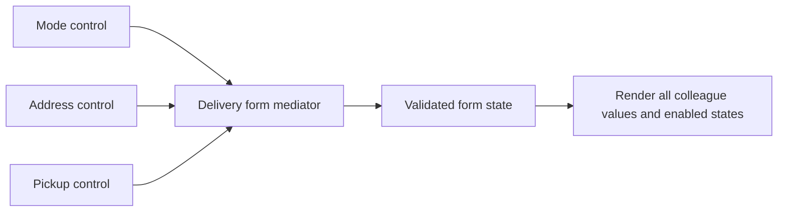

Mediator centralizes interaction rules among collaborating components. A delivery form's mode selector, address field, and pickup field should not each call every other control to keep the screen consistent.

A mediator can own the state transition and render a coherent result to all colleagues. The benefit is a visible coordination rule, not merely moving callbacks into a class named `Manager`.

<!--more-->

The Swift 5.7 example uses small control models so it can run without a UI framework. Programmatic rendering does not emit user-change events, preventing a common callback feedback loop.

## Give controls a narrow colleague contract

```swift
final class Field<Value: Equatable> {
    private(set) var value: Value
    private(set) var enabled: Bool
    var onUserChange: ((Value) -> Void)?
    init(_ value: Value, enabled: Bool = true) {
        self.value = value; self.enabled = enabled
    }
    func userChanged(_ value: Value) {
        guard enabled else { return }
        self.value = value
        onUserChange?(value)
    }
    fileprivate func render(_ value: Value, enabled: Bool) {
        self.value = value; self.enabled = enabled
    }
}

enum DeliveryMode: Equatable { case pickup, courier }
struct DeliveryFormState: Equatable {
    var mode: DeliveryMode = .pickup
    var address = ""
    var pickupPoint = ""
    var canSubmit: Bool {
        mode == .pickup ? !pickupPoint.isEmpty : !address.isEmpty
    }
}
```

A user change updates the control and reports intent. Rendering updates the control without pretending another user action occurred.

Real UIKit, SwiftUI, or web controls have their own event semantics. An adapter should preserve this distinction instead of assuming setting a bound property can never trigger another callback.

## Let one owner enforce the interaction rules

```swift
final class DeliveryFormMediator {
    let mode = Field<DeliveryMode>(.pickup)
    let address = Field<String>("", enabled: false)
    let pickup = Field<String>("")
    private(set) var state = DeliveryFormState()
    private enum Event {
        case mode(DeliveryMode)
        case address(String)
        case pickup(String)
    }
    init() {
        mode.onUserChange = { [weak self] in self?.receive(.mode($0)) }
        address.onUserChange = { [weak self] in self?.receive(.address($0)) }
        pickup.onUserChange = { [weak self] in self?.receive(.pickup($0)) }
        render()
    }
    private func receive(_ event: Event) {
        var next = state
        switch event {
        case let .mode(mode):
            next.mode = mode
            if mode == .pickup { next.address = "" }
            else { next.pickupPoint = "" }
        case let .address(text):
            guard state.mode == .courier else { return }
            next.address = text
        case let .pickup(text):
            guard state.mode == .pickup else { return }
            next.pickupPoint = text
        }
        state = next
        render()
    }
    private func render() {
        mode.render(state.mode, enabled: true)
        address.render(state.address, enabled: state.mode == .courier)
        pickup.render(state.pickupPoint, enabled: state.mode == .pickup)
    }
}

let form = DeliveryFormMediator()
assert(!form.state.canSubmit && !form.address.enabled)
form.pickup.userChanged("Desk A")
assert(form.state.canSubmit)
form.mode.userChanged(.courier)
assert(form.pickup.value.isEmpty && !form.pickup.enabled)
assert(!form.state.canSubmit)
form.pickup.userChanged("Ignored while disabled")
assert(form.pickup.value.isEmpty)
form.address.userChanged("12 Library Road")
assert(form.state.canSubmit && form.address.enabled)
```

Changing mode clears irrelevant data by an explicit product policy. Preserving both drafts while switching modes would also be possible, but it would require another state model and tests.

The mediator commits state before rendering. A more complex renderer or observer can then see the coherent new state rather than half-applied field changes.

## Remove the colleague-to-colleague web



Each control knows how to report its own change. It does not know how pickup and courier rules interact or which other field must be cleared.

The mediator strongly owns its controls, while their callbacks weakly reference the mediator. That avoids a strong ownership cycle. A control without an owner is not kept alive merely because a weak callback exists.

## Coordinate interactions, not every domain rule

The empty-string validation is intentionally simple. Address validation, delivery eligibility, and pricing can belong to domain services or pure functions called by the mediator.

A mediator that directly opens databases, formats every label, authenticates users, and calculates shipping becomes another overloaded manager. Keep it focused on the collaboration it owns.

If the state machine grows, extracting a pure transition function can make sequences easier to test. The mediator can remain the owner that receives events and applies rendered state, while the calculation stays independent of controls.

## Reentrancy and asynchronous validation need identities

The sample has no asynchronous work. An address validator that returns later needs a request generation or input version so an obsolete response does not mark a newer address valid.

Commit the new input state before starting effects. When a validation outcome arrives, accept it only if it matches the current value and generation. Cancelling old work helps, but does not replace stale-result rejection.

Likewise, an observer that changes another field during notification introduces reentrancy. Queue events or reject nested transitions according to a documented policy rather than relying on accidental callback order.

## Mediator is not an event bus or service locator

An event bus broadcasts facts to independent subscribers. A mediator knows a specific set of colleagues and enforces their coordination rules. It is appropriate for a coherent local workflow where someone must own the interaction.

A service locator discovers arbitrary capabilities at runtime. Passing a locator to every control does not centralize coordination; it hides which controls reach which services.

A coordinator often owns navigation and child-flow lifetime. A mediator can live inside one coordinated screen, owning the interactions among that screen's controls.

## Test the state and rendered projections together

Verify mode changes, disabled input rejection, required-field completion, and the chosen clearing policy. Assert state and control values agree after each event.

Add a recorder to programmatic rendering and verify it does not generate another user event. A test that only checks final text can miss an unnecessary feedback cycle that happens to settle at the same value.

## Keep one owner for a form invariant

The delivery form has one rule spanning several controls: address is relevant for delivery, pickup location is relevant for collection, and submission depends on the currently relevant value. If each control tries to maintain that rule by calling the others directly, changing one field can trigger a loop of callbacks.

The mediator owns the rule and uses rendering operations that do not report a second user edit. That separates an input event from the state update produced in response. It does not mean that rendering should never be observed; it means the observation must not pretend to be a new user intention.

For a larger form, derive a value describing the entire visible state from the model, then render that value into controls. This makes it possible to test the invariant without a running UI framework. The mediator can remain the boundary that translates user events into model changes and model state into rendering.

## Clearing hidden input is a product policy

The example clears the irrelevant field when the delivery mode changes. Another form might preserve both values so switching back restores unfinished input. Either policy can be correct, but it changes what submission and cancellation mean.

Preserving values requires ensuring that hidden stale data is not accidentally submitted. Clearing values requires acknowledging that switching modes discards work. Write tests around the chosen behavior instead of treating it as an incidental detail of enabling or disabling a control.

The same applies to validation errors. An error for an inactive field should not keep the active form from submitting unless the product explicitly requires both fields. Derive validity from the current mode and relevant data, not from a global collection of historical field errors.

## Async validation introduces stale completions

Suppose address validation later calls a remote service. The user can change the address or switch to pickup before the response returns. Give each validation attempt an identity, and apply the completion only if the mode and input still match that attempt.

Cancelling the previous task can save work, but a late callback may still arrive. The acceptance check protects state even when cancellation races with completion. This is the same general issue as the request IDs in the [State article](/swift-state-pattern/).

Finally, watch the mediator's scope. It should coordinate one coherent interaction. If it starts owning authentication, persistence, analytics policy, and navigation for unrelated features, extract those capabilities and keep their use-case rules in the appropriate services. A central callback owner can still become an overloaded dependency hub.

## Exercise: add asynchronous availability

A pickup point becomes valid only after an availability check. Model checking, available, and unavailable states, then simulate responses arriving out of order. Keep the validator outside control code and verify obsolete results cannot enable submission for a different pickup point.

Return to the [Design Patterns roadmap](/swift-design-patterns/).
