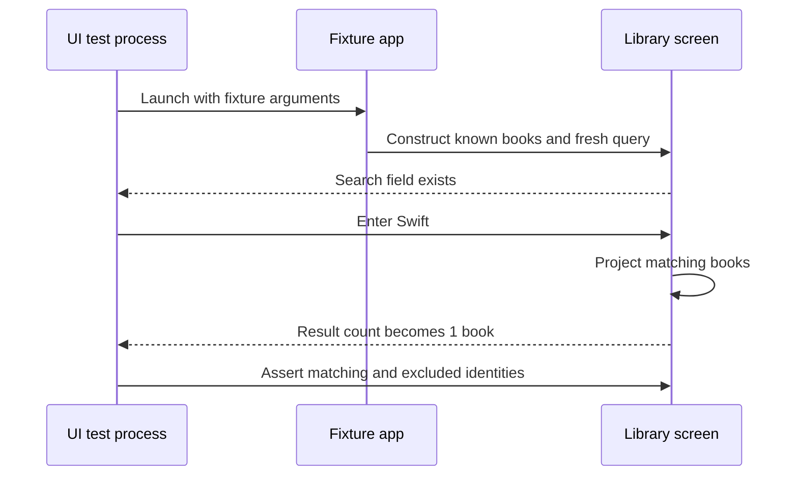

A UI test should verify a user-visible journey through the assembled application. It can catch missing event wiring, navigation problems, and state that never reaches the screen even when unit tests pass.

Reliability comes from a controlled launch, stable element identity, and waiting for an observable condition. A long sleep and a coordinate tap provide much weaker evidence about whether the application was ready.

<!--more-->

This July 2024 example uses Swift 5.7, XCTest UI automation, and a SwiftUI fixture app targeting iOS 16 or later. The app-target and UI-test-target code belong in separate files and targets. The sample uses local data deliberately so its UI contract does not depend on a live server.

## Give the journey a deterministic entry point

A UI test runs outside the app process. Injecting a fake into the test class does not automatically change the app's dependencies. Establish a launch contract that selects a known app-side fixture.

```swift
// App target: TestLibraryApp.swift
import Foundation
import SwiftUI

struct LibraryBook: Identifiable {
    let id: Int
    let title: String
}
enum LibraryLaunch {
    static func books(arguments: [String]) -> [LibraryBook] {
        if arguments.contains("--ui-testing") {
            precondition(arguments.contains("--fixture-library"), "Select a known UI fixture")
            return [
                LibraryBook(id: 1, title: "Swift Values"),
                LibraryBook(id: 2, title: "Algorithms"),
                LibraryBook(id: 3, title: "Databases")
            ]
        }
        return [LibraryBook(id: 10, title: "My local library")]
    }
}

@main
struct TestLibraryApp: App {
    private let books = LibraryLaunch.books(arguments: ProcessInfo.processInfo.arguments)
    var body: some Scene {
        WindowGroup { LibraryScreen(books: books) }
    }
}

struct LibraryScreen: View {
    let books: [LibraryBook]
    @State private var query = ""
    private var filtered: [LibraryBook] {
        books.filter { query.isEmpty || $0.title.lowercased().contains(query.lowercased()) }
    }
    private var countLabel: String {
        filtered.count == 1 ? "1 book" : "\(filtered.count) books"
    }
    var body: some View {
        NavigationStack {
            VStack {
                TextField("Search books", text: $query)
                    .textInputAutocapitalization(.never)
                    .autocorrectionDisabled()
                    .accessibilityIdentifier("library.search")
                Button("Clear search") { query = "" }
                    .accessibilityIdentifier("library.clear")
                Text(countLabel).accessibilityIdentifier("library.resultCount")
                if filtered.isEmpty {
                    Text("No matching books").accessibilityIdentifier("library.empty")
                }
                List(filtered) { book in
                    Text(book.title).accessibilityIdentifier("book.\(book.id)")
                }
            }
            .padding()
            .navigationTitle("Library")
        }
    }
}
```

Each launch constructs a fresh in-memory fixture, and the query is local view state. The sample does not persist an account or request permissions, so those environmental dependencies cannot affect this journey.

In a production app, route fixture selection through the composition root and keep it distinct from authorization or server permission logic. A test mode should select controlled dependencies; it should not become a remotely accessible bypass for production security decisions.

A real fixture can supply an isolated database or a controlled service response. Avoid resetting one shared backend account before every test: parallel workers can still delete one another's data.

## Identify intent and content, not visual position

The search field and clear action have semantic identifiers. Rows use stable book IDs. A test can ask for `book.1` without knowing whether it is the first cell, which font it uses, or where it appears on screen.

Accessibility identifiers are automation keys, not spoken labels. Keep human-facing accessibility labels meaningful, and do not replace them with internal names merely to make a query easy.

Use a stable ID when the item can move. An array index may remain valid while referring to a different book after sorting. Coordinate taps have an even weaker relationship to product identity and can change with device size, keyboard, layout, or Dynamic Type.

## Wait for the state the test needs

```swift
// UI test target: LibraryUITests.swift
import XCTest

final class LibraryUITests: XCTestCase {
    override func setUpWithError() throws {
        continueAfterFailure = false
    }

    @MainActor
    private func launchFixture() -> XCUIApplication {
        let app = XCUIApplication()
        app.launchArguments = ["--ui-testing", "--fixture-library"]
        app.launch()
        XCTAssertTrue(app.textFields["library.search"].waitForExistence(timeout: 5))
        return app
    }

    @MainActor
    private func waitForLabel(_ label: String, on element: XCUIElement) {
        let updated = expectation(for: NSPredicate(format: "label == %@", label),
                                  evaluatedWith: element)
        wait(for: [updated], timeout: 5)
    }

    @MainActor
    func testSearchShowsOnlyTheMatchingBook() {
        let app = launchFixture()
        let search = app.textFields["library.search"]
        XCTAssertTrue(search.isHittable)
        search.tap()
        search.typeText("Swift")
        waitForLabel("1 book", on: app.staticTexts["library.resultCount"])
        XCTAssertTrue(app.staticTexts["book.1"].exists)
        XCTAssertFalse(app.staticTexts["book.2"].exists)
        XCTAssertFalse(app.staticTexts["library.empty"].exists)
    }

    @MainActor
    func testClearingAnEmptySearchRestoresTheFixture() {
        let app = launchFixture()
        let search = app.textFields["library.search"]
        search.tap()
        search.typeText("no-such-book")
        XCTAssertTrue(app.staticTexts["library.empty"].waitForExistence(timeout: 5))
        waitForLabel("0 books", on: app.staticTexts["library.resultCount"])
        app.buttons["library.clear"].tap()
        waitForLabel("3 books", on: app.staticTexts["library.resultCount"])
        XCTAssertTrue(app.staticTexts["book.1"].exists)
        XCTAssertTrue(app.staticTexts["book.2"].exists)
        XCTAssertFalse(app.staticTexts["library.empty"].exists)
    }
}
```

Create a UI testing bundle whose target application is the fixture app. Each test launches its own initial state. Neither test depends on the other having searched or cleared anything.

`waitForExistence` establishes that an element exists. It does not establish that a request finished or that a count changed. The label expectation waits for the semantic condition needed before the following assertions.

The five-second timeout is a failure bound, not a fixed five-second delay. Successful waits finish as soon as the observed condition is satisfied. This synchronous UI-test wait runs in the automation process; an async unit test should use nonblocking expectation fulfillment instead.

## Verify one journey at the right depth

The search test proves text input changes the visible result and excludes an unrelated row. The clear test proves empty presentation and recovery through the actual button. These are assembly claims that a pure filtering test would not establish.

Do not duplicate every string-matching edge case through UI automation. Test the matching policy cheaply at its own boundary, then retain representative journeys showing the real controls are wired to it.

Conversely, a test that only launches the app and takes a screenshot does not establish the search behavior. Assertions must express a meaningful outcome.

## Separate transport readiness from screen readiness



In a network-backed feature, a response arriving does not necessarily mean the UI rendered it. Wait for a user-visible state or an explicitly exposed readiness condition, not a server-side log entry alone.

A loading spinner disappearing is also ambiguous if the app can hide it on failure. Assert the expected content or error outcome rather than assuming disappearance means success.

## Keep environment and diagnostics reproducible

Pin the simulator device and OS in CI, and record the Xcode version, locale, and relevant launch configuration. Run accessibility and layout checks under deliberate variations such as large text, rather than letting a random inherited setting choose the environment.

On failure, preserve the result bundle, screenshots, accessibility hierarchy, and app logs. Logs should describe route and state transitions without exposing credentials or private fixture data. A retry that discards the first failure's artifacts makes diagnosis harder.

For permission dialogs, establish a known permission state or exercise the prompt as the test's explicit subject. Avoid a broad interruption handler that blindly accepts every alert; it can hide a real application error.

Use UI interruption and scrolling APIs according to their actual contracts. If an element is offscreen, scroll the relevant container and wait until the intended element can be interacted with. Repeating taps at guessed coordinates usually adds uncertainty.

## Understand the limits of the fixture

The local fixture proves UI behavior over known content. It does not prove authentication, server schema compatibility, offline persistence, or actual transport. Those claims belong to [integration tests](/swift-integration-testing/) and selected end-to-end journeys with isolated services.

A test-only synchronous source can also hide loading-state bugs. Add a controlled delayed app-side dependency when loading, cancellation, or retry is the journey under test. Expose a deliberate test control rather than sleeping until a guessed network duration has passed.

## Exercise: test an error and retry journey

Add a launch fixture that returns a controlled failure, renders an error, and succeeds after retry. Wait for the error and content states through stable identifiers. Verify the retry button starts one operation, and capture diagnostics if the expected state never appears.

Apple documents the automation application in [`XCUIApplication`](https://developer.apple.com/documentation/xcuiautomation/xcuiapplication) and element readiness in [`waitForExistence(timeout:)`](https://developer.apple.com/documentation/xcuiautomation/xcuielement/waitforexistence(timeout:)).

Return to the [Testing roadmap](/swift-testing/).
