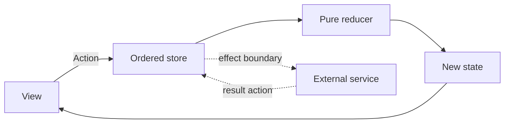

Redux-style architecture keeps authoritative state in a store and changes it through actions interpreted by pure reducers. Views render state and dispatch intentions rather than mutating the state tree directly.

The benefit is a visible transition path. It does not mean every temporary gesture must enter a process-wide store, or that remote writes become reversible because their local actions can be replayed.

<!--more-->

This Swift 5.7 example implements account-scoped book favorites. It is an original Swift interpretation of Redux's state/action/reducer model, not a port of the JavaScript library or a claim that its ecosystem APIs are available in Swift.

## Define state and actions as values

```swift
struct CatalogState: Equatable {
    let bookIDs: Set<Int>
    var favorites: Set<Int> = []
}
struct AppState: Equatable {
    var accountID: Int?
    var catalog: CatalogState
}
enum CatalogAction { case toggleFavorite(Int) }
enum AppAction {
    case accountChanged(Int?)
    case catalog(CatalogAction)
}

func reduceCatalog(_ state: inout CatalogState, _ action: CatalogAction) {
    switch action {
    case let .toggleFavorite(id):
        guard state.bookIDs.contains(id) else { return }
        if !state.favorites.insert(id).inserted { state.favorites.remove(id) }
    }
}
func reduce(_ state: AppState, _ action: AppAction) -> AppState {
    var next = state
    switch action {
    case let .accountChanged(account):
        guard account == nil || account! > 0 else { return state }
        if next.accountID != account { next.catalog.favorites = [] }
        next.accountID = account
    case let .catalog(action):
        guard next.accountID != nil else { return state }
        reduceCatalog(&next.catalog, action)
    }
    return next
}
```

Changing accounts clears favorites because this demonstration has no persisted account repository. Keeping the old set would leak one account's local presentation into another's scope. A real app would load the new account's favorites and accept only results belonging to that account and request generation.

The reducer does not read a clock, generate a random ID, or start a task. Given the same state and action, it produces the same next state. Swift value semantics make that contract natural, provided state does not hide mutable reference objects that are edited elsewhere.

An action is an intention or a reported fact. It is not proof that a server committed an effect. Use distinct actions for initiating a write and receiving its outcome when persistence is added.

## Compose reducers without splitting authority

`reduceCatalog` owns the catalog transition. The parent reducer handles account context before delegating catalog actions. This keeps account replacement visible at the parent boundary instead of requiring the child to discover a global account service.

Reducer composition needs an ordering policy when parent and child affect related state. For example, a logout action should not let a child start new account work after its state has been removed. Frameworks can help express composition, but the invariant still belongs to the application.

Avoid copying the same favorites into several writable stores. Derived subsets are fine; independent writers require synchronization and conflict policy. “Single source of truth” is about authority, not a ban on all cached or rendered copies.

## Serialize reentrant dispatch through a mailbox

```swift
final class AppStore {
    private(set) var state: AppState
    private var observer: ((AppState) -> Void)?
    private var pending: [AppAction] = []
    private var draining = false
    init(state: AppState) { self.state = state }
    func bind(_ observer: @escaping (AppState) -> Void) {
        self.observer = observer
        observer(state)
    }
    func dispatch(_ action: AppAction) {
        pending.append(action)
        guard !draining else { return }
        draining = true
        defer { pending.removeAll(); draining = false }
        var index = 0
        while index < pending.count {
            let action = pending[index]
            index += 1
            state = reduce(state, action)
            observer?(state)
        }
    }
    func unbind() { observer = nil }
}
```

This store requires serialized access. An observer may dispatch another action, which waits until the current state notification finishes. The reducer itself has no store reference and cannot dispatch recursively.

The mailbox is intentionally unbounded for this small demonstration. A production store needs an overload or feedback policy if observers can generate unlimited actions. Moving a feedback loop from recursion into an array prevents stack overflow but does not make infinite work terminate.

A multi-subscriber store also needs recipient ordering, cancellation, and replay rules. This example has one observer so those policies stay explicit rather than hidden in a generalized abstraction.

## Verify invariants and deterministic replay

```swift
let initial = AppState(accountID: nil, catalog: CatalogState(bookIDs: [1, 2]))
let actions: [AppAction] = [
    .catalog(.toggleFavorite(1)),
    .accountChanged(7),
    .catalog(.toggleFavorite(1)),
    .catalog(.toggleFavorite(999)),
    .accountChanged(8),
    .catalog(.toggleFavorite(2))
]
let replayed = actions.reduce(initial, reduce)
assert(replayed.accountID == 8 && replayed.catalog.favorites == [2])
assert(actions.reduce(initial, reduce) == replayed)
let store = AppStore(state: initial)
var frames: [AppState] = []
store.bind { state in
    frames.append(state)
    if state.accountID == 7 && state.catalog.favorites.isEmpty {
        store.dispatch(.catalog(.toggleFavorite(1)))
    }
}
store.dispatch(.accountChanged(7))
assert(store.state.catalog.favorites == [1])
assert(frames.count == 3)
store.unbind()
```

The nested dispatch produces a second transition after the account transition's notification. It does not interrupt that notification halfway through. The observer is explicitly removed to break its strong capture of the store in this test.

For deterministic reducers, replay is a fold over the recorded action sequence:

$$
s_n=\operatorname{fold}(r,s_0,[a_1,\ldots,a_n]).
$$

This relation assumes the same initial state and deterministic transition logic. It does not replay a network, restore a server, or reverse an email already sent. External results must appear as recorded facts or controllable dependencies for a meaningful replay.

## Keep effects outside the reducer



An effect runner can observe a deliberate command or handle selected actions outside the pure reducer. Define its lifetime, cancellation, and error policy. A middleware that retries a mutating operation must understand idempotency; the reducer's purity does not make the effect safe to repeat.

Separate feature state from transient resources. Store request IDs and results as values, while task handles and transport subscriptions belong to an effect owner. Persisting a state tree containing live closures is not a durable recovery plan.

## Scope the store to the product

A document app may use one store per document or window, with shared services beneath it. A global store is useful only when its state genuinely has application-wide authority. Otherwise account and window interactions can become coupled accidentally.

Do not force hover state, animation interpolation, or every keystroke into a shared store without a reason. Local UI state can remain local when it does not participate in application invariants or restoration requirements.

## Case study: persist only the state that is authoritative

A state tree can be serializable without every field belonging in durable storage. Favorites may be persistent account data, while a loading flag and a request generation describe one runtime's work.

Persisting `isLoading = true` and restoring it after relaunch does not recreate the task that was loading. A recovery path should translate stored facts into valid new runtime state and deliberately start any required work. Do not deserialize task handles, closures, or cancellation tokens into the tree.

Version persisted state separately from Swift's type spelling. New fields need defaults or migration, removed enum cases need a fallback, and restored entity IDs need validation against current data. An action log also needs versioning if it is retained across application versions.

For sensitive account data, scope persistence to the account and clear or detach it according to logout policy. A global store reset that leaves an account cache reachable elsewhere can still expose old content on the next render.

Derived selectors can reduce repeated work, but memoization needs a correct equality and invalidation boundary. A selector that closes over mutable global locale or permissions is not purely a function of the state arguments it advertises.

The strongest Redux-style benefit is an explicit authority and transition path. Persistence, selectors, and effect middleware should preserve that property rather than create hidden writers. Test restoration and account replacement as transitions with meaningful invariants, not as arbitrary dictionary assignments.

## Exercise: persist a favorite safely

Add requested, succeeded, and failed actions for saving favorites. Preserve account identity and request generation, roll back only the optimistic change belonging to the failed operation, and verify an old account's response cannot modify the new account's set.

The official [Redux principles](https://redux.js.org/understanding/thinking-in-redux/three-principles) explain its core authority and transition model. This article's Swift store and account policy are independent implementations.

Return to the [App Architectures roadmap](/swift-architectures/).
