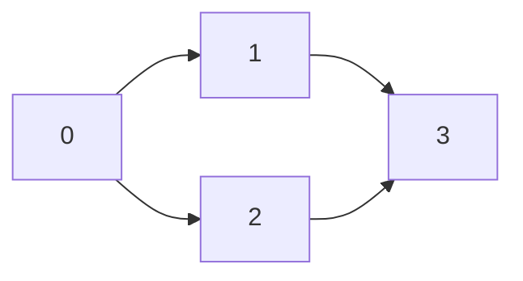

Depth-first search follows one branch until it can go no farther, then resumes unfinished work. That traversal supports reachability, dependency ordering, and cycle detection, but each task needs a different amount of state.

A visited set answers whether a vertex has been encountered. It does not tell whether the vertex is still on the active search path. That distinction is essential for directed cycles.

<!--more-->

These Swift 5.7 examples use adjacency arrays with integer vertices. The topological-order implementation returns a concrete cycle when dependencies are inconsistent.

## A stack is enough for reachability

```swift
func reachable(from start: Int, in graph: [[Int]]) -> Set<Int> {
    precondition(graph.indices.contains(start))
    precondition(graph.allSatisfy { $0.allSatisfy { graph.indices.contains($0) } })
    var visited: Set<Int> = [start]
    var pending = [start]
    while let vertex = pending.popLast() {
        for neighbor in graph[vertex] where visited.insert(neighbor).inserted {
            pending.append(neighbor)
        }
    }
    return visited
}

let graph = [[1, 2], [3], [3], [], []]
assert(reachable(from: 0, in: graph) == [0, 1, 2, 3])
assert(reachable(from: 4, in: graph) == [4])
```

Vertices are marked when pushed, avoiding repeated pending entries. This computes membership, not a promise about a particular recursive DFS discovery tree. A stack of neighboring vertices can produce a different visitation order from recursive DFS unless frames preserve each node's next-child position.

A goal-directed path search can store a predecessor when discovering a vertex. That finds a path, but not necessarily the fewest-edge path; [BFS](/swift-breadth-first-search/) provides the latter for unit-cost edges.

## Directed cycle detection needs active and finished states

Use three colors: unvisited, active, and finished. An edge to an active vertex returns to the current recursion path and proves a directed cycle. An edge to a finished vertex can be a harmless shared dependency.

```swift
enum DFSFailure: Error, Equatable {
    case invalidEndpoint
    case cycle([Int])
}

func topologicalOrder(_ graph: [[Int]]) -> Result<[Int], DFSFailure> {
    guard graph.allSatisfy({ $0.allSatisfy { graph.indices.contains($0) } }) else {
        return .failure(.invalidEndpoint)
    }
    var color = Array(repeating: 0, count: graph.count)
    var activePath: [Int] = []
    var finished: [Int] = []

    func visit(_ vertex: Int) throws {
        color[vertex] = 1
        activePath.append(vertex)
        defer { activePath.removeLast() }
        for neighbor in graph[vertex] {
            if color[neighbor] == 0 {
                try visit(neighbor)
            } else if color[neighbor] == 1 {
                let start = activePath.firstIndex(of: neighbor)!
                throw DFSFailure.cycle(Array(activePath[start...]) + [neighbor])
            }
        }
        color[vertex] = 2
        finished.append(vertex)
    }
    do {
        for vertex in graph.indices where color[vertex] == 0 { try visit(vertex) }
        return .success(finished.reversed())
    } catch let failure as DFSFailure {
        return .failure(failure)
    } catch {
        preconditionFailure("Only DFSFailure is thrown")
    }
}

let order = try topologicalOrder(graph).get()
let position = Dictionary(uniqueKeysWithValues: order.enumerated().map { ($0.element, $0.offset) })
for vertex in graph.indices {
    for neighbor in graph[vertex] { assert(position[vertex]! < position[neighbor]!) }
}
assert(topologicalOrder([[1], [2], [0]]) == .failure(.cycle([0, 1, 2, 0])))
assert(topologicalOrder([]) == .success([]))
assert(topologicalOrder([[9]]) == .failure(.invalidEndpoint))
```

The full outer loop includes disconnected components and isolated vertices. Running DFS from only one start would not produce a complete ordering of the graph.

## State the edge direction before interpreting the order

The returned order places `u` before `v` for every edge `u → v`. That is appropriate when the edge means “u must happen before v.”

If your model instead stores an edge from a task to its prerequisite, evaluation order is the opposite. Reverse the convention or reverse the interpretation deliberately. A correct graph algorithm cannot infer the domain meaning of an arrow.



The two paths to vertex `3` do not make a cycle. When the second branch reaches it, that vertex is already finished rather than active.

## Reverse finishing order follows from dependencies

For an acyclic graph, when DFS finishes `u`, every reachable outgoing neighbor has finished. Thus the finishing list places destinations before their sources. Reversing it makes every source precede its destinations.

A back edge to an active vertex would contradict that dependency ordering, which is why the function returns a cycle instead of a partial schedule.

The reported cycle includes the repeated starting vertex so each adjacent pair is an actual directed edge. The force unwrap of `firstIndex` follows from the active-color invariant; a gray vertex must be on the active path.

## Bound work and storage

With adjacency lists, every vertex is finished at most once and every edge is examined once:

$$
T(V,E)=O(V+E),\qquad S_{\mathrm{aux}}=O(V).
$$

Cycle-path extraction adds at most linear work before the first reported failure. Recursion depth can reach `V` in a chain, even though total work is linear.

An iterative production version can store frames containing a vertex and the next outgoing-edge index. It must preserve entry and exit events to maintain active colors and finishing order. Replacing recursion with a simple visited-node stack is insufficient for this exact contract.

## Test relationships rather than one convenient order

Topological order is generally not unique. Assert that every vertex appears once and every edge points forward, as above, instead of hardcoding one order unrelated to a product requirement.

Test self-loops, a cycle in a disconnected component, a diamond, duplicate adjacency entries, and a long chain within a safe test limit. Validate that every returned cycle step corresponds to an edge.

For undirected graphs, the reverse edge to the parent is normal. This directed algorithm would treat it as a cycle, so do not reuse it without changing the parent-edge policy.

## A cycle diagnostic is a useful witness

A returned vertex list should begin and end at the same vertex, and each adjacent pair must correspond to a directed edge. That makes the error actionable: a dependency editor can highlight the exact loop rather than merely announce failure.

Do not return every vertex currently on the stack as the cycle. The active path may contain an acyclic prefix before the repeated vertex. Slicing from the repeated vertex removes that unrelated prefix.

For a self-loop, the witness is simply the vertex repeated twice. For parallel edges, duplicate adjacency entries do not alone prove a directed cycle; the active-path relationship still decides.

## Topological order can support incremental work

A build system may evaluate vertices in dependency order and skip results whose inputs have not changed. DFS provides an ordering, but cache validity still depends on a correct identity for inputs and rule versions.

Adding an edge can invalidate an old order even when no vertex was added. A cached schedule must correspond to the exact graph version. A cycle introduced by an edit should reject the new schedule rather than execute a partial order as though it were complete.

For very large dynamic graphs, incremental topological algorithms can avoid a full rebuild, but they maintain additional order and affected-region invariants. Start with full validation until a measured workload justifies that complexity.

## Exercise: make DFS iterative

Replace recursive `visit` with explicit frames while preserving the same neighbor order. Compare finishing order and cycle diagnostics on bounded fixtures. Then add a maximum visited-vertex budget and return budget exhaustion separately from a graph cycle.

Return to the [Data Structures and Algorithms roadmap](/swift-data-structures-and-algorithms/).
