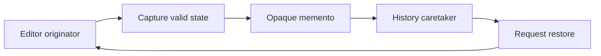

Memento captures a receiver's state so another object can request restoration without interpreting that state. A history caretaker stores opaque snapshots; the editor that owns the invariant knows how to capture and restore them.

This differs from a reversible command, which records an operation and its inverse. A memento can be simpler when several related fields must return to one coherent earlier configuration.

<!--more-->

The Swift 5.7 example keeps editor and memento definitions in one file. File-private snapshot fields prevent clients in other files from constructing arbitrary internal state. The caretaker uses only capture and restore operations.

## Let the receiver own its snapshot representation

```swift
import Foundation

fileprivate struct EditorSnapshot {
    let text: String
    let selection: Range<Int>
}

enum RestoreFailure: Error { case wrongOwner, invalidSelection, revisionExhausted }

final class TextEditor {
    struct Memento {
        fileprivate let owner: UUID
        fileprivate let snapshot: EditorSnapshot
    }
    private let identity = UUID()
    private var state = EditorSnapshot(text: "", selection: 0..<0)
    private(set) var revision = 0
    var text: String { state.text }
    var selection: Range<Int> { state.selection }

    init(text: String) { state = EditorSnapshot(text: text, selection: 0..<0) }

    func edit(text: String, selection: Range<Int>) throws {
        guard selection.lowerBound >= 0, selection.upperBound <= text.count else {
            throw RestoreFailure.invalidSelection
        }
        guard revision < Int.max else { throw RestoreFailure.revisionExhausted }
        state = EditorSnapshot(text: text, selection: selection)
        revision += 1
    }

    func capture() -> Memento { Memento(owner: identity, snapshot: state) }

    func restore(_ memento: Memento) throws {
        guard memento.owner == identity else { throw RestoreFailure.wrongOwner }
        guard revision < Int.max else { throw RestoreFailure.revisionExhausted }
        state = memento.snapshot
        revision += 1
    }
}

final class EditorHistory {
    private let editor: TextEditor
    private var checkpoints: [TextEditor.Memento] = []
    init(editor: TextEditor) { self.editor = editor }
    func checkpoint() { checkpoints.append(editor.capture()) }
    func undo() throws -> Bool {
        guard let previous = checkpoints.last else { return false }
        try editor.restore(previous)
        checkpoints.removeLast()
        return true
    }
}
```

The memento stores content and selection together. A caretaker cannot accidentally restore one without the other through the public interface.

The owner token rejects snapshots from another editor instance. It is an in-memory capability boundary, not a durable document identifier or a security credential.

## Verify restoration and owner rejection

```swift
let editor = TextEditor(text: "Draft")
let history = EditorHistory(editor: editor)
history.checkpoint()
try editor.edit(text: "Published", selection: 0..<3)
let editedRevision = editor.revision
let restored = try history.undo()
assert(restored && editor.text == "Draft" && editor.selection == 0..<0)
assert(editor.revision > editedRevision)
let emptyUndo = try history.undo()
assert(!emptyUndo)

let other = TextEditor(text: "Other document")
let foreign = other.capture()
do {
    try editor.restore(foreign)
    assertionFailure("An unrelated editor snapshot must be rejected")
} catch RestoreFailure.wrongOwner {}
assert(editor.text == "Draft")
```

Restoring earlier content is still a new mutation, so revision increases rather than rewinding. Background work tied to an earlier revision can then be rejected even when content happens to match again.

The selection is expressed in character offsets for this example. Native text frameworks may use `String.Index`, UTF-16 ranges, or another coordinate system. Translate deliberately at the UI boundary.

## A snapshot must contain stable facts

The snapshot stores value text and a range. If it stored a mutable selection object or a live document reference, later edits could change the supposedly historical snapshot.

Arrays containing mutable class elements have the same issue. Copying the outer value does not deep-clone the referenced graph. Use immutable state or an explicit copy policy for whatever restoration must preserve.

An opaque wrapper does not make captured state immutable automatically. Opacity controls who can interpret the representation; independence controls what can change after capture.



## Capture all fields required by the invariant

Content, selection, and formatting may need to move together. Omitting a field can restore a state that never existed, such as a selection beyond the restored text length.

Not every runtime field belongs in the memento. Active tasks, network subscriptions, and cached renderers usually have their own lifecycle. Restoring content should trigger appropriate new effects rather than resurrect an obsolete task handle.

The receiver decides which fields define restorable domain state and which are derived or operational. A generic property copier cannot make that decision for the application.

## Memento does not define the whole history policy

The caretaker above stores explicit checkpoints and supports undo only. Redo, command grouping, no-op suppression, and branching history are separate choices.

A new edit after undo often discards redo history. A preview feature may instead keep several branches. A bounded history needs a retention policy whose effect on available restoration is visible to the user.

The caretaker removes a checkpoint only after successful restoration. If restoration can fail because of a schema or resource issue, popping first would lose the snapshot needed for diagnosis or retry.

## Persistence requires another format contract

An in-memory memento containing a random editor-instance token should not be serialized and assumed reusable after restart. A new process has a different owner instance.

A persisted recovery document needs a durable document identity, schema version, validation, and migration policy. It may store similar facts, but it is a different boundary from an opaque runtime memento.

Likewise, restoring a local draft does not reverse a published remote article or a payment. External effects require compensation or a transactional protocol; the memento restores only the receiver state it actually owns.

## Measure retained history rather than snapshot handles

A small memento can retain a large text or image buffer. Copy-on-write may make capture cheap until later edits separate storage, while keeping many versions can retain substantial memory.

Measure representative edits and history lengths. A maximum checkpoint count does not bound bytes when one document is much larger than another.

A delta-based history can reduce retained data, but requires more involved reconstruction and validation. Prefer the simplest representation that meets the feature's actual memory and restoration needs.

## Define the snapshot boundary before capturing state

An editor can contain document text, selection, search highlights, a spell-check cache, and an open network connection. A useful undo snapshot does not necessarily contain all of them. It captures authoritative state needed to restore the editing experience, then lets derived caches recompute.

The selection belongs in this example because restoring text without a compatible selection could leave an invalid range. A network connection does not belong because recreating an old connection object is neither necessary nor meaningful for undoing a text edit.

Dependencies between fields matter. If selection is measured in characters, validate it against the restored text in that same coordinate system. Restoring text and selection in separate externally visible steps could briefly expose an invalid combination. Keep restoration inside the originator's controlled operation.

## Opacity is an API boundary, not encryption

The caretaker can retain a memento without being entitled to inspect its payload. Swift access control expresses that separation at the source-file or module boundary chosen by the implementation. Code with access to the same private implementation context is not an adversary this design attempts to defeat.

Likewise, an owner UUID prevents accidentally applying one editor's snapshot to another editor. It is not a cryptographic authentication token for mementos loaded from an untrusted source.

If snapshots are persisted, introduce a versioned serialization format, size limits, integrity checks appropriate to the threat model, and a validation step before restoration. Do not assume an in-memory opaque type remains safe merely because its serialized representation was given the same name.

## Revisions should describe change, not travel backward

Restoring an old snapshot produces a new current state. The monotonic revision therefore advances rather than taking the revision number that existed when the snapshot was captured. Observers and asynchronous work can use that revision to distinguish the restored state from a previously seen state with identical text.

This matters when background work is still running. A preview computed for revision five should not automatically publish just because undo later restores text that happens to match revision five. The restored document has a new lifecycle point and may have other relevant differences.

Snapshots can also retain substantial memory. Copy-on-write values often make capture cheap initially, but later edits can cause storage to diverge. Measure retained history under realistic editing, and set limits according to bytes or workload rather than assuming that every memento has the same cost. An explicit history policy belongs to the caretaker; only the originator should define how valid restoration works.

## Exercise: add redo and a history budget

Extend the caretaker with redo and clear the abandoned future after a new committed edit. Define whether identical checkpoints are suppressed. Add a byte estimate or bounded count and test eviction without corrupting the remaining restore sequence.

Compare [Command](/swift-command/) to decide whether storing snapshots or inverse edits better matches the receiver's state and operation model.

Return to the [Design Patterns roadmap](/swift-design-patterns/).
