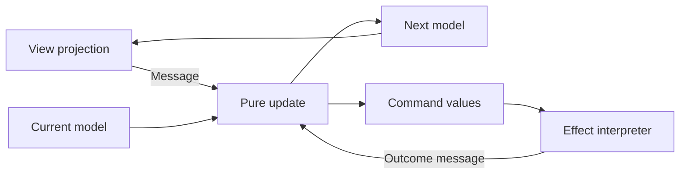

The Elm Architecture separates Model, Update, and View. Update consumes a message and returns the next model plus descriptions of work to perform. The runtime executes that work and sends outcomes back as messages.

Describing an effect is different from performing it. That separation makes it possible to test not only the next screen state but also which external work the transition requests.

<!--more-->

This Swift 5.7 example implements search with explicit command values. It borrows the architecture's shape, not Elm's language runtime. Swift does not automatically provide Elm's runtime guarantees, so the small runtime below states its own serialization and delivery assumptions.

## Give model, messages, and commands different jobs

```swift
enum LookupFailure: Error, Equatable { case offline }
struct SearchModel: Equatable {
    var query = ""
    var results: [String] = []
    var requestID: Int?
    var nextID = 0
    var message: String?
}
enum SearchMessage {
    case queryChanged(String)
    case submitted
    case response(Int, Result<[String], LookupFailure>)
}
enum SearchCommand: Equatable {
    case search(id: Int, query: String)
    case cancel(id: Int)
}
struct SearchTransition {
    let model: SearchModel
    let commands: [SearchCommand]
}
```

The model contains facts needed to render the interaction. Messages represent user input or external outcomes. Commands describe effects the runtime should attempt. A cancellation command requests cancellation; it does not establish that a late response can never arrive.

Request identity therefore remains in the model. Changing the query invalidates the old request and clears its displayed results under this product policy. A product that keeps old results should label which submitted query they belong to instead of displaying them as if they matched the new input.

## Keep update pure and explicit

```swift
func update(_ model: SearchModel, _ message: SearchMessage) -> SearchTransition {
    var next = model
    var commands: [SearchCommand] = []
    switch message {
    case let .queryChanged(query):
        if let id = next.requestID { commands.append(.cancel(id: id)) }
        next.query = query
        next.requestID = nil
        next.results = []
        next.message = nil
    case .submitted:
        guard !next.query.isEmpty else { return SearchTransition(model: next, commands: []) }
        if let id = next.requestID { commands.append(.cancel(id: id)) }
        precondition(next.nextID < Int.max)
        next.nextID += 1
        next.requestID = next.nextID
        next.message = nil
        commands.append(.search(id: next.nextID, query: next.query))
    case let .response(id, result):
        guard next.requestID == id else { return SearchTransition(model: next, commands: []) }
        next.requestID = nil
        switch result {
        case let .success(values): next.results = values; next.message = nil
        case .failure: next.message = "Search is unavailable."
        }
    }
    return SearchTransition(model: next, commands: commands)
}
```

Update does not call a service, mutate a global, or generate an unrecorded random ID. It returns a value describing what should happen. The bounded ID counter is local to one runtime lifetime; cross-runtime callbacks need a broader identity or an adapter that cannot deliver into a different instance.

A repeated submit replaces the old request. A query edit cancels the current request even before another submit. An empty submit performs no work. These are explicit interaction rules, not requirements imposed by TEA.

The failure case retains any results already present in the model. Because query changes clear them here, retained results belong to the same current input. Extend the model if the interface needs a richer “old results while refreshing” contract.

## A runtime commits state before executing commands

```swift
final class SearchRuntime {
    typealias Perform = (SearchCommand, @escaping (SearchMessage) -> Void) -> Void
    private let perform: Perform
    private var pending: [SearchMessage] = []
    private var draining = false
    private(set) var model = SearchModel()
    var render: ((SearchModel) -> Void)?
    init(perform: @escaping Perform) { self.perform = perform }
    func send(_ message: SearchMessage) {
        pending.append(message)
        guard !draining else { return }
        draining = true
        defer { pending.removeAll(); draining = false }
        var index = 0
        while index < pending.count {
            let transition = update(model, pending[index])
            index += 1
            model = transition.model
            render?(model)
            for command in transition.commands {
                perform(command) { [weak self] in self?.send($0) }
            }
        }
    }
}
```

The runtime requires serialized callbacks. A transport adapter must marshal background results to that executor. The mailbox makes synchronous service completions safe: their messages are processed after the current transition has committed and its commands have been issued.

The command interpreter should retain and cancel real task handles by ID. The runtime itself stores only model values and messages. Its unbounded mailbox is suitable for this bounded demonstration; a reusable runtime needs a defined overload and shutdown policy.

`render` should describe presentation without starting hidden effects. If rendering dispatches an intention, the mailbox orders it, but a render loop that endlessly dispatches still needs to be prevented by application policy.

## Test state and requested work together

```swift
var commands: [SearchCommand] = []
var responders: [Int: (SearchMessage) -> Void] = [:]
let runtime = SearchRuntime { command, send in
    commands.append(command)
    if case let .search(id, _) = command { responders[id] = send }
}
runtime.send(.queryChanged("Swift"))
runtime.send(.submitted)
assert(commands == [.search(id: 1, query: "Swift")])
runtime.send(.queryChanged("Actors"))
runtime.send(.submitted)
assert(commands.suffix(2) == [.cancel(id: 1), .search(id: 2, query: "Actors")])
responders[1]?(.response(1, .success(["Obsolete"])))
assert(runtime.model.results.isEmpty && runtime.model.requestID == 2)
responders[2]?(.response(2, .success(["Current"])))
assert(runtime.model.results == ["Current"] && runtime.model.requestID == nil)
let unchanged = update(runtime.model, .response(1, .failure(.offline)))
assert(unchanged.model == runtime.model && unchanged.commands.isEmpty)
```

The fake deliberately does not erase the old responder when cancellation is requested. It proves stale-message rejection rather than assuming cancellation wins every race.

A separate interpreter test should establish that `.cancel(id:)` actually targets the right task and that a service failure becomes the right response message. Pure update tests cannot prove those adapter details.

## Relate view rendering to the transition loop



A view can be a SwiftUI function over the model or a UIKit renderer that receives it. The architecture does not require a web UI even though Elm's own runtime renders HTML.

Subscriptions are another effect category: ongoing sources such as timers or connectivity changes. A complete runtime needs to reconcile which subscriptions the current model requires and stop obsolete ones. Do not restart every ongoing source on every render.

## Replay and recovery need recorded external facts

Pure update makes a message sequence reproducible from the same initial model. A real run also depends on service outcomes, time, and identifiers. Record or inject those inputs if replay is a product requirement.

A command log alone is not proof that effects committed. A response might be lost after a remote write. Durable workflows still need operation identity, idempotency, and reconciliation appropriate to the service.

## Case study: a subscription replaces repeated polling commands

A connectivity indicator can be modeled as a stream of messages from one ongoing subscription. Starting a new observer on every render would accumulate listeners, while treating each connectivity change as an unrelated command can obscure who stops the stream.

A subscription description can depend on the current model. The runtime compares desired subscriptions with active ones, keeps equivalent sources alive, starts newly required sources, and stops obsolete ones. Stable subscription identity makes that reconciliation possible.

The same idea applies to a timer active only while an editor has unsaved work. Returning a timer description from every update should not create a new timer each time. The runtime owns the concrete handle and routes ticks back as messages.

Cancellation remains cooperative. A tick already queued before a subscription stops can still arrive. Include enough context in the message for update to reject a tick that no longer belongs to the current phase.

For testing, separate update's desired subscription set from the interpreter's actual handles. A pure test checks which sources the model requires; an interpreter test checks start-once, stop-once, and late-delivery behavior. An integration test verifies the real source uses the promised executor.

This decomposition is more informative than saying “TEA makes effects testable.” It identifies exactly which facts are values, which resources belong to the runtime, and which outcomes must return through the same message boundary as user input.

## Exercise: add a debounce command

Represent debounce scheduling and cancellation as commands rather than calling a timer inside `update`. Use a controllable scheduler in the interpreter, reject an old timer firing after a query change, and verify only the accepted query starts a transport request.

The official [Elm Architecture guide](https://guide.elm-lang.org/architecture/) introduces Model, Update, and View; the command interpreter and request policies here are explicit Swift adaptations.

Return to the [App Architectures roadmap](/swift-architectures/).
