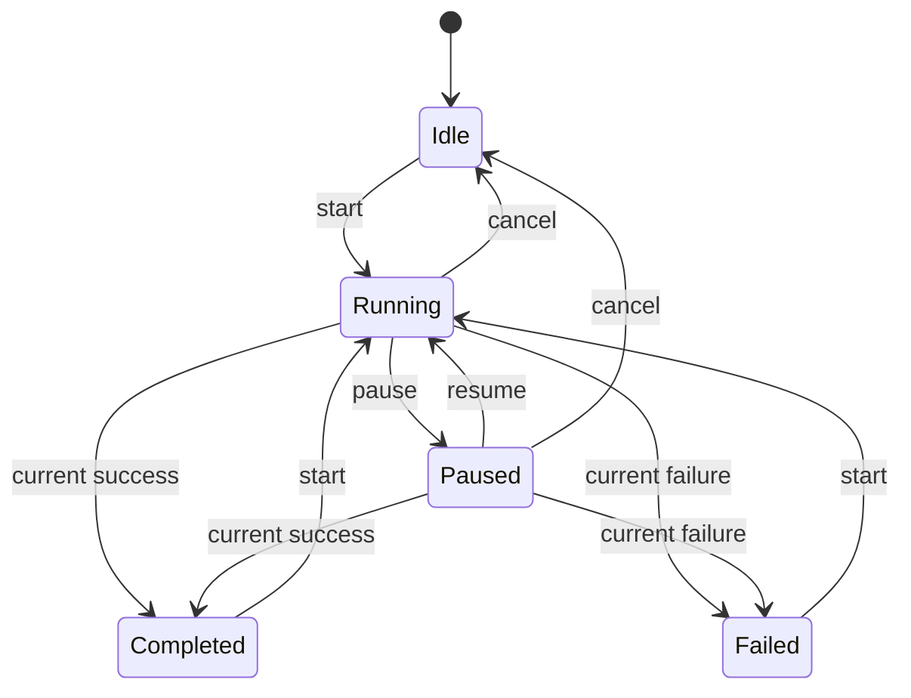

State makes an object's legal behavior depend on an explicit current phase. A transfer can be running, paused, completed, or failed; independent booleans such as `isRunning` and `isPaused` can represent contradictory combinations unless every caller maintains their relationship.

Swift enums are often a good implementation for a closed state set. State objects behind a protocol can fit externally extensible families. The essential design is that transitions and phase-dependent operations are deliberate.

<!--more-->

The Swift 5.7 example owns transfer state and rejects stale outcomes by request identity. It plans local state only; an effect adapter remains responsible for actual loading, pause, resume, and cancellation.

## Put required facts inside each phase

```swift
enum TransferState: Equatable {
    case idle
    case running(request: Int, percent: Int)
    case paused(request: Int, percent: Int)
    case completed(file: String)
    case failed(message: String)
}
enum TransferEvent {
    case start
    case progress(request: Int, percent: Int)
    case pause
    case resume
    case succeeded(request: Int, file: String)
    case failed(request: Int, message: String)
    case cancel
}

final class TransferMachine {
    private(set) var state: TransferState = .idle
    private var generation = 0
    private var activeRequest: Int? {
        switch state {
        case let .running(request, _), let .paused(request, _): return request
        default: return nil
        }
    }
    @discardableResult
    func send(_ event: TransferEvent) -> Bool {
        switch event {
        case .start:
            guard activeRequest == nil else { return false }
            precondition(generation < Int.max)
            generation += 1
            state = .running(request: generation, percent: 0)
        case let .progress(request, percent):
            guard case let .running(current, oldPercent) = state,
                  current == request, (oldPercent...100).contains(percent) else { return false }
            state = .running(request: request, percent: percent)
        case .pause:
            guard case let .running(request, percent) = state else { return false }
            state = .paused(request: request, percent: percent)
        case .resume:
            guard case let .paused(request, percent) = state else { return false }
            state = .running(request: request, percent: percent)
        case let .succeeded(request, file):
            guard activeRequest == request, !file.isEmpty else { return false }
            state = .completed(file: file)
        case let .failed(request, message):
            guard activeRequest == request else { return false }
            state = .failed(message: message)
        case .cancel:
            guard activeRequest != nil else { return false }
            state = .idle
        }
        return true
    }
}
```

Running and paused phases carry their request and progress. Settled phases do not accidentally retain an active request ID.

`send` returns false when an event is not accepted and leaves state unchanged. This makes rejection observable rather than silently pretending an operation succeeded.

## State shape and transition rules work together

```swift
let transfer = TransferMachine()
assert(transfer.send(.start))
assert(transfer.send(.progress(request: 1, percent: 20)))
assert(transfer.send(.pause))
assert(!transfer.send(.progress(request: 1, percent: 30)))
assert(transfer.state == .paused(request: 1, percent: 20))
assert(transfer.send(.succeeded(request: 1, file: "file-1")))
assert(!transfer.send(.succeeded(request: 1, file: "duplicate")))
assert(transfer.send(.start))
assert(transfer.send(.cancel))
assert(!transfer.send(.failed(request: 2, message: "Late cancellation outcome")))
assert(transfer.send(.start))
assert(!transfer.send(.progress(request: 2, percent: 90)))
assert(transfer.send(.progress(request: 3, percent: 40)))
assert(!transfer.send(.progress(request: 3, percent: 10)))
```

Progress while paused is ignored, but a current completion while paused is accepted. That models a pause request racing with completion. A product that requires another policy should change that transition and its tests together.

Cancellation returns to idle without resetting the generation. A later start gets a new request ID, so old callbacks cannot be mistaken for the new transfer within this owner's lifetime.

## Progress one hundred is not durable completion

A progress report can reach one hundred before a file is validated, moved, or committed. The machine remains running until it receives an explicit successful file outcome.

Likewise, a failure message is a domain outcome, not a substitute for task cleanup. The effect owner must release resources and stop or cancel work under its own contract.

These distinctions prevent UI state from claiming stronger guarantees than the infrastructure has actually established.



Stale events and duplicate settled outcomes leave the state unchanged and are omitted from the diagram for readability.

## Keep actual effects outside transition logic

A coordinator can accept a user action, compute the next state, commit it, then start or cancel the corresponding task. Committing before starting matters when a cache or test implementation completes synchronously.

The adapter must distinguish logical pause from cancellation. This model preserves one logical request ID across pause and resume; an implementation issuing a new underlying task should map its callbacks coherently into that logical identity.

If callbacks can outlive the owner and reach a new owner, a local integer generation is insufficient. Prevent that delivery or use an identity whose scope cannot collide across owner lifetimes.

## Enum states and state objects suit different extension models

An enum is a strong fit when the state family is known and every transition should be reviewed together. Associated values carry data that exists only in a particular state, avoiding combinations such as “completed with a running request and no result.”

Separate state objects can help when state-specific behavior is large or supplied through an extension boundary. They make it easier to add a state implementation, but harder to see the whole transition graph in one place. Keep ownership of shared context and transition authority explicit.

Neither representation removes the need to test sequences. Generate event sequences containing cancel, restart, delayed progress, and duplicate completion. Assert invariants after every event, not just the expected final screen. This catches illegal intermediate states that a single happy-path test would overlook.

## Test sequences and invariants

For every accepted progress event, percent remains between zero and one hundred and never decreases within one running phase. Rejected events must leave the full state unchanged.

Generate sequences containing start, pause, resume, cancellation, stale outcomes, and duplicates. Test current outcomes from paused state separately from progress updates. A snapshot test of one valid state does not establish that every transition preserves its invariant.

## Separate a transition decision from its effects

A download transition often needs to start a task, cancel a task, or update a display. Keeping the state machine's decision separate from those effects makes it possible to inspect a transition without performing I/O.

One extension is to return a list of effect descriptions alongside the new state. A running-to-paused transition might return a cancel-request effect, while a start transition returns a begin-request effect carrying the newly allocated request ID. An external driver executes those descriptions and feeds completions back as events.

This organization does not automatically make effects reliable. If recording the new state and starting the task can be separated by a crash, recovery still needs a policy. For an in-memory UI flow, restarting from a known idle state may be sufficient. A durable workflow needs persisted intentions and reconciliation.

## Stale events need identity, not timing assumptions

The request ID distinguishes attempts that happen to use the same URL or payload. Cancelling and restarting cannot safely reuse an ID just because the old task was asked to stop. Cancellation and completion can race, and a callback may already be queued.

Progress also needs an acceptance rule. The example accepts only nondecreasing progress for the active running request. A late progress event after completion cannot return the machine to a running state. Accepting completion while paused is an explicit choice to handle a task that finished before cancellation took effect.

These rules are easier to audit as a transition table. For each state and event, record the next state, ignored-event behavior, and any effect. Missing entries are design questions. An ignored event can be a normal stale completion, but an unexpected current-request event may deserve diagnostics.

## Exercise: add retry with preserved content

A failed transfer may offer retry while retaining previous downloaded metadata. Define whether retry creates a new logical request ID and which information survives. Verify an old failure or success cannot settle the retry, and keep actual task restart in the effect owner.

For the value-model foundations, see [Algebraic Data Types](/swift-algebraic-data-types/).

Return to the [Design Patterns roadmap](/swift-design-patterns/).
