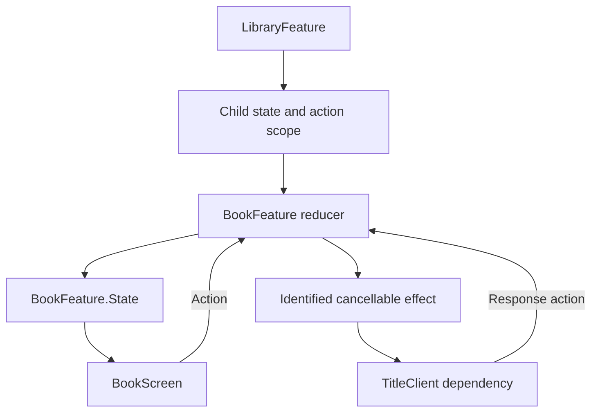

The Composable Architecture combines state, actions, reducers, dependencies, and effects into features that can be composed and tested. Its value goes beyond putting a switch statement in a type: child state and effect lifetimes become part of an explicit parent contract.

Library APIs evolve, so an article must say which generation it uses. Mixing an old reducer example with newer Observation macros can produce code that never existed as one working release.

<!--more-->

This September 2024 article targets **TCA 1.7.0 and Swift 5.9**. TCA 1.7's Observation integration was released on [January 29, 2024](https://www.pointfree.co/blog/posts/130-observation-comes-to-the-composable-architecture). The example uses `@Reducer`, `@ObservableState`, dependency overrides, cancellation IDs, and `TestStore` from that generation. It is not a claim about the latest TCA API.

## Pin the library and the dependency graph

Add the package at `https://github.com/pointfreeco/swift-composable-architecture` with an exact direct version of `1.7.0`, and link the `ComposableArchitecture` product. A manifest dependency entry is `.package(url: "https://github.com/pointfreeco/swift-composable-architecture", exact: "1.7.0")`.

Commit the resulting `Package.resolved` as well. Pinning the direct package alone does not freeze its transitive dependencies. For reproducing this historical example, use the dependency versions recorded by the 1.7.0 tag, not an arbitrary future resolution of every compatible range.

The core feature is usable without a view. The native-observation SwiftUI view below requires iOS 17 or macOS 14. TCA's backported observation path for earlier systems uses additional perception tracking; that is a separate deployment choice, not automatic native support.

## Define a controllable dependency

```swift
import ComposableArchitecture
import SwiftUI

enum TitleFailure: Error, Equatable { case offline, unconfigured }
struct TitleClient: Sendable {
    var load: @Sendable () async throws -> String
}
private enum TitleClientKey: DependencyKey {
    static let liveValue = TitleClient(load: { throw TitleFailure.unconfigured })
    static let testValue = TitleClient(load: { throw TitleFailure.unconfigured })
}
extension DependencyValues {
    var titleClient: TitleClient {
        get { self[TitleClientKey.self] }
        set { self[TitleClientKey.self] = newValue }
    }
}
```

The default fails explicitly because the sample has no production transport. A composition root supplies the real client, and tests supply deterministic behavior. Returning a plausible empty title by default would conceal a missing dependency.

The client is a value containing one sendable operation. This keeps the effect independent of a concrete networking stack while making its fallibility visible. A real adapter should validate its response and translate transport errors into the application contract.

## Keep transitions and effect identity together

```swift
@Reducer
struct BookFeature {
    @ObservableState
    struct State: Equatable {
        var title = ""
        var isLoading = false
        var message: String?
        var generation = 0
    }
    enum Action: Equatable {
        case reload
        case response(Int, Result<String, TitleFailure>)
        case stop
    }
    private enum CancelID { case load }
    @Dependency(\.titleClient) var titleClient

    var body: some ReducerOf<Self> {
        Reduce { state, action in
            switch action {
            case .reload:
                precondition(state.generation < Int.max)
                state.generation += 1
                let ticket = state.generation
                state.isLoading = true
                state.message = nil
                let load = titleClient.load
                return .run { send in
                    do {
                        let title = try await load()
                        try Task.checkCancellation()
                        await send(.response(ticket, .success(title)))
                    } catch is CancellationError {
                        return
                    } catch {
                        await send(.response(ticket, .failure(.offline)))
                    }
                }
                .cancellable(id: CancelID.load, cancelInFlight: true)

            case let .response(ticket, result):
                guard ticket == state.generation, state.isLoading else { return .none }
                state.isLoading = false
                switch result {
                case let .success(title): state.title = title; state.message = nil
                case .failure: state.message = "The title could not be loaded."
                }
                return .none

            case .stop:
                precondition(state.generation < Int.max)
                state.generation += 1
                state.isLoading = false
                return .cancel(id: CancelID.load)
            }
        }
    }
}
```

The effect captures the dependency operation before entering asynchronous work. A new reload cancels the previous effect with the same cancellation ID. The generation also rejects an obsolete response if it reaches the reducer despite cancellation.

Cancellation and acceptance solve different problems. Cancellation can save resources; acceptance protects state. The dependency's cooperation and TCA's effect lifecycle do not justify removing every application identity check, especially when external callbacks or account replacement are involved.

The example maps non-cancellation failures to one display outcome. If the product distinguishes unconfigured dependencies, missing data, and offline transport, preserve those cases instead of collapsing them as this small example does.

## Compose the child feature at a parent boundary

```swift
@Reducer
struct LibraryFeature {
    @ObservableState
    struct State: Equatable { var book = BookFeature.State() }
    enum Action: Equatable { case book(BookFeature.Action) }
    var body: some ReducerOf<Self> {
        Scope(state: \.book, action: \.book) { BookFeature() }
    }
}

@available(macOS 14, iOS 17, *)
@MainActor
struct BookScreen: View {
    let store: StoreOf<BookFeature>
    var body: some View {
        VStack {
            Text(store.title)
            if store.isLoading { ProgressView() }
            if let message = store.message { Text(message) }
            Button("Reload") { store.send(.reload) }
        }
        .onDisappear { store.send(.stop) }
    }
}
```

`Scope` routes the child's portion of state and actions to its reducer. The parent can add independent rules without giving the child direct access to sibling state.

The view reads tracked state and sends actions. Its `onDisappear` policy ends this example's load, but a production flow must decide whether temporary disappearance should cancel work. A child removed from a parent graph also needs the appropriate lifetime handling; a permanent child property does not model optional navigation by itself.

## Test actions, state changes, and received effects

```swift
let store = await MainActor.run {
    TestStore(initialState: LibraryFeature.State()) {
        LibraryFeature()
    } withDependencies: {
        $0.titleClient.load = { "Architecture in Swift" }
    }
}
await store.send(.book(.reload)) {
    $0.book.generation = 1
    $0.book.isLoading = true
}
await store.receive(.book(.response(1, .success("Architecture in Swift")))) {
    $0.book.title = "Architecture in Swift"
    $0.book.isLoading = false
}
await store.send(.book(.response(0, .success("Obsolete"))))
await store.send(.book(.stop)) { $0.book.generation = 2 }
await store.finish()
await MainActor.run {
    assert(store.state.book.title == "Architecture in Swift")
    assert(store.state.book.generation == 2 && !store.state.book.isLoading)
}
```

The test accounts for the effect-produced response and its exact state change. The obsolete response expects no change. `finish` checks that effects do not remain unaccounted for at the end of this scenario.

For cancellation races, use a dependency with controlled suspension and release it after replacement or stop. For time-based work, inject the library's clock dependency and advance a test clock rather than sleep. Exhaustive tests are useful when they describe behavior; asserting every incidental state field can still make a poorly scoped feature difficult to evolve.

## Draw composition and effects separately



TCA does not make a remote write atomic or guarantee a latest server snapshot. Domain transactions, idempotency, and authorization remain service contracts. Its tools make state and effect behavior explicit enough to test those boundaries coherently.

## Case study: the same child appears twice

Composing one book feature is straightforward. Composing several books introduces entity identity, child lifetime, and effect routing. A response for book A must not update book B merely because both reducers use the same action case.

Use the pinned release's identified collection and child-composition tools when the parent owns a collection of features. Keep entity IDs stable, and define what happens when an item is removed while its effect is running. Do not manually route by a current array index that can change after sorting or deletion.

The dependency can also carry account scope. A child created under account one should not complete into a graph rebuilt for account two. Removing the child and cancelling its work is useful, while result acceptance remains a domain concern when external callbacks outlive the effect's local ownership.

Test one representative sequence through the parent: start A's work, remove A, add another child, and release the old dependency. The parent must preserve the current graph. A child reducer test alone cannot establish the parent's lifecycle behavior.

Keep dependency overrides as narrow as the test needs. A deterministic client result is enough for a success path; a controllable clock is appropriate for debounce or retry. Replacing all dependencies globally can conceal which capability the feature actually uses.

Finally, budget library upgrades as real maintenance. Read migration guidance for the pinned version transition, update examples and tests together, and avoid mixing macro syntax or navigation helpers from different generations. An exact direct package pin plus a reviewed lockfile makes that work reproducible.

## Exercise: remove an optional child during loading

Change the parent to own an optional book feature. Begin a controlled load, remove the child, and release the dependency. Verify no stale response re-creates the child or mutates a newly presented instance. Follow the optional-state composition APIs of the pinned release rather than combining snippets from another version.

Return to the [App Architectures roadmap](/swift-architectures/).
