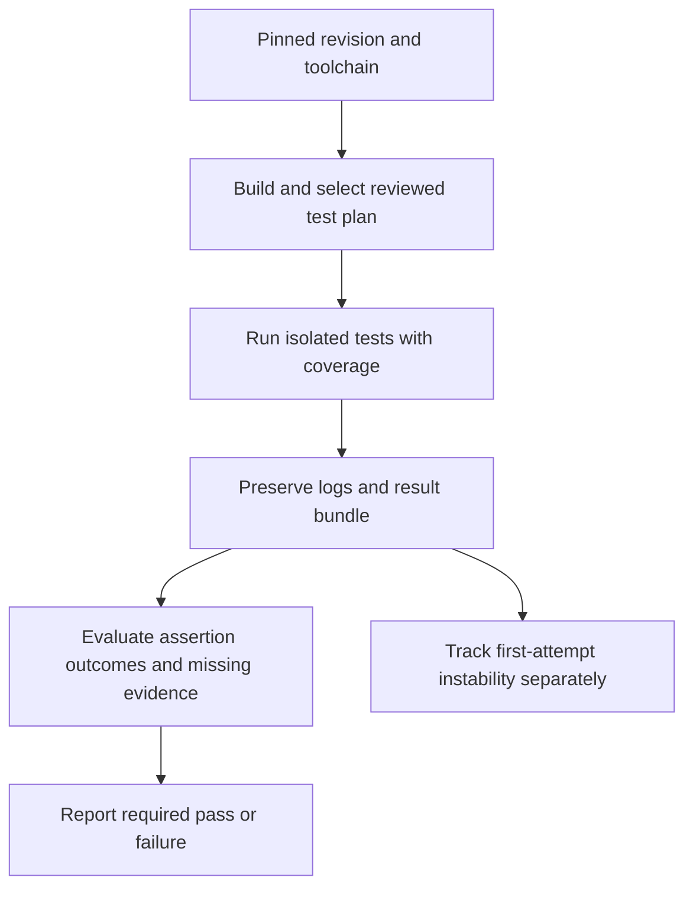

Coverage tells you which instrumented code executed. It does not tell you whether the test checked the right outcome. CI should combine useful assertions, an appropriate test selection, reproducible execution, and visible failure evidence.

A green dashboard becomes less meaningful when retries erase unstable first attempts or a high percentage hides an important untested failure path.

<!--more-->

This October 2024 article includes **Swift Testing from the Swift 6 toolchain**, released in September 2024, alongside XCTest. Earlier articles in this guide use XCTest and older Swift baselines. The command examples assume a configured project and installed simulator; replace the illustrative scheme and device with your actual CI configuration.

## Give coverage a precise denominator

Let `L_hit` count instrumented executable lines hit and `L_eligible` count instrumented executable lines considered. The line-coverage ratio is:

$$
C_{\text{line}}=\frac{L_{\text{hit}}}{L_{\text{eligible}}}.
$$

The ratio is undefined when the denominator is zero. Tools can also report functions, regions, or branches, which answer different questions. State the unit and exclusions before comparing percentages.

Generated code, platform conditionals, excluded targets, and build configuration can change the denominator. A percentage can rise because untested code was excluded, even if no new behavior was checked. Keep exclusion policy reviewable.

Use coverage to find questions: which outcome has no evidence, which boundary is only covered through an expensive test, and which branch executes without an assertion? Do not use it as a substitute for those questions.

## Design a test that catches a plausible defect

A force-update policy must compare numeric components. Lexicographic string comparison can consider `1.10.0` less than `1.2.0`, and a test checking only `1.0.0` against `2.0.0` would not expose the mistake.

```swift
import Testing
import XCTest

struct AppVersion: Comparable, Sendable, CustomStringConvertible {
    let major: Int
    let minor: Int
    let patch: Int
    init?(_ text: String) {
        let parts = text.split(separator: ".", omittingEmptySubsequences: false)
        guard parts.count == 3,
              parts.allSatisfy({ !$0.isEmpty && $0.utf8.allSatisfy { (48...57).contains($0) } }) else {
            return nil
        }
        let numbers = parts.compactMap { Int($0) }
        guard numbers.count == 3, numbers.allSatisfy({ (0...999).contains($0) }) else { return nil }
        major = numbers[0]; minor = numbers[1]; patch = numbers[2]
    }
    static func < (lhs: AppVersion, rhs: AppVersion) -> Bool {
        [lhs.major, lhs.minor, lhs.patch].lexicographicallyPrecedes([rhs.major, rhs.minor, rhs.patch])
    }
    var description: String { "\(major).\(minor).\(patch)" }
}
struct UpdateCase: Sendable {
    let current: String
    let required: String
    let needsUpdate: Bool
}

@Suite("Required application versions")
struct UpdatePolicyTests {
    @Test("Compares numeric components", arguments: [
        UpdateCase(current: "1.2.0", required: "1.10.0", needsUpdate: true),
        UpdateCase(current: "2.0.0", required: "1.999.999", needsUpdate: false),
        UpdateCase(current: "1.2.3", required: "1.2.3", needsUpdate: false),
        UpdateCase(current: "1.2.3", required: "1.2.4", needsUpdate: true),
        UpdateCase(current: "0.0.0", required: "0.0.1", needsUpdate: true)
    ])
    func compares(_ fixture: UpdateCase) throws {
        let current = try #require(AppVersion(fixture.current))
        let required = try #require(AppVersion(fixture.required))
        #expect((current < required) == fixture.needsUpdate)
    }

    @Test("Rejects unsupported version forms", arguments: [
        "", "1.2", "1..2", "1.2.3.4", "-1.2.3", "+1.2.3", "1.2.beta", "1000.0.0"
    ])
    func rejects(_ input: String) {
        #expect(AppVersion(input) == nil)
    }
}

final class LegacyVersionTests: XCTestCase {
    func testEqualVersionsDoNotRequireAnUpdate() throws {
        let version = try XCTUnwrap(AppVersion("1.2.3"))
        XCTAssertFalse(version < version)
    }
}
```

This parser intentionally supports a bounded three-component application format. It is not a complete Semantic Versioning parser: prerelease and build metadata are outside its contract. Name and validate the format the product actually accepts.

Swift Testing's parameterized cases make each input visible to the runner. `#require` stops the case when a prerequisite is absent; `#expect` checks the behavior. XCTest and Swift Testing can coexist in a test target, while UI automation remains an XCTest concern in this toolchain generation.

## Review assertions with a mutation thought experiment

Imagine replacing numeric comparison with string comparison. The multi-digit minor-version case should fail. Imagine requiring an update for equal versions. The equality case should fail. Imagine always returning false. The upgrade cases should fail.

This is a small form of mutation-oriented review: ask which plausible defect each test would detect. Automated mutation tools can broaden the exercise, but the principle already improves a code review without adding a new dependency.

Avoid computing the expected answer with the same algorithm under test. Comparing one numeric tuple routine against an identical tuple routine can let the same mistake appear on both sides. Concrete boundary cases and independent properties provide different evidence.

## Build test plans around feedback and risk

| Lane | Typical contents | Purpose |
|---|---|---|
| Local focused run | Changed policy and presentation tests | Immediate feedback |
| Pull request | Fast unit suite and relevant adapter checks | Prevent known regressions |
| Broader integration | Storage, server contracts, supported configurations | Verify real boundaries |
| UI and end-to-end | Critical user journeys | Verify assembly and interaction |

Test plans can define configurations, environment, arguments, and selected tests. Keep those decisions under source control and review changes to exclusions. A test accidentally omitted from every plan provides no gate even if its source file looks complete.

Parallel execution requires isolated resources. A faster plan that races over one shared database is not an improvement. Use distinct fixtures and keep test-owned work inside its lifetime before enabling broad parallelism.

## Make command-line runs reproducible

For a Swift package, enable coverage during the test run:

```sh
swift test --enable-code-coverage
swift test --show-codecov-path
```

The second command reports where SwiftPM's coverage output can be found for the package and build configuration. Preserve the actual output and logs as artifacts. Confirm the command exists in the pinned toolchain before building a parser around its format.

For an Xcode project, a representative run is:

```sh
xcodebuild test \
  -scheme MyApp \
  -testPlan PullRequest \
  -destination 'platform=iOS Simulator,name=iPhone 15,OS=17.5' \
  -enableCodeCoverage YES \
  -resultBundlePath TestResults/PullRequest.xcresult

xcrun xccov view --report --json TestResults/PullRequest.xcresult > coverage.json
```

These scheme, test-plan, and device names are placeholders for a configured application. Select a simulator installed on the worker, pin the Xcode version, and use a fresh result-bundle path per run. Reusing a previous bundle can cause a tooling failure unrelated to product tests.

Ensure the CI job checks the test command's exit status. If output is piped through a formatter, configure the shell so the formatter cannot hide a failing `xcodebuild`. Artifact collection should still run after a failed test without converting that failure into success.

Keep simulator boot failures, compilation failures, and assertion failures distinguishable in the report. They require different investigation even though each should prevent a misleading green result.

## Preserve the first failure



Retries can help distinguish a persistent failure from an intermittent one, but keep the first attempt visible. A final pass after three retries is different evidence from a first-attempt pass. Track the unstable test's owner and repair work rather than letting retry configuration silently redefine success.

Also detect missing tests. A filter typo that executes zero relevant tests can produce a successful command while proving nothing about the change. Validate selected suites or expected test discovery at a useful granularity; avoid a brittle exact test count that blocks legitimate additions.

## Use thresholds as a prompt for review

A minimum coverage threshold can prevent large untested additions, but exceptions need context. A small critical branch can matter more than many generated lines. Review changed behavior, failure paths, and assertions alongside the number.

Performance tests need a separate environment and baseline policy. A shared busy CI worker can make timing comparisons noisy. Keep ordinary functional tests focused on correctness, and do not add elapsed-time assertions to a deterministic unit test merely because it is supposed to be fast.

## Exercise: strengthen one covered but weak test

Find a covered branch whose test asserts only that no error occurred. Add an assertion about the returned value or committed state, identify a plausible mutation it would catch, and include the test in the appropriate plan. Preserve an intentionally failing run's result bundle and confirm CI reports the failure correctly.

The Swift project introduced the new testing library in [Announcing Swift 6](https://www.swift.org/blog/announcing-swift-6/). Apple describes test-plan organization in [Testing in Xcode](https://developer.apple.com/videos/play/wwdc2019/413/).

Return to the [Testing roadmap](/swift-testing/).
