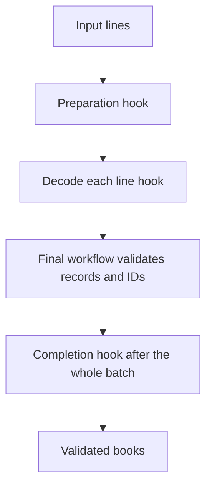

Template Method fixes an algorithm's overall sequence while allowing subclasses to vary selected steps. It is useful when a base type intentionally provides an extension framework with stable ordering and validation guarantees.

It can also create fragile inheritance if every internal detail becomes an override hook. A good template exposes a small contract and keeps non-bypassable rules in the final workflow.

<!--more-->

The Swift 5.7 example imports book records from text or JSON lines. The base pipeline controls preparation, decoding, validation, and the final notification. All hooks have working defaults.

## Put invariant checks in the fixed algorithm

```swift
import Foundation

struct ImportedBook: Decodable, Equatable {
    let id: Int
    let title: String
}
enum ImportFailure: Error, Equatable { case malformedLine, invalidBook, duplicateID(Int) }

class BookImportPipeline {
    final func run(_ lines: [String]) throws -> [ImportedBook] {
        let prepared = prepare(lines)
        var seen: Set<Int> = []
        var books: [ImportedBook] = []
        for line in prepared {
            let book = try decode(line)
            guard book.id > 0, !book.title.isEmpty else { throw ImportFailure.invalidBook }
            guard seen.insert(book.id).inserted else { throw ImportFailure.duplicateID(book.id) }
            books.append(book)
        }
        didValidate(books)
        return books
    }

    func prepare(_ lines: [String]) -> [String] {
        lines.map { $0.trimmingCharacters(in: .whitespacesAndNewlines) }.filter { !$0.isEmpty }
    }
    func decode(_ line: String) throws -> ImportedBook {
        let pieces = line.split(separator: ":", maxSplits: 1, omittingEmptySubsequences: false)
        guard pieces.count == 2, let id = Int(pieces[0]) else { throw ImportFailure.malformedLine }
        return ImportedBook(id: id, title: String(pieces[1]))
    }
    func didValidate(_ books: [ImportedBook]) {}
}

final class JSONBookImport: BookImportPipeline {
    override func decode(_ line: String) throws -> ImportedBook {
        try JSONDecoder().decode(ImportedBook.self, from: Data(line.utf8))
    }
}
final class CommentedBookImport: BookImportPipeline {
    override func prepare(_ lines: [String]) -> [String] {
        super.prepare(lines).filter { !$0.hasPrefix("#") }
    }
}

let plain = try BookImportPipeline().run(["1:Values", "", "2:Objects"])
assert(plain.map { $0.id } == [1, 2])
let json = try JSONBookImport().run(["{\"id\":3,\"title\":\"Protocols\"}"])
assert(json == [ImportedBook(id: 3, title: "Protocols")])
let commented = try CommentedBookImport().run(["# note", "4:Patterns"])
assert(commented.map { $0.id } == [4])
```

`run` is final, so a subclass cannot replace it and skip duplicate or validity checks. An override can still be wrong, but the base does not delegate away the invariant it promises to enforce.

`prepare` determines which input lines become candidates. `decode` creates one record. `didValidate` runs once only after the complete batch validates.

## A hook's timing is a public extension contract

```swift
final class RecordingImport: BookImportPipeline {
    private(set) var completedBatches = 0
    override func didValidate(_ books: [ImportedBook]) { completedBatches += 1 }
}
let recording = RecordingImport()
do {
    _ = try recording.run(["1:Valid", "2:"])
    assertionFailure("An empty title must reject the batch")
} catch ImportFailure.invalidBook {}
assert(recording.completedBatches == 0)
do {
    _ = try recording.run(["1:First", "1:Duplicate"])
    assertionFailure("Duplicate IDs must be rejected")
} catch ImportFailure.duplicateID(1) {}
```

The completion hook is not called for a partially valid batch. Moving it into the loop would be a behavior change affecting every subclass.

The decoding hook is expected to be a calculation. The Swift type system does not prove purity; a subclass writing files during decode could create partial effects before a later record fails. Document the hook contract instead of promising a transaction the base cannot enforce.



## Defaults avoid fake abstract methods

Swift has no general abstract-method keyword. A base implementation that always calls `fatalError` relies on runtime discipline instead of a compiler-enforced requirement.

Here the base type is usable as a plain text importer. If there is no meaningful default, a protocol requirement or injected function can force the consumer to supply an implementation at construction.

Do not instantiate a base type whose documentation says it must never be instantiated and assume a pattern name makes that safe. Choose a representation that expresses the actual requirement.

## Template Method and Factory Method can cooperate

A template hook may construct a product used by the fixed algorithm. That hook then plays Factory Method's narrower role.

In this pipeline, `decode` varies a calculation rather than product construction. Calling it a factory solely because it returns a value would blur the distinction.

Strategy expresses variation through a collaborator instead of subclass overriding. A pipeline accepting a decoder closure may be simpler when callers need only one replaceable operation and no inherited framework.

## Inheritance creates a compatibility surface

Subclasses depend on hook invocation count, ordering, failure propagation, and whether `super` must be called. Changing any of those can break behavior even when method signatures stay the same.

Keep the rules explicit. The preparation override above calls `super` because it deliberately retains trimming and blank-line handling. Another override replacing that policy entirely should say so.

Avoid invoking overridable methods during base initialization. A subclass may depend on state not yet ready for those calls. Run the template only after construction establishes valid state.

## Parsing policy remains a domain decision

The text format splits at the first colon, so a title may contain another colon. Leading and trailing line whitespace is trimmed, but title content after the split is not independently normalized.

The JSON decoder may accept fields beyond those used by `ImportedBook`; rejecting unknown keys would require another policy. Both formats must still satisfy the base's positive-ID and nonempty-title rules.

These examples keep syntax variation separate from common domain validity. A valid JSON object can still describe an invalid book, and a correct decoder is not a substitute for use-case validation.

## Test every supported extension mode

Run the same domain-invalid fixtures through plain and JSON pipelines. Verify shared guarantees rather than testing only each format's happy path.

Also test preparation changes, empty input, duplicate IDs, malformed records, and hook timing. A subclass that emits completion after one valid record must not appear successful when a later record fails.

## Hooks are promises to future subclasses

Once a hook is public or open, subclasses can depend on when it runs, what state is valid, and which errors it may propagate. Moving a hook earlier can be a behavioral breaking change even when its signature stays identical.

The completion hook above runs after the whole batch has passed common validation. A subclass can rely on that fact when recording successful validation. If an implementation later invokes the hook after each row, a subclass that writes an import receipt may record success for a batch whose final row is invalid.

Document hook timing in terms of invariants, not implementation line numbers. “Called once after every decoded row validates” is a useful promise. “Called after decoding” is too vague if several later checks can still fail.

## Avoid calling overridable behavior during initialization

A superclass initializer that invokes a hook can expose a subclass before all subclass state is ready for use. Even where a language restricts some forms of this behavior, designing around initialization-time dispatch makes ownership and ordering harder to understand.

Prefer constructing a valid object first and invoking the template operation explicitly. Dependencies needed by hooks should be supplied during initialization, and execution should begin only when those dependencies are established.

The same concern applies to teardown. A hook should not assume that collaborators remain available indefinitely after the owning operation finishes. If a hook launches asynchronous work, the workflow must define whether completion waits for that work and how failure is reported.

## When hooks begin to interact, reconsider the boundary

A template with `prepare`, `decode`, `validate`, `transform`, `persist`, `notify`, and several Boolean switches can become a hidden framework. Subclasses then have to understand which hooks may be overridden together and which orderings are legal.

Separate independently varying capabilities into injected protocols or closures. For example, a decoder and a persistence service can be composed without making every decoder a subclass of a persistence workflow. Keep inheritance for cases where the shared algorithm truly is the stable abstraction.

Also avoid exposing mutable workflow internals simply so a subclass can bypass validation. A hook that receives validated values is easier to use correctly than one that can mutate an object between every step.

Review subclasses alongside the template whenever changing its algorithm. The compiler checks override signatures, but it cannot prove that assumptions about call count, error propagation, or batch atomicity remain valid. The recording hook test above protects one of those important semantic promises.

## Exercise: replace inheritance with composition

Build a value pipeline taking preparation, decoding, and completion capabilities explicitly. Keep the same validation sequence and tests. Compare what becomes easier to configure and what extension contract is no longer enforced by a final inherited method.

Return to the [Design Patterns roadmap](/swift-design-patterns/).
