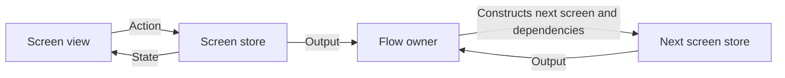

Lasso separates a screen's state and actions from outputs consumed by a flow. The screen owns its interaction. The flow owns how several screens fit together and which screen should come next.

That is useful when a reusable screen can participate in several journeys. A format picker can return a choice without constructing the export preview or deciding how the app presents it.

<!--more-->

Lasso's author describes `ScreenModule`, `LassoStore`, state, actions, outputs, and flows in the original [Lasso introduction](https://medium.com/ww-tech-blog/lasso-introducing-a-new-architectural-framework-for-ios-360da7546df9). This October 2024 article uses Swift 5.7 and an original framework-independent model of those responsibilities. The executable types below are not Lasso package APIs; use the matching library documentation when integrating its actual screen and flow types.

## A screen owns state and handles actions

```swift
enum ExportFormat: Equatable { case pdf, epub }
struct FormatState: Equatable {
    var selected: ExportFormat?
    var canContinue: Bool { selected != nil }
}
enum FormatAction { case selected(ExportFormat), continueTapped, cancelTapped }
enum FormatOutput { case chosen(ExportFormat), cancelled }

final class FormatScreenStore {
    private(set) var state = FormatState()
    var stateChanged: ((FormatState) -> Void)?
    var output: ((FormatOutput) -> Void)?
    private var active = true

    func send(_ action: FormatAction) {
        guard active else { return }
        switch action {
        case let .selected(format): state.selected = format; stateChanged?(state)
        case .continueTapped:
            guard let format = state.selected else { return }
            finish(.chosen(format))
        case .cancelTapped: finish(.cancelled)
        }
    }
    func invalidate() { active = false; stateChanged = nil; output = nil }
    private func finish(_ event: FormatOutput) {
        let emit = output
        invalidate()
        emit?(event)
    }
}
```

The view can read state but cannot assign the selected format directly. It sends an action. Continue is inert without a selection, even if a malformed renderer leaves its button enabled.

The output is different from state. A newly attached view should display the current selection; it should not repeat a prior completion merely because it read a replayed Boolean called `isDone`.

Clearing callbacks before emission makes the screen's completion one-shot and releases its binding context. The owner still has to decide when to invalidate a screen that disappears through interactive navigation rather than an explicit button.

## A second screen has its own contract

```swift
enum PreviewAction { case confirmed, back }
enum PreviewOutput { case confirmed(ExportFormat), back }
final class PreviewScreenStore {
    let format: ExportFormat
    var output: ((PreviewOutput) -> Void)?
    private var active = true
    init(format: ExportFormat) { self.format = format }
    func send(_ action: PreviewAction) {
        guard active else { return }
        let event: PreviewOutput
        switch action {
        case .confirmed: event = .confirmed(format)
        case .back: event = .back
        }
        let emit = output
        invalidate()
        emit?(event)
    }
    func invalidate() { active = false; output = nil }
}
```

The preview receives immutable input at construction. It does not query the previous screen's private state. Confirmation means the person accepted these options; it does not claim that a file has already been written.

A real exporter would be a separate capability with its own progress, cancellation, and partial-file cleanup contract. Putting export success behind this confirmation output would overstate what the screen actually established.

## Let the flow own the transition and child lifetime

```swift
final class ExportFlow {
    enum Stage { case idle, format, preview, finished(ExportFormat) }
    private(set) var stage: Stage = .idle
    private(set) var formatScreen: FormatScreenStore?
    private(set) var previewScreen: PreviewScreenStore?
    private var generation = 0
    var completed: ((ExportFormat) -> Void)?

    func start() {
        clearChildren()
        let ticket = nextGeneration()
        let screen = FormatScreenStore()
        formatScreen = screen
        stage = .format
        screen.output = { [weak self] in self?.acceptFormat($0, ticket: ticket) }
    }
    private func acceptFormat(_ output: FormatOutput, ticket: Int) {
        guard generation == ticket, case .format = stage else { return }
        clearChildren()
        switch output {
        case .cancelled: stage = .idle
        case let .chosen(format):
            let next = nextGeneration()
            let screen = PreviewScreenStore(format: format)
            previewScreen = screen
            stage = .preview
            screen.output = { [weak self] in self?.acceptPreview($0, ticket: next) }
        }
    }
    private func acceptPreview(_ output: PreviewOutput, ticket: Int) {
        guard generation == ticket, case .preview = stage else { return }
        clearChildren()
        switch output {
        case .back: start()
        case let .confirmed(format): stage = .finished(format); completed?(format)
        }
    }
    func stop() { clearChildren(); stage = .idle }
    private func clearChildren() {
        formatScreen?.invalidate(); previewScreen?.invalidate()
        formatScreen = nil; previewScreen = nil
    }
    private func nextGeneration() -> Int {
        precondition(generation < Int.max)
        generation += 1
        return generation
    }
}
```

All calls require serialized access. The flow retains current children and accepts outputs only from the current generation and phase. A stale output closure retained elsewhere cannot advance a later flow.

Back from preview starts a fresh format screen and intentionally discards the previous selection. A product that preserves the choice should pass it as explicit input to the reconstructed format screen. Neither behavior is implied by the flow architecture.

The navigation renderer is omitted deliberately: it would project `stage` and report actual dismissals to the flow. It must not silently remove a screen while leaving that screen's output capability active.

## Verify state, output, and flow behavior independently

```swift
let flow = ExportFlow()
var exports: [ExportFormat] = []
flow.completed = { exports.append($0) }
flow.start()
let old = flow.formatScreen!
let staleOutput = old.output!
old.send(.continueTapped)
assert(flow.previewScreen == nil)
old.send(.selected(.epub))
old.send(.continueTapped)
assert(flow.previewScreen?.format == .epub)
flow.previewScreen?.send(.confirmed)
assert(exports == [.epub])
flow.start()
staleOutput(.chosen(.pdf))
assert(flow.previewScreen == nil && flow.formatScreen != nil)
let current = flow.formatScreen!
flow.stop()
current.send(.selected(.pdf))
current.send(.continueTapped)
assert(flow.previewScreen == nil && exports == [.epub])
```

The test keeps stale objects and callbacks alive on purpose. Logical invalidation must work before deallocation. Separate memory tests can then establish that the intended owner graph releases screens after external references disappear.

## Map the model to Lasso's vocabulary



In Lasso, a screen module defines its associated state, action, and output types; a store handles actions and emits state and outputs; a flow composes screens. The example makes those boundaries explicit without reproducing framework convenience APIs.

The shape overlaps with MVVM plus coordinators and other unidirectional designs. Compare actual contracts: who can mutate state, whether outputs replay, who owns navigation, and how screen lifetimes end. An acronym comparison without those details is not useful.

## Keep bindings consistent with read-only state

A SwiftUI field normally expects a writable `Binding`. With action-owned state, its getter reads current state and its setter sends an action. A setter must not bypass the store and mutate a copied state value that the store never observes.

UIKit adapters have the same obligation: render silently and forward user events. Distinguish a selection changed by rendering from a person selecting a row, or the update loop can feed itself.

If a screen begins asynchronous work, tie results to its active identity and define cancellation separately from output. The flow may end while a service still retains a callback. The store should not emit navigation after its logical lifetime ends.

## Case study: one screen contributes to two different flows

The format screen can participate in a full export flow or a preferences flow that merely stores the default format. Its state and action contract can remain the same, while its output is interpreted differently by each owner.

The export parent builds a preview. The preferences parent performs a conditional settings update and renders its outcome. Neither continuation belongs inside the picker store, or the reusable screen would need mode flags for unrelated journeys.

Sharing the screen does not imply sharing its live store instance. Two windows should usually construct separate stores so one person's unfinished selection does not appear in another window. Immutable choices and stateless formatting can be shared beneath them.

When mapping this design to the Lasso library, inspect the actual screen module's associated state, action, and output types, the store's action handler, and the flow's ownership of presented screens. Keep package-specific convenience APIs at that assembly boundary rather than pretending the miniature types here are drop-in framework code.

For asynchronous work, decide whether it belongs to the screen or the flow. Loading screen-local preview content can stop when the screen ends. A committed export intended to survive navigation may need a longer-lived operation owner and a separate progress subscriber.

A test should keep the old screen alive after the flow advances, send another action, and invoke a retained old output. Neither should affect the next screen. Then release the old screen and verify intended ownership ends. That combination checks both logical flow isolation and resource lifetime.

## Exercise: add asynchronous export as another screen

After preview confirmation, create an exporting screen with progress, cancellation, and a final receipt. Define whether backing out cancels export or detaches only its UI. Test a late completion after flow replacement and preserve the distinction between accepted options and a successfully written file.

Return to the [App Architectures roadmap](/swift-architectures/).
