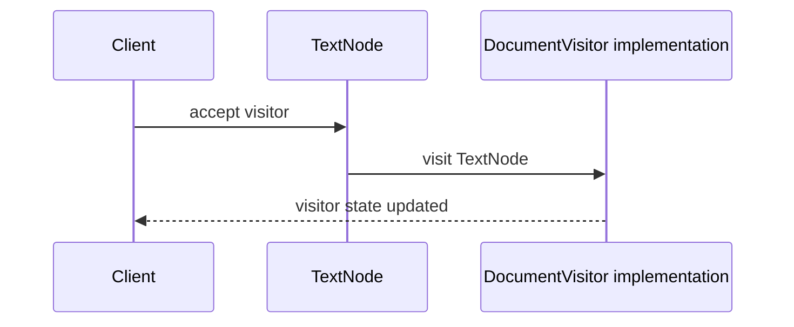

Visitor adds operations over a known family of element types without putting every operation into those element types. A document can support plain-text extraction, link collection, validation, and export while each node only knows how to accept a visitor.

The tradeoff is the closed element family: adding another node kind requires updating every visitor that promises to handle the whole family.

<!--more-->

The Swift 5.7 example uses value nodes and mutable value visitors. Generic `accept` preserves the concrete visitor type, while each node selects the correctly typed visit operation.

## Define the element family and visitor operations

```swift
protocol DocumentNode {
    func accept<V: DocumentVisitor>(_ visitor: inout V)
}
protocol DocumentVisitor {
    mutating func visit(_ node: TextNode)
    mutating func visit(_ node: LinkNode)
    mutating func visit(_ node: GroupNode)
}

struct TextNode: DocumentNode {
    let text: String
    func accept<V: DocumentVisitor>(_ visitor: inout V) { visitor.visit(self) }
}
struct LinkNode: DocumentNode {
    let label: String
    let destination: String
    func accept<V: DocumentVisitor>(_ visitor: inout V) { visitor.visit(self) }
}
struct GroupNode: DocumentNode {
    let children: [any DocumentNode]
    func accept<V: DocumentVisitor>(_ visitor: inout V) { visitor.visit(self) }
}
```

Inside `TextNode.accept`, `self` is statically a text node, so the text-specific visitor requirement is selected. The analogous calls choose the link and group operations.

This is the double-dispatch collaboration: the element routes to an operation specialized for its kind, and the concrete visitor supplies the behavior. Merely overloading several free functions and passing an erased base value does not necessarily produce runtime subtype selection in Swift.

## Add an operation without editing node implementations

```swift
struct PlainTextVisitor: DocumentVisitor {
    private(set) var fragments: [String] = []
    var text: String { fragments.joined(separator: " ") }
    mutating func visit(_ node: TextNode) { fragments.append(node.text) }
    mutating func visit(_ node: LinkNode) { fragments.append(node.label) }
    mutating func visit(_ node: GroupNode) {
        for child in node.children { child.accept(&self) }
    }
}

struct LinkCollector: DocumentVisitor {
    private(set) var destinations: Set<String> = []
    mutating func visit(_ node: TextNode) {}
    mutating func visit(_ node: LinkNode) { destinations.insert(node.destination) }
    mutating func visit(_ node: GroupNode) {
        for child in node.children { child.accept(&self) }
    }
}

let document = GroupNode(children: [
    TextNode(text: "Read"),
    LinkNode(label: "Swift", destination: "https://www.swift.org"),
    GroupNode(children: [TextNode(text: "Next"),
        LinkNode(label: "Docs", destination: "https://docs.swift.org")])
])
var text = PlainTextVisitor()
document.accept(&text)
assert(text.text == "Read Swift Next Docs")
var links = LinkCollector()
document.accept(&links)
assert(links.destinations == ["https://www.swift.org", "https://docs.swift.org"])
```

The text visitor emits link labels, while the link collector ignores ordinary text. Both intentionally recurse through groups.

Traversal belongs to each visitor in this design. A visitor can skip a subtree or use a different order. An alternative framework can centralize traversal and provide entry/exit hooks; that is another contract and should not be mixed in accidentally.



## The extension direction determines whether Visitor helps

Adding a word-count or outline visitor changes no node implementation. Adding an image node requires a new visitor requirement and updates to both visitors.

If node kinds change frequently while operations are stable, methods on nodes or a protocol with narrower capabilities may fit better. If the node set is closed and operations grow, Visitor can keep related operation logic together.

A recursive enum plus an exhaustive switch is often a compact Swift alternative. It provides similar compiler feedback for a closed family without an `accept` method on every case. Choose based on module boundaries and extension needs rather than preserving class-based ceremony.

## Access should follow the operation's needs

A visitor needs enough information to perform its operation, but exposing every mutable internal field can weaken encapsulation. Prefer immutable node facts or dedicated query methods.

If visitors mutate the structure, define whether iteration sees new children, whether removed nodes are visited, and how parents remain consistent. The value model above performs read-only traversal and avoids that additional contract.

A mutable reference graph can also contain cycles. A tree visitor without cycle handling may recurse indefinitely. Decide whether repeated references represent repeated occurrences or unique entities before adding a visited set.

## Accumulation and recursion have costs

The text visitor appends fragments and joins once, avoiding repeated whole-subtree string concatenation. Output storage still scales with emitted text, and recursion depth scales with nesting.

The link collector uses a set, deliberately deduplicating destinations. If the consumer needs every occurrence and source position, a set is insufficient; collect records containing that context.

Resource limits matter when documents are imported. A finite valid node tree can still be too deep or large for the application's supported traversal. Validate size and depth or use an explicit traversal stack.

## Tests must cover every node kind and nested traversal

A text-only fixture can let a missing link handler pass. A flat fixture can let a visitor forget to recurse into groups. Include each kind, an empty group, repeated links, and nested groups.

For new visitors, state whether they preserve order, deduplicate, or ignore some node kinds intentionally. An empty text visit method is correct for link collection, but the same no-op would be a defect in a text exporter.

Compiler conformance catches missing required methods, not an incorrectly empty implementation. Behavioral tests still protect meaning.

## Dispatch and traversal are separate design choices

The node's `accept` method selects the visitor operation for its concrete node type. The visitor then decides whether and how to visit children. Keeping traversal in the visitor lets one operation traverse every descendant while another intentionally stops at a group boundary.

It also creates a responsibility: a visitor that forgets to recurse can silently produce an incomplete result. The nested test document is important because a flat fixture would not detect that omission. Include empty groups and several nesting levels when testing aggregating visitors.

An alternative framework can provide a default traversal and offer enter/leave hooks. That reduces repeated walking code but changes what an operation controls. Choose deliberately according to whether most operations share one traversal order or require different navigation policies.

## Double dispatch makes a maintenance tradeoff visible

Ordinary dynamic dispatch selects behavior based on the receiver's type. Here, `accept` dispatches to the concrete node, and that node calls the visitor's corresponding overload. The result depends on both the node kind and the visitor implementation.

Adding an operation means adding a new visitor while keeping existing node implementations stable. Adding a new node kind means updating the visitor protocol and every existing visitor. For a mature document format with many analyses and few node changes, that tradeoff can be attractive.

Default visitor methods can reduce compilation work when adding a node, but they may turn a useful compiler error into silently missing behavior. A security audit visitor or serializer should not unknowingly ignore a new executable or persistent node kind. Exhaustive updates can be a feature.

## Values, mutation, and reusable visitors

The visitors here accumulate results in their own value state. Passing the visitor `inout` makes that mutation explicit and avoids relying on hidden global output. A fresh visitor is a fresh operation; reusing one visitor instance requires a deliberate reset or accumulation policy.

Transforming a document is a different capability from observing it. A transforming visitor may return replacement nodes and rebuild ancestor groups. Avoid adding arbitrary mutation to a read-only node protocol merely to support one transformation.

For a closed Swift enum, a recursive switch can provide similar exhaustiveness with fewer types. Prefer that form when the node family and operations live together and the protocol boundary adds little value. Visitor becomes more useful when named operations need separate ownership or when concrete node types already form an established hierarchy. The pattern should clarify the extension direction rather than serve as a prerequisite for every recursive structure.

## Exercise: add an HTML exporter

Implement a visitor that escapes text and attribute content and applies an explicit destination policy to links. Preserve nesting where the node model carries it. Then add an image node and observe which visitor implementations must change, comparing that maintenance cost with a recursive enum version.

For the underlying dispatch rules, see [Protocols](https://docs.swift.org/swift-book/documentation/the-swift-programming-language/protocols/).

Return to the [Design Patterns roadmap](/swift-design-patterns/).
