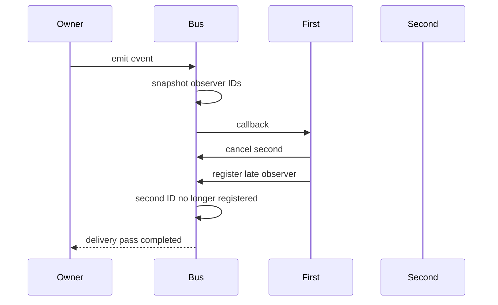

An observer API is a delivery contract, not merely an array of closures. Callers need to know who retains a subscription, whether cancellation suppresses a callback already waiting in a delivery pass, and what happens when an observer adds another observer or emits another event.

We will build a small synchronous event bus with explicit answers. It preserves registration order, lets cancellation suppress a not-yet-started callback, defers newly registered observers until the next event, and reports rejected reentrant delivery.

<!--more-->

## Represent the lifetime with a token

```swift
final class EventSubscription {
    private var cancelAction: (() -> Void)?

    init(cancel: @escaping () -> Void) { cancelAction = cancel }

    func cancel() {
        let action = cancelAction
        cancelAction = nil
        action?()
    }

    deinit { cancel() }
}
```

Cancellation removes its own action before invoking it. A repeated or reentrant call therefore has no second effect. Deinitialization is a cleanup fallback, while an owner can call `cancel` explicitly when its feature stops.

A subscription must be retained while observation is desired. Discarding a newly returned token immediately ends this subscription's lifetime. That is intentional, so the API's usage and documentation should make token ownership visible.

The cancellation closure will weakly refer to the bus. A retained token should not keep the entire producer alive after its actual owner releases it.

## State the delivery rules in the implementation

```swift
final class EventBus<Event> {
    private var callbacks: [Int: (Event) -> Void] = [:]
    private var order: [Int] = []
    private var nextID = 0
    private var delivering = false

    func observe(_ callback: @escaping (Event) -> Void) -> EventSubscription {
        nextID += 1
        let id = nextID
        callbacks[id] = callback
        order.append(id)
        return EventSubscription { [weak self] in
            self?.callbacks[id] = nil
            self?.order.removeAll { $0 == id }
        }
    }

    @discardableResult
    func emit(_ event: Event) -> Bool {
        guard !delivering else { return false }
        delivering = true
        defer { delivering = false }
        let scheduled = order
        for id in scheduled {
            callbacks[id]?(event)
        }
        return true
    }
}
```

The delivery pass snapshots identifiers, not closures. Before each callback, it looks up the identifier in the current callback dictionary. Cancellation before an observer's turn removes that entry and suppresses its delivery.

New observers append to the live order array, but their identifiers are absent from the current snapshot. They begin with a later event. This avoids mutating the collection being iterated and gives addition a clear timing rule.

`emit` returns `false` for a nested attempt rather than silently pretending that nested event was delivered. A product that needs queued nested events should implement an explicit queue and termination policy instead. Unbounded recursive emission can otherwise overflow the stack or create an infinite feedback loop.

## Verify ordinary delivery and idempotent cancellation

```swift
final class EventRecorder<Event> {
    var values: [Event] = []
}

let integerEvents = EventBus<Int>()
let integerRecorder = EventRecorder<Int>()
let integerSubscription = integerEvents.observe { [weak integerRecorder] value in
    integerRecorder?.values.append(value)
}
assert(integerEvents.emit(7))
assert(integerRecorder.values == [7])
integerSubscription.cancel()
integerSubscription.cancel()
assert(integerEvents.emit(8))
assert(integerRecorder.values == [7])
```

The bus retains the callback, and the callback weakly references the receiver. The receiver's separate owner keeps it alive. If a callback strongly captures an owner that retains the bus or token, inspect the complete graph for cycles.

A weak capture does not automatically remove the dead callback from the bus. In this implementation the token still owns explicit cancellation. A more specialized weak-observer registry could prune dead entries, but that is a separate policy.

Swift's [ARC documentation](https://docs.swift.org/swift-book/documentation/the-swift-programming-language/automaticreferencecounting/) explains weak references and closure capture cycles. The observer pattern does not change those ownership rules.

## Exercise changes during notification

```swift
func checkObserverOrdering() {
    let bus = EventBus<String>()
    var received: [String] = []
    var second: EventSubscription?
    var late: EventSubscription?

    let first = bus.observe { [weak bus] _ in
        received.append("first")
        second?.cancel()
        if late == nil {
            late = bus?.observe { _ in received.append("late") }
        }
        assert(bus?.emit("nested") == false)
    }
    second = bus.observe { _ in received.append("second") }

    assert(bus.emit("initial"))
    assert(received == ["first"])
    assert(bus.emit("next"))
    assert(received == ["first", "first", "late"])

    first.cancel()
    second?.cancel()
    late?.cancel()
}
checkObserverOrdering()
```

The second observer is registered before the event begins, but cancellation suppresses it before its callback starts. The late observer is created during the first pass and appears only in the next pass. Reentrant emission is rejected on both passes.

The assertions are deterministic because delivery is synchronous and serialized. They do not depend on sleeps, background scheduling, or a UI lifecycle. A test checking only that some closure was called would miss every timing rule demonstrated here.



## Exactly-once needs a scope

Each observer registered at the start of this pass can be invoked at most once during that pass. Cancellation can result in zero deliveries. Calling `emit` again is another pass and can notify the same observer again.

This is not durable event delivery. The bus stores no history, provides no acknowledgment, and cannot replay events after a restart. If an event represents a required payment or persistence action, an optional in-memory subscription should not be its only execution mechanism.

Also distinguish an event from a current-state query. A late subscriber receives future events, not an automatic copy of the latest state. If a screen needs the current state immediately, provide a snapshot or a replay policy explicitly.

## Protocols describe recipients when they need a named interaction

A closure is sufficient for one event value. A protocol can be clearer when a receiver handles several related notifications with shared semantics. A class-only receiver protocol also permits weak storage when that ownership relationship is appropriate.

Do not create one universal application observer protocol with dozens of unrelated methods and empty defaults. Consumers become difficult to construct, and missing handling can disappear into no-ops. Separate coherent event domains or use explicit event enums when that makes the supported cases clearer.

A generic `Event` type keeps this bus from accepting an unrelated payload by accident. A concrete event enum can describe several cases while retaining exhaustive handling in a receiver.

## Isolation must protect the whole delivery operation

This bus is not thread-safe. The dictionary, order array, and `delivering` flag assume serialized access. Locking individual dictionary accesses would not by itself establish a coherent pass or make arbitrary observer callbacks safe under a lock.

For a UI feature, main-actor isolation on the bus and its consumers can be appropriate. For asynchronous event streams, an actor or `AsyncSequence` may better express cancellation and backpressure. Decide whether a slow observer should delay every other observer, as it does in this synchronous design.

Never assume using a protocol or closure automatically chooses the callback's executor. Execution context is part of the event contract.

## Review cleanup under every owner transition

A screen may stop observing when hidden, on sign-out, or when a document is replaced, even though its object remains alive. Explicit cancellation handles those transitions; waiting for `deinit` ties behavior to memory lifetime instead of feature lifetime.

Tests should keep the token alive, cancel twice, release a receiver, cancel before its turn, add during delivery, and attempt reentrant emission. For a queued implementation, also test whether cancelling removes queued deliveries or only prevents future scheduling.

As an exercise, add a result that reports how many callbacks actually started in a pass. Keep that distinct from the number scheduled at the beginning. The difference makes cancellation observable and reinforces the central lesson: an observer API should describe delivery precisely enough that callers can reason about the events they will see.

## Worked lifetime checks: tokens do not own the event producer

Automatic token cleanup and producer lifetime are separate properties. Exercise both explicitly:

```swift
func checkObserverLifetimes() {
    let bus = EventBus<Int>()
    let recorder = EventRecorder<Int>()
    var subscription: EventSubscription? = bus.observe { recorder.values.append($0) }
    assert(bus.emit(1))
    assert(subscription != nil)
    subscription = nil
    assert(bus.emit(2))
    assert(recorder.values == [1])

    var temporaryBus: EventBus<Int>? = EventBus()
    weak var observedBus = temporaryBus
    let survivingToken = temporaryBus!.observe { _ in }
    temporaryBus = nil
    assert(observedBus == nil)
    survivingToken.cancel()
}
checkObserverLifetimes()
```

In the first case, releasing the sole token cancels registration through `deinit`. In the second, retaining a token does not retain the bus, and cancelling after the bus disappears remains harmless.

These checks would catch a cancellation closure accidentally capturing the bus strongly. A cycle involving an observer's own callback is a different edge and requires a corresponding owner-release test.

Explicit cleanup still matters when a feature stops before its objects are released. A hidden screen can remain in a navigation stack, and an account coordinator can retain a child for later reuse. Relying only on `deinit` would keep its observation active throughout that interval.

A useful production owner stores its tokens alongside the lifecycle they represent and cancels them at the documented stop transition. The automatic fallback handles forgotten release paths; it should not be the only expression of application-level intent.

Continue through the [Protocol-Oriented Programming roadmap](/swift-protocol-oriented-programming/).
