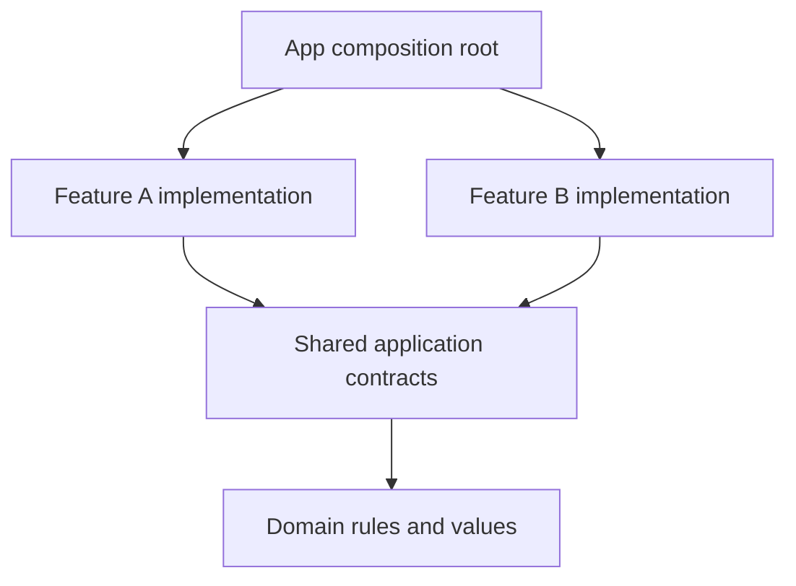

Team size influences architecture through ownership and coordination, not through a magic threshold. Twenty engineers working on independent bounded features can need less shared machinery than three engineers changing one complicated workflow.

Choose structure from the state space, effects, lifetimes, and change boundaries a feature actually has. Then consider whether the team can understand, enforce, and maintain that structure.

<!--more-->

This Swift 5.7 article builds a small state-space example and a decision process grounded in concrete change scenarios. It avoids assigning numerical “quality scores” to architecture names, because those numbers would conceal assumptions rather than establish evidence.

## Separate visual complexity from state complexity

A screen with many labels can have simple behavior. A screen with one button can coordinate offline edits, retries, account switching, and recovery after a crash. The second screen may have a much larger state space despite its smaller layout.

With `b` independent Boolean flags, the representation permits:

$$
N=2^b
$$

combinations. That is a count of representable combinations, not a count of valid product states or a runtime performance prediction. Constraints may make most combinations invalid.

For several independent categorical dimensions with sizes `d_i`, the analogous unconstrained count is the product of those sizes. Real workflows often couple dimensions, so state modeling should capture those relationships rather than rely on every consumer to remember them.

## Make invalid combinations visible in a small example

```swift
struct ImportFlags {
    let isReading: Bool
    let hasDocument: Bool
    let hasError: Bool
    var isValidForThisProduct: Bool {
        [isReading, hasDocument, hasError].filter { $0 }.count <= 1
    }
}
var valid = 0
var invalid = 0
for mask in 0..<8 {
    let flags = ImportFlags(isReading: mask & 1 != 0,
                            hasDocument: mask & 2 != 0,
                            hasError: mask & 4 != 0)
    if flags.isValidForThisProduct { valid += 1 } else { invalid += 1 }
}
assert(valid == 4 && invalid == 4)

struct ImportedDocument: Equatable { let title: String }
enum ImportPhase: Equatable {
    case idle
    case reading
    case ready(ImportedDocument)
    case failed(String)
}
func heading(for phase: ImportPhase) -> String {
    switch phase {
    case .idle: return "Choose a document"
    case .reading: return "Reading document"
    case let .ready(document): return document.title
    case let .failed(message): return "Could not import: " + message
    }
}
assert(heading(for: .ready(ImportedDocument(title: "Swift"))) == "Swift")
assert(heading(for: .reading) == "Reading document")
```

This product intentionally shows one of idle, reading, content, or failure. Another product may legitimately show old content while refreshing or a warning alongside content. Its valid state model should be richer. The enum is better here because it expresses this product's rule, not because four cases are universally correct.

An architecture that makes transitions explicit can help manage a large state space. It does not excuse an inaccurate model. A reducer over contradictory flags can be just as difficult to maintain as a controller over those flags.

## Evaluate four distinct kinds of pressure

| Pressure | Concrete symptom | Boundary to investigate |
|---|---|---|
| Presentation policy | Several layouts duplicate validation feedback | Presenter or view model |
| Effect ordering | Old responses replace current results | Request identity and effect owner |
| Business authority | Several clients repeat borrowing rules | Shared use case and atomic data port |
| Organizational ownership | One team's change edits sibling internals | Feature API and module boundary |

The same feature can have several pressures. Select boundaries that address them independently rather than adopting every part of a large framework at once.

For example, a coordinator can solve child-flow lifetime while the screen remains MVC. A repository can solve freshness and write conflicts while the view remains SwiftUI. A reducer can make a complex interaction testable without requiring a global store for the whole application.

## Compare architecture families by contracts

MVC keeps a direct controller coordination path and fits UIKit well. MVP makes passive-view presentation explicit. MVVM exposes presentation state for a renderer. Clean Architecture emphasizes dependency direction and use-case policy. RIBs emphasizes nested business scopes and activation. Redux and TEA emphasize deliberate state transitions and effect paths.

These are overlapping choices, not mutually exclusive products on one ranking ladder. A Clean use case can serve an MVVM screen inside a coordinated flow. A RIB can use local unidirectional state. Combining them is useful only when the resulting contract remains understandable.

Ask what a new team member must learn to make an ordinary change. Consistent conventions can reduce cognitive load. A framework nobody understands can increase it even when its theoretical decomposition is strong.

## Test a representative change before standardizing

Choose a change that has been painful: add another presentation surface, replace a data source, introduce a child flow, or handle offline retry. Implement one vertical slice with the proposed boundary.

Review which code changed, which tests controlled the relevant failures, and which assembly rules had to be learned. Include teardown and partial failure. A prototype showing only successful rendering can make almost any architecture look simple.

Then ask a different engineer to modify the slice using only the written contract. If they need private knowledge or direct access to implementation objects, the boundary is not yet delivering independent ownership.

## Make module structure support the decision



Use separate targets where enforcement matters. A folder named `Domain` does not stop a file from importing UIKit or a database library. Public interfaces should expose values and capabilities appropriate to their consumers rather than implementation-specific objects.

Do not turn the shared module into a dumping ground. If every feature imports a huge common target, changes can propagate widely and ownership becomes unclear. Share stable contracts deliberately and keep feature-private details private.

## Consider operational and migration constraints

Architecture must work with deployment targets, build time, dependency policy, and existing code. A new Observation-based approach cannot be copied unchanged into an older iOS target. A third-party framework introduces versioning and migration work in addition to its runtime model.

A mixed app can adopt stronger boundaries one feature at a time. Consistency is valuable, but requiring a whole-app rewrite before improving one failure path can delay the very benefit the new design promises.

Document the reasons for an exception. A simple static screen and a complex editor need not have identical internal graphs if they expose coherent application boundaries.

## Case study: a small team with a complicated editor

Three engineers building a collaborative editor may need explicit revision handling, operation identity, recovery, and a well-defined state machine. A larger team building many independent informational screens may not need the same interaction machinery in each feature.

The distinction is the number of coupled decisions, not the number of people alone. An editor's save, undo, remote update, and offline recovery can interact in ways that ordinary screen decomposition does not capture. A strong application contract can reduce that complexity before a particular presentation pattern is selected.

Conversely, organizational complexity can dominate even when each feature is simple. Several teams changing a shared mutable singleton can block one another through hidden assumptions. Narrow feature contracts and scoped assembly may provide more benefit than a new reducer framework.

Separate these dimensions in a decision record. State which problem is about interaction state, which is about effects, which is about ownership, and which is about team collaboration. Then choose tools that address those pressures without claiming one name solves all of them.

Re-evaluate after actual change. If teams still edit sibling internals, module names did not establish independence. If tests still rely on real time and uncontrolled callbacks, moving to view models did not establish determinism. If the same invalid states remain representable, adding a store did not establish a sound model.

Architecture selection becomes more useful when its promises can fail a concrete review or test. That evidence supports revising the decision without turning the discussion into a contest between acronyms.

## Exercise: write a decision around one constraint

Choose a real feature and list its authoritative state, external effects, lifetime owner, team owner, and expected changes. Propose the smallest boundary that addresses the strongest pressure. State what evidence would make you reconsider it after several releases.

Use [structure cost](/swift-architecture-structure-cost/) for an explicit tradeoff estimate and [migration](/swift-architecture-migration/) for introducing the boundary incrementally.

Return to the [App Architectures roadmap](/swift-architectures/).
