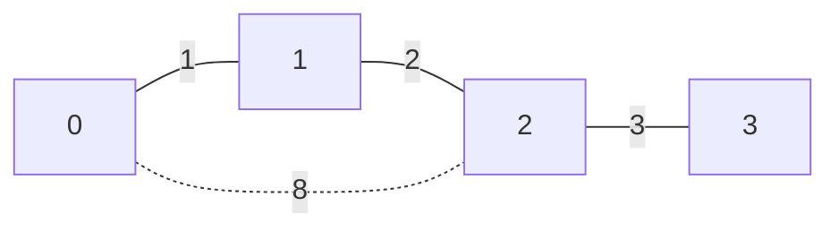

A minimum spanning tree connects every vertex of an undirected connected graph while minimizing total selected edge weight. It is not a shortest-path tree: minimizing the sum of the network's edges differs from minimizing travel distance from one source.

Kruskal's algorithm considers edges from cheapest to most expensive and accepts one only when it connects different components. Union-find makes that component test efficient.

<!--more-->

These Swift 5.7 examples return a minimum spanning forest for disconnected input. Negative edge weights are allowed, self-loops are ignored by the component test, and selected-weight overflow is reported.

## Keep connected components as a separate structure

```swift
struct UnionFind {
    private var parent: [Int]
    private var size: [Int]
    private(set) var components: Int
    init(_ count: Int) {
        precondition(count >= 0)
        parent = Array(0..<count)
        size = Array(repeating: 1, count: count)
        components = count
    }
    mutating func root(_ value: Int) -> Int {
        var cursor = value
        while parent[cursor] != cursor {
            parent[cursor] = parent[parent[cursor]]
            cursor = parent[cursor]
        }
        return cursor
    }
    mutating func union(_ a: Int, _ b: Int) -> Bool {
        var x = root(a), y = root(b)
        guard x != y else { return false }
        if size[x] < size[y] { swap(&x, &y) }
        parent[y] = x
        size[x] += size[y]
        components -= 1
        return true
    }
}

struct SpanningEdge: Equatable { let from: Int; let to: Int; let weight: Int }
struct SpanningForest { let edges: [SpanningEdge]; let weight: Int; let components: Int }
enum SpanningFailure: Error { case invalidGraph, overflow }

func kruskal(vertices: Int, edges: [SpanningEdge]) throws -> SpanningForest {
    guard vertices >= 0 else { throw SpanningFailure.invalidGraph }
    guard edges.allSatisfy({ (0..<vertices).contains($0.from) && (0..<vertices).contains($0.to) }) else {
        throw SpanningFailure.invalidGraph
    }
    let ordered = edges.sorted {
        if $0.weight != $1.weight { return $0.weight < $1.weight }
        if $0.from != $1.from { return $0.from < $1.from }
        return $0.to < $1.to
    }
    var groups = UnionFind(vertices)
    var selected: [SpanningEdge] = []
    var total = 0
    for edge in ordered where groups.union(edge.from, edge.to) {
        let sum = total.addingReportingOverflow(edge.weight)
        guard !sum.overflow else { throw SpanningFailure.overflow }
        total = sum.partialValue
        selected.append(edge)
    }
    return SpanningForest(edges: selected, weight: total, components: groups.components)
}

let edges = [SpanningEdge(from: 0, to: 1, weight: 1),
             SpanningEdge(from: 1, to: 2, weight: 2),
             SpanningEdge(from: 0, to: 2, weight: 8),
             SpanningEdge(from: 2, to: 3, weight: 3)]
let tree = try kruskal(vertices: 4, edges: edges)
assert(tree.weight == 6 && tree.edges.count == 3 && tree.components == 1)
let forest = try kruskal(vertices: 5, edges: edges)
assert(forest.components == 2 && forest.edges.count == 3)
```

Path halving shortens component-parent paths during lookup. Union by size attaches the smaller component below the larger. These trees represent component membership; their links are not the selected network edges.

## The cut property explains safe choices

Consider a cut separating one current component from the rest. A minimum-weight edge crossing that cut is safe to include in some minimum spanning tree compatible with the already accepted forest.

Kruskal's next accepted edge is such a cheapest crossing edge for the components it joins. If a candidate joins vertices already connected, adding it would create a cycle and cannot help connect a new component.

An exchange argument replaces a no-cheaper crossing edge in a competing spanning tree with the chosen edge. That preserves connectivity without increasing total weight, justifying the greedy step.



The expensive direct edge from `0` to `2` is omitted because those vertices are already connected more cheaply. The tree optimizes total construction weight, not every pair's travel distance.

## A forest makes disconnected input explicit

A connected nonempty graph's spanning tree has `V - 1` selected edges. More generally:

$$
|E_{\mathrm{selected}}|=V-C,
$$

where `C` is the number of components in the returned forest, including isolated vertices. An empty graph has zero components and zero selected edges under this API.

If the product requires one connected network, reject a forest with more than one component. Do not label a partially connected result a successful spanning tree just because an algorithm returned some edges.

## Equal weights permit several correct answers

Different equally weighted edges can produce different minimum trees. The comparator supplies a deterministic endpoint tie policy for this representation, but the minimum-weight property does not require uniqueness.

Reversing the stored orientation of an undirected edge can affect this tie order without affecting its logical cost. Canonicalize endpoints or include stable edge IDs if serialized output must be invariant to input orientation.

Parallel edges remain separate candidates; the cheapest useful one can be selected. Self-loops never merge components, even if their weights are negative.

## Account for sorting and union-find separately

Sorting costs `O(E log E)`. Union by size with path compression or halving gives very small amortized component-operation cost, conventionally expressed using the inverse Ackermann function:

$$
T=O(E\log E+E\,\alpha(V)).
$$

Storage includes `O(V)` component arrays and the sorted edge copy plus selected output. The component structure is fast, but sorting usually dominates this straightforward implementation.

Prim's algorithm grows a tree from a frontier instead of sorting all edges. Its performance depends on adjacency representation and priority queue. Both are suitable for undirected spanning problems; neither directly solves a directed minimum-arborescence problem.

## Validate the result independently

Check that selected edges exist in the input, contain no cycle, and connect the same original components. Compare total weight against brute-force spanning subsets on very small graphs.

Do not hardcode one edge set when equal-weight alternatives exist unless tie-breaking is part of the public contract. Include negative edges, duplicate candidates, isolated vertices, and overflow totals.

## A small counterexample separates network cost from route cost

Take three vertices with edge weights `A-B = 2`, `B-C = 2`, and `A-C = 3`. The minimum spanning tree selects the two edges of weight two, totaling four.

A shortest-path tree rooted at `A` selects `A-B` and the direct `A-C`, totaling five, because the direct route to `C` costs three instead of four. Both trees are correct for their own objective.

This matters in application naming. A network-construction feature and a navigation feature should not share a method called `bestTree` without stating what “best” measures.

## Dynamic updates invalidate different evidence

Adding a cheaper edge can change the minimum tree even when connectivity remains unchanged. Deleting a selected edge can split the tree while the original graph remains connected through an unselected replacement.

A static Kruskal implementation rebuilds from the new graph snapshot. A dynamic MST structure can maintain replacements more efficiently, but requires substantially more metadata than union-find alone.

Union-find supports merging components efficiently; it does not support splitting a component after deleting an edge. Reusing its parent arrays after arbitrary topology deletion gives stale connectivity results.

## Verify negative edges without rejecting the model

A negative edge is perfectly valid in this undirected spanning objective because a tree cannot repeat a cycle to reduce cost indefinitely. The algorithm simply considers it early.

That differs from shortest-walk algorithms, where a negative undirected edge can create an arbitrarily cheap repeated walk. Algorithm assumptions belong to the objective, not to a blanket graph-wide rule that every negative number is invalid.

## Exercise: require connectivity

Wrap `kruskal` in an API that returns a structured disconnected-graph error containing component information. Then add a fixture where the minimum spanning tree differs from a shortest-path tree rooted at vertex zero and explain which objective each optimizes.

Return to the [Data Structures and Algorithms roadmap](/swift-data-structures-and-algorithms/).
