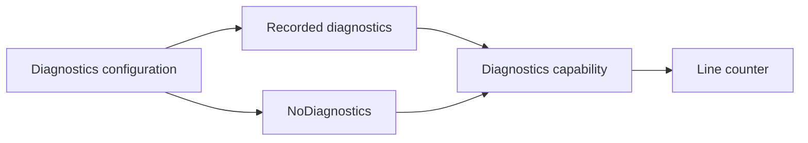

Null Object supplies a deliberate neutral implementation of a capability. A feature can call optional diagnostics without checking an optional logger at every line, while assembly explicitly chooses whether diagnostics are collected.

The important word is deliberate. Silently replacing a required dependency with a no-op can make failed work look successful and hide a configuration error.

<!--more-->

These Swift 5.7 examples use best-effort diagnostics and optional suggestions. They do not use a no-op to stand in for mandatory persistence, authorization, or auditing.

## Define a capability whose no-op is valid

```swift
enum DiagnosticEvent: Equatable {
    case started(lines: Int)
    case finished(nonempty: Int)
}
protocol Diagnostics {
    func record(_ event: DiagnosticEvent)
}
struct NoDiagnostics: Diagnostics {
    func record(_ event: DiagnosticEvent) {}
}
final class RecordedDiagnostics: Diagnostics {
    private(set) var events: [DiagnosticEvent] = []
    func record(_ event: DiagnosticEvent) { events.append(event) }
}

struct LineCounter {
    let diagnostics: any Diagnostics
    func count(_ lines: [String]) -> Int {
        diagnostics.record(.started(lines: lines.count))
        let nonempty = lines.filter { !$0.isEmpty }.count
        diagnostics.record(.finished(nonempty: nonempty))
        return nonempty
    }
}

let disabled = LineCounter(diagnostics: NoDiagnostics())
assert(disabled.count(["A", "", "B"]) == 2)
let recorder = RecordedDiagnostics()
let recorded = LineCounter(diagnostics: recorder)
assert(recorded.count(["A", "", "B"]) == 2)
assert(recorder.events == [.started(lines: 3), .finished(nonempty: 2)])
```

Both versions perform the same required calculation. Diagnostics are observational under this contract and may intentionally collect nothing.

The no-op is a stateless value. It needs no singleton identity, mutable flag, or special branch in `LineCounter`. The caller chooses it explicitly rather than relying on an absent optional to mean several different things.

## A neutral result can be data rather than void

```swift
protocol Suggesting {
    func suggestions(for query: String) -> [String]
}
struct DisabledSuggestions: Suggesting {
    func suggestions(for query: String) -> [String] { [] }
}
struct SearchPresentation {
    let suggestions: any Suggesting
    func rows(query: String) -> [String] { suggestions.suggestions(for: query) }
}
let plainSearch = SearchPresentation(suggestions: DisabledSuggestions())
assert(plainSearch.rows(query: "swift").isEmpty)
```

An empty suggestion list means the optional suggestion feature is disabled. It does not mean a required search service failed and the application chose to hide that failure.

The neutral value depends on the domain. Zero, false, an empty list, and successful `Void` are not universal substitutes for missing behavior.

## Empty results and unavailable results differ

A suggestions feature intentionally disabled by the account policy can validly return an empty list. A suggestions service that could not be reached has not established that no suggestions exist.

Using the same empty result for both states makes error handling easy to omit and can mislead the interface. Preserve failure or availability when it affects the user. An explicit policy can choose to suppress that distinction for a particular optional surface, but make the choice at the use-case boundary rather than burying it in a universal null service.

Names such as `DisabledSuggestions` help because they describe why the object is neutral. A type called `DefaultSuggestions` can hide whether it supplies real defaults, disables a feature, or masks a failure.

If a diagnostic recorder fails to initialize, choose explicitly between failing construction and reporting a permitted degraded mode. An unconditional `try? makeRecorder() ?? NoDiagnostics()` hides that policy decision.



## Neutral behavior must be defined by the consumer

A no-op diagnostics sink is neutral because the consumer's primary result does not depend on diagnostics being stored. Replacing the sink changes observability, but it does not make a successful line count false.

That judgment depends on context. In a regulated audit workflow, recording an event may be a required part of success. A no-op implementation would then violate the use case even if it conforms to the same logging protocol. The capability name “logger” does not settle whether omission is acceptable.

Write the consumer's postcondition before supplying a null implementation. If the postcondition requires durable evidence, a disabled sink cannot satisfy it. If diagnostics are explicitly optional, a no-op can remove repetitive branching while keeping the consumer focused on its main operation.

The same reasoning excludes fake successful persistence, authorization, or payment implementations when the consumer requires the corresponding real effect.

## Null Object and Optional communicate different facts

An optional dependency says the capability may be absent and lets the consumer branch on that absence. A Null Object says a valid implementation is present whose behavior is deliberately neutral.

Use Optional when absence changes required control flow or should be displayed. Use a neutral implementation when the consumer can follow the same algorithm and the chosen no-op is a valid policy.

For example, a form without an optional preview renderer can simply show no preview. A checkout without a required tax calculator cannot assume a zero amount unless that is an explicit supported tax policy.

## Avoid hidden mutable switches

A logger with `enabled = false` can provide similar behavior but introduces mutable shared state. One feature disabling it can affect another feature unexpectedly.

A configured stateless no-op value makes the selection stable for the consumer's lifetime. If the user can change the mode live, an owner can replace the capability or publish a new configuration under an isolation policy.

The pattern does not require a class hierarchy. Protocol-conforming structs or injected closures often express it with less lifetime complexity.

## Preserve the consumer's observability needs

A UI may need to show that suggestions are disabled rather than merely show an empty list. In that case, return or inject a separate feature-status value instead of asking consumers to inspect the concrete implementation type.

Testing `if service is DisabledSuggestions` inside feature code recreates concrete coupling the capability was meant to avoid. Model the status because it matters to the product, not because one class happens to implement no-op behavior.

Likewise, a diagnostic recorder's nonthrowing interface implies best-effort collection from the caller's perspective. A mandatory write with failure propagation deserves a different capability.

## Test neutral behavior alongside the required result

Verify the no-op does not change the calculation and the recording implementation sees the intended events. Include empty input and failure paths where the feature's policy requires a final event or deliberately omits it.

Do not infer correctness from a mock's default empty return value. A default stub can accidentally act as a Null Object without any explicit decision that the neutral result is valid.

## Test absence of effects without making absence invisible

For a no-op sink, test that the consumer returns the same primary result as it does with a recording sink. Also test that the recording sink receives expected diagnostics. Together these checks establish that diagnostics are optional and that the real integration has not disappeared accidentally.

At composition time, inspect which environments receive the no-op implementation. A development preview may intentionally disable telemetry, while production may require it. Accidentally wiring the preview dependency into production is a configuration error that protocol conformance will not catch.

Avoid an ever-growing hierarchy of null services that claim success for payments, persistence, authentication, and messaging. Those capabilities generally have outcomes the caller must observe. Null Object is strongest when it represents a deliberate neutral policy, not when it turns an unavailable dependency into a successful-looking response.

## Exercise: make fallback policy explicit

Build a diagnostics factory returning either enabled, deliberately disabled, or unavailable status. Let application assembly choose whether unavailable is fatal or degraded. Test that a feature requiring auditing cannot be constructed with the optional-diagnostics capability by mistake.

Compare [Dependency Injection](/swift-dependency-injection/) for selecting implementations without hidden global defaults.

Return to the [Design Patterns roadmap](/swift-design-patterns/).
