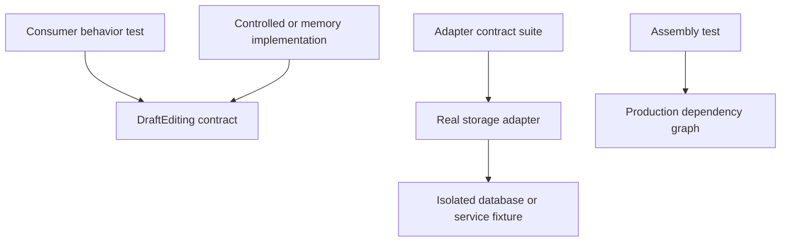

A testable architecture lets a test control important inputs and observe meaningful outcomes. Moving code out of a view controller helps only if clocks, storage, network results, and lifecycle are also controllable at the relevant boundary.

A fake that always succeeds can make a poor contract look easy to test. Stronger evidence comes from testing failure positions, interleavings, and the real adapters that claim to satisfy the contract.

<!--more-->

This Swift 5.7 example defines a versioned draft capability and runs a reusable contract suite against an in-memory adapter. It then explains what that evidence establishes and what a real database or network adapter still has to prove.

## Define an operation whose failure is meaningful

```swift
struct DraftRecord: Equatable {
    let title: String
    let revision: Int
}
enum DraftFailure: Error, Equatable { case emptyTitle, conflict, revisionExhausted }
protocol DraftEditing: AnyObject {
    func read() -> DraftRecord
    func save(title: String, expectedRevision: Int) throws -> DraftRecord
}
final class MemoryDraft: DraftEditing {
    private var record = DraftRecord(title: "Original", revision: 1)
    func read() -> DraftRecord { record }
    func save(title: String, expectedRevision: Int) throws -> DraftRecord {
        guard !title.isEmpty else { throw DraftFailure.emptyTitle }
        guard expectedRevision == record.revision else { throw DraftFailure.conflict }
        guard record.revision < Int.max else { throw DraftFailure.revisionExhausted }
        let saved = DraftRecord(title: title, revision: record.revision + 1)
        record = saved
        return saved
    }
}
```

The operation promises a conditional write. It cannot be implemented honestly as an unprotected read followed later by a write when concurrent writers exist. The in-memory implementation requires serialized access; a real adapter needs an equivalent atomic storage operation.

The capability does not expose database transactions or UI fields. That allows tests to exercise domain outcomes without constructing a scene. It does not make every possible adapter correct by virtue of protocol conformance.

## Test a contract through independent observations

```swift
func checkDraftContract(make: () -> any DraftEditing) throws {
    let store = make()
    let initial = store.read()
    let saved = try store.save(title: "Revised", expectedRevision: initial.revision)
    assert(saved.title == "Revised" && saved.revision > initial.revision)
    assert(store.read() == saved)
    do {
        _ = try store.save(title: "Obsolete", expectedRevision: initial.revision)
        assertionFailure("An obsolete writer must not overwrite the current draft")
    } catch DraftFailure.conflict {}
    assert(store.read() == saved)
    do {
        _ = try store.save(title: "", expectedRevision: saved.revision)
        assertionFailure("Invalid input must not change storage")
    } catch DraftFailure.emptyTitle {}
    assert(store.read() == saved)
    let independent = make()
    assert(independent.read() == initial)
}
try checkDraftContract(make: { MemoryDraft() })
```

Reading after a rejected write establishes that failure preserved the previous record. Checking only that an error was thrown would miss an implementation that changed storage and then threw.

The independent instance check is a contract of this test factory: each call supplies a fresh isolated store. A database fixture can provide a separate namespace or transaction per call. It should not reset a process-global database underneath other tests.

The suite uses `assert` for an executable article example. In a test target, use XCTest assertions that remain active in the chosen build configuration and report useful failure context.

## Keep consumer policy separate from adapter mechanics

```swift
struct EditorState: Equatable {
    var record: DraftRecord
    var message: String?
}
final class DraftEditor {
    private let store: any DraftEditing
    private(set) var state: EditorState
    init(store: any DraftEditing) {
        self.store = store
        state = EditorState(record: store.read())
    }
    func save(_ title: String) {
        do {
            let record = try store.save(title: title, expectedRevision: state.record.revision)
            state = EditorState(record: record, message: nil)
        } catch DraftFailure.conflict {
            state.message = "The draft changed elsewhere. Reload before saving."
        } catch {
            state.message = "The draft could not be saved."
        }
    }
}
let shared = MemoryDraft()
let editor = DraftEditor(store: shared)
_ = try shared.save(title: "External edit", expectedRevision: 1)
editor.save("My stale edit")
assert(editor.state.record.title == "Original")
assert(editor.state.message?.contains("changed elsewhere") == true)
assert(shared.read().title == "External edit")
```

The editor preserves its current local record on conflict and displays a decision-relevant message. Another design might refresh automatically or preserve an editable draft separately from the base revision. Whichever policy is chosen, test it explicitly rather than silently replacing the person's edit.

This consumer test is different from the adapter suite. It establishes how the feature reacts to conflict, not how storage detects it.

## Build an evidence matrix

| Boundary | Controlled inputs | Meaningful observation |
|---|---|---|
| Pure policy | Values and reference time | Result and invariant |
| Presentation model | Use-case outcomes and actions | Visible state and requested work |
| Storage adapter | Real isolated storage | Atomicity, constraints, rollback |
| Navigation adapter | Actual transitions | Stack, dismissal, child release |
| Assembled journey | User actions | End-to-end product outcome |



A fake can be useful even when it is simpler than production. It becomes dangerous when it violates the contract in ways tests rely on, such as never reporting conflicts or invoking callbacks on an executor production does not use.

## Make time and interleavings explicit

For asynchronous work, a controlled dependency should signal when it reaches a known suspension point. The test then performs the competing action and releases the delayed result. Sleeping for an arbitrary duration tests machine timing rather than the intended ordering.

Inject a clock or scheduler for debounce, retry, and expiration. Tests should advance time deliberately and observe which work starts, not wait for wall-clock seconds. Capture reference time once when several rules must agree on “now.”

Cancellation tests should deliver a late result even after the cancellation request. Otherwise the fake may hide an acceptance bug by deleting the only path that could expose it. Separate “the token was cancelled” from “the late result was rejected.”

## Test architecture claims, not private choreography

A claim that two windows have independent interaction state needs two window-scoped models in the same test. A claim that logout stops child work needs retained stale callbacks after logout. A claim that a persistence adapter can be replaced needs a conformance suite run against both implementations.

Assertions about every private helper call often make refactoring harder without proving those claims. Prefer observable state, effect requests, committed data, and lifecycle outcomes. Use interaction assertions when the interaction itself matters, such as proving a forbidden operation never reached storage.

Coverage can reveal unexercised code, but a covered branch can still have a weak assertion. Review which defect each test would catch. A useful test suite fails for a meaningful broken contract and remains stable under a behavior-preserving reorganization.

## Case study: a fake masks an uncertain write

A callback fake often reports either success or failure before changing its stored value. A remote service can commit a write and then lose the response. The caller sees failure or timeout even though storage changed.

If the consumer assumes every thrown error means “nothing happened,” it may retry with a new operation ID and duplicate an effect. A stronger contract distinguishes known rejection from uncertain completion, or provides idempotent retry and a reconciliation lookup.

Model that failure explicitly in a controlled adapter: commit, withhold the response, then report a transport failure. Verify the caller does not invent a definitive rollback. If retry uses the same operation ID, run the adapter contract against the real deduplication boundary as well.

This is why isolated consumer tests and real adapter tests complement each other. A fake can expose the consumer's policy, while storage tests establish what actually commits atomically. Neither proves the other's responsibility.

Use mutation-oriented review when assessing assertions. Imagine an adapter that writes before validating, a presenter that treats conflict as success, or an owner that ignores cancellation. Identify which test would fail and why. If none would, the suite may execute the path without protecting the contract.

Test diagnostics matter too. A deterministic test should reveal the controlled interleaving and expected outcome when it fails. Avoid broad retries that turn a race into an occasional pass; fix the uncontrolled timing or the acceptance rule instead.

## Exercise: run the contract against a persistent store

Implement `DraftEditing` with a real isolated store and run the same suite. Add two concurrent conditional writes using the same base revision and verify exactly one succeeds. Then add a response-loss scenario to distinguish an operation known to fail from one whose commit status is uncertain.

Return to the [App Architectures roadmap](/swift-architectures/).
