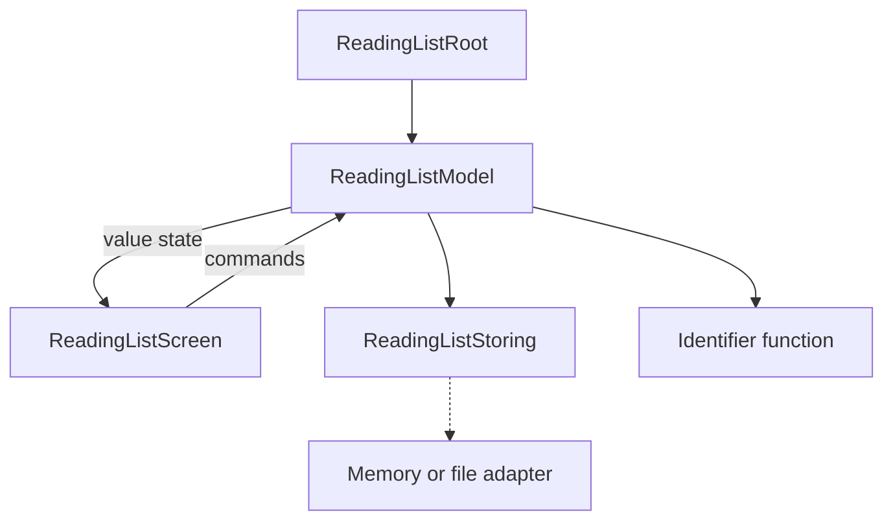

A useful protocol-oriented example should do more than print two interchangeable greetings. It should own state, reject invalid input, perform a replaceable effect, and behave predictably when that effect fails.

This reading-list feature adds books and toggles their read status. A SwiftUI screen renders one model, a small storage protocol isolates persistence, and value snapshots keep proposed changes separate from accepted state. The complete examples target Swift 6 and a modern SwiftUI toolchain.

<!--more-->

## State the product rules first

A new item needs a nonblank title. Every item has a stable identifier independent of its title. Toggling one item must not change another. A failed save must preserve the list the user previously saw, and the input should remain available for another attempt.

These rules tell us where boundaries belong. Titles and item snapshots are values. One observable model owns the screen's current state. Storage is a capability because production and tests need different effects. Identifier creation is a function because it is one source of nondeterminism.

This is a complete small feature, with a runnable in-memory store and a SwiftUI screen. Disk persistence is an adapter exercise rather than an untested network call hidden behind a synchronous signature.

## Keep the domain values concrete

```swift
import Foundation
import SwiftUI

struct ReadingItem: Identifiable, Equatable {
    let id: UUID
    let title: String
    var isRead: Bool
}

struct ReadingListState: Equatable {
    var items: [ReadingItem] = []
    var message: String?
    var loaded = false
}
```

An item does not need a protocol merely because the feature uses protocol-oriented design elsewhere. Its concrete fields already form a useful snapshot.

Identity uses a UUID, so two books with the same title can remain distinct. Equality compares the whole snapshot, including read status. That separates “the same list row” from “the same current content.”

The state contains values rather than mutable service references. Copying a proposed item array therefore preserves the observable independence needed before a save is accepted.

## Define the persistence guarantee the model needs

```swift
@MainActor
protocol ReadingListStoring: AnyObject {
    func load() throws -> [ReadingItem]
    // A failed replacement must preserve the previously stored list.
    func replace(_ items: [ReadingItem]) throws
}

enum ReadingStoreFailure: Error { case unavailable }

@MainActor
final class MemoryReadingStore: ReadingListStoring {
    private var items: [ReadingItem]
    var rejectsWrites = false
    private(set) var writeAttempts = 0

    init(items: [ReadingItem] = []) { self.items = items }
    func load() -> [ReadingItem] { items }

    func replace(_ proposed: [ReadingItem]) throws {
        writeAttempts += 1
        guard !rejectsWrites else { throw ReadingStoreFailure.unavailable }
        items = proposed
    }
}
```

The store deliberately exposes a whole-list replacement. That makes the model's transaction boundary small and explicit. A real file adapter might encode the snapshot and use an atomic replacement operation; it must honor the same failure guarantee.

Main-actor isolation fits this in-memory UI example. Do not implement blocking remote or large disk operations under this synchronous interface. An asynchronous storage contract needs additional loading, cancellation, and stale-result rules, while the value snapshots can remain useful.

The fault switch is specific to the teaching store. It makes a failure deterministic without changing global state or waiting for a server to fail.

## Let one model own accepted state

```swift
@MainActor
final class ReadingListModel: ObservableObject {
    @Published private(set) var state = ReadingListState()
    private let store: any ReadingListStoring
    private let nextID: () -> UUID

    init(store: any ReadingListStoring, nextID: @escaping () -> UUID = UUID.init) {
        self.store = store
        self.nextID = nextID
    }

    func loadIfNeeded() {
        guard !state.loaded else { return }
        do {
            let items = try store.load()
            guard Set(items.map(\.id)).count == items.count else {
                state.message = "The saved list contains duplicate identifiers"
                return
            }
            state = ReadingListState(items: items, message: nil, loaded: true)
        } catch {
            state.message = "Could not load your reading list"
        }
    }

    func add(title: String) {
        guard state.loaded else {
            state.message = "Load the reading list first"
            return
        }
        let cleaned = title.trimmingCharacters(in: .whitespacesAndNewlines)
        guard !cleaned.isEmpty else {
            state.message = "Enter a title"
            return
        }
        let id = nextID()
        guard !state.items.contains(where: { $0.id == id }) else {
            state.message = "Could not create a unique item"
            return
        }
        save(state.items + [ReadingItem(id: id, title: cleaned, isRead: false)])
    }

    func toggle(id: UUID) {
        guard state.loaded else { return }
        guard let index = state.items.firstIndex(where: { $0.id == id }) else {
            state.message = "This item is no longer available"
            return
        }
        var proposed = state.items
        proposed[index].isRead.toggle()
        save(proposed)
    }

    private func save(_ proposed: [ReadingItem]) {
        do {
            try store.replace(proposed)
            state = ReadingListState(items: proposed, message: nil, loaded: true)
        } catch {
            state.message = "Could not save that change"
        }
    }
}
```

The model calculates a proposed list, asks storage to accept it, then publishes the new snapshot. Failure updates only the message. It does not leave a toggled in-memory row that disagrees with storage.

`loadIfNeeded` avoids resetting accepted state on repeated SwiftUI appearances. A failed initial load can be retried because `loaded` remains false. Duplicate saved identifiers are rejected before the list is accepted, protecting the identity assumption the UI relies on.

Identifier generation is injected so tests can reproduce exact items. The duplicate check also establishes a defined failure if a faulty generator returns an existing ID. A UUID makes collisions unlikely; it does not justify leaving the model's invariants undefined.

## Give SwiftUI a rendering role

```swift
struct ReadingListScreen: View {
    @ObservedObject var model: ReadingListModel
    @State private var newTitle = ""

    var body: some View {
        VStack {
            HStack {
                TextField("Book title", text: $newTitle)
                Button("Add") {
                    model.add(title: newTitle)
                    if model.state.message == nil { newTitle = "" }
                }
                .disabled(!model.state.loaded)
            }
            List(model.state.items) { item in
                HStack {
                    Text(item.title)
                    Spacer()
                    Button(item.isRead ? "Mark unread" : "Mark read") {
                        model.toggle(id: item.id)
                    }
                }
            }
            if let message = model.state.message {
                Text(message).foregroundStyle(.red)
                if !model.state.loaded {
                    Button("Retry loading") { model.loadIfNeeded() }
                }
            }
        }
        .padding()
        .task { model.loadIfNeeded() }
    }
}

struct ReadingListRoot: View {
    @StateObject private var model: ReadingListModel

    @MainActor
    init(store: any ReadingListStoring) {
        _model = StateObject(wrappedValue: ReadingListModel(store: store))
    }

    var body: some View { ReadingListScreen(model: model) }
}
```

The root establishes observable-object ownership with `StateObject`. The child observes the supplied model. Constructing a fresh model inside the child's `body` would risk resetting state when SwiftUI reevaluates the view hierarchy.

The screen keeps unsaved text in local `State`. It clears that text only after the model reports a successful operation. A failed save leaves the input available, matching the stated product rule.

The UI does not know whether storage is a dictionary, a file, or a test recorder. It also does not navigate through a service locator to discover dependencies during rendering.

## Assemble a preview with an explicit lifetime

At the application's composition root, construct one `MemoryReadingStore` and pass it to `ReadingListRoot(store:)`. Place that root in your app's window or navigation flow. Its `StateObject` keeps the model stable for that root's identity.

The memory store intentionally loses data when that owner disappears. That is suitable for a preview or a test, not durable storage. A production adapter can preserve the same whole-list contract while adding encoding and atomic file replacement.

Do not make the store a global singleton simply to preserve data across view recreation. Persistence lifetime and view lifetime are different concerns. Decide which owner retains the store and where the durable data lives.



## Test without launching the UI

```swift
@MainActor
func checkReadingListFeature() throws {
    let firstID = UUID(uuidString: "00000000-0000-0000-0000-000000000001")!
    let secondID = UUID(uuidString: "00000000-0000-0000-0000-000000000002")!
    var identifiers = [firstID, secondID].makeIterator()
    let store = MemoryReadingStore()
    let model = ReadingListModel(store: store, nextID: { identifiers.next()! })

    model.loadIfNeeded()
    assert(model.state.loaded)
    model.add(title: "  Protocols  ")
    assert(model.state.items == [ReadingItem(id: firstID, title: "Protocols", isRead: false)])
    assert(store.writeAttempts == 1)

    model.add(title: " \n ")
    assert(model.state.message == "Enter a title")
    assert(store.writeAttempts == 1)

    model.toggle(id: firstID)
    assert(model.state.items[0].isRead)
    let beforeFailure = model.state.items
    store.rejectsWrites = true
    model.toggle(id: firstID)
    assert(model.state.items == beforeFailure)
    assert(model.state.message == "Could not save that change")
    let storedAfterFailure = try store.load()
    assert(storedAfterFailure == beforeFailure)

    store.rejectsWrites = false
    model.add(title: "Generics")
    assert(model.state.items.map(\.id) == [firstID, secondID])
    assert(model.state.message == nil)
    model.loadIfNeeded()
    assert(model.state.items.count == 2)
}
try checkReadingListFeature()
```

The test controls identity and failure directly. It proves validation prevents a storage attempt, a rejected save preserves both visible and stored state, and a later valid change can recover.

The finite identifier iterator is a focused test fixture. Its forced unwrap represents the test's known number of ID requests; production construction uses UUID generation. If the model unexpectedly creates another identifier, the fixture fails rather than quietly masking that interaction change.

## Extend the adapter boundary carefully

A file store should test missing files, corrupted data, duplicate IDs, encoding failure, and replacement failure. Decide whether a missing file means an empty initial list or an error; the adapter must implement the chosen policy consistently.

For multiple simultaneous editors, whole-list replacement can overwrite another editor's changes. Add a revision token and conditional save when that is a real requirement. A protocol does not make read-modify-write sequences transactional across independently loaded owners.

For asynchronous storage, accept or reject late outcomes according to a request generation or operation identifier. Cancelling a task may not prevent a completion already in flight. Keep the model's acceptance rule separate from the transport's cancellation mechanism.

## Evaluate what POP contributed

The storage protocol isolates an effect and makes a failure controllable. The model remains a concrete class because it owns observable identity and state. Items remain concrete values because independent proposals and comparisons matter. Identifier creation remains a small function because a larger service interface would add little.

There is no protocol for the view, item, state, or model merely for consistency. Each abstraction has a consumer and an observable benefit.

As an exercise, add deletion with the same save-before-publish rule. Test deleting an unknown identifier, a failed deletion save, and deleting one of two identically titled items. The stable ID should determine which item changes. If that extension can be understood without rewriting the storage and presentation boundaries, the design is doing useful work.

## Worked extension: delete by identity with the same commit rule

Deletion can reuse the model's existing save boundary. Place this extension in the same file as the model so it can access that model's private save operation:

```swift
extension ReadingListModel {
    func remove(id: UUID) {
        guard state.loaded else { return }
        guard state.items.contains(where: { $0.id == id }) else {
            state.message = "This item is no longer available"
            return
        }
        save(state.items.filter { $0.id != id })
    }
}

@MainActor
func checkReadingListDeletion() throws {
    let first = UUID(uuidString: "00000000-0000-0000-0000-000000000011")!
    let second = UUID(uuidString: "00000000-0000-0000-0000-000000000012")!
    let originals = [
        ReadingItem(id: first, title: "Same title", isRead: false),
        ReadingItem(id: second, title: "Same title", isRead: true)
    ]
    let store = MemoryReadingStore(items: originals)
    let model = ReadingListModel(store: store)
    model.loadIfNeeded()
    store.rejectsWrites = true
    model.remove(id: first)
    assert(model.state.items == originals)
    let unchangedStorage = try store.load()
    assert(unchangedStorage == originals)

    store.rejectsWrites = false
    model.remove(id: first)
    assert(model.state.items == [originals[1]])
    let attempts = store.writeAttempts
    model.remove(id: first)
    assert(store.writeAttempts == attempts)
    assert(model.state.items == [originals[1]])
}
try checkReadingListDeletion()
```

The two items share a title, so a title-based removal would be ambiguous. Stable identity selects exactly one row. A rejected save leaves both rows present; a repeated removal reports absence without another write attempt.

The SwiftUI row can call `remove(id:)` from a delete control. Pass the item's identifier rather than a retained array index. An index captured before another edit may refer to a different item later, while the identifier expresses the intended entity.

A duplicate-ID load is a different failure. The model rejects that saved list before enabling editing because it cannot safely identify individual rows. A production adapter should also validate its decoded schema, but the model's check preserves the invariant at the point the UI accepts the data.

No new storage protocol or factory was needed for deletion. The existing whole-list replacement already matches the feature's transaction boundary. That is a useful test of the design: a related command reuses an honest capability without inventing a new layer merely to represent another button.

Continue through the [Protocol-Oriented Programming roadmap](/swift-protocol-oriented-programming/).
