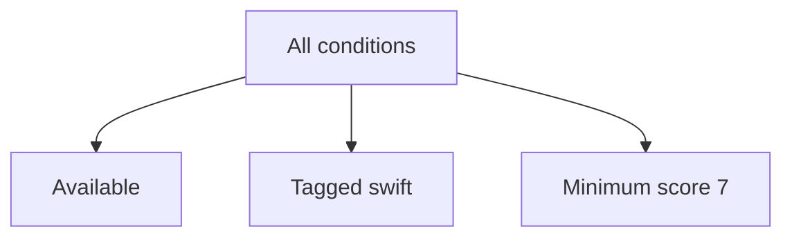

Specification represents a rule that can be evaluated against a candidate and composed with other rules. A catalog filter such as “available Swift books with score at least seven” can become a named policy rather than a long condition repeated across screens.

The interesting decisions are whether rules are pure, whether evaluation short-circuits, and whether the rule must be inspected or translated rather than merely executed.

<!--more-->

These Swift 5.7 examples compare a function-backed generic specification with a structured domain rule tree. Both can evaluate the same policy, but they preserve different information.

## Compose executable predicates

```swift
struct Specification<Value> {
    let isSatisfied: (Value) -> Bool
    func and(_ other: Specification<Value>) -> Specification<Value> {
        Specification { value in self.isSatisfied(value) && other.isSatisfied(value) }
    }
    func or(_ other: Specification<Value>) -> Specification<Value> {
        Specification { value in self.isSatisfied(value) || other.isSatisfied(value) }
    }
    var negated: Specification<Value> {
        Specification { !self.isSatisfied($0) }
    }
}

struct CatalogBook {
    let id: Int
    let score: Int
    let tags: Set<String>
    let available: Bool
}
let available = Specification<CatalogBook> { $0.available }
let swift = Specification<CatalogBook> { $0.tags.contains("swift") }
let wellRated = Specification<CatalogBook> { $0.score >= 7 }
let recommended = available.and(swift).and(wellRated)
let books = [
    CatalogBook(id: 1, score: 9, tags: ["swift"], available: true),
    CatalogBook(id: 2, score: 8, tags: ["swift"], available: false),
    CatalogBook(id: 3, score: 6, tags: ["design"], available: true)
]
assert(books.filter(recommended.isSatisfied).map { $0.id } == [1])
```

Each specification can be named and tested independently. Generic composition preserves the candidate type, so a rule for books cannot accidentally receive an unrelated account value.

The closure can still read global state or mutate a reference. Purity is a behavioral requirement, not a property supplied by wrapping it in `Specification`.

## Short-circuiting is part of the contract

`and` stops when its first rule is false; `or` stops when its first rule is true. That can save work and is observable if predicates perform effects.

A rule should normally evaluate stable facts. If eligibility depends on time, pass a timestamp in the evaluation context or bind a stable policy version when constructing the specification.

Reordering pure Boolean rules preserves the truth value under the usual laws. Reordering effectful rules can change logging, queries, and mutations. Do not use a specification chain as an accidental sequence of required external actions.

## Test laws over a meaningful domain

```swift
for book in books {
    assert(available.and(available).isSatisfied(book) == available.isSatisfied(book))
    assert(available.and(swift).negated.isSatisfied(book) ==
           available.negated.or(swift.negated).isSatisfied(book))
    assert(available.or(swift).isSatisfied(book) == swift.or(available).isSatisfied(book))
}
```

These bounded checks illustrate idempotence, De Morgan's law, and commutativity for pure predicates. Generated fixtures can explore score boundaries and tag combinations more broadly.

A law test should not replace examples of the product policy. A score threshold accidentally set to eight can still satisfy every Boolean algebra law while rejecting a legitimate score-seven book.

## Executable closures cannot explain themselves

A function-backed specification is easy to call but difficult to serialize, display in a filter editor, or translate into another query language. A description string attached by hand can drift from the actual predicate.

A structured rule preserves intent:

```swift
indirect enum CatalogRule {
    case available
    case tagged(String)
    case minimumScore(Int)
    case all([CatalogRule])
    case any([CatalogRule])
    case not(CatalogRule)

    func matches(_ book: CatalogBook) -> Bool {
        switch self {
        case .available: return book.available
        case let .tagged(tag): return book.tags.contains(tag)
        case let .minimumScore(score): return book.score >= score
        case let .all(rules): return rules.allSatisfy { $0.matches(book) }
        case let .any(rules): return rules.contains { $0.matches(book) }
        case let .not(rule): return !rule.matches(book)
        }
    }
}
let rule = CatalogRule.all([.available, .tagged("swift"), .minimumScore(7)])
for book in books { assert(rule.matches(book) == recommended.isSatisfied(book)) }
assert(CatalogRule.all([]).matches(books[0]))
assert(!CatalogRule.any([]).matches(books[0]))
```

The empty conjunction is true and the empty disjunction false. Those are logical identities. A UI that requires at least one selected filter should validate that requirement separately instead of changing the rule algebra accidentally.



## Translation requires a semantic agreement

The structured `CatalogRule` can be interpreted in memory or translated into a query language, but matching syntax is only the first step. A database's handling of nulls, case folding, locale-sensitive comparison, and numeric precision may differ from Swift's evaluator.

An empty conjunction is true and an empty disjunction is false in this example. A query adapter must preserve those identities rather than emit an invalid empty `IN` clause or omit a condition that changes the result.

Use a shared conformance fixture: evaluate records in memory, query equivalent stored records through the adapter, and compare the selected IDs. Include missing optional fields, Unicode tags, and boundary scores. If the back end cannot express a rule, report unsupported translation or perform a clearly bounded post-filter; silently dropping the rule can return unauthorized or ineligible records.

Specifications are useful reusable policy values. They do not replace the transaction or authorization boundary at which a final decision must be enforced against authoritative data.

A query translator must also use parameterized operations. Never interpolate user-supplied tag text into SQL fragments. Arbitrary Swift closures cannot generally be translated; the structured rule language defines the supported subset.

## Boolean composition does not compose explanations

A predicate answers whether a value satisfies a rule. A form or eligibility screen may also need to explain which requirements failed. Returning only `false` loses that information, and short-circuit evaluation can skip rules whose explanations would be useful.

Keep evaluation modes explicit. A fast eligibility check can stop at the first failure. A diagnostic evaluation can collect independent failures in a defined order. Some validations are dependent: checking a date range may require successfully parsing both dates first. Evaluating every rule indiscriminately can produce misleading secondary errors.

One design returns a structured explanation tree parallel to the rule tree. Another separates validation stages from Boolean specifications. The important point is to define what conjunction and disjunction mean for explanations before promising a generic error-combining API.

Represent evaluation failure separately from a negative result. Negating “service unavailable” must not make an entity eligible.

## Keep rule dependencies visible

A specification can capture a small immutable policy, such as the minimum score. Capturing a large service locator hides dependencies and makes repeated evaluation potentially expensive or stateful.

If many candidates share a lookup dataset, take an immutable snapshot once and evaluate against it. Include its version in any cached rule result. A cache keyed only by book ID is wrong when policy or availability changes.

## Purity makes the algebra useful

The Boolean laws tested above assume predicates behave like functions of their input. If evaluating a specification increments a counter, reads the current clock, or performs a network request, equivalent-looking rewrites may change effects or observe different facts.

For a time-sensitive rule, capture a reference time once and evaluate all candidates against that value. For account eligibility, obtain the relevant account snapshot before applying pure rules. This makes evaluation reproducible and allows caching or reordering only where those operations preserve semantics.

Short-circuiting is still observable when predicates have effects. Do not reorder predicates merely because conjunction is mathematically commutative unless the predicates satisfy the purity assumptions required by that reasoning.

## Exercise: add rejection reasons

Create a rule evaluator returning named failures for each unsatisfied leaf in an `all` group. Define how `any` and `not` explain rejection without inventing misleading reasons. Test the score-seven boundary and compare local evaluation with a deliberately small query interpreter using the same null and text policies.

See [Higher-Order Functions](/swift-higher-order-functions/) and [Applicative Validation](/swift-functors-applicatives-monads/) for related composition techniques.

Return to the [Design Patterns roadmap](/swift-design-patterns/).
