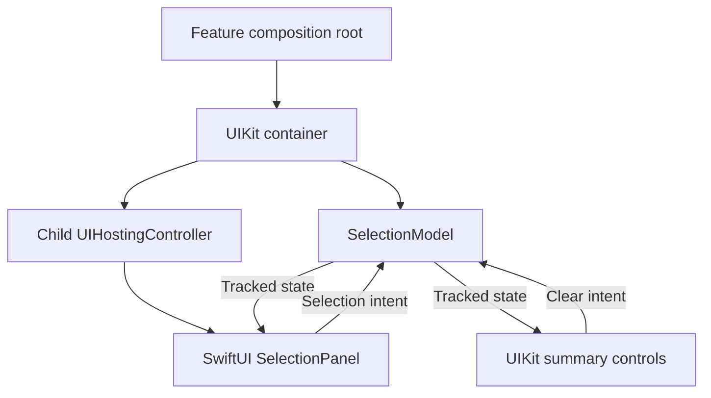

UIKit and SwiftUI differ in rendering and lifecycle mechanics, but neither decides who owns application state. A hybrid feature is easiest to reason about when one owner supplies state and both renderers use the same intent contract.

The dangerous bridge is a second writable copy: a UIKit controller stores one selection, a SwiftUI view stores another, and callbacks try to keep them synchronized. Small omissions then become contradictory screens.

<!--more-->

This January 2025 example uses Swift 5.9, native Observation, and iOS 17 or macOS 14 for its model and SwiftUI view. Its conditional UIKit container requires iOS 17. The deployment requirements are explicit because Observation is not available natively on earlier systems.

## Put shared authority in one model

```swift
import Observation
import SwiftUI

@available(macOS 14, iOS 17, *)
@MainActor
@Observable
final class SelectionModel {
    let validIDs: [Int]
    private(set) var selected: Set<Int> = []
    init(validIDs: [Int]) {
        precondition(Set(validIDs).count == validIDs.count)
        self.validIDs = validIDs
    }
    func setSelected(_ enabled: Bool, id: Int) {
        guard validIDs.contains(id) else { return }
        if enabled { selected.insert(id) } else { selected.remove(id) }
    }
    func clear() { selected.removeAll() }
}

@available(macOS 14, iOS 17, *)
@MainActor
struct SelectionPanel: View {
    let model: SelectionModel
    var body: some View {
        List(model.validIDs, id: \.self) { id in
            Toggle("Book \(id)", isOn: Binding(
                get: { model.selected.contains(id) },
                set: { model.setSelected($0, id: id) }
            ))
        }
    }
}
```

The binding getter reads authoritative state. Its setter expresses an intent through a validated method. There is no second local `@State` set that needs synchronization with UIKit.

Using an idempotent setter rather than a toggle operation matters. A repeated `setSelected(true)` should remain selected; a repeated toggle would undo the first event. Framework adapters should preserve the meaning of the interaction rather than assume every setter call is a unique tap.

The model is main-actor isolated. Native Observation tracks reads; it does not itself make arbitrary mutation thread-safe or choose the executor for a network callback.

## Let UIKit own a SwiftUI child through real containment

```swift
#if canImport(UIKit)
import UIKit

@available(iOS 17, *)
@MainActor
final class SelectionContainer: UIViewController {
    let model: SelectionModel
    private let status = UILabel()
    private let clearButton = UIButton(type: .system)
    private var active = true

    init(model: SelectionModel) {
        self.model = model
        super.init(nibName: nil, bundle: nil)
    }
    required init?(coder: NSCoder) { return nil }

    override func viewDidLoad() {
        super.viewDidLoad()
        view.backgroundColor = .systemBackground
        clearButton.setTitle("Clear selection", for: .normal)
        clearButton.addAction(UIAction { [weak self] _ in self?.model.clear() }, for: .touchUpInside)
        let header = UIStackView(arrangedSubviews: [status, clearButton])
        header.axis = .horizontal
        let hosted = UIHostingController(rootView: SelectionPanel(model: model))
        addChild(hosted)
        let column = UIStackView(arrangedSubviews: [header, hosted.view])
        column.axis = .vertical
        column.translatesAutoresizingMaskIntoConstraints = false
        view.addSubview(column)
        NSLayoutConstraint.activate([
            column.leadingAnchor.constraint(equalTo: view.safeAreaLayoutGuide.leadingAnchor),
            column.trailingAnchor.constraint(equalTo: view.safeAreaLayoutGuide.trailingAnchor),
            column.topAnchor.constraint(equalTo: view.safeAreaLayoutGuide.topAnchor),
            column.bottomAnchor.constraint(equalTo: view.safeAreaLayoutGuide.bottomAnchor)
        ])
        hosted.didMove(toParent: self)
        observeAndRender()
    }
    private func observeAndRender() {
        guard active else { return }
        withObservationTracking {
            status.text = "\(model.selected.count) selected"
            clearButton.isEnabled = !model.selected.isEmpty
        } onChange: { [weak self] in
            Task { @MainActor [weak self] in self?.observeAndRender() }
        }
    }
    func stopObserving() { active = false }
}
#endif
```

Containment uses `addChild`, installs the hosted view, and calls `didMove`. Merely adding a hosting controller's view as a subview omits the controller relationship that UIKit uses for lifecycle and appearance behavior.

The container retains its model, and the hosted view receives the same reference. SwiftUI tracks the selection reads in its body. UIKit needs an explicit observation loop for its label and button.

The invalidation callback schedules re-reading on the main actor after mutation rather than reading during the will-change notification. Tracking is re-established on each pass. Several changes can coalesce into one render, which is appropriate for current state; this is not an event-delivery mechanism.

`stopObserving` prevents future scheduled passes from rearming. It does not remove the hosted feature or cancel unrelated work. The owning flow must call it when this container's logical feature ends and perform the corresponding navigation teardown.

## Test authority independently of either renderer

```swift
if #available(macOS 14, iOS 17, *) {
    await MainActor.run {
        let model = SelectionModel(validIDs: [1, 2])
        let panel = SelectionPanel(model: model)
        assert(panel.model === model)
        model.setSelected(true, id: 1)
        model.setSelected(true, id: 1)
        assert(model.selected == [1])
        model.setSelected(true, id: 999)
        assert(model.selected == [1])
        model.clear()
        assert(model.selected.isEmpty)
    }
}
```

These assertions establish identity sharing and the intent's domain behavior. They do not prove a toggle is wired or that the UIKit status label updates. A small iOS integration test should interact through the actual controls and inspect the resulting shared state and visible presentation.

Test both directions: selecting in SwiftUI changes the UIKit summary; clearing through UIKit changes the SwiftUI toggles. Also test teardown while an observation pass is queued.

## Draw authority, rendering, and lifetime



A hosting controller is a rendering bridge, not a new architecture layer with permission to duplicate domain state. Keep application capabilities in the feature graph and let the bridge translate framework lifecycle and input.

## Understand the inverse bridge too

A SwiftUI `UIViewRepresentable` or `UIViewControllerRepresentable` creates a UIKit object once for a particular identity, then updates it as input values change. Its coordinator can translate delegate callbacks into current closures or bindings.

Refresh the coordinator's inputs in the update method when they can change. Capturing an initial closure forever can send events into an old account or old selection even while the visible UIKit object shows new data.

Dismantling must clear delegates or stop work owned by that representable. Do not stop a service shared by several feature instances merely because one rendering wrapper disappears.

## Keep navigation under one policy owner

Embedding a `NavigationStack` inside a UIKit navigation flow can be valid, but two independent owners must not both push the same logical destination. Decide which layer owns the journey and which layer owns only local navigation.

Report actual back and dismissal outcomes to the flow owner. A SwiftUI view disappearing during a transition does not necessarily mean the whole feature ended, and a UIKit controller's deallocation is not an adequate substitute for explicit cancellation.

Stable identity is equally important when an account changes. If the model's dependencies are account-scoped, replace the feature graph or use a deliberate reconfiguration operation. Reusing one UI container while silently changing a global account can let old callbacks target new state.

## Case study: a reusable UIKit view holds an old closure

A representable coordinator may outlive several SwiftUI value reconstructions. If it captures a model only during creation, later updates can render new content while delegate callbacks still mutate the original model.

Refresh the coordinator's current callback or model reference in the update method. When the owning identity changes, also invalidate callbacks already queued for the old identity. Updating a property is not enough if an asynchronous operation captured the previous value earlier.

The inverse problem appears in a UIKit host that replaces its SwiftUI root view while accidentally retaining old observation loops. Both old and new renderers can remain connected to state, producing unnecessary work or navigation from an invisible feature.

A bridge test should therefore change input without destroying the framework object. Verify the next user event reaches the current owner, then deliberately deliver a queued event from the old owner and verify its acceptance policy. A test that recreates everything each time cannot expose stale coordinator captures.

Also preserve accessibility responsibility across the boundary. Hosting a view does not eliminate the need to test focus order, labels, Dynamic Type, and container behavior. A correct shared state model can still be presented through an unusable hybrid layout.

Keep those integration tests small and representative. Model tests can cover the broad state space, while the bridge tests establish containment, callback freshness, and actual control wiring. This provides stronger evidence than repeating every domain scenario through an expensive UI test.

## Exercise: bridge a UIKit text editor into SwiftUI

Implement a representable whose text getter reads one authoritative model and whose delegate sends edits through an intent method. Update the coordinator when its model changes, avoid sending an edit during programmatic rendering, and verify a queued old delegate callback cannot modify a newly installed account model.

Apple describes the rendering bridge in [`UIHostingController`](https://developer.apple.com/documentation/swiftui/uihostingcontroller) and native dependency tracking in [Discover Observation in SwiftUI](https://developer.apple.com/videos/play/wwdc2023/10149/).

Return to the [App Architectures roadmap](/swift-architectures/).
