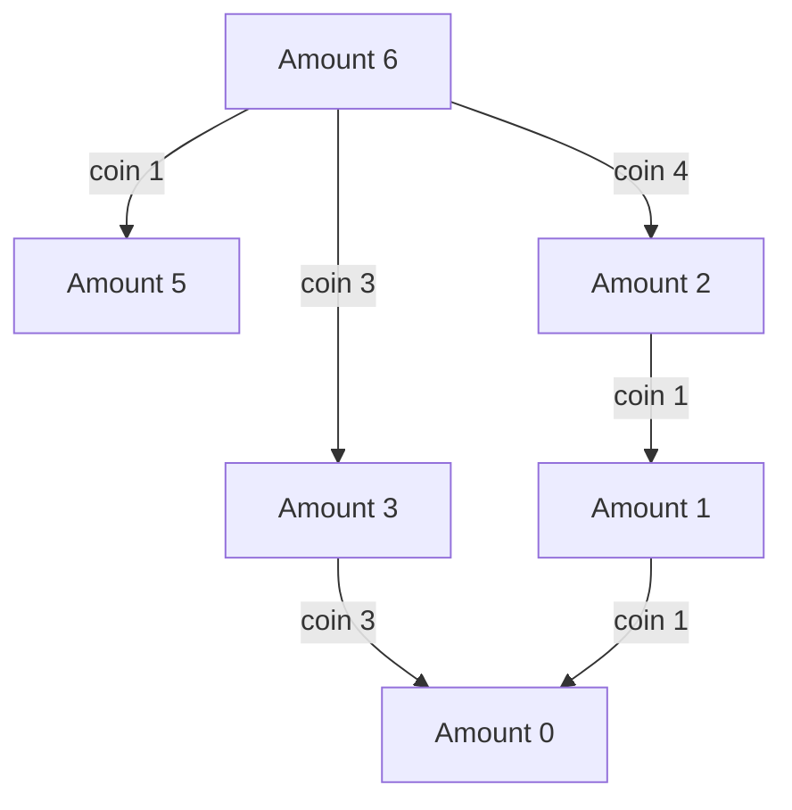

Dynamic programming solves a problem by defining states, expressing each state in terms of smaller states, and reusing their results. A table is an implementation detail; the state meaning and recurrence are the design.

Minimum coin change is a useful example because a plausible greedy strategy can fail. With coins `1, 3, 4`, paying six greedily uses `4 + 1 + 1`, while the optimum is `3 + 3`.

<!--more-->

These Swift 5.7 examples return an actual minimum-length coin selection, distinguish unreachable amounts, and reject invalid denominations. The algorithm allows unlimited use of each denomination.

## Define a state that contains enough information

Let `F(a)` be the minimum number of coins needed for amount `a`. The last selected coin must be one of the denominations no larger than `a`:

$$
F(0)=0,\qquad F(a)=1+\min_{c\le a}F(a-c).
$$

Unreachable subamounts do not contribute candidates. A Swift optional represents that absence more safely than a large sentinel that might overflow when incremented.

The recurrence is valid because after choosing the last coin, the remaining task is the same problem for a smaller amount. Positive denominations ensure progress; zero or negative denominations would invalidate the dependency structure.

## Fill states in a dependency-respecting order



The path from six to three to zero gives two coins. The diagram shows selected dependencies; the table evaluates every legal smaller-amount transition.

```swift
enum CoinFailure: Error { case invalidInput, budgetExceeded }

func minimumCoins(amount: Int, denominations: [Int]) throws -> [Int]? {
    guard amount >= 0, denominations.allSatisfy({ $0 > 0 }) else {
        throw CoinFailure.invalidInput
    }
    guard amount <= 1_000_000 else { throw CoinFailure.budgetExceeded }
    if amount == 0 { return [] }
    let coins = Set(denominations).sorted()
    var count = Array<Int?>(repeating: nil, count: amount + 1)
    var choice = Array<Int?>(repeating: nil, count: amount + 1)
    count[0] = 0
    for subtotal in 1...amount {
        for coin in coins where coin <= subtotal {
            guard let earlier = count[subtotal - coin] else { continue }
            let candidate = earlier + 1
            if count[subtotal] == nil || candidate < count[subtotal]! {
                count[subtotal] = candidate
                choice[subtotal] = coin
            }
        }
    }
    guard count[amount] != nil else { return nil }
    var selected: [Int] = []
    var remaining = amount
    while remaining > 0 {
        let coin = choice[remaining]!
        selected.append(coin)
        remaining -= coin
    }
    return selected
}

let optimal = try minimumCoins(amount: 6, denominations: [1, 3, 4])
assert(optimal == [3, 3])
let impossible = try minimumCoins(amount: 7, denominations: [4, 6])
assert(impossible == nil)
let zero = try minimumCoins(amount: 0, denominations: [])
assert(zero == [])
```

The one-million limit is an explicit demonstration resource policy, not a mathematical requirement. It prevents a public amount from directly requesting an arbitrarily large allocation. Applications should choose a budget from their own workload and memory limits.

Each dependency `subtotal - coin` is smaller than the current subtotal, so increasing-amount order has already computed it. Sorting unique denominations gives deterministic tie handling under strict improvement.

## Reconstruction requires retaining decisions

The minimum count alone does not explain which coins achieve it. `choice[a]` stores a coin selected by an improving transition. Following those choices reduces the remaining amount until zero.

The unwrap follows from a reachable positive state's construction: a finite count is assigned only together with a choice. If the representation is later made externally writable, that invariant needs protection.

Several optimal selections may exist. This implementation returns one according to its iteration and strict-improvement policy. A requirement to minimize large coins, prefer certain denominations, or enumerate all optimal answers needs additional state or a different tie rule.

## Overlapping subproblems explain the benefit

A naive recursive search can recompute the same remaining amount through many different coin sequences. Memoization caches each amount's result; tabulation fills all states in advance.

Top-down memoization may skip unreachable regions of the state space but uses recursive call depth. Bottom-up tabulation makes iteration and storage straightforward but computes states the final solution might never use.

Both depend on the same recurrence. A memoized incorrect state definition remains incorrect, and a table filled in the wrong order can read incomplete dependencies.

## Time is polynomial in the numeric amount

For amount `A` and `C` distinct denominations:

$$
T(A,C)=O(AC),\qquad S(A)=O(A).
$$

This is pseudopolynomial: the binary input length of `A` is logarithmic in its numeric value, while the table grows with the value itself. Saying “polynomial time” without that qualification can conceal an enormous allocation for a compactly encoded amount.

The reconstruction adds at most `A` selected coins under positive integer denominations. If output is excluded from auxiliary space, state that convention explicitly.

## State compression must preserve dependencies

A one-dimensional table is appropriate here because amounts fully describe the remaining problem and coins are reusable. In zero-one knapsack, a state also depends on which items have been considered.

Compressing that knapsack table requires iterating capacities downward so one item is not reused during its own update. Iterating upward changes the problem into an unbounded variant. The direction of a short loop can encode a major semantic difference.

Similarly, retaining only two rows can preserve an optimal score while losing information needed to reconstruct a path. Decide whether the caller needs a score, a witness, or all witnesses before discarding state.

## Test optimality with a different method on small cases

For small amounts, BFS over reachable sums provides an independent minimum-coin reference because each coin addition is one edge. Compare DP counts with BFS distances, not just with another copy of the same recurrence.

Verify returned coins belong to the denomination set, sum to the requested amount, and have the optimal count. Include empty denominations, duplicates, an exact denomination, amount zero, and unsupported negative or zero coins.

Useful properties include that adding another denomination cannot make a previously reachable optimum worse, and reordering denominations does not change the minimum count. The particular witness may depend on a documented tie policy.

## Distinguish an optimum value from a policy preference

For denominations one, two, and three, amount four has two-coin answers `1 + 3` and `2 + 2`. A minimum-count recurrence treats them equally. Preferring fewer distinct denominations or a larger first coin adds another objective.

A lexicographic score can represent multiple priorities, but every transition must compare the full score consistently. A tie rule hidden in loop order can be acceptable for selecting any witness; it is insufficient when the product promises a particular preference.

Document whether callers should compare exact witness arrays or only count and sum. Tests that hardcode an arbitrary optimum can block safe changes in iteration order.

## Recognize when the state is missing history

Suppose a discount coin can be used only once. The remaining amount no longer describes the whole subproblem because future choices also depend on whether that coin has been used.

Add a state dimension or process items in a recurrence whose order encodes that restriction. Caching only by amount would combine states with different legal futures and could return an impossible optimum.

This is a general diagnostic: if two executions reach the same proposed state but have different valid continuations, the state definition is incomplete.

## Bound reconstruction output deliberately

A reachable amount can require many small coins, so returning the full witness can dominate memory even after score computation is optimized. A count-only API can omit the choice array, while a summary API can aggregate denomination counts.

Keep those interfaces distinct. Compressing a witness into counts is valid for coin selection because order is irrelevant, but would lose essential information for a route or an edit script where order matters.

## Exercise: reconstruct a longest common subsequence

Define a state for prefixes of two strings, derive match and mismatch transitions, and store enough information to reconstruct one subsequence. Decide whether strings are processed as characters or bytes, and include conversion and storage costs in the analysis.

For testing recurrence-based code, see [Property-Based Testing](/swift-property-based-testing/).

Return to the [Data Structures and Algorithms roadmap](/swift-data-structures-and-algorithms/).
