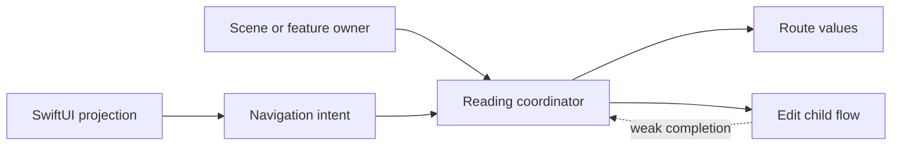

A coordinator owns navigation decisions and the lifetime of child flows. Screens report user intent; the coordinator decides which route follows and retains a child flow until it finishes or is removed.

A navigation stack alone is not a complete coordinator. Interactive back navigation, repeated completion, and parent-child ownership are where small examples often fail.

<!--more-->

The Swift 5.7 example uses a main-actor route owner and a thin SwiftUI shell. `NavigationStack` requires iOS 16 or macOS 13, released before this February 2025 article. The flow models run independently of a visible UI.

## Model routes as values and child work as owned objects

```swift
import Foundation
import SwiftUI

enum ReadingRoute: Hashable {
    case details(bookID: Int)
    case edit(UUID)
}

@MainActor
final class EditFlow {
    let id: UUID
    let bookID: Int
    private var completion: (() -> Void)?
    init(id: UUID, bookID: Int, completion: @escaping () -> Void) {
        self.id = id; self.bookID = bookID; self.completion = completion
    }
    func finish() {
        let action = completion
        completion = nil
        action?()
    }
    func cancel() { completion = nil }
}

@MainActor
final class ReadingCoordinator: ObservableObject {
    @Published private(set) var path: [ReadingRoute] = []
    private var children: [UUID: EditFlow] = [:]
    var childCount: Int { children.count }

    @discardableResult
    func showBook(_ id: Int) -> Bool {
        guard id > 0 else { return false }
        path.append(.details(bookID: id))
        return true
    }
    func startEditing(bookID: Int) -> EditFlow? {
        guard bookID > 0 else { return nil }
        let id = UUID()
        let child = EditFlow(id: id, bookID: bookID) { [weak self] in self?.finished(id) }
        children[id] = child
        path.append(.edit(id))
        return child
    }
    func finishEditing(_ id: UUID) { children[id]?.finish() }

    private func finished(_ id: UUID) {
        guard children[id] != nil, let index = path.firstIndex(of: .edit(id)) else { return }
        _ = reconcile(to: Array(path.prefix(index)))
    }
    @discardableResult
    func reconcile(to proposed: [ReadingRoute]) -> Bool {
        guard proposed.count <= path.count,
              path.prefix(proposed.count).elementsEqual(proposed) else { return false }
        let retained = Set(proposed.compactMap { route -> UUID? in
            if case let .edit(id) = route { return id }
            return nil
        })
        for id in Array(children.keys) where !retained.contains(id) {
            children.removeValue(forKey: id)?.cancel()
        }
        path = proposed
        return true
    }
    func stop() { _ = reconcile(to: []) }
}
```

The parent strongly owns children. Each child callback weakly references the parent. Completion clears its own callback before invoking it, making repeated completion harmless.

Removing a route also cancels and releases its child. A child retained elsewhere cannot later finish and pop an unrelated current route because its completion has been cleared.

## Test completion and interactive removal without a UI

```swift
await MainActor.run {
    let coordinator = ReadingCoordinator()
    coordinator.showBook(7)
    let child = coordinator.startEditing(bookID: 7)!
    assert(coordinator.path.count == 2 && coordinator.childCount == 1)
    child.finish()
    assert(coordinator.path == [.details(bookID: 7)] && coordinator.childCount == 0)
    child.finish()
    let dismissed = coordinator.startEditing(bookID: 7)!
    assert(coordinator.reconcile(to: [.details(bookID: 7)]))
    dismissed.finish()
    assert(coordinator.path == [.details(bookID: 7)])
    assert(!coordinator.reconcile(to: [.details(bookID: 8)]))
    coordinator.stop()
    assert(coordinator.path.isEmpty && coordinator.childCount == 0)
}
```

The reconciliation API accepts only a prefix of the existing path. This is the back-navigation contract, not a general deep-link replacement API. Forward navigation uses explicit coordinator operations.

A deep-link operation can validate a complete proposed route and construct matching child state separately. Treating every arbitrary array from a UI binding as trusted child-flow state would weaken the invariant.

## Keep the SwiftUI view a projection and intent source

```swift
@available(iOS 16.0, macOS 13.0, *)
@MainActor
struct ReadingRoot: View {
    @ObservedObject var coordinator: ReadingCoordinator
    var body: some View {
        NavigationStack(path: Binding(
            get: { coordinator.path },
            set: { _ = coordinator.reconcile(to: $0) }
        )) {
            Button("Open book") { _ = coordinator.showBook(7) }
                .navigationDestination(for: ReadingRoute.self) { route in
                    switch route {
                    case let .details(bookID):
                        VStack {
                            Text("Book \(bookID)")
                            Button("Edit") { _ = coordinator.startEditing(bookID: bookID) }
                        }
                    case let .edit(id):
                        VStack {
                            Text("Editing draft")
                            Button("Done") { coordinator.finishEditing(id) }
                        }
                    }
                }
        }
    }
}
```

An application owner retains one coordinator for the desired scene or feature lifetime and places `ReadingRoot(coordinator:)` in its view hierarchy. Do not create a fresh coordinator on every body evaluation.

The view uses a binding for interactive pops, but cannot mutate the published path directly. Reconciliation therefore remains the place where route removal and child cleanup stay coherent.



## Lifetime is as important as route selection

A child flow may own a draft, task, or subscription. Its cancellation operation should stop that work when the flow is removed. Deinitialization alone is a weak product completion signal, especially if another object retains the child.

The sample child has no external task, so cancelling clears only its callback. A production flow should define whether cancellation preserves drafts, asks for confirmation, or discards changes.

If completion arrives asynchronously, associate it with the child's ID and current ownership, as the parent check does. Do not simply pop the last route on every callback; another flow may have become current.

## Keep navigation policy separate from domain policy

The coordinator decides which screen or flow follows a successful edit. A repository decides how a draft is stored, while a domain operation decides whether publishing is allowed.

A coordinator that directly performs every database write, formats every label, and validates every form becomes an overloaded application object. Inject the capabilities needed by a child instead of moving all feature logic into the navigation owner.

It can cooperate with a [Mediator](/swift-mediator/) inside one screen or an [Application Facade](/swift-facade/) for a use case. Their scopes differ even if all three coordinate something.

## Navigation state and child lifetime must agree

The path says which screens are presented; the child dictionary says which editing flows remain owned. If a person swipes back, changing only the path can leave an invisible child alive. That child may retain subscriptions or later complete and navigate from a screen that no longer exists.

The reconciliation method treats the shortened path as an ownership event. It removes children whose routes disappeared and cancels their completion capability. A stale completion is harmless because the coordinator checks that the child still belongs to the active graph.

Test both orders of the race: completion before the back action, and back action before completion. A cleanup design that works only when callbacks arrive in one order is fragile even on the main actor, because suspension and queued callbacks can change that order.

The completion closure is cleared before it is invoked. This makes a second call inert and prevents reentrant completion from running the same finish operation twice. Clearing the callback is also a lifecycle decision: it releases captured context as soon as the flow ends.

## Separate navigation requests from trusted restored state

The binding setter above accepts shortening an existing path, which is what interactive back navigation needs. It does not accept arbitrary route injection. Programmatic forward navigation goes through named coordinator methods that create the corresponding child ownership.

Deep links and state restoration need a separate entry point. Decode external data into stable route descriptions, validate referenced IDs and permissions, then construct the path and any child flows together. A persisted child UUID is not evidence that a corresponding live editor still exists after relaunch.

If an item no longer exists, choose an explicit fallback screen or error. Restoring a route should not force an empty placeholder into the child dictionary merely to satisfy a stale path.

## Keep one observable owner across view updates

`ReadingRoot` observes the supplied coordinator; its owner must retain that coordinator for the intended flow lifetime. When a parent view creates it, a state-owned observable object is the usual SwiftUI way to preserve it across value-view reconstruction. Constructing a fresh coordinator inside every `body` evaluation would reset navigation and orphan the meaning of in-flight work.

Use `@ObservedObject` for receiving an existing owner and `@StateObject` where the view establishes that ownership. Both property wrappers were available before the September 2022 NavigationStack baseline used here.

A coordinator should own navigation decisions and child lifetimes. Persisting books, checking domain eligibility, and performing network retries belong to injected services. Keeping those responsibilities separate makes coordinator tests about routes, ownership, and accepted callbacks rather than full application execution.

## Exercise: support deep links and unsaved changes

Add a deep-link operation that replaces the route model only after validating book IDs and creating required child flows. Then add an unsaved-change policy for interactive removal. Test cancellation, stale completion, parent release, and two simultaneously retained scene coordinators with independent paths.

## Language and API reference

Apple introduced the data-driven navigation APIs in [The SwiftUI cookbook for navigation, WWDC22](https://developer.apple.com/videos/play/wwdc2022/10054/). The path binding and destination mapping used here follow that API model.

Return to the [Design Patterns roadmap](/swift-design-patterns/).
