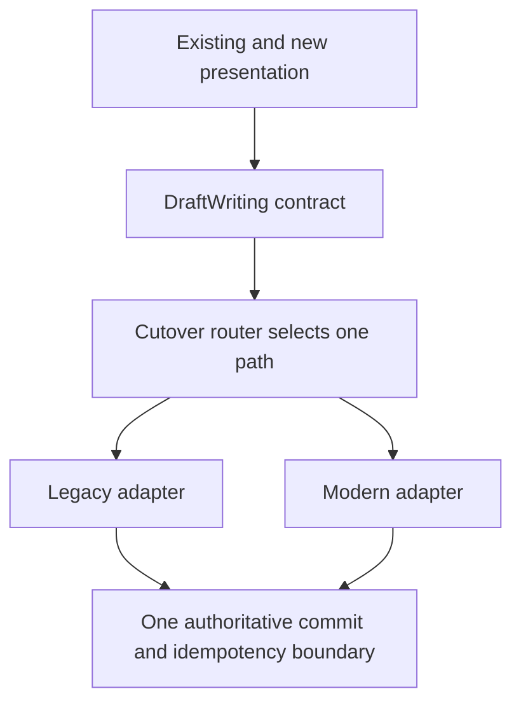

Migrating architecture safely means changing ownership and dependencies while preserving product behavior. A whole-app rewrite is rarely the only route. A stable boundary can let one feature move at a time while the surrounding app continues to work.

The most important invariant is often one writer. If old and new paths both perform a side effect during comparison, a successful-looking migration can duplicate loans, notifications, or saved revisions.

<!--more-->

This Swift 5.7 example routes saves through one selected implementation while both adapters use one authoritative store and one idempotency ledger. It demonstrates cutover and retry semantics without claiming that an in-memory actor is a durable production migration system.

## Establish the consumer contract first

```swift
struct SaveDraft: Sendable, Equatable {
    let operationID: String
    let title: String
    let expectedRevision: Int
}
struct SavedDraft: Sendable, Equatable { let title: String; let revision: Int }
enum SaveFailure: Error { case invalid, conflict, operationConflict, exhausted }
protocol DraftWriting: Sendable {
    func save(_ request: SaveDraft) async throws -> SavedDraft
}
```

The consumer needs a conditional save with retry identity. It does not need to know whether the implementation is called a controller service, repository, or use-case adapter.

Before writing the new path, characterize the old path's meaningful behavior: validation, conflict outcomes, partial completion, cancellation, and side effects. Do not preserve accidental bugs silently, but separate intentional behavior changes from structural migration so they can be reviewed clearly.

An operation ID must have a scope and retention policy. Here the example has one draft and one process-local store. A real system needs account and entity scope, durable records where required, and a rule for reusing an ID with different input.

## Preserve one authoritative commit boundary

```swift
actor SharedDraftStore {
    private var current = SavedDraft(title: "Original", revision: 1)
    private var completed: [String: (SaveDraft, SavedDraft)] = [:]
    private(set) var commits = 0

    func save(_ request: SaveDraft) throws -> SavedDraft {
        guard !request.operationID.isEmpty, !request.title.isEmpty else { throw SaveFailure.invalid }
        if let (old, saved) = completed[request.operationID] {
            guard old == request else { throw SaveFailure.operationConflict }
            return saved
        }
        guard request.expectedRevision == current.revision else { throw SaveFailure.conflict }
        guard current.revision < Int.max, commits < Int.max else { throw SaveFailure.exhausted }
        let saved = SavedDraft(title: request.title, revision: current.revision + 1)
        current = saved
        completed[request.operationID] = (request, saved)
        commits += 1
        return saved
    }
}
actor LegacyDraftAdapter: DraftWriting {
    let store: SharedDraftStore
    private(set) var calls = 0
    init(store: SharedDraftStore) { self.store = store }
    func save(_ request: SaveDraft) async throws -> SavedDraft {
        calls += 1
        return try await store.save(request)
    }
}
actor ModernDraftAdapter: DraftWriting {
    let store: SharedDraftStore
    private(set) var calls = 0
    init(store: SharedDraftStore) { self.store = store }
    func save(_ request: SaveDraft) async throws -> SavedDraft {
        calls += 1
        return try await store.save(request)
    }
}
```

The adapters intentionally share the same semantics in this demonstration. In a real migration, they translate different implementation mechanisms into the same consumer contract. Their call counters let the test distinguish routing attempts from authoritative commits.

The actor performs its checks and mutation without suspension, making this local operation atomic. A persistent implementation needs an equivalent transaction or conditional write including the operation record. Moving the ledger into a separate non-atomic write would reopen the duplicate-commit window.

## Select one path before suspension

```swift
enum SavePath { case legacy, modern }
actor SaveRouter: DraftWriting {
    private let legacy: any DraftWriting
    private let modern: any DraftWriting
    private var path: SavePath = .legacy
    init(legacy: any DraftWriting, modern: any DraftWriting) {
        self.legacy = legacy; self.modern = modern
    }
    func use(_ path: SavePath) { self.path = path }
    func save(_ request: SaveDraft) async throws -> SavedDraft {
        let selected: any DraftWriting
        switch path {
        case .legacy: selected = legacy
        case .modern: selected = modern
        }
        return try await selected.save(request)
    }
}
```

A path change affects later calls. An in-flight operation keeps its selected adapter rather than switching halfway through. Because actors can process other messages while awaiting, capturing this decision before suspension is an explicit semantic choice.

The router does not automatically fall back after a failed write. A timeout can mean the first path committed but its response was lost. Blindly trying another writer can duplicate the effect unless both paths share an authoritative idempotency contract.

## Verify cutover and retry across paths

```swift
let storage = SharedDraftStore()
let legacy = LegacyDraftAdapter(store: storage)
let modern = ModernDraftAdapter(store: storage)
let router = SaveRouter(legacy: legacy, modern: modern)
let request = SaveDraft(operationID: "edit-1", title: "Revised", expectedRevision: 1)
let saved = try await router.save(request)
await router.use(.modern)
let retried = try await router.save(request)
let commits = await storage.commits
let oldCalls = await legacy.calls
let newCalls = await modern.calls
assert(saved == retried && saved.revision == 2)
assert(commits == 1 && oldCalls == 1 && newCalls == 1)
do {
    _ = try await router.save(SaveDraft(operationID: "edit-2", title: "Stale", expectedRevision: 1))
    assertionFailure("Cutover must preserve optimistic conflict semantics")
} catch SaveFailure.conflict {}
let afterConflict = await storage.commits
assert(afterConflict == 1)
```

Two adapter calls represent one logical operation retried across the cutover. The shared ledger ensures one commit. This is different from sending every save to both paths “for comparison,” which would be unsafe without a deliberate replication protocol.

## Use a strangler boundary around one vertical slice



Start with one operation or feature. Introduce the boundary around the existing implementation, protect its behavior, then add the new implementation behind the same contract. Cut over at a controlled scope, observe outcomes, and remove the old path when evidence supports it.

A feature flag is useful for selecting a path, but it does not provide rollback of data already written. Define which stored formats both versions can read and what happens to in-flight work when the flag changes.

## Compare reads without duplicating writes

Shadow reads can help compare two projections when both are side-effect-free and their freshness assumptions are understood. Different results may reflect timing rather than a logic defect, so compare versions or a common snapshot when possible.

Do not send emails, payments, or inventory mutations down both implementations as if they were harmless reads. If dual writes are genuinely required for a data migration, design ordering, retries, deduplication, reconciliation, and recovery as a separate protocol.

Likewise, analytics can accidentally double count when both old and new presentation layers report the same user action. Treat telemetry ownership as part of the cutover contract.

## Migrate ownership as well as method calls

Replacing a controller with a view model changes little if the old controller still owns global subscriptions and hidden tasks. Draw the old and new ownership graphs. Identify which owner starts work, accepts results, cancels it, and releases child features.

Keep one authoritative state owner during the transition. An adapter can translate old callbacks into the new contract, but a second mutable copy needs a synchronization policy and can become the next migration problem.

Finish the migration by removing obsolete assembly, flags, adapters, and tests that only protect the removed path. Leaving both graphs active indefinitely increases the cost of every later change.

## Case study: rollback after the new writer changes stored data

Turning a flag back to the legacy path is only safe if the old implementation can still understand data written by the new one. A code rollback does not automatically roll back schema, operation ledgers, or already delivered external effects.

Plan compatibility in both directions during the migration window. An expand-and-contract data change can first add a representation both paths tolerate, then move writers, then remove the obsolete representation only after old readers are gone. The exact protocol depends on the storage system and deployment model.

Mobile clients make this especially important because old application versions can remain installed. A server migration cannot assume every reader upgrades at once. Version contracts and compatibility periods belong in the architecture decision, not only in release notes.

For an in-app architectural refactor that preserves the same server contract, the risk can be much smaller. Keep that scope clear. Replacing presentation ownership is different from replacing persistence semantics, even when both happen behind the same feature flag.

Define a rollback observation before cutting over: which error rates, conflict outcomes, or missing behaviors would trigger reversal, and what state is safe to reverse? Avoid collecting sensitive payloads merely to compare implementations; stable outcome codes and operation identities often provide sufficient evidence.

Complete the migration by removing the unused path and its compatibility machinery at the agreed point. A permanent router with two barely maintained implementations can turn a temporary safety mechanism into ongoing uncertainty about which behavior is authoritative.

## Exercise: cut over during an in-flight save

Make the selected adapter wait after receiving its request. Change the router path, then release the save. Verify the first operation remains on its selected path and the next operation uses the new one. Add a lost-response retry and prove the authoritative store still commits once.

Return to the [App Architectures roadmap](/swift-architectures/).
