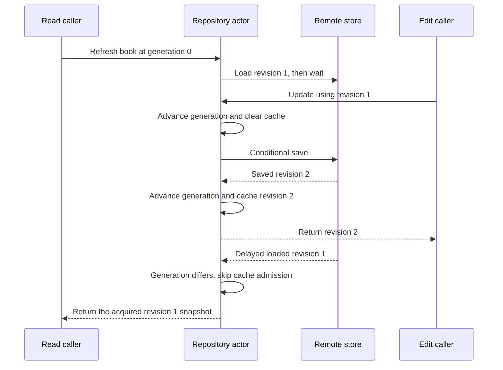

A repository exposes a domain-facing way to obtain and update entities while hiding persistence-specific details. It should define freshness, conflict, and failure behavior rather than merely rename database CRUD methods.

A cache complicates that contract. An older load can finish after a newer save and overwrite a correct cached version unless the repository guards asynchronous result publication.

<!--more-->

The Swift 5.7 example uses actors, optimistic revision checks, and per-entity generations. It returns snapshots and keeps stale completions from replacing newer cached data. It does not claim cross-system transactions or linearizable reads across arbitrary remote operations.

## Keep the domain result independent of storage rows

```swift
struct BookRecord: Sendable, Equatable {
    let id: Int
    let title: String
    let revision: Int
}
enum BookFailure: Error, Equatable {
    case missing
    case invalidTitle
    case conflict(expected: Int, actual: Int)
    case invalidResponse
    case revisionExhausted
}
protocol BookRemote: Sendable {
    func load(id: Int) async throws -> BookRecord
    func save(id: Int, title: String, expectedRevision: Int) async throws -> BookRecord
}

actor MemoryBookRemote: BookRemote {
    private var records: [Int: BookRecord]
    private(set) var loads = 0
    init(_ records: [Int: BookRecord]) { self.records = records }
    func load(id: Int) async throws -> BookRecord {
        loads += 1
        guard let record = records[id] else { throw BookFailure.missing }
        return record
    }
    func save(id: Int, title: String, expectedRevision: Int) async throws -> BookRecord {
        guard !title.isEmpty else { throw BookFailure.invalidTitle }
        guard let old = records[id] else { throw BookFailure.missing }
        guard old.revision == expectedRevision else {
            throw BookFailure.conflict(expected: expectedRevision, actual: old.revision)
        }
        guard old.revision < Int.max else { throw BookFailure.revisionExhausted }
        let next = BookRecord(id: id, title: title, revision: old.revision + 1)
        records[id] = next
        return next
    }
}
```

The remote adapter's compare-and-save is atomic within this actor method because it performs no suspension between checking and updating. A database implementation needs an equivalent conditional write or transaction, not an independent read followed by an unprotected update.

Revisions are part of the editing contract, not a leaked SQL row shape. A real server may use opaque tokens instead of integers; callers still need to express which version they edited.

## Protect cache admission across suspension

```swift
enum ReadPolicy { case cached, refresh }

actor BookRepository {
    private let remote: any BookRemote
    private var cache: [Int: BookRecord] = [:]
    private var generations: [Int: Int] = [:]
    init(remote: any BookRemote) { self.remote = remote }

    private func advance(_ id: Int) {
        let old = generations[id, default: 0]
        precondition(old < Int.max)
        generations[id] = old + 1
    }
    private func validate(_ record: BookRecord, id: Int) throws {
        guard record.id == id, record.revision > 0, !record.title.isEmpty else {
            throw BookFailure.invalidResponse
        }
    }
    private func admit(_ record: BookRecord) {
        if let old = cache[record.id], old.revision > record.revision { return }
        cache[record.id] = record
    }

    func book(id: Int, policy: ReadPolicy) async throws -> BookRecord {
        if policy == .cached, let value = cache[id] { return value }
        let generation = generations[id, default: 0]
        let loaded = try await remote.load(id: id)
        try validate(loaded, id: id)
        if generations[id, default: 0] == generation { admit(loaded) }
        return loaded
    }

    func update(id: Int, title: String, expectedRevision: Int) async throws -> BookRecord {
        guard !title.isEmpty else { throw BookFailure.invalidTitle }
        advance(id)
        cache.removeValue(forKey: id)
        do {
            let saved = try await remote.save(id: id, title: title, expectedRevision: expectedRevision)
            try validate(saved, id: id)
            guard saved.revision > expectedRevision else { throw BookFailure.invalidResponse }
            advance(id)
            admit(saved)
            return saved
        } catch {
            advance(id)
            cache.removeValue(forKey: id)
            throw error
        }
    }
}
```

Generation changes invalidate loads begun before or during a write. Revision comparison also prevents an older write response from replacing a newer cached record.

A rejected load can still return its acquired snapshot to its own caller; it simply cannot publish that snapshot into the current cache. A UI needing only the latest request must additionally apply its own request or version acceptance rule.

## Verify cache, update, and conflict behavior

```swift
let remote = MemoryBookRemote([1: BookRecord(id: 1, title: "Draft", revision: 1)])
let repository = BookRepository(remote: remote)
let first = try await repository.book(id: 1, policy: .cached)
let again = try await repository.book(id: 1, policy: .cached)
let loads = await remote.loads
assert(first == again && loads == 1)
let saved = try await repository.update(id: 1, title: "Published", expectedRevision: 1)
assert(saved.revision == 2)
let cached = try await repository.book(id: 1, policy: .cached)
assert(cached == saved)
do {
    _ = try await repository.update(id: 1, title: "Obsolete edit", expectedRevision: 1)
    assertionFailure("An obsolete writer must not overwrite the new revision")
} catch BookFailure.conflict(expected: 1, actual: 2) {}
let afterConflict = try await repository.book(id: 1, policy: .cached)
assert(afterConflict.title == "Published")
```

The conflict clears the local cache conservatively and forces a later fetch. This can discard a useful newer cached value under concurrent failures, but it does not replace it with stale data.

The demonstration's generation counter is bounded by process lifetime assumptions. Durable versioning remains the remote store's responsibility.

## Actor isolation does not make a whole workflow atomic

While a repository awaits the remote, other repository calls can run. The generation and revision checks exist because actor isolation protects access to stored fields, not an uninterrupted multi-await transaction.

A refresh can therefore return a snapshot older than a concurrently completed edit. If the contract required a strongly ordered read-after-write barrier, it would need an additional operation sequencing policy.

A network timeout after a write can also leave commit status uncertain. Retrying with the same expected revision may conflict because the first write actually succeeded. Use an idempotency or reconciliation protocol appropriate to the service rather than translating every timeout into “nothing happened.”

## Repository is not a universal cache or transaction

A repository can choose cache policy, but it should not conceal every source behind one vague `get`. State whether a read may be stale and whether absence differs from unavailable storage.

Combining updates to several repositories is not automatically atomic. A use-case service needs a transaction boundary or explicit partial-outcome protocol when several effects must agree.

Similarly, a repository should return domain values or results, not expose a vendor query object that forces presentation code to know table names and persistence lifecycle.

## Walk through the stale-load race

The important sequence is not two threads writing the dictionary simultaneously; actor isolation already prevents that. The problem occurs across suspension points, when a logically older operation resumes later.



The old caller still receives the snapshot its operation acquired, as documented. A later cached read receives revision two. Rejecting old cache publication and guaranteeing that every caller receives the newest value are different contracts.

The remote adapter must also honor its revision promise. A successful save should return a revision newer than the expected revision, with the requested entity identity. Validate that promise at the boundary so a malformed adapter response does not look like a successful committed update.

## Invalidation is not a consistency protocol for every source

A generation counter belongs to one repository instance. Another device, another process, or a second repository can change the remote record without advancing this instance's generation. A cache policy must therefore include an external freshness mechanism if those writes matter: explicit refresh, server versions, expiration, or change notifications with defined delivery semantics.

Even refresh is only as current as the remote service's read contract. A replicated server may return an older revision after a write unless it provides a stronger consistency guarantee. If the application requires a particular minimum version, pass that requirement explicitly and handle the service's inability to satisfy it.

Offline edits add another dimension. Preserve the base revision used for editing, the pending operation identity, and the conflict outcome. Replacing an old cached object with a new local title is not enough to describe which writes remain uncommitted or how to reconcile them.

## Test ordering with controlled suspension

Avoid sleeps in race tests. A fake remote can capture the first load and signal that it has reached a known suspension point. The test then completes a save, releases the captured old load, and inspects the next cached result. This proves the intended interleaving without depending on machine speed.

Use separate cases for an old load after a successful write, an uncertain failed write, and two write responses arriving in reverse revision order. Each case exercises a distinct acceptance rule.

## Reproduce an old completion without a timer

This controlled adapter signals when it has captured the old snapshot. The test can then save the new revision before releasing that snapshot. No scheduling delay is assumed.

```swift
actor DelayedBookRemote: BookRemote {
    private var current = BookRecord(id: 1, title: "Before", revision: 1)
    private var held: (BookRecord, CheckedContinuation<BookRecord, Never>)?
    private var waitingForLoad: CheckedContinuation<Void, Never>?
    private(set) var loadCount = 0

    func load(id: Int) async throws -> BookRecord {
        guard id == current.id else { throw BookFailure.missing }
        loadCount += 1
        if loadCount == 1 {
            let captured = current
            return await withCheckedContinuation { continuation in
                held = (captured, continuation)
                waitingForLoad?.resume()
                waitingForLoad = nil
            }
        }
        return current
    }
    func waitUntilLoadIsHeld() async {
        if held != nil { return }
        await withCheckedContinuation { waitingForLoad = $0 }
    }
    func releaseHeldLoad() {
        guard let (value, continuation) = held else { preconditionFailure("No held load") }
        held = nil
        continuation.resume(returning: value)
    }
    func save(id: Int, title: String, expectedRevision: Int) async throws -> BookRecord {
        guard id == current.id else { throw BookFailure.missing }
        guard !title.isEmpty else { throw BookFailure.invalidTitle }
        guard current.revision == expectedRevision else {
            throw BookFailure.conflict(expected: expectedRevision, actual: current.revision)
        }
        guard current.revision < Int.max else { throw BookFailure.revisionExhausted }
        current = BookRecord(id: id, title: title, revision: current.revision + 1)
        return current
    }
}

let delayedRemote = DelayedBookRemote()
let racingRepository = BookRepository(remote: delayedRemote)
let oldRead = Task { try await racingRepository.book(id: 1, policy: .refresh) }
await delayedRemote.waitUntilLoadIsHeld()
let newWrite = try await racingRepository.update(id: 1, title: "After", expectedRevision: 1)
await delayedRemote.releaseHeldLoad()
let oldResult = try await oldRead.value
let retainedResult = try await racingRepository.book(id: 1, policy: .cached)
let delayedLoadCount = await delayedRemote.loadCount
assert(oldResult.revision == 1 && newWrite.revision == 2)
assert(retainedResult == newWrite && delayedLoadCount == 1)
```

The single load count is significant. It proves the last read used the preserved newer cache entry instead of masking an overwritten entry with another remote refresh. The fake supports one controlled waiter because this test exercises exactly one held read; it is not a general-purpose concurrent queue.

## Exercise: deliver write responses out of order

Extend the controlled remote to commit revision two and then revision three while withholding both responses. Return the revision-three response first, then revision two, and confirm cache admission never moves the retained revision backward. Also return a malformed successful response and verify the repository rejects it. See [Swift Concurrency](/swift-concurrency/) for the actor and suspension model.

## Language and API reference

The Swift language guide explains [actor isolation and reentrancy across suspension points](https://docs.swift.org/swift-book/documentation/the-swift-programming-language/concurrency/). The cache acceptance rules above are application policy built on that model.

Return to the [Design Patterns roadmap](/swift-design-patterns/).
