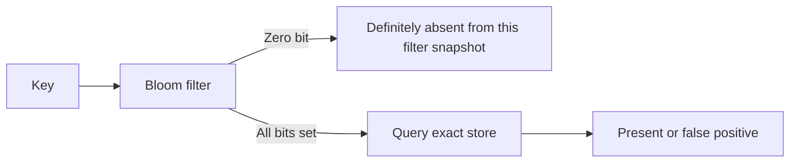

A Bloom filter answers membership approximately using a bit array. A negative result means an item was not inserted under the filter's stated assumptions; a positive result means it may have been inserted and needs confirmation when exact membership matters.

That asymmetry makes Bloom filters useful ahead of expensive storage lookups. They are not a substitute for an exact permission check, a definitive duplicate ledger, or a structure that must enumerate its contents.

<!--more-->

The Swift 5.7 example uses CryptoKit's SHA-256 to derive stable bit positions, available on Apple platforms since 2019. It is an append-only teaching filter with a power-of-two bit count and compatible-filter union.

## Multiple positions trade bits for an error probability

Insert each key by setting `k` bit positions. Query by checking all `k`; any zero proves absence. Other keys can set the same positions, causing false positives.

With `m` bits, `n` inserted distinct items, and idealized independent positions, the approximate false-positive probability is:

$$
p\approx\left(1-e^{-kn/m}\right)^k.
$$

The usual approximate optimum is:

$$
k\approx\frac{m}{n}\ln2,\qquad
m\approx-\frac{n\ln p}{(\ln2)^2}.
$$

These are sizing models, not deterministic guarantees for every dataset or hash derivation. Rounding and implementation constraints change the final choice.

## Implement stable positions and explicit occupancy

```swift
import Foundation
import CryptoKit

enum BloomFailure: Error { case incompatible }

struct BloomFilter {
    private var words: [UInt64]
    let bitCount: Int
    let hashCount: Int

    init(bitCount: Int, hashCount: Int) {
        precondition(bitCount >= 64 && bitCount.nonzeroBitCount == 1)
        precondition(hashCount > 0 && hashCount <= bitCount)
        self.bitCount = bitCount
        self.hashCount = hashCount
        words = Array(repeating: 0, count: bitCount / 64)
    }

    private func positions(for key: String) -> [Int] {
        let digest = Array(SHA256.hash(data: Data(key.utf8)))
        func word(_ range: Range<Int>) -> UInt64 {
            range.reduce(0) { ($0 << 8) | UInt64(digest[$1]) }
        }
        let first = word(0..<8)
        let step = word(8..<16) | 1
        return (0..<hashCount).map { index in
            Int((first &+ (UInt64(index) &* step)) % UInt64(bitCount))
        }
    }

    mutating func insert(_ key: String) {
        for position in positions(for: key) {
            words[position / 64] |= UInt64(1) << (position % 64)
        }
    }

    func mayContain(_ key: String) -> Bool {
        positions(for: key).allSatisfy { position in
            words[position / 64] & (UInt64(1) << (position % 64)) != 0
        }
    }

    mutating func formUnion(_ other: BloomFilter) throws {
        guard bitCount == other.bitCount, hashCount == other.hashCount else {
            throw BloomFailure.incompatible
        }
        for index in words.indices { words[index] |= other.words[index] }
    }
}

var filter = BloomFilter(bitCount: 1_024, hashCount: 7)
for id in 0..<100 { filter.insert("item-\(id)") }
for id in 0..<100 { assert(filter.mayContain("item-\(id)")) }
var other = BloomFilter(bitCount: 1_024, hashCount: 7)
other.insert("remote-item")
try filter.formUnion(other)
assert(filter.mayContain("remote-item"))
```

Wrapping arithmetic is intentional for hash derivation. Because the modulus is a power of two, an odd step traverses distinct positions until the cycle repeats at `m`; it cannot collapse immediately through a zero step.

The two-word derivation is not the fully independent-hash model from the sizing equation. Evaluate its observed behavior for the intended workload instead of presenting the formula as an exact measured rate.

## No false negatives has conditions

A key inserted with the same encoding and hash configuration will find all its bits still set in an append-only intact filter. Clearing bits, changing normalization, merging incompatible formats, or reading stale data can break that statement.

UTF-8 encoding is explicit. If the application wants case-insensitive membership, normalize before both insert and query. Persist that normalization policy along with the filter format.

Swift's ordinary `hashValue` is randomized and unsuitable for a serialized filter queried in another process. A stable digest specification prevents that particular incompatibility, though storage corruption and version changes still need handling.

## A positive answer needs the exact source of truth



A stale filter can incorrectly report absence relative to a newer store even though it has no false negatives relative to its own inserted snapshot. Publish filters and data with a coherent version or use an update protocol that prevents that mismatch.

In a cache, a false positive typically costs an extra lookup. In access control, treating “may contain” as authorization would be a correctness failure. The consumer must preserve the asymmetry.

## Deletion and saturation require another policy

Clearing a key's positions can erase bits shared by other keys, creating false negatives. Counting Bloom filters use counters, but require overflow and deletion-validity rules. A rebuild from exact contents is often simpler for periodic snapshots.

As more items are inserted, more bits become one and false-positive probability rises. A fixed filter does not retain a target error rate indefinitely. Track insertion estimates or occupancy and rebuild or scale when the design capacity is exceeded.

Union uses bitwise OR only when bit count, position derivation, encoding, and hash count agree. The in-memory type fixes the algorithm version; a serialized format must carry and validate it explicitly.

## Test guarantees and measure errors separately

Every inserted key must query positive, including repeated inserts and keys split across merged filters. That is a deterministic correctness property.

False positives are expected. Do not write a test asserting every absent sample returns false. Measure the rate over a disjoint representative sample and compare distributions to the sizing model with an appropriate statistical interpretation.

Test incompatible union rejection and empty filters. Include non-ASCII keys to ensure encoding consistency.

## Estimate the operational benefit, not only the bit count

If almost every query is absent from an expensive exact store, a small false-positive rate can avoid most storage lookups. If almost every query is present, the filter adds hashing work while nearly every query still reaches the store.

Let the absent-query fraction be `a` and false-positive probability be `p`. Ignoring update and cache effects, the expected fraction of queries requiring exact confirmation is approximately:

$$
(1-a)+a p.
$$

Compare that saved lookup work with the cost of hashing keys, retaining the bit array, and keeping the filter current. A low error rate is not itself evidence of an end-to-end speedup.

## Snapshot publication can preserve the negative guarantee

One safe pattern builds a new filter from a coherent exact-store snapshot, then publishes both generation identifiers together. Queries use the filter only when it corresponds to the store view being queried.

For a continuously changing store, an auxiliary exact set of recently inserted keys can cover additions since the last snapshot, with a defined rotation protocol. Clearing or replacing that set too early can introduce false negatives relative to current data.

The protocol should be tested around publication boundaries, not only by checking bits in a single isolated filter. Most operational violations of “no false negatives” arise from lifecycle mismatches rather than the bit-setting loop itself.

## Double hashing preserves a chosen family of positions

The odd-step rule matches the power-of-two modulus in this implementation. If the bit-count constraint changes, revisit the cycle argument. An odd step is not necessarily coprime to every arbitrary modulus.

Serialization compatibility should therefore include the modulus policy as well as the digest name. Two implementations both labeled “SHA-256 Bloom filter” can still disagree about every queried position.

## Exercise: size a cache prefilter

For an expected one hundred thousand keys and a one-percent target false-positive rate, calculate `m` and `k`, round to the implementation's constraints, and recompute the predicted rate. Estimate how many exact-store lookups remain for a workload dominated by absent keys.

Return to the [Data Structures and Algorithms roadmap](/swift-data-structures-and-algorithms/).
