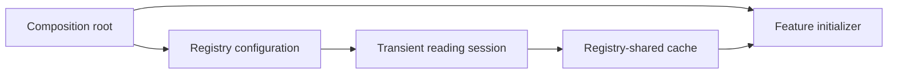

A registry records how capabilities are constructed. A service locator lets code discover those capabilities at runtime. The same container can be useful at application assembly and harmful when passed everywhere, hiding what each feature actually needs.

Typing the lookup improves error checking but does not make hidden dependencies explicit. Scope, construction cycles, failure cleanup, and registration lifetime still need a contract.

<!--more-->

The Swift 5.7 implementation below is a small serialized registry with transient and registry-shared registrations. Configuration is frozen before resolution, and recursive construction reports a cycle instead of overflowing the stack.

## Separate registration from resolution

```swift
enum ResolutionFailure: Error {
    case frozen
    case notFrozen
    case duplicate(String)
    case missing(String)
    case cycle([String])
    case typeMismatch(String)
}
enum ServiceScope { case transient, shared }

final class ServiceRegistry {
    private struct Entry {
        let scope: ServiceScope
        let make: (ServiceRegistry) throws -> Any
    }
    private var entries: [ObjectIdentifier: Entry] = [:]
    private var instances: [ObjectIdentifier: Any] = [:]
    private var active: Set<ObjectIdentifier> = []
    private var path: [String] = []
    private var frozen = false

    func register<Value>(_ type: Value.Type, scope: ServiceScope,
                         factory: @escaping (ServiceRegistry) throws -> Value) throws {
        guard !frozen else { throw ResolutionFailure.frozen }
        let key = ObjectIdentifier(type)
        let name = String(reflecting: type)
        guard entries[key] == nil else { throw ResolutionFailure.duplicate(name) }
        entries[key] = Entry(scope: scope, make: { try factory($0) })
    }
    func freeze() { frozen = true }

    func resolve<Value>(_ type: Value.Type) throws -> Value {
        guard frozen else { throw ResolutionFailure.notFrozen }
        let key = ObjectIdentifier(type)
        let name = String(reflecting: type)
        if let existing = instances[key] {
            guard let value = existing as? Value else { throw ResolutionFailure.typeMismatch(name) }
            return value
        }
        guard let entry = entries[key] else { throw ResolutionFailure.missing(name) }
        guard active.insert(key).inserted else { throw ResolutionFailure.cycle(path + [name]) }
        path.append(name)
        defer { active.remove(key); path.removeLast() }
        let created = try entry.make(self)
        guard let value = created as? Value else { throw ResolutionFailure.typeMismatch(name) }
        if entry.scope == .shared { instances[key] = created }
        return value
    }
}
```

Type identity, not an arbitrary string name, selects the registration. The erased storage remains private, and a guarded cast checks the boundary before returning a value.

The active set tracks only the current construction path. A dependency already created and cached is not a cycle merely because several services use it.

## Test scopes through identity

```swift
final class ImageCache {}
final class ReadingSession {
    let cache: ImageCache
    init(cache: ImageCache) { self.cache = cache }
}
let registry = ServiceRegistry()
var cacheCreations = 0
try registry.register(ImageCache.self, scope: .shared) { _ in
    cacheCreations += 1
    return ImageCache()
}
try registry.register(ReadingSession.self, scope: .transient) { registry in
    ReadingSession(cache: try registry.resolve(ImageCache.self))
}
registry.freeze()
let first = try registry.resolve(ReadingSession.self)
let second = try registry.resolve(ReadingSession.self)
assert(first !== second)
assert(first.cache === second.cache && cacheCreations == 1)
```

Shared means one cached result per registry, not one per process. Two account registries can have independent caches. A transient registration invokes its factory each time; freshness still depends on the factory actually constructing a fresh object rather than returning a global instance.

The factory receives the current registry as a parameter. Capturing the registry strongly from an outer variable can create a registry-to-factory-to-registry ownership cycle.

## Detect construction cycles and preserve cleanup

```swift
struct ServiceA {}
struct ServiceB {}
let cyclic = ServiceRegistry()
try cyclic.register(ServiceA.self, scope: .shared) { registry in
    let _: ServiceB = try registry.resolve(ServiceB.self)
    return ServiceA()
}
try cyclic.register(ServiceB.self, scope: .shared) { registry in
    let _: ServiceA = try registry.resolve(ServiceA.self)
    return ServiceB()
}
cyclic.freeze()
do {
    let _: ServiceA = try cyclic.resolve(ServiceA.self)
    assertionFailure("The construction cycle must be reported")
} catch let ResolutionFailure.cycle(path) {
    assert(path.count == 3 && path.first == path.last)
}
```

The deferred cleanup removes every failed construction from the active path. A later attempt should report the same real cycle, not a stale path left behind by the first failure.

Failed products are not cached. Dependencies successfully created before a later parent factory fails can remain cached, so resolution is not an all-or-nothing resource transaction. Their owner must still have a valid lifetime and cleanup policy.



## Hidden dependencies move errors to resolution time

An initializer accepting `ImageCache` declares what the object needs. An initializer accepting `ServiceRegistry` declares only that the object may ask for something later. The dependency graph still exists, but reading the initializer no longer reveals it.

That difference matters during maintenance. A feature can begin resolving a new service without changing its public construction signature. Tests that construct the feature may then fail only when a rarely used method attempts the new lookup. Constructor injection makes the same change visible at every composition site.

A registry is therefore most useful at a composition boundary, where dynamic assembly is genuinely needed. Resolve dependencies there and pass narrow capabilities into ordinary application objects. Passing the registry through the entire feature graph turns every object into an implicit composition root.

## Freeze and isolation solve different problems

Freezing prevents registration changes after resolution starts. It avoids one service using old configuration while another resolves a new factory under the same key.

The cache, active set, and path still mutate, so this class requires serialized access. A thread-safe container needs a synchronization strategy that also considers factory reentrancy and shared-resource lifetimes.

Holding a nonrecursive lock while calling a factory that resolves another service can deadlock. Releasing it around construction can create duplicate shared instances unless in-flight construction is represented explicitly.

An actor-based asynchronous registry has similar suspension and cancellation questions. Do not add async factories without specifying who owns shared construction and how failed waiters affect a newer attempt.

## Use registries where runtime discovery is a real requirement

Plugin systems and configurable host applications can benefit from runtime registration. Validate required capabilities before activating a feature and report duplicate or missing registrations clearly.

For a small application graph, direct initializers and factories are often simpler. Dependency injection describes how a consumer receives collaborators; a container is only one assembly mechanism.

## Scope is ownership, not a caching adjective

The shared scope in this implementation means one value per registry instance. Two account registries can each resolve a different shared cache. Registering everything into a single process registry changes that ownership decision even though the registration API looks identical.

A transient service can still retain a shared dependency. Repeatedly constructing transient sessions does not imply that all objects reachable from those sessions are fresh. Draw the ownership graph when testing account isolation or resource cleanup.

Similarly, returning a class through a protocol does not make its shared instance safe for concurrent access. Freezing registrations prevents later configuration changes; it does not synchronize resolution or use of returned services. This implementation requires serialized access, as stated above.

## Construction failure must unwind bookkeeping

The active-resolution set detects cycles only while factories are executing. `defer` removes each entry on both success and failure. If a throwing factory left its key active, the next legitimate retry would be reported as a false cycle.

Test this explicitly with a factory that fails on its first invocation and succeeds on its second. Also verify that a failed shared factory does not populate the cache. A cycle test alone establishes detection but not recovery after errors.

Factories can also capture the registry strongly while being retained by that registry, creating a reference cycle. Prefer the registry supplied to the factory call, or review capture ownership carefully. When a scope closes, release its graph deliberately and verify that resources receive their intended shutdown calls.

For large systems, a build-time dependency graph or explicit composition code can catch missing registrations earlier. A dynamic registry should be a deliberate tradeoff, with typed keys and clear scope, rather than the default escape hatch whenever an initializer becomes inconvenient.

## Verify failure recovery, not only cycle detection

```swift
enum FactoryFailure: Error { case unavailable }
final class RecoveredService {}
let recovering = ServiceRegistry()
var attempts = 0
try recovering.register(RecoveredService.self, scope: .shared) { _ in
    attempts += 1
    if attempts == 1 { throw FactoryFailure.unavailable }
    return RecoveredService()
}
recovering.freeze()
do {
    _ = try recovering.resolve(RecoveredService.self)
    assertionFailure("The first construction should fail")
} catch FactoryFailure.unavailable {}
let recovered = try recovering.resolve(RecoveredService.self)
let reused = try recovering.resolve(RecoveredService.self)
assert(recovered === reused && attempts == 2)
```

The second resolution succeeds only if the first failure cleared active-construction bookkeeping. The third resolution reuses the successfully created shared value instead of invoking the factory again. Together, those assertions cover error unwinding and cache admission as separate responsibilities.

## Exercise: add an operation scope

Create a child scope with its own shared instances while inheriting factory definitions. Decide which parent resources may be reused and which must be recreated. Test two independent scopes, missing registrations, a throwing factory retried after failure, and cleanup when the scope ends.

See [Dependency Injection](/swift-dependency-injection/) for the consumer-facing boundary.

Return to the [Design Patterns roadmap](/swift-design-patterns/).
