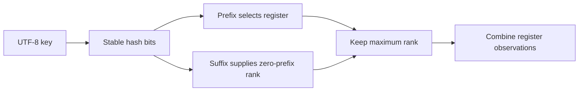

Counting distinct values exactly requires remembering which values have appeared. HyperLogLog trades exactness for a compact summary whose size is chosen in advance. It estimates cardinality without storing the original keys and can merge compatible summaries without counting overlap twice.

It does not answer membership, enumerate values, or return an exact financial ledger total. Those are different questions requiring different information.

<!--more-->

The Swift 5.7 example uses a stable 64-bit portion of SHA-256, power-of-two registers, the standard raw estimator, and a small-range correction. It omits large-range and later bias-correction refinements, so it is a teaching sketch rather than a production HLL++ implementation.

## Split a hash into a bucket and an observation



Use the first `p` bits to select one of `m = 2ᵖ` registers. The remaining bits provide a rank: one plus the number of leading zeros. Each register stores the largest rank seen in its bucket.

Long zero prefixes are rare under a uniform hash. Seeing unusually large ranks suggests many distinct observations. Taking a maximum makes duplicate insertion idempotent and compatible merges straightforward.

```swift
import Foundation
import CryptoKit

enum SketchFailure: Error { case incompatible }

struct HyperLogLog {
    let precision: Int
    private var registers: [UInt8]

    init(precision: Int) {
        precondition((4...16).contains(precision))
        self.precision = precision
        registers = Array(repeating: 0, count: 1 << precision)
    }

    mutating func insert(_ key: String) {
        let digest = SHA256.hash(data: Data(key.utf8))
        let hash = digest.prefix(8).reduce(UInt64(0)) { ($0 << 8) | UInt64($1) }
        let bucket = Int(hash >> (64 - precision))
        let suffix = hash << precision
        let rank = min(suffix.leadingZeroBitCount + 1, 65 - precision)
        registers[bucket] = max(registers[bucket], UInt8(rank))
    }

    mutating func formUnion(_ other: HyperLogLog) throws {
        guard precision == other.precision else { throw SketchFailure.incompatible }
        for index in registers.indices {
            registers[index] = max(registers[index], other.registers[index])
        }
    }

    var estimate: Double {
        let m = Double(registers.count)
        let alpha: Double
        switch registers.count {
        case 16: alpha = 0.673
        case 32: alpha = 0.697
        case 64: alpha = 0.709
        default: alpha = 0.7213 / (1 + 1.079 / m)
        }
        let harmonic = registers.reduce(0.0) { $0 + pow(2.0, -Double($1)) }
        let raw = alpha * m * m / harmonic
        let empty = registers.filter { $0 == 0 }.count
        if raw <= 2.5 * m && empty > 0 {
            return m * log(m / Double(empty))
        }
        return raw
    }
}

var full = HyperLogLog(precision: 10)
assert(full.estimate == 0)
var left = HyperLogLog(precision: 10)
var right = HyperLogLog(precision: 10)
for id in 0..<1_000 {
    let key = "visitor-\(id)"
    full.insert(key)
    if id % 2 == 0 { left.insert(key) } else { right.insert(key) }
}
try left.formUnion(right)
assert(left.estimate == full.estimate)
let beforeDuplicate = full.estimate
full.insert("visitor-10")
assert(full.estimate == beforeDuplicate)
```

The rank cap handles an all-zero suffix. After shifting away bucket bits, artificial low zeros must not create a rank larger than the available suffix width plus one.

## Why the estimator uses a harmonic expression

The raw estimate is:

$$
\widehat n=\alpha_m\,m^2\left(\sum_{j=1}^{m}2^{-M_j}\right)^{-1}.
$$

The register observations are combined rather than trusting one extreme hash. The calibration constant depends on register count. For small cardinalities, many registers remain empty; linear counting uses that occupancy information:

$$
\widehat n_{\mathrm{small}}=m\ln(m/Z),
$$

where `Z` is empty registers. The empty sketch then estimates zero naturally. Applying the raw formula alone would produce a positive estimate even before insertion.

The [original HyperLogLog paper](https://algo.inria.fr/flajolet/Publications/FlFuGaMe07.pdf) derives the estimator and its typical relative standard error, approximately `1.04 / √m`. This is a statistical scale, not a guaranteed maximum error for every set.

## Precision is a resource decision

With 1,024 registers, that approximation is about 3.25 percent. Increasing precision by two bits quadruples register count and roughly halves standard error.

This implementation uses one byte per register rather than bit-packing, plus array overhead. It hashes each input's UTF-8 bytes, so insertion cost includes key length even though register update work is bounded.

No original IDs are retained, but a sketch is not automatically anonymous or safe to publish. Domain privacy and data-release decisions require their own analysis; cardinality compression alone is not a privacy mechanism.

## Merge only identical hash universes

Register-wise maximum models observing the union of both input sets, including overlap. Summing estimates instead would double-count shared visitors.

Compatibility includes precision, hash algorithm, selected hash bits, encoding, normalization, and any seed or domain prefix. The in-memory type fixes those choices; a stored or exchanged format must identify them explicitly.

A different precision cannot simply be merged by lining up the first few registers. Downsampling requires a defined transformation of bucket and rank information. This API rejects it rather than inventing a conversion.

## Compare sketches by the question they answer

| Structure | Question | Main uncertainty |
| --- | --- | --- |
| Bloom filter | May this key be present? | False positives |
| HyperLogLog | How many distinct keys appeared? | Cardinality estimation error |
| Count-min sketch | How often did this key appear? | Overestimation from collisions |
| Reservoir sample | Which representative observations can I retain? | Sampling variability |

A count-min sketch increments several hashed counters and estimates a key's frequency by their minimum. Nonnegative updates produce an overestimate because collisions add other keys' counts. Deletions, counter overflow, and incompatible merges require separate rules.

These structures do not replace one another merely because they all use hashing and bounded storage.

## Test merge laws and accuracy separately

Duplicate idempotence and merge equivalence are deterministic properties. Also test merge commutativity and associativity for compatible sketches and rejection of mismatched precision.

Accuracy needs experiments over many independent sets, sizes, and hash samples. Compare relative error and root-mean-square error with an exact `Set` reference. One passing fixture within a chosen percentage is not a statistical guarantee.

Include cardinalities near the small-range transition. A correction bug can create a discontinuity that tests at only zero and one million miss.

## A daily dashboard needs union, not summed distinct counts

Suppose the same person visits on Monday and Tuesday. Adding two daily distinct estimates counts that overlap twice. Merging the daily registers estimates distinct visitors across the combined period.

The same logic supports distributed workers processing overlapping events: compatible register maxima are insensitive to duplicate observations. However, merging does not recover which visitors overlapped or how many visits each made.

If the dashboard needs per-user frequency or exact retention cohorts, keep another data representation. A cardinality sketch cannot answer questions whose identities it intentionally discarded.

## Small-range behavior deserves focused fixtures

At very low cardinality, the fraction of untouched registers contains strong information. As occupancy increases, the raw rank estimator becomes useful. A transition between estimators can introduce bias or discontinuity if implemented incorrectly.

Measure sets just below and above the correction threshold across several precisions. Also insert the same key many times: cardinality should remain unchanged even though event count grows.

Empty sketches, fully merged duplicate sketches, and incompatible precision errors are deterministic tests. They should not be replaced by broad statistical assertions whose failures are harder to diagnose.

## Stored sketches need an evolution policy

Persist the register count, hash selection, encoding, and format version. If a later release changes normalization or chooses another portion of the digest, treat the resulting sketches as another universe unless a justified migration exists.

A missing version field can turn an apparently valid merge into a numerically plausible but meaningless answer. Compatibility checks are part of correctness, even when all arrays happen to have the same length.

## Cardinality across windows is not reversible

Register maxima support adding observations and merging unions. They do not reveal which item produced a maximum, so deleting one visitor cannot generally decrement the sketch correctly.

A rolling dashboard can keep separate sketches for bounded time buckets and merge the active buckets. Expiring a whole bucket is possible because its sketch remains separate; subtracting it from an already merged sketch is not generally defined.

Smaller buckets improve time-window resolution but increase stored sketches and merge work. A query for an arbitrary partial bucket needs another representation or an explicitly approximate boundary policy.

This is an example of designing around the algebra the structure actually supports. A mergeable summary is not necessarily an invertible summary, and an API named `remove` would require information the registers do not retain.

## Exercise: measure an error distribution

Generate many disjoint labeled sets of the same exact size, build one sketch per set, and plot relative errors. Repeat at several precisions. Report mean bias and RMS error, then compare a merged overlapping-set sketch with the exact union cardinality.

Return to the [Data Structures and Algorithms roadmap](/swift-data-structures-and-algorithms/).
