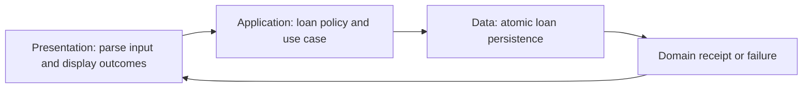

Three-tier architecture separates presentation, application behavior, and data management. Those responsibilities can be deployed as client, application server, and database, while their source-code boundaries still need explicit dependency contracts.

Merely creating three folders does not produce a useful architecture. The important question is which layer owns validation, domain decisions, persistence guarantees, and translation of failures.

<!--more-->

The Swift 5.7 case study implements a library-loan workflow in one process so its responsibilities can be tested. A physically separated three-tier deployment adds network, authentication, serialization, and operational concerns beyond this local example.

## Put use-case rules in the application tier

```swift
struct LoanRequest { let bookID: Int; let memberID: Int; let days: Int }
struct LoanReceipt: Equatable { let bookID: Int; let memberID: Int; let dueDay: Int }
enum LoanFailure: Error {
    case invalidRequest
    case inactiveMember
    case unavailableBook
    case storageUnavailable
}

protocol LoanStoring {
    func createLoan(bookID: Int, memberID: Int, dueDay: Int) throws -> LoanReceipt
}

struct LoanService {
    let store: any LoanStoring
    func borrow(_ request: LoanRequest, today: Int) throws -> LoanReceipt {
        guard request.bookID > 0, request.memberID > 0, today >= 0,
              (1...14).contains(request.days) else { throw LoanFailure.invalidRequest }
        let due = today.addingReportingOverflow(request.days)
        guard !due.overflow else { throw LoanFailure.invalidRequest }
        return try store.createLoan(bookID: request.bookID, memberID: request.memberID,
                                    dueDay: due.partialValue)
    }
}
```

The service owns the supported loan duration and calculation. It depends on an application-facing persistence capability, not a database connection or query object.

`today` is a supplied day number. A boundary adapter must define the calendar and time zone when translating real timestamps into this model. The domain calculation should not read a hidden system clock halfway through the workflow.

## Give the data boundary an atomic contract

```swift
final class MemoryLoanStore: LoanStoring {
    private var available: [Int: Int]
    private let activeMembers: Set<Int>
    private(set) var loans: [LoanReceipt] = []
    init(available: [Int: Int], activeMembers: Set<Int>) {
        precondition(available.values.allSatisfy { $0 >= 0 })
        self.available = available
        self.activeMembers = activeMembers
    }
    func createLoan(bookID: Int, memberID: Int, dueDay: Int) throws -> LoanReceipt {
        guard activeMembers.contains(memberID) else { throw LoanFailure.inactiveMember }
        guard let count = available[bookID], count > 0 else { throw LoanFailure.unavailableBook }
        let receipt = LoanReceipt(bookID: bookID, memberID: memberID, dueDay: dueDay)
        available[bookID] = count - 1
        loans.append(receipt)
        return receipt
    }
}
```

This in-memory adapter requires serialized access. Within one call it checks member status and inventory before changing stock and recording the loan. A production database adapter needs a transaction or equivalent atomic operation preserving those relationships under concurrent borrowers.

Exposing separate `hasCopy`, `decrementCopy`, and `insertLoan` calls would force the service to orchestrate a race-prone check-then-write sequence. A narrow domain operation can express the persistence guarantee the use case actually needs.

If membership lives in another external system, the guarantee needs a cross-system policy rather than a claim that one local transaction covers everything.

## Keep presentation parsing and result mapping separate

```swift
enum BorrowViewState: Equatable {
    case invalidInput
    case success(LoanReceipt)
    case inactiveMember
    case unavailableBook
    case unavailable
}

struct BorrowPresenter {
    let service: LoanService
    func submit(book: String, member: String, days: String, today: Int) -> BorrowViewState {
        guard let bookID = Int(book), let memberID = Int(member), let duration = Int(days) else {
            return .invalidInput
        }
        do {
            let receipt = try service.borrow(LoanRequest(bookID: bookID, memberID: memberID,
                                                         days: duration), today: today)
            return .success(receipt)
        } catch LoanFailure.invalidRequest { return .invalidInput }
        catch LoanFailure.inactiveMember { return .inactiveMember }
        catch LoanFailure.unavailableBook { return .unavailableBook }
        catch { return .unavailable }
    }
}

let store = MemoryLoanStore(available: [7: 1], activeMembers: [3])
let service = LoanService(store: store)
let presenter = BorrowPresenter(service: service)
assert(presenter.submit(book: "7", member: "3", days: "30", today: 100) == .invalidInput)
assert(store.loans.isEmpty)
assert(presenter.submit(book: "7", member: "3", days: "14", today: 100) ==
       .success(LoanReceipt(bookID: 7, memberID: 3, dueDay: 114)))
assert(presenter.submit(book: "7", member: "3", days: "14", today: 100) == .unavailableBook)
assert(store.loans.count == 1)
```

The presenter translates text into a request and maps domain outcomes into display state. It does not know how inventory is stored or repeat the fourteen-day rule in its own branch.

The service still validates parsed values because other callers may bypass this presenter. Presentation validation improves feedback; it is not the only enforcement of a domain invariant.

## Distinguish runtime flow from source dependencies



At runtime, the service invokes the store. In source code, the application owns `LoanStoring`, and a data adapter implements that contract. This keeps domain policy from importing a particular persistence SDK.

A physically deployed application server and database introduce network boundaries. The Swift client should not gain direct database credentials merely because the local tutorial uses one process.

## Put guarantees where they can be enforced

The application tier defines what a valid loan means. The data tier enforces stock consistency and atomic recording under concurrency. The presentation tier explains outcomes to the user.

If all validation exists only in UI controls, a background import can bypass it. If every domain rule is hardcoded in a screen's database query, another client can implement a different policy. If storage exposes no conditional operation, a service cannot invent atomicity from separate calls.

Use contracts that match the required guarantee, then test each boundary and the assembled use case.

## Failure and retries cross tiers too

A timeout between application server and client can happen after the loan committed. Blindly resubmitting may create another loan if stock remains. A request identity and durable idempotency protocol can make retries safe under the chosen scope.

Mapping every failure to “book unavailable” hides infrastructure outages and membership problems. Preserve enough structured information for the product's recovery choices while keeping vendor-specific diagnostics at the appropriate adapter or operational boundary.

The sample's revision-free store is intentionally small. Multi-record editing, optimistic conflicts, and cache freshness deserve explicit contracts like those in [Repository](/swift-repository/).

## Three tiers are not three classes per feature

A tiny local tool may co-locate these responsibilities with little ceremony. A larger application can enforce module boundaries and physical deployment separately. The number of files does not prove separation.

Avoid generic pass-through services that add a method for every table operation but own no policy. A use-case boundary should explain why an operation exists and which invariants it protects.

## Trace one invariant through all three responsibilities

The loan duration rule belongs to the application or domain boundary because every presentation surface must obey it. The presenter parses a text field, but the service still validates the numeric range. A future command-line client or background job must not bypass the rule by skipping the original screen.

Inventory availability belongs to the authoritative storage operation at commit time. Checking availability in the service and decrementing it later would create a race: two callers could both observe the last copy before either records a loan.

The in-memory store keeps the check and mutation in one serialized operation. A database implementation needs an equivalent transaction or conditional update. The three-tier diagram identifies responsibilities; it does not create a database isolation level or make two separate calls atomic.

## Dependency direction matters more than file count

Putting every type in a folder named `Presentation`, `Business`, or `Data` does not enforce the boundary. A presenter that opens the database directly still crosses it. A domain service returning a vendor-managed database object still exposes persistence lifecycle to its caller.

Use narrow protocols at the business boundary and return values meaningful to the use case. The data implementation adapts those operations to storage. The composition root supplies the implementation without making business rules depend on the concrete database library.

These logical layers may live in one process and one deployment. If the data tier moves across a network, latency, authentication, serialization, and uncertain outcomes become additional contracts. Distribution is an architectural decision with operational consequences, not a prerequisite for separating responsibilities in code.

## Reliability requirements reveal missing boundaries

Suppose a successful loan must also send a notification. Sending before committing risks announcing a loan that fails. Sending afterward risks a crash leaving a committed loan without a notification. If reliable notification is required, record pending notification work durably with the loan where an atomic storage boundary permits it.

The sender then delivers that work with a retry and deduplication policy. This is a separate responsibility from the presenter showing a receipt. A simple three-tier sketch must be refined when the product requires reliable coordination of several effects.

Similarly, retries of a loan request need a stable operation identity if duplicate loans are possible. The service's validation of days and inventory does not tell whether a repeated request is a retry or a genuinely new borrowing action.

Test business rules through the service with a recording store, storage invariants through the storage implementation, and presentation mapping with a fake service boundary. Integration tests then verify that the assembled tiers preserve those contracts together.

## Exercise: add idempotent borrowing

Introduce a caller request ID stored atomically with the loan receipt. A repeated identical request should return the earlier receipt, while a conflicting payload under the same ID should be rejected. Simulate a lost response after commit and verify retry does not consume another copy.

Then replace the in-memory adapter with a fake that reports unavailable storage and confirm presentation shows the distinct unavailable state without changing loan-policy code.

Return to the [Design Patterns roadmap](/swift-design-patterns/).
