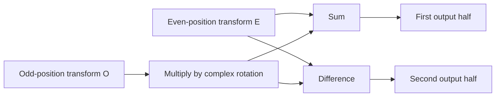

The discrete Fourier transform expresses a finite signal as a combination of frequency components. A fast Fourier transform computes the same result more efficiently; it does not provide a different frequency definition or repair incorrect sampling.

A useful implementation should specify sign, normalization, input length, and the mapping from bins to physical frequencies. Without those conventions, two numerically plausible arrays can represent different transforms.

<!--more-->

These Swift 5.7 examples implement a direct reference DFT and a radix-two FFT over complex samples. Foundation supplies trigonometric functions. The code favors clarity over the specialized layouts and vectorization of a production DSP library.

## Define the transform convention

For `N` samples, the forward transform is:

$$
X_k=\sum_{j=0}^{N-1}x_j e^{-2\pi i jk/N}.
$$

The inverse changes the exponent sign and divides by `N`. A real-valued signal is represented by complex inputs whose imaginary parts are zero.

```swift
import Foundation

struct Complex {
    let real: Double
    let imaginary: Double
    static let zero = Complex(real: 0, imaginary: 0)
    var magnitude: Double { hypot(real, imaginary) }
    static func + (a: Complex, b: Complex) -> Complex {
        Complex(real: a.real + b.real, imaginary: a.imaginary + b.imaginary)
    }
    static func - (a: Complex, b: Complex) -> Complex {
        Complex(real: a.real - b.real, imaginary: a.imaginary - b.imaginary)
    }
    static func * (a: Complex, b: Complex) -> Complex {
        Complex(real: a.real * b.real - a.imaginary * b.imaginary,
                imaginary: a.real * b.imaginary + a.imaginary * b.real)
    }
    func divided(by scale: Double) -> Complex {
        Complex(real: real / scale, imaginary: imaginary / scale)
    }
}

func dft(_ input: [Complex], inverse: Bool = false) -> [Complex] {
    guard !input.isEmpty else { return [] }
    let sign = inverse ? 1.0 : -1.0
    return input.indices.map { k in
        var sum = Complex.zero
        for j in input.indices {
            let angle = sign * 2 * Double.pi * Double(j) * Double(k) / Double(input.count)
            sum = sum + input[j] * Complex(real: cos(angle), imaginary: sin(angle))
        }
        return inverse ? sum.divided(by: Double(input.count)) : sum
    }
}
```

The direct implementation has `N` outputs, each combining `N` inputs, giving quadratic arithmetic work. It is valuable as an independent reference for small tests.

## Split even and odd positions



The radix-two decomposition writes the transform in terms of the even-index and odd-index subtransforms:

$$
X_k=E_k+\omega_N^k O_k,\qquad
X_{k+N/2}=E_k-\omega_N^k O_k.
$$

```swift
enum TransformFailure: Error { case invalidInput }

func fft(_ input: [Complex], inverse: Bool = false) throws -> [Complex] {
    guard !input.isEmpty, input.count.nonzeroBitCount == 1,
          input.allSatisfy({ $0.real.isFinite && $0.imaginary.isFinite }) else {
        throw TransformFailure.invalidInput
    }
    let sign = inverse ? 1.0 : -1.0
    func transform(_ values: [Complex]) -> [Complex] {
        if values.count == 1 { return values }
        let even = transform(stride(from: 0, to: values.count, by: 2).map { values[$0] })
        let odd = transform(stride(from: 1, to: values.count, by: 2).map { values[$0] })
        var output = Array(repeating: Complex.zero, count: values.count)
        for k in 0..<(values.count / 2) {
            let angle = sign * 2 * Double.pi * Double(k) / Double(values.count)
            let rotated = Complex(real: cos(angle), imaginary: sin(angle)) * odd[k]
            output[k] = even[k] + rotated
            output[k + values.count / 2] = even[k] - rotated
        }
        return output
    }
    let output = transform(input)
    return inverse ? output.map { $0.divided(by: Double(input.count)) } : output
}

let signal = (0..<8).map { index in
    Complex(real: sin(2 * Double.pi * Double(index) / 8), imaginary: 0)
}
let spectrum = try fft(signal)
let reference = dft(signal)
for index in spectrum.indices {
    assert(abs(spectrum[index].real - reference[index].real) < 1e-9)
    assert(abs(spectrum[index].imaginary - reference[index].imaginary) < 1e-9)
}
assert(abs(spectrum[1].magnitude - 4) < 1e-9)
assert(abs(spectrum[7].magnitude - 4) < 1e-9)
let restored = try fft(spectrum, inverse: true)
for index in signal.indices { assert(abs(restored[index].real - signal[index].real) < 1e-9) }
```

The sign is shared by every recursive call, and normalization happens once after the inverse transform. Dividing at every level by the full original length would produce incorrect scaling.

## Account for this representation's allocation

The recurrence is:

$$
T(N)=2T(N/2)+O(N)=O(N\log N).
$$

The implementation allocates even, odd, and output arrays at recursive levels. Total allocation traffic can be `O(N log N)`, while peak simultaneously live storage follows an `O(N)` bound under normal depth-first evaluation, plus logarithmic call depth.

An iterative in-place FFT can reuse a buffer after a permutation step, but requires more intricate indexing. Apple's [Accelerate framework](https://developer.apple.com/documentation/accelerate) provides optimized DSP facilities; verify its layout and scaling conventions rather than replacing this function mechanically.

## Interpret bins using the sample rate

For sample rate `fₛ`, bin spacing is `fₛ / N`. Bin `k` represents `k fₛ / N` under the forward convention, with upper bins corresponding to negative frequencies in the standard wrapped ordering.

A real signal has conjugate-symmetric frequency components, which is why the sample sinusoid has matching magnitudes at bins one and seven. A one-sided amplitude spectrum needs an explicit scaling convention and special treatment of DC and the Nyquist bin.

Frequency resolution depends on observation duration. Zero-padding produces more displayed frequency samples but does not create additional observed cycles or resolve information absent from the recording.

## Sampling and windows are separate decisions

Sampling below the required rate causes aliasing: different continuous signals can produce identical discrete samples. An FFT cannot distinguish them afterward. The acquisition chain needs an appropriate bandwidth and anti-alias filter.

A non-integer number of cycles in the observation window spreads energy across bins. Window functions trade sidelobe behavior against main-lobe width and alter amplitude scaling. Document the chosen window and its gain before interpreting peaks quantitatively.

The test uses an exact integer-bin sinusoid deliberately, isolating transform correctness from those signal-analysis effects.

## Test numerical behavior with tolerances

Compare the FFT with the direct DFT for lengths one, two, four, eight, and larger bounded powers of two. Test an impulse, a constant signal, complex-valued samples, and inverse round trips.

Use absolute and relative error appropriate to signal scale. Exact floating-point equality is generally the wrong oracle. Finite inputs can still overflow intermediate arithmetic at extreme magnitudes, so applications need a supported amplitude range or scaling policy.

## Energy conservation supplies another numerical check

Under this forward/inverse scaling convention, Parseval's relationship is:

$$
\sum_{j=0}^{N-1}|x_j|^2=\frac1N\sum_{k=0}^{N-1}|X_k|^2.
$$

```swift
let timeEnergy = signal.reduce(0.0) { $0 + $1.real * $1.real + $1.imaginary * $1.imaginary }
let frequencyEnergy = spectrum.reduce(0.0) {
    $0 + $1.real * $1.real + $1.imaginary * $1.imaginary
} / Double(spectrum.count)
assert(abs(timeEnergy - frequencyEnergy) < 1e-9)
for index in signal.indices {
    assert(abs(restored[index].imaginary - signal[index].imaginary) < 1e-9)
}
```

This detects some normalization mistakes that a peak-location check would miss. It should complement, not replace, direct-DFT comparison and round trips; several wrong transformations can preserve energy while permuting bins.

## Distinguish frequency content from presentation

A spectrum display may use magnitude, squared magnitude, logarithmic power, or a normalized one-sided amplitude. Those are derived representations with different units and scaling.

Taking a logarithm of zero requires a floor or explicit negative-infinity display policy. Doubling every one-sided bin incorrectly doubles DC and Nyquist terms. A window's gain also changes how a sinusoid's amplitude maps to the displayed peak.

Keep raw complex results available for algorithm tests and derive display values in a separate function. That makes a visual scale change independent of transform correctness and keeps phase information from being discarded before a later consumer needs it.

## Choose a convention before comparing another library

Some FFT APIs normalize neither direction, some normalize only the inverse, and some expose packed real transforms whose output omits redundant conjugate entries. A direct element-by-element comparison is meaningful only after converting those conventions.

Start with an impulse and a constant signal. An impulse at zero has a flat spectrum under this forward convention; a constant real signal concentrates at DC. Those fixtures reveal scaling and packing errors more clearly than an arbitrary noisy waveform.

Then test a shifted impulse to expose phase orientation. Magnitudes alone cannot distinguish opposite exponent signs, because both can produce the same magnitude spectrum while reversing phase.

Keep raw complex tests when integrating Accelerate. A spectrum plot that looks plausible is weak evidence for inverse transforms or convolution, where phase and normalization are essential.

## Exercise: implement linear convolution

Pad two sequences to a power-of-two length at least the sum of their lengths minus one, transform them, multiply corresponding bins, and invert. Compare with direct convolution. Explain why insufficient padding computes circular wraparound instead of the intended linear result.

Return to the [Data Structures and Algorithms roadmap](/swift-data-structures-and-algorithms/).
