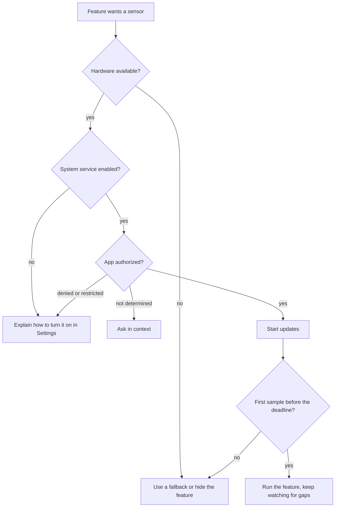

A feature built on a sensor makes a promise the hardware may not be able to keep. A floor counter needs a barometer, a compass needs a magnetometer, a step counter needs the motion coprocessor, and a geofence needs a location service that can monitor regions. Each iPhone, iPad, and Mac has a different mix of this hardware, and the iOS simulator has almost none of it. Before an app shows a button that depends on a sensor, it has to ask whether the device can provide that sensor at all.

This article covers that first question: which APIs answer it, what happens when an app skips the check, and how to design a feature so a missing sensor changes what the feature does instead of breaking it. The most useful result is a measurement. On the iOS 27 simulator, which has no motion hardware, starting the accelerometer, gyroscope, magnetometer, fused device motion, barometer, and compass anyway produced no error and no callback in ten seconds. Those services simply never sent anything. An app that waits for an error before it falls back would wait forever.

<!--more-->

The examples use Swift 6 language mode and were compiled with the Swift 6.4 toolchain from Xcode 27.1. Blocks that use Core Motion, which has no motion services on macOS, ran in a unit-test bundle hosted by an app on an iPhone 17 simulator running iOS 27.0. They are marked as iOS code in the text. The other blocks also ran as a macOS command-line program on macOS 26. To run them yourself, put the declarations at file scope and the statements, in order, in one `async` test method. The plain Swift blocks also work as a `main.swift`.

```swift
import Foundation
import Synchronization

/// A value that any thread can read and change. Sensor callbacks arrive on framework queues, so the examples
/// collect results in one of these.
final class Locked<Value: Sendable>: Sendable {
    private let mutex: Mutex<Value>
    init(_ value: Value) { mutex = Mutex(value) }
    var value: Value { mutex.withLock { $0 } }
    func mutate<R: Sendable>(_ body: (inout Value) -> R) -> R { mutex.withLock { body(&$0) } }
}
```

## Four questions before a sensor starts

"Can I use the barometer?" sounds like one question. In practice, an app has to answer four separate questions, each with its own API and its own failure:

1. **Does the hardware exist?** This is a fixed fact about the device. The answer comes from class or instance methods such as `CMAltimeter.isRelativeAltitudeAvailable()` and `CLLocationManager.headingAvailable()`.
2. **Is the system service switched on?** Location Services has a global switch in Settings. When the user turns it off, every app loses location, whatever permission it was granted.
3. **Has the user allowed this app to use it?** This is the authorization status, covered in the [next article](/ios-sensor-permissions/). It is separate from availability: on the simulator, `CMAltimeter.authorizationStatus()` reports `.notDetermined` for a barometer that doesn't exist.
4. **Is data actually arriving?** A service that is available, enabled, and authorized can still go quiet, because the user walks into a building, the app is suspended, or the hardware is busy.



The questions go from cheapest to most expensive. Availability is a synchronous call that costs microseconds and never shows the user anything. Authorization may show a system alert, which the app gets one chance at. Starting updates uses power. Checking availability first means an iPad without a barometer never sees a permission prompt for a floor counter it can't run.

The last box in the diagram is the one most apps leave out, and the rest of this article explains why it matters.

## The availability APIs

Apple spreads availability checks across several classes, and some are class methods while others need an instance. The table lists the checks for the sensors in this series, with the value each one returned on the iPhone 17 simulator running iOS 27.0:

| Sensor or service | API | Kind | Simulator |
| --- | --- | --- | --- |
| Accelerometer | `CMMotionManager().isAccelerometerAvailable` | instance | `false` |
| Gyroscope | `CMMotionManager().isGyroAvailable` | instance | `false` |
| Magnetometer | `CMMotionManager().isMagnetometerAvailable` | instance | `false` |
| Fused device motion | `CMMotionManager().isDeviceMotionAvailable` | instance | `false` |
| Attitude reference frames | `CMMotionManager.availableAttitudeReferenceFrames()` | class | `[]` |
| Step counting | `CMPedometer.isStepCountingAvailable()` | class | `false` |
| Pedometer distance, floors, pace, cadence | `CMPedometer.isDistanceAvailable()` and siblings | class | `false` |
| Pedometer events | `CMPedometer.isPedometerEventTrackingAvailable()` | class | `false` |
| Activity recognition | `CMMotionActivityManager.isActivityAvailable()` | class | `false` |
| Relative altitude (barometer) | `CMAltimeter.isRelativeAltitudeAvailable()` | class | `false` |
| Absolute altitude | `CMAltimeter.isAbsoluteAltitudeAvailable()` | class | `false` |
| Headphone motion | `CMHeadphoneMotionManager().isDeviceMotionAvailable` | instance | `false` |
| Heading (compass) | `CLLocationManager.headingAvailable()` | class | `false` |
| Circular region monitoring | `CLLocationManager.isMonitoringAvailable(for: CLCircularRegion.self)` | class | `false` |
| Significant location changes | `CLLocationManager.significantLocationChangeMonitoringAvailable()` | class | `true` |
| Beacon ranging | `CLLocationManager.isRangingAvailable()` | class | `false` |
| Location Services switch | `CLLocationManager.locationServicesEnabled()` | class | `true` |

There is no `isGPSAvailable`. Core Location hides which radios produced a fix. A Wi-Fi-only iPad still gets locations from Wi-Fi positioning, with a larger `horizontalAccuracy`. The [location accuracy article](/ios-location-updates-accuracy/) covers how to read that number.

The `CMMotionManager` checks are instance properties. Apple's documentation says to create only one `CMMotionManager` for the whole app, because "multiple instances of this class can affect the rate at which the system receives data from the accelerometer and gyroscope." An app that creates a throwaway manager just to read `isGyroAvailable` breaks that rule. Read the flags from the one shared manager instead.

### A capability snapshot

Hardware doesn't change while the app runs, so the checks belong in one value, captured once and passed to the code that needs it. A plain `Sendable` struct can cross actors, be encoded into a bug report, and be built by hand in a test:

```swift
/// The sensors this device has. These are hardware facts, so the value doesn't change while the app runs.
/// User permission and the Location Services switch are dynamic and deliberately aren't part of it.
struct SensorCapabilities: Sendable, Equatable, Codable {
    var accelerometer = false
    var gyroscope = false
    var magnetometer = false
    var deviceMotion = false
    var attitudeFrames: Set<AttitudeFrame> = []
    var stepCounting = false
    var pedometerDistance = false
    var floorCounting = false
    var activity = false
    var relativeAltitude = false
    var absoluteAltitude = false
    var heading = false
    var circularRegionMonitoring = false
    var significantLocationChanges = false
}

enum AttitudeFrame: String, Sendable, Codable, CaseIterable {
    case arbitrary, arbitraryCorrected, magneticNorth, trueNorth
}
```

The snapshot leaves out the Location Services switch and the authorization status on purpose. Those change while the app runs, when the user visits Settings, so they reach the app as delegate callbacks and updates instead of as part of a cached value. Mixing the two kinds of fact in one struct invites a bug where the app caches `locationServicesEnabled == true` at launch and never notices the switch going off.

The live implementation reads the real APIs. This block is iOS code:

<!-- ios -->
```swift
import CoreMotion
import CoreLocation

extension SensorCapabilities {
    /// Reads the hardware flags. Pass the app's single CMMotionManager.
    static func current(using motion: CMMotionManager) -> SensorCapabilities {
        let frames = CMMotionManager.availableAttitudeReferenceFrames()
        var set: Set<AttitudeFrame> = []
        if frames.contains(.xArbitraryZVertical) { set.insert(.arbitrary) }
        if frames.contains(.xArbitraryCorrectedZVertical) { set.insert(.arbitraryCorrected) }
        if frames.contains(.xMagneticNorthZVertical) { set.insert(.magneticNorth) }
        if frames.contains(.xTrueNorthZVertical) { set.insert(.trueNorth) }
        return SensorCapabilities(
            accelerometer: motion.isAccelerometerAvailable,
            gyroscope: motion.isGyroAvailable,
            magnetometer: motion.isMagnetometerAvailable,
            deviceMotion: motion.isDeviceMotionAvailable,
            attitudeFrames: set,
            stepCounting: CMPedometer.isStepCountingAvailable(),
            pedometerDistance: CMPedometer.isDistanceAvailable(),
            floorCounting: CMPedometer.isFloorCountingAvailable(),
            activity: CMMotionActivityManager.isActivityAvailable(),
            relativeAltitude: CMAltimeter.isRelativeAltitudeAvailable(),
            absoluteAltitude: CMAltimeter.isAbsoluteAltitudeAvailable(),
            heading: CLLocationManager.headingAvailable(),
            circularRegionMonitoring: CLLocationManager.isMonitoringAvailable(for: CLCircularRegion.self),
            significantLocationChanges: CLLocationManager.significantLocationChangeMonitoringAvailable())
    }
}

let sharedMotion = CMMotionManager()
let simulator = SensorCapabilities.current(using: sharedMotion)
assert(simulator == SensorCapabilities(significantLocationChanges: true))
```

The assertion is the whole simulator in one line: the only sensor service it reports is significant location changes. Every flag the struct leaves at its default of `false` is `false`.

## What happens when you start anyway

The availability flags are advisory. Nothing stops an app from calling `startAccelerometerUpdates` on a device without an accelerometer. What the frameworks do then decides how an app finds out about a missing sensor, so it's worth measuring.

Permission has to be settled first, or it muddies the result. The pedometer, activity, and altimeter APIs are covered by the Motion & Fitness permission, and while that question is unanswered they wait for the user. So the test grants motion and location access before it starts, from the Mac's terminal:

<!-- sim-setup -->
```sh
xcrun simctl privacy booted grant motion dev.swiftbydeya.Host
xcrun simctl privacy booted grant location dev.swiftbydeya.Host
```

The next block, which is iOS code, then starts every motion service the simulator lacks, plus heading updates and region monitoring, and records every callback for ten seconds:

<!-- ios -->
```swift
/// Collects callback descriptions from any thread.
typealias CallbackLog = Locked<[String]>
extension Locked<[String]> {
    func add(_ entry: String) { mutate { $0.append(entry) } }
}

func describe(_ error: (any Error)?) -> String {
    error.map { "error \(($0 as NSError).code)" } ?? "data"
}

final class LocationProbe: NSObject, CLLocationManagerDelegate {
    let log: CallbackLog
    init(log: CallbackLog) { self.log = log }
    func locationManager(_ manager: CLLocationManager, didFailWithError error: any Error) {
        log.add("location \(describe(error))")
    }
    func locationManager(_ manager: CLLocationManager, didUpdateHeading newHeading: CLHeading) {
        log.add("heading")
    }
    func locationManager(_ manager: CLLocationManager, monitoringDidFailFor region: CLRegion?, withError error: any Error) {
        log.add("monitoring \(describe(error))")
    }
}

/// Starts every service with handlers built outside the main actor, because Core Motion calls them on its queue.
nonisolated func startEverything(motion: CMMotionManager, pedometer: CMPedometer, altimeter: CMAltimeter,
                                 activity: CMMotionActivityManager, queue: OperationQueue, log: CallbackLog) {
    motion.startAccelerometerUpdates(to: queue) { _, error in log.add("accelerometer \(describe(error))") }
    motion.startGyroUpdates(to: queue) { _, error in log.add("gyro \(describe(error))") }
    motion.startMagnetometerUpdates(to: queue) { _, error in log.add("magnetometer \(describe(error))") }
    motion.startDeviceMotionUpdates(using: .xMagneticNorthZVertical, to: queue) { _, error in
        log.add("device motion \(describe(error))")
    }
    pedometer.startUpdates(from: Date()) { _, error in log.add("pedometer \(describe(error))") }
    pedometer.queryPedometerData(from: Date(timeIntervalSinceNow: -3600), to: Date()) { _, error in
        log.add("pedometer query \(describe(error))")
    }
    altimeter.startRelativeAltitudeUpdates(to: queue) { _, error in log.add("altimeter \(describe(error))") }
    activity.queryActivityStarting(from: Date(timeIntervalSinceNow: -3600), to: Date(), to: queue) { _, error in
        log.add("activity query \(describe(error))")
    }
}

assert(CMPedometer.authorizationStatus() == .authorized)
let log = CallbackLog([])
let queue = OperationQueue()
let pedometer = CMPedometer(), altimeter = CMAltimeter(), activity = CMMotionActivityManager()
startEverything(motion: sharedMotion, pedometer: pedometer, altimeter: altimeter, activity: activity, queue: queue, log: log)
let locationManager = CLLocationManager()
let probe = LocationProbe(log: log)
locationManager.delegate = probe
locationManager.startUpdatingHeading()
locationManager.startMonitoring(for: CLCircularRegion(
    center: CLLocationCoordinate2D(latitude: 51.5007, longitude: -0.1246), radius: 200, identifier: "probe"))

assert(!sharedMotion.isAccelerometerActive && !sharedMotion.isDeviceMotionActive)
try await Task.sleep(for: .seconds(10))

let notAvailable = Int(CMErrorMotionActivityNotAvailable.rawValue)
assert(notAvailable == 104)
assert(log.value.sorted() == [
    "activity query error 104",
    "monitoring error \(CLError.regionMonitoringFailure.rawValue)",
    "pedometer error 104",
    "pedometer query error 104",
])

sharedMotion.stopAccelerometerUpdates(); sharedMotion.stopGyroUpdates()
sharedMotion.stopMagnetometerUpdates(); sharedMotion.stopDeviceMotionUpdates()
pedometer.stopUpdates(); altimeter.stopRelativeAltitudeUpdates()
locationManager.stopUpdatingHeading()
assert(locationManager.monitoredRegions.isEmpty, "the failed region was dropped")
```

After ten seconds the log held four entries. The rest of the services never called back:

| Call | Result on missing hardware |
| --- | --- |
| `startAccelerometerUpdates(to:withHandler:)`, gyroscope, magnetometer, device motion | No callback, no error. `isAccelerometerActive` stays `false`. |
| `CMAltimeter.startRelativeAltitudeUpdates(to:withHandler:)` | No callback, no error |
| `CLLocationManager.startUpdatingHeading()` | No delegate call, and `heading` stays `nil` |
| `CMPedometer.startUpdates(from:withHandler:)` | Error 104, `CMErrorMotionActivityNotAvailable` |
| `CMPedometer.queryPedometerData(from:to:withHandler:)` | Error 104 |
| `CMMotionActivityManager.queryActivityStarting(from:to:to:withHandler:)` | Error 104 |
| `CLLocationManager.startMonitoring(for:)` | `monitoringDidFailFor` with code 5, `regionMonitoringFailure` |

So the frameworks split into two groups. The pedometer and activity APIs, which come from the motion coprocessor, report the missing hardware. The raw sensor streams, the barometer, and the compass don't report anything. They just never deliver a sample. The failed region is also gone: after `monitoringDidFailFor`, `monitoredRegions` was empty, so an app that wants to retry later has to remember what it asked for.

The permission grant in the setup step turned out to matter. In an earlier run, motion access was undecided. The pedometer and activity calls then stayed silent too, while the system's Motion & Fitness alert waited on screen, and they reported error 104 only after the alert was answered. An `async` wrapper around `queryPedometerData` built with `withCheckedThrowingContinuation` would be suspended for as long as the alert stays up. The [permissions article](/ios-sensor-permissions/) measures that wait.

Two things follow:

- **Check availability before every start, not once per app.** The check costs nothing. Starting without it costs a stream that never delivers, or an error you have to decode.
- **Don't rely on an error to find a missing sensor.** Half of the services above never report one. Even with availability checked, a sensor can stop delivering for reasons no flag predicts. The fourth question, "is data arriving?", needs a deadline.

## A deadline for the first sample

A watchdog that fails a stream when its first element doesn't arrive in time covers all of these cases: missing hardware, a query waiting on an unanswered alert, and a sensor that is busy or suspended. It wraps any `AsyncStream` and returns a throwing stream that forwards every element, or throws `SensorSilent` if nothing arrives before the deadline:

```swift
/// Thrown when a sensor stream produces nothing before its deadline.
struct SensorSilent: Error, Equatable {
    let deadline: Duration
}

/// Forwards `upstream`, but fails with `SensorSilent` if the first element takes longer than `deadline`.
/// Finishing or cancelling the returned stream cancels the iteration of `upstream`, which ends it.
func requiringFirstElement<Element: Sendable>(
    of upstream: AsyncStream<Element>, within deadline: Duration
) -> AsyncThrowingStream<Element, any Error> {
    AsyncThrowingStream { continuation in
        let forwarding = Task {
            let watchdog = Task {
                try await Task.sleep(for: deadline)
                continuation.finish(throwing: SensorSilent(deadline: deadline))
            }
            for await element in upstream {
                watchdog.cancel()
                continuation.yield(element)
            }
            watchdog.cancel()
            continuation.finish()
        }
        continuation.onTermination = { _ in forwarding.cancel() }
    }
}
```

The cleanup path matters as much as the timeout. When the watchdog finishes the output stream, `onTermination` cancels the forwarding task. That ends its `for await` loop, which releases the upstream iterator, and the upstream stream's own `onTermination` runs. If the upstream stream wraps a sensor, its `onTermination` is where the sensor stops. So a silent sensor gets turned off rather than left running in the hope that it wakes up.

Fake streams test both outcomes on any platform. The silent one never yields and records when it's terminated. The other yields twice after 50 ms:

```swift
/// A stream that never yields, and records whether its consumer let go of it.
func silentStream(terminated: Locked<Bool>) -> AsyncStream<Double> {
    AsyncStream { continuation in
        continuation.onTermination = { _ in terminated.mutate { $0 = true } }
    }
}

let terminated = Locked(false)
let clock = ContinuousClock()
let started = clock.now
var silence: SensorSilent?
do {
    for try await _ in requiringFirstElement(of: silentStream(terminated: terminated), within: .milliseconds(200)) {}
} catch let error as SensorSilent {
    silence = error
}
let silentAfter = clock.now - started
assert(silence == SensorSilent(deadline: .milliseconds(200)))
assert(silentAfter >= .milliseconds(200) && silentAfter < .milliseconds(400))
try await Task.sleep(for: .milliseconds(20))
assert(terminated.value, "the silent upstream was released")

let talkative = AsyncStream<Double> { continuation in
    Task {
        try? await Task.sleep(for: .milliseconds(50))
        continuation.yield(9.81); continuation.yield(9.79); continuation.finish()
    }
}
var received: [Double] = []
for try await value in requiringFirstElement(of: talkative, within: .milliseconds(200)) { received.append(value) }
assert(received == [9.81, 9.79])
print("silent stream failed after", silentAfter)
```

In three macOS runs the silent stream failed after 209 to 213 ms, the deadline plus the time to schedule the watchdog and unwind. Its `onTermination` had run by the time the test checked 20 ms later. The talkative stream delivered both values and finished normally, because the watchdog was cancelled when the first element arrived.

### Applying the deadline to Core Motion

Real sensors need a wrapper that turns callbacks into an `AsyncStream`. The [accelerometer article](/ios-accelerometer-gyroscope/) builds this wrapper properly. Here is the short version, enough to show the deadline catching the simulator's silent accelerometer. Two details are about Swift 6:

- The handler is built in a `nonisolated` static function. Core Motion calls it on the operation queue, and a closure written inside a main-actor method would be main-actor isolated, so it would fail Swift's runtime isolation check on that queue.
- The sample is copied into a `Sendable` struct before it leaves the handler, because `CMAccelerometerData` isn't `Sendable`.

This block is iOS code too:

<!-- ios -->
```swift
struct Acceleration: Sendable {
    let x, y, z: Double
    let timestamp: TimeInterval
}

@MainActor final class MotionService {
    private let manager: CMMotionManager
    private let queue: OperationQueue = {
        let queue = OperationQueue()
        queue.maxConcurrentOperationCount = 1
        return queue
    }()
    private(set) var stopCount = 0

    init(manager: CMMotionManager) { self.manager = manager }

    func accelerations(every interval: TimeInterval) -> AsyncStream<Acceleration> {
        let (stream, continuation) = AsyncStream.makeStream(of: Acceleration.self, bufferingPolicy: .bufferingNewest(64))
        manager.accelerometerUpdateInterval = interval
        manager.startAccelerometerUpdates(to: queue, withHandler: Self.forward(to: continuation))
        continuation.onTermination = { [weak self] _ in
            Task { @MainActor in self?.stopAccelerometer() }
        }
        return stream
    }

    private func stopAccelerometer() {
        manager.stopAccelerometerUpdates()
        stopCount += 1
    }

    private nonisolated static func forward(to continuation: AsyncStream<Acceleration>.Continuation) -> CMAccelerometerHandler {
        { data, _ in
            guard let data else { return }
            continuation.yield(Acceleration(x: data.acceleration.x, y: data.acceleration.y,
                                            z: data.acceleration.z, timestamp: data.timestamp))
        }
    }
}

let motionService = MotionService(manager: sharedMotion)
var accelerometerSilent = false
do {
    for try await _ in requiringFirstElement(of: motionService.accelerations(every: 0.02), within: .seconds(1)) {}
} catch is SensorSilent {
    accelerometerSilent = true
}
try await Task.sleep(for: .milliseconds(100))
assert(accelerometerSilent)
assert(motionService.stopCount == 1, "the deadline stopped the accelerometer")
```

On the simulator the loop threw `SensorSilent` after one second, and the termination chain called `stopAccelerometerUpdates()` once. On an iPhone the first sample arrives within a few update intervals, and the same code just runs.

How long should the deadline be? Long enough that a healthy sensor never trips it, and short enough that the user doesn't notice the wait. A motion sensor at 50 Hz should deliver its first sample within tens of milliseconds, so a deadline of half a second is generous. Location is different. A cold GPS start outdoors can take many seconds, and the first fix indoors may never be precise. The [accuracy article](/ios-location-updates-accuracy/) handles location with a separate idea, a time budget for reaching a target accuracy, because "no fix yet" and "only a poor fix so far" are different situations.

## Designing for the device you get

Availability checks are only half the job. The other half is deciding what the feature does without the sensor. Most sensor features have a sensible fallback, and writing the fallbacks down as code makes them testable and visible to product discussions.

Take a run tracker that shows steps, heading, and floors climbed. Each value has a best source and a worse one:

| Value | Best source | Fallback | Last resort |
| --- | --- | --- | --- |
| Steps | `CMPedometer` (motion coprocessor) | Step detection on raw accelerometer data | Estimate from GPS distance and stride length |
| Heading | Compass (`CLHeading`) | GPS course, only while moving | None |
| Floors | `CMPedometer` floor counting | Barometric relative altitude | None |

A plan is a pure function from capabilities to sources, so it runs in a unit test without any hardware:

```swift
enum StepSource: Equatable { case pedometer, accelerometer, gpsDistance, none }
enum HeadingSource: Equatable { case compass, courseWhileMoving, none }
enum FloorSource: Equatable { case pedometer, barometer, none }

struct RunTrackerPlan: Equatable {
    var steps: StepSource
    var heading: HeadingSource
    var floors: FloorSource
}

func plan(for capabilities: SensorCapabilities, locationAllowed: Bool) -> RunTrackerPlan {
    let steps: StepSource =
        capabilities.stepCounting ? .pedometer :
        capabilities.accelerometer ? .accelerometer :
        locationAllowed ? .gpsDistance : .none
    let heading: HeadingSource =
        capabilities.heading && locationAllowed ? .compass :
        locationAllowed ? .courseWhileMoving : .none
    let floors: FloorSource =
        capabilities.floorCounting ? .pedometer :
        capabilities.relativeAltitude ? .barometer : .none
    return RunTrackerPlan(steps: steps, heading: heading, floors: floors)
}

let iPhone = SensorCapabilities(accelerometer: true, gyroscope: true, magnetometer: true, deviceMotion: true,
                                attitudeFrames: Set(AttitudeFrame.allCases), stepCounting: true,
                                pedometerDistance: true, floorCounting: true, activity: true,
                                relativeAltitude: true, absoluteAltitude: true, heading: true,
                                circularRegionMonitoring: true, significantLocationChanges: true)
let simulatorLike = SensorCapabilities(significantLocationChanges: true)

assert(plan(for: iPhone, locationAllowed: true) == RunTrackerPlan(steps: .pedometer, heading: .compass, floors: .pedometer))
assert(plan(for: simulatorLike, locationAllowed: true) == RunTrackerPlan(steps: .gpsDistance, heading: .courseWhileMoving, floors: .none))
assert(plan(for: simulatorLike, locationAllowed: false) == RunTrackerPlan(steps: .none, heading: .none, floors: .none))
```

Notice that the compass also needs location permission. `CLHeading` comes from `CLLocationManager`, and while `magneticHeading` needs no fix, `trueHeading` does, because the conversion from magnetic north to true north depends on where the device is. The [heading article](/ios-heading-compass/) has the details. The plan says so explicitly, so a denied location permission downgrades the heading instead of showing a compass that never moves.

The plan also gives the interface something to say. `floors == .none` is a reason to hide the floors tile. `steps == .gpsDistance` is a reason to label the number "estimated". Both decisions are made once, from data, instead of being discovered when a tile shows zero forever. The [missing data article](/ios-sensor-missing-data/) returns to that last problem, the zero that really means "no sensor".

## When availability changes at runtime

Built-in hardware doesn't appear or disappear, but three related things do change while the app runs.

**The Location Services switch.** Apple's documentation for `locationServicesEnabled()` describes what happens when the user turns the switch off: the system calls the delegate's authorization callback with a `.denied` status, and when the switch comes back on it restores the app's previous authorization and calls the delegate again. So an app that handles authorization changes already handles the switch. It calls `locationServicesEnabled()` only to pick the right instructions. If it returns `false`, tell the user to turn Location Services on. If it returns `true` and the status is `.denied`, tell them to allow your app.

Don't make that call on the main thread. Xcode reports a runtime warning when you do, and an Apple engineer on the developer forums [explains it plainly](https://developer.apple.com/forums/thread/732108): the method "can take a while to come back, so calling it on the main thread puts you at risk of UI responsiveness problems." It's a synchronous query to another process. Measured on the simulator, from iOS code that keeps the call off the main actor, it was fast:

<!-- ios -->
```swift
/// Asks for the Location Services switch away from the main actor.
nonisolated func locationServicesSwitch() async -> Bool {
    CLLocationManager.locationServicesEnabled()
}

let switchClock = ContinuousClock()
let switchStart = switchClock.now
let servicesOn = await locationServicesSwitch()
let switchTook = switchClock.now - switchStart
assert(servicesOn)
print("locationServicesEnabled took", switchTook)
```

A `nonisolated async` function runs on the global concurrent executor, so the main actor keeps running while it waits. On the simulator the round trip took under a millisecond. A real device with location services busy can take longer, and a frame at 120 Hz lasts only 8.3 ms. Since the authorization callback already reports when the switch goes off, most apps never need to call this at all.

**Headphones.** `CMHeadphoneMotionManager.isDeviceMotionAvailable` says whether the system supports headphone motion, not whether motion-capable headphones are connected right now. Connections arrive as `headphoneMotionManagerDidConnect(_:)` and `headphoneMotionManagerDidDisconnect(_:)` delegate calls, which `startConnectionStatusUpdates()` turns on before any motion updates start. The headers say the callbacks run on the queue used for motion updates, or on the main thread if none was given. The documentation also warns that starting headphone motion without `NSMotionUsageDescription` in the Info.plist crashes the app.

**Region monitoring support.** `isMonitoringAvailable(for:)` returned `false` on the simulator, and starting monitoring failed with code 5. On a device the flag is usually `true`, but monitoring can still fail at runtime, for example when the app goes over the system's limit on monitored regions. The [geofencing article](/ios-region-monitoring-geofencing/) covers that limit and `CLMonitor`, the newer API, which reports these failures as properties of its events.

## Declaring hard requirements

Some apps can't work at all without a sensor. A compass app without a magnetometer has nothing to show. For those apps, the `UIRequiredDeviceCapabilities` Info.plist key tells the App Store not to offer the app to devices without the hardware. The sensor-related values are `accelerometer`, `gyroscope`, `magnetometer`, `gps`, and `location-services`.

Use the key carefully, for three reasons from Apple's documentation:

- The App Store "prevents customers from installing an app on a device that doesn't support the required capabilities," so each value shrinks the audience.
- For `gps`, the documentation says to require it "only if your app needs location data more accurate than the cellular or Wi-Fi radios provide". A Wi-Fi-only iPad has location services but no GPS.
- For updates, "you can only maintain or relax capability requirements". Adding a requirement in version 2 would strand existing users on devices that no longer qualify. That decision is hard to undo, so it belongs before the first release.

For everything short of "the app is pointless without it", a runtime check and a fallback plan reach more users than a declared requirement.

## Summary

- Using a sensor means answering four questions in order: does the hardware exist, is the system service on, has the user allowed it, and is data arriving. Each has its own API and its own failure.
- Availability checks are cheap and synchronous, so run them before any permission prompt or start call. On an iPhone 17 simulator running iOS 27.0, every motion check returned `false`, and of the location checks only significant changes and the Location Services switch returned `true`.
- Starting a missing sensor often doesn't fail. The accelerometer, gyroscope, magnetometer, device motion, altimeter, and compass never called back in ten seconds. The pedometer and activity APIs reported error 104, but only once motion permission was decided. Region monitoring reported `regionMonitoringFailure`.
- A deadline on the first sample catches silent sensors whatever the cause, and wiring the deadline to stream termination stops the sensor when it trips.
- Keep hardware facts in an immutable `Sendable` snapshot. Leave out the dynamic state (authorization, the Location Services switch), which arrives through callbacks.
- Write fallbacks as a pure function from capabilities to sources. It can be tested without hardware, and it tells the interface what to hide and what to label as an estimate.
- Declare `UIRequiredDeviceCapabilities` only for hardware the app truly can't do without, because the requirement can never be added later without stranding users.

## Exercise

Write an `async` wrapper for `CMPedometer.queryPedometerData(from:to:)` that can't wait forever, even while a permission alert is up. It should return the data, rethrow Core Motion's error, or throw `SensorSilent` after a deadline you pass in. Make sure the continuation is resumed exactly once even when the handler fires after the deadline. A `Mutex<CheckedContinuation<...>?>` that is taken out with `withLock { $0.take() }` is one way. Test it against a fake query function that calls back after 50 ms, never, or twice, without any hardware involved.

## Further reading

- [`CMMotionManager`](https://developer.apple.com/documentation/coremotion/cmmotionmanager), including the advice to create a single instance
- [`locationServicesEnabled()`](https://developer.apple.com/documentation/corelocation/cllocationmanager/locationservicesenabled()), on the system switch and how the delegate learns about it
- [`CMHeadphoneMotionManager`](https://developer.apple.com/documentation/coremotion/cmheadphonemotionmanager), for headphone availability and the usage-description requirement
- [`UIRequiredDeviceCapabilities`](https://developer.apple.com/documentation/bundleresources/information-property-list/uirequireddevicecapabilities), the list of device capability keys and how the App Store applies them

Next: [Requesting Motion and Location Permissions in Context](/ios-sensor-permissions/)

Return to the [Sensors and Location roadmap](/ios-sensors/).
