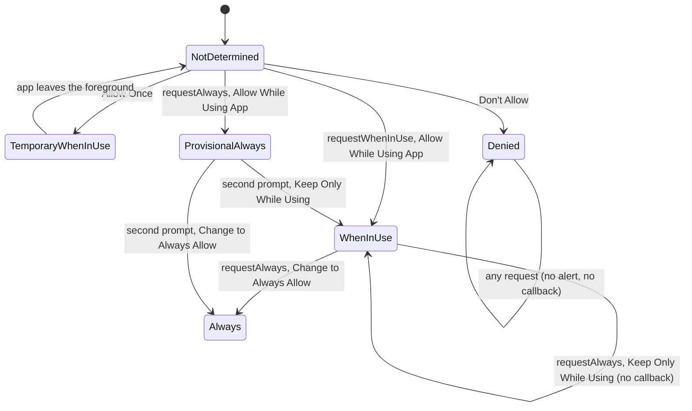

A permission alert is a question an app gets to ask once. If the user taps Don't Allow, later requests show nothing and report nothing, and the only way back is a trip to Settings that most people never make. So *when* and *how* an app asks matters as much as the call that shows the alert.

This article covers both permission systems a sensor app deals with, Core Location's and Core Motion's. They differ in almost everything: how the request is made, what happens when the Info.plist is incomplete, and what the app hears back. Every outcome below was measured by tapping the real system alerts on an iOS 27 simulator. Three results shape the design. A missing motion purpose string crashes the app, but a missing location purpose string fails without a sound. "Keep Only While Using" sends the app no callback at all. And the Motion & Fitness alert appears even on a device with no motion hardware.

<!--more-->

The examples use Swift 6 language mode and were compiled with the Swift 6.4 toolchain from Xcode 27.1. The iOS code ran in a unit-test bundle hosted by an app on an iPhone 17 simulator running iOS 27.0, whose Info.plist has the usage descriptions shown below. The plain Swift blocks also ran as a macOS command-line program on macOS 26. The [availability article](/ios-sensor-availability/) explains the setup. To answer the alerts while the test waits, a small UI test taps the button with a given label. That UI test appears near the end of the article.

```swift
import Foundation
import CoreLocation
```

## Two permission systems

Core Location and Core Motion protect different data in different ways:

| | Location | Motion & Fitness |
| --- | --- | --- |
| What it covers | `CLLocationManager` updates, heading, regions, visits, `CLLocationUpdate`, `CLMonitor` | `CMPedometer`, `CMMotionActivityManager`, `CMAltimeter`, `CMHeadphoneMotionManager` |
| Not covered | | `CMMotionManager`: raw accelerometer, gyroscope, magnetometer, and device motion need no permission |
| How to ask | `requestWhenInUseAuthorization()`, `requestAlwaysAuthorization()`, or `CLServiceSession` | No request API. The first query or start call shows the alert |
| Levels | When In Use, Always, plus full or reduced accuracy | One switch for all four classes |
| Status | `authorizationStatus`, `accuracyAuthorization`, delegate callback | `authorizationStatus()` class method on each class, no callback |
| Info.plist key | `NSLocationWhenInUseUsageDescription`, and `NSLocationAlwaysAndWhenInUseUsageDescription` for Always | `NSMotionUsageDescription` |

The raw-sensor exemption deserves a second look. An app can read the accelerometer and gyroscope at 100 Hz without asking anyone, while the step count derived from the same hardware sits behind a permission. Apple gates the *interpreted* data: steps walked, activity type, floors climbed. Those describe a person's day, while a raw acceleration sample on its own doesn't. The [pedometer article](/ios-pedometer-activity/) shows that you can still derive steps from raw samples yourself. That is legal, but the user hasn't agreed to it, so the honest thing is to treat it with the same care.

## Purpose strings, and what happens without one

The text in the system alert comes from the Info.plist. The test host for this series declares these strings:

| Key | Value |
| --- | --- |
| `NSLocationWhenInUseUsageDescription` | Shows where you are on the run map. |
| `NSLocationAlwaysAndWhenInUseUsageDescription` | Records your run while the screen is off. |
| `NSMotionUsageDescription` | Counts steps during a run. |

Apple's Human Interface Guidelines ask for "a brief, complete sentence that's straightforward, specific, and easy to understand". The alert shows it under a title the system writes, "Allow "Host" to use your location?", so the string should say what the user gets, not repeat the request.

Forgetting a key is a common mistake, and the two frameworks fail in opposite ways. A second test host was built with the same code and no usage descriptions. With that host, requesting location did this:

- `requestWhenInUseAuthorization()` showed no alert, and the status stayed `.notDetermined`.
- `startUpdatingLocation()` produced no location and no error callback.
- `CLLocationUpdate.liveUpdates()` delivered one update with `authorizationRequestInProgress == true` and no location, then nothing more. So the update claimed a request was in progress when none could ever finish.
- The only trace was in the device log: "This app has attempted to access privacy-sensitive data without a usage description. The app's Info.plist must contain an "NSLocationWhenInUseUsageDescription" key…"

Motion is the opposite. This code crashed the bare host the moment it ran, even though the simulator has no pedometer:

<!-- ios -->
```swift
// Crashes in an app without NSMotionUsageDescription: the system aborts the process with a TCC privacy violation
import CoreMotion
let pedometer = CMPedometer()
pedometer.queryPedometerData(from: Date(timeIntervalSinceNow: -60), to: Date()) { _, _ in }
```

The crash report's exception was `SIGABRT` with termination namespace `TCC`, and the top frames were `abort_with_payload` called from `__TCC_CRASHING_DUE_TO_PRIVACY_VIOLATION__`. The console said "This app has crashed because it attempted to access privacy-sensitive data without a usage description."

A crash at least gets noticed in the first test run. The silent location failure can ship. A preflight check in debug builds catches both. It's a pure function over the Info.plist dictionary, so it also works in a unit test:

```swift
enum ProtectedService: CaseIterable {
    case locationWhenInUse, locationAlways, motion

    var purposeKeys: [String] {
        switch self {
        case .locationWhenInUse: ["NSLocationWhenInUseUsageDescription"]
        case .locationAlways: ["NSLocationWhenInUseUsageDescription", "NSLocationAlwaysAndWhenInUseUsageDescription"]
        case .motion: ["NSMotionUsageDescription"]
        }
    }
}

/// The purpose-string keys that are missing or blank for the services an app uses.
func missingPurposeStrings(for services: [ProtectedService], in info: [String: Any]) -> [String] {
    let needed = Set(services.flatMap(\.purposeKeys))
    return needed.filter { key in
        let text = (info[key] as? String)?.trimmingCharacters(in: .whitespacesAndNewlines) ?? ""
        return text.isEmpty
    }.sorted()
}

let incomplete: [String: Any] = [
    "NSLocationWhenInUseUsageDescription": "Shows where you are on the run map.",
    "NSMotionUsageDescription": "  ",
]
assert(missingPurposeStrings(for: [.locationWhenInUse], in: incomplete) == [])
assert(missingPurposeStrings(for: ProtectedService.allCases, in: incomplete)
       == ["NSLocationAlwaysAndWhenInUseUsageDescription", "NSMotionUsageDescription"])
```

At launch, in debug builds, run it against the real bundle:

<!-- ios -->
```swift
let info = Bundle.main.infoDictionary ?? [:]
let missing = missingPurposeStrings(for: ProtectedService.allCases, in: info)
assert(missing.isEmpty, "Missing purpose strings: \(missing)")
```

Localized purpose strings live in `InfoPlist.strings` or a string catalog. The check above reads the base Info.plist, so a key that exists only in a localization would be reported as missing. That's arguably correct, because the base value is what users see in any language that has no translation.

## The location authorization lifecycle

`CLAuthorizationStatus` has five values. The raw values show up in logs, so they're worth knowing:

| Status | Raw value | Meaning |
| --- | --- | --- |
| `.notDetermined` | 0 | Never asked, or a temporary grant expired |
| `.restricted` | 1 | Parental controls or device management forbid it. The user can't change it |
| `.denied` | 2 | The user said no, or turned Location Services off |
| `.authorizedAlways` | 3 | Always, or *provisional* Always |
| `.authorizedWhenInUse` | 4 | While using the app, or Allow Once |

How the app moves between them depends on which request it makes and which button the user taps. These are the transitions measured on the simulator, each from a reset state, with the button tapped by a UI test:



| Request | Alert | Button | Callback status |
| --- | --- | --- | --- |
| `requestWhenInUseAuthorization()` | Allow Once / Allow While Using App / Don't Allow | Allow While Using App | 4 |
| same | same | Allow Once | 4, then 0 about 18 s after the app went to the background |
| same | same | Don't Allow | 2, with `accuracyAuthorization` reading `.reducedAccuracy` |
| `requestAlwaysAuthorization()` from 0 | The same three-button alert | Allow While Using App | 3 (provisional Always) |
| `requestAlwaysAuthorization()` from 4 | "Allow "Host" to also use your location even when you are not using the app?" | Change to Always Allow | 3 |
| same | same | Keep Only While Using | none |
| Any request after Don't Allow | none | | none |

A few rows need explaining.

**Allow Once looks exactly like Allow While Using App.** Both report status 4, and nothing in the API tells them apart. The difference shows up later. After the app went to the background, the status reverted to `.notDetermined`, and the delegate was called with 0 roughly 18 seconds after the switch. Apple's documentation says the temporary grant "expires when your app is no longer in use", and that afterwards `requestAlwaysAuthorization()` is ignored. So an app must never cache "the user granted location" as a permanent fact. It must re-read the status whenever it comes back to the foreground, and it must be ready to ask again.

**Provisional Always reports Always.** When the app asks for Always first, the user sees the ordinary When In Use alert, and tapping Allow While Using App reports `.authorizedAlways`. Apple's documentation calls this "Provisional Always". The real Always question comes later, in a second alert the system shows "when Core Location prepares to deliver an event to your app requiring authorizedAlways", and typically "when your app isn't running." Until then the app can't know whether Always will stick. Code that sees status 3 and promises the user background tracking may have to take that back.

**Keep Only While Using is silent.** The upgrade alert's "no" leaves the status at When In Use, and Apple documents that "the delegate doesn't receive any updates." The measurement agrees: no callback in the two seconds after the tap. That one fact rules out an API shaped like `await requestAlways() -> Status`, because for one of the two answers there is nothing to wait for.

**Denied is final from inside the app.** After Don't Allow, both request methods did nothing. There was no alert and no callback. Apple's documentation says the same about `requestAlwaysAuthorization()`: "After your app calls this method, further calls have no effect."

The initial callback matters too. Assigning a delegate doesn't call it synchronously: the event list was still empty on the line right after `manager.delegate = delegate`. Then, 2 to 9 ms later on the main thread, every manager got one `locationManagerDidChangeAuthorization(_:)` call with its current status, even when that status was `.notDetermined`. Code that treats every callback as "the user answered" will see an answer before it has asked.

## Asking with `CLServiceSession`

iOS 18 added a declarative way to ask. Instead of calling a request method, the app creates a `CLServiceSession` that states what the current feature needs, and keeps it alive while the feature runs. If the requirement isn't met and the app is in the foreground, Core Location shows the alert itself. The session's `diagnostics` sequence reports what is blocking it. `CLLocationUpdate.liveUpdates()` also prompts on its own, through an implicit session.

The test resets location access and puts the simulated device at Westminster Bridge:

<!-- sim-setup -->
```sh
xcrun simctl privacy booted reset location dev.swiftbydeya.Host
xcrun simctl privacy booted reset motion dev.swiftbydeya.Host
xcrun simctl location booted set 51.5007,-0.1246
```

Then it creates a session and watches both the diagnostics and the live updates. This is iOS code:

<!-- ios -->
```swift
/// What a diagnostic or update said, reduced to the flags this article is about.
struct AccessFlags: Equatable, Sendable {
    var requestInProgress: Bool
    var denied: Bool
    var hasLocation: Bool
}

let session = CLServiceSession(authorization: .whenInUse)
var diagnostics: [AccessFlags] = []
let watchDiagnostics = Task { @MainActor in
    for try await diagnostic in session.diagnostics {
        diagnostics.append(AccessFlags(requestInProgress: diagnostic.authorizationRequestInProgress,
                                       denied: diagnostic.authorizationDenied, hasLocation: false))
    }
}
var updates: [AccessFlags] = []
let watchUpdates = Task { @MainActor in
    for try await update in CLLocationUpdate.liveUpdates() {
        updates.append(AccessFlags(requestInProgress: update.authorizationRequestInProgress,
                                   denied: update.authorizationDenied, hasLocation: update.location != nil))
        if update.location != nil { break }
    }
}
try await Task.sleep(for: .seconds(1))
assert(diagnostics.first?.requestInProgress == true)
assert(updates == [AccessFlags(requestInProgress: true, denied: false, hasLocation: false)])
```

The alert is now on screen, and both sequences say so: the first diagnostic and the first update have `authorizationRequestInProgress == true`, and the update has no location. The test answers the alert, the way a user would:

<!-- sim-run -->
```sh
./tap-alert.sh "Allow While Using App"
```

<!-- ios -->
```swift
try await Task.sleep(for: .seconds(1))
assert(CLLocationManager().authorizationStatus == .authorizedWhenInUse)
assert(diagnostics.last == AccessFlags(requestInProgress: false, denied: false, hasLocation: false))
assert(updates.last == AccessFlags(requestInProgress: false, denied: false, hasLocation: true))
watchDiagnostics.cancel()
_ = try await watchUpdates.value
```

After the tap, a diagnostic with every flag cleared arrived, and the update stream delivered the Westminster Bridge fix.

A session fits how features actually work. A run-tracking screen needs When In Use while it's open and nothing after. With a session, the requirement lives exactly as long as the screen: create the session in the screen's task, and `invalidate()` it (or let it deinitialize) when the screen goes away. The [background location article](/ios-background-location/) uses the same idea for work that continues after the app leaves the foreground.

Two cautions from the measurements. First, the flags describe the moment, not a promise. `authorizationRequestInProgress` was also `true` in the bare host, where no request could ever complete, so a UI that shows "Waiting for permission…" needs a timeout like the [first-sample deadline](/ios-sensor-availability/#a-deadline-for-the-first-sample). Second, a session can't get past Don't Allow any better than the request methods can. With access denied, `liveUpdates()` delivered one update with `authorizationDenied == true` and then went quiet.

## Requests as commands, status as a stream

Because some answers produce no callback, the reliable model is the one Core Location itself uses: a request is a command that may or may not show an alert, and the status is a value that may change at any time, for reasons the app didn't cause, such as Settings, Allow Once expiring, or a device-management profile. The UI renders the current status. It never awaits "the answer".

<!-- ios -->
```swift
@MainActor final class LocationAuthorization: NSObject, @preconcurrency CLLocationManagerDelegate {
    private let manager = CLLocationManager()
    private let defaults: UserDefaults
    private var observers: [UUID: AsyncStream<CLAuthorizationStatus>.Continuation] = [:]
    private(set) var status: CLAuthorizationStatus
    private(set) var callbacks: [CLAuthorizationStatus] = []

    init(defaults: UserDefaults = .standard) {
        self.defaults = defaults
        status = manager.authorizationStatus
        super.init()
        manager.delegate = self
    }

    /// The system shows the Always upgrade alert once, so remember that it was used.
    private(set) var askedForAlways: Bool {
        get { defaults.bool(forKey: "askedForAlwaysLocation") }
        set { defaults.set(newValue, forKey: "askedForAlwaysLocation") }
    }

    var canRequestWhenInUse: Bool { status == .notDetermined }
    var canRequestAlways: Bool {
        status == .notDetermined || (status == .authorizedWhenInUse && !askedForAlways)
    }

    func requestWhenInUse() {
        guard canRequestWhenInUse else { return }
        manager.requestWhenInUseAuthorization()
    }

    func requestAlways() {
        guard canRequestAlways else { return }
        askedForAlways = true
        manager.requestAlwaysAuthorization()
    }

    /// The current status, then every change the delegate reports.
    func statuses() -> AsyncStream<CLAuthorizationStatus> {
        let (stream, continuation) = AsyncStream.makeStream(of: CLAuthorizationStatus.self)
        let id = UUID()
        observers[id] = continuation
        continuation.yield(status)
        continuation.onTermination = { [weak self] _ in
            Task { @MainActor in self?.observers[id] = nil }
        }
        return stream
    }

    func locationManagerDidChangeAuthorization(_ manager: CLLocationManager) {
        status = manager.authorizationStatus
        callbacks.append(status)
        for continuation in observers.values { continuation.yield(status) }
    }
}
```

The delegate conformance is marked `@preconcurrency`. `CLLocationManagerDelegate` is an Objective-C protocol with no isolation, while this class is main-actor isolated. `@preconcurrency` accepts the main-actor method as the witness and adds a runtime check that the call really arrives on the main thread. It does, because Core Location calls a delegate on the run loop of the thread that created the manager, and this one was created on the main actor.

The guards encode the measured rules. `requestWhenInUse()` does nothing unless the status is undecided, since any other call is a no-op anyway. `requestAlways()` works once, from undecided or When In Use, and records that it was used, because after "Keep Only While Using" there's no callback to learn from. The flag is in `UserDefaults` because the system's limit outlives the process.

Now the test exercises the silent answer. Location is already When In Use from the session above:

<!-- ios -->
```swift
UserDefaults.standard.removeObject(forKey: "askedForAlwaysLocation")
let authorization = LocationAuthorization()
try await Task.sleep(for: .milliseconds(200))
assert(authorization.callbacks == [.authorizedWhenInUse], "one initial callback with the current status")
assert(!authorization.canRequestWhenInUse && authorization.canRequestAlways)

var seen: [CLAuthorizationStatus] = []
let watchStatus = Task { @MainActor in
    for await status in authorization.statuses() { seen.append(status) }
}
authorization.requestAlways()
try await Task.sleep(for: .seconds(1))
```

<!-- sim-run -->
```sh
./tap-alert.sh "Keep Only While Using"
```

<!-- ios -->
```swift
try await Task.sleep(for: .seconds(2))
assert(authorization.status == .authorizedWhenInUse)
assert(authorization.callbacks == [.authorizedWhenInUse], "Keep Only While Using produced no callback")
assert(seen == [.authorizedWhenInUse])
assert(!authorization.canRequestAlways, "the app knows not to ask again")
authorization.requestAlways()
watchStatus.cancel()
```

The tap produced nothing: no callback, and no new element in the status stream. What the app knows comes from its own bookkeeping. `canRequestAlways` is now `false`, so the interface can replace "Allow background tracking" with instructions to change the setting in Settings. The final `requestAlways()` call shows that the guard holds. It returned without calling Core Location.

## Asking for Motion & Fitness

Core Motion has no request method. The alert appears the first time the app calls a protected API, and the handler of that call waits until the user answers. A common way to ask on purpose is a query for an empty slice of activity history. The answer itself is useless, but it shows the alert.

One measurement changes how to write this. The simulator has no motion coprocessor, so `CMMotionActivityManager.isActivityAvailable()` is `false`. Still, the query below showed the Motion & Fitness alert, with the purpose string "Counts steps during a run." The system asks for a permission the device can't use. So the availability check has to come first, in the app's code:

<!-- ios -->
```swift
import CoreMotion

enum MotionAccess: Equatable {
    case unavailable, notDetermined, restricted, denied, authorized

    init(_ status: CMAuthorizationStatus) {
        switch status {
        case .notDetermined: self = .notDetermined
        case .restricted: self = .restricted
        case .denied: self = .denied
        case .authorized: self = .authorized
        @unknown default: self = .denied
        }
    }
}

/// Asks for Motion & Fitness access, but only on hardware that can use it.
@MainActor func requestMotionAccess(using manager: CMMotionActivityManager) async -> MotionAccess {
    guard CMMotionActivityManager.isActivityAvailable() else { return .unavailable }
    return await showMotionPrompt(using: manager)
}

/// Shows the Motion & Fitness alert if it hasn't been answered, and returns after the answer.
@MainActor func showMotionPrompt(using manager: CMMotionActivityManager) async -> MotionAccess {
    let current = MotionAccess(CMMotionActivityManager.authorizationStatus())
    guard current == .notDetermined else { return current }
    let now = Date()
    await withCheckedContinuation { (continuation: CheckedContinuation<Void, Never>) in
        // The main queue keeps this main-actor closure on the main actor.
        manager.queryActivityStarting(from: now, to: now, to: .main) { _, _ in continuation.resume() }
    }
    return MotionAccess(CMMotionActivityManager.authorizationStatus())
}

let activityManager = CMMotionActivityManager()
let withoutHardware = await requestMotionAccess(using: activityManager)
assert(withoutHardware == .unavailable)
assert(CMMotionActivityManager.authorizationStatus() == .notDetermined, "no alert on the simulator")

let prompted = Task { @MainActor in await showMotionPrompt(using: activityManager) }
try await Task.sleep(for: .seconds(1))
```

`requestMotionAccess` returned `.unavailable` and showed nothing. Calling `showMotionPrompt` directly, without the guard, put the alert up. The test taps Allow:

<!-- sim-run -->
```sh
./tap-alert.sh "Allow"
```

<!-- ios -->
```swift
let motionAnswer = await prompted.value
assert(motionAnswer == .authorized)
assert(CMPedometer.authorizationStatus() == .authorized)
assert(CMAltimeter.authorizationStatus() == .authorized)
assert(CMHeadphoneMotionManager.authorizationStatus() == .authorized)
```

One answer authorized all four classes: the activity manager that asked, plus the pedometer, the altimeter, and headphone motion. On the simulator the query's handler then ran with error 104, `CMErrorMotionActivityNotAvailable`. That's the [missing-hardware error](/ios-sensor-availability/#what-happens-when-you-start-anyway), which came only after the permission question was settled. Before the tap, the handler and the `await` waited with the alert. In one earlier run the alert went unanswered, and it was still on screen when the next test process launched. An `await` on a motion query can therefore last as long as the user takes, so call it from a task the user can leave, not from launch code that blocks the first screen.

## Asking in context

The Human Interface Guidelines put the rule simply: "Request permission only when your app clearly needs access to the data or resource," and "ideally, wait to request permission until people actually use an app feature that requires access." The measurements explain why the rule has teeth. The alert can be shown once, and after a no there are no more alerts and no more callbacks.

A small model makes the stakes concrete. Say a fraction $p$ of users tap Allow when the alert appears, and a fraction $r$ of those who refuse later fix it in Settings. The share of users who end up authorized is

$$
A = p + (1 - p)\,r .
$$

Turning access on in Settings means leaving the app and finding the right switch, so $r$ is small. The sensitivity of the outcome to the first answer is

$$
\frac{\partial A}{\partial p} = 1 - r \approx 1 .
$$

Nearly every point of $p$ lost at the alert is lost for good. Asking at launch, before the user knows what the app does, spends the single attempt when $p$ is at its lowest. Asking when the user taps "Start run" spends it when the purpose string, "Shows where you are on the run map.", answers a question the user just raised.

If the purpose needs more than one sentence, the guidelines allow a custom screen before the system alert, with conditions: it mustn't mirror the alert, and in particular it mustn't have a button titled "Allow" or anything similar, "because people don't allow anything in a pre-alert screen." A button that says "Continue" and then shows the real alert is fine.

After a refusal, the app's job changes from asking to explaining. The decision can be a pure function of the status, which makes it easy to test. It takes a small enum of its own instead of `CLAuthorizationStatus`, for two reasons. `.authorizedWhenInUse` is unavailable on macOS, so the function would otherwise compile only for iOS. And the enum can carry a fact Core Location doesn't track, whether the Always upgrade was already used:

```swift
enum LocationAccess: Equatable {
    case notDetermined, restricted, denied, whenInUse(askedForAlways: Bool), always
}

enum PermissionStep: Equatable {
    case proceed
    case explainThenAsk
    case offerAlwaysUpgrade
    case openAppSettings
    case turnOnLocationServices
    case explainRestriction
}

func nextStep(for access: LocationAccess, servicesEnabled: Bool, needsAlways: Bool) -> PermissionStep {
    switch access {
    case .notDetermined:
        return .explainThenAsk
    case .restricted:
        return .explainRestriction
    case .denied:
        // The switch in Settings > Privacy turns location off for every app, and the app sees .denied.
        return servicesEnabled ? .openAppSettings : .turnOnLocationServices
    case .whenInUse(let askedForAlways) where needsAlways:
        return askedForAlways ? .openAppSettings : .offerAlwaysUpgrade
    case .whenInUse, .always:
        return .proceed
    }
}

assert(nextStep(for: .notDetermined, servicesEnabled: true, needsAlways: false) == .explainThenAsk)
assert(nextStep(for: .denied, servicesEnabled: true, needsAlways: false) == .openAppSettings)
assert(nextStep(for: .denied, servicesEnabled: false, needsAlways: false) == .turnOnLocationServices)
assert(nextStep(for: .whenInUse(askedForAlways: false), servicesEnabled: true, needsAlways: true) == .offerAlwaysUpgrade)
assert(nextStep(for: .whenInUse(askedForAlways: true), servicesEnabled: true, needsAlways: true) == .openAppSettings)
assert(nextStep(for: .whenInUse(askedForAlways: true), servicesEnabled: true, needsAlways: false) == .proceed)
assert(nextStep(for: .always, servicesEnabled: true, needsAlways: true) == .proceed)
```

On iOS, `LocationAuthorization` supplies the value:

<!-- ios -->
```swift
extension LocationAuthorization {
    var access: LocationAccess {
        switch status {
        case .notDetermined: .notDetermined
        case .restricted: .restricted
        case .denied: .denied
        case .authorizedWhenInUse: .whenInUse(askedForAlways: askedForAlways)
        case .authorizedAlways: .always
        @unknown default: .denied
        }
    }
}

assert(authorization.access == .whenInUse(askedForAlways: true))
assert(nextStep(for: authorization.access, servicesEnabled: true, needsAlways: true) == .openAppSettings)
```

After the "Keep Only While Using" tap earlier in the test, a run tracker that needs background location now sends the user to Settings instead of asking again.

`.openAppSettings` maps to `UIApplication.openSettingsURLString`, which opens the app's own page in Settings, where the Location row lives. Restricted gets its own case because sending the user to a setting they can't change is worse than saying so. The `servicesEnabled` argument should come from `CLLocationManager.locationServicesEnabled()` called off the main thread, as the [availability article](/ios-sensor-availability/#when-availability-changes-at-runtime) explains, and only once the status is `.denied`, since that's the only case where its answer changes what the app says.

## The alert tapper

The tests above answered real alerts with `tap-alert.sh`, which runs one UI test in a separate target. A UI test can reach the springboard, the system process that owns permission alerts, even though the app under test can't. Here is the whole test:

<!-- skip-check -->
```swift
import XCTest

/// Taps a button in whatever system alert is on screen. The label comes from TEST_RUNNER_TAP_LABEL.
final class Tapper: XCTestCase {
    @MainActor func testTap() throws {
        let label = ProcessInfo.processInfo.environment["TAP_LABEL"] ?? "Allow While Using App"
        let springboard = XCUIApplication(bundleIdentifier: "com.apple.springboard")
        let button = springboard.buttons[label]
        XCTAssertTrue(button.waitForExistence(timeout: 10), "no button \(label)")
        button.tap()
    }
}
```

The script runs `xcodebuild test-without-building` for that one test, passing the label through an environment variable. `xcodebuild` forwards variables prefixed with `TEST_RUNNER_` to the test process without the prefix:

```sh
TEST_RUNNER_TAP_LABEL="$1" xcodebuild test-without-building -project SenHost.xcodeproj -scheme Tap \
  -destination "platform=iOS Simulator,name=iPhone 17" -collect-test-diagnostics never
```

The UI test target needs its own small host app, separate from the app under test. A UI test installs its target app before it runs, and reinstalling the app under test would kill the test that's waiting for the tap. `xcrun simctl privacy` can also grant or revoke access without an alert, and the other articles use it to set up a state quickly. But it doesn't replace tapping when the subject is the alert itself. A grant from `simctl` changed the status while the alert stayed on screen, and no user ever sees that combination.

## Summary

- Location and motion have different permission systems. Location has request methods, levels, and a delegate callback. Motion has no request method, one switch that covers the pedometer, activity, altimeter, and headphones, and no callback. Raw `CMMotionManager` data needs no permission at all.
- A missing `NSMotionUsageDescription` crashes the app with a TCC violation. A missing location key fails silently: no alert, no error, and `liveUpdates()` claiming a request is in progress forever. Check purpose strings at launch in debug builds.
- Every `CLLocationManager` delivers one authorization callback a few milliseconds after its delegate is set, even when nothing is decided. That callback isn't an answer.
- Allow Once reports the same status as Allow While Using App and expires after the app leaves the foreground. Provisional Always reports `.authorizedAlways` before the user has really agreed. "Keep Only While Using" and every request after Don't Allow produce no callback at all.
- So model a request as a command and the status as a stream. Keep your own record of one-time requests such as the Always upgrade.
- `CLServiceSession` ties a requirement to a feature's lifetime and prompts for you, and its diagnostics say what's blocking. Its flags describe the moment and still need a timeout.
- The Motion & Fitness alert appears even on a device without motion hardware, so check availability before you trigger it.
- Ask in context, when the purpose string answers a question the user just raised. After a refusal, explain how to change the setting instead of asking again.

## Exercise

Extend `LocationAuthorization` so it can tell Allow Once from Allow While Using App after the fact. Record the time the app entered the background, and when a `.notDetermined` callback arrives while the app is in the background after a When In Use grant, mark the previous grant as temporary. Then use that flag in `nextStep` so a user who chose Allow Once is asked again, in context, the next time they start a run, instead of being sent to Settings. Write the timing logic as a pure function and test it with recorded event sequences, like the measured one in this article: grant at 8.7 s, background at about 10 s, revert at 28.3 s.

## Further reading

- [`requestAlwaysAuthorization()`](https://developer.apple.com/documentation/corelocation/cllocationmanager/requestalwaysauthorization()), with Apple's tables of which button produces which status, including provisional Always
- [Human Interface Guidelines: Privacy](https://developer.apple.com/design/human-interface-guidelines/privacy), on when to ask and what a pre-alert screen may and may not do
- [`CLServiceSession`](https://developer.apple.com/documentation/corelocation/clservicesession-pt7n), the declarative authorization API added in iOS 18
- [What's new in location authorization](https://developer.apple.com/videos/play/wwdc2024/10212/), the WWDC24 session that introduced service sessions
- [`CMMotionActivityManager`](https://developer.apple.com/documentation/coremotion/cmmotionactivitymanager), one of the classes behind the Motion & Fitness permission

Previous: [Checking Sensor Availability Before Starting Work](/ios-sensor-availability/)

Next: [Handling Permission Changes and Reduced Accuracy](/ios-location-permission-changes/)

Return to the [Sensors and Location roadmap](/ios-sensors/).
