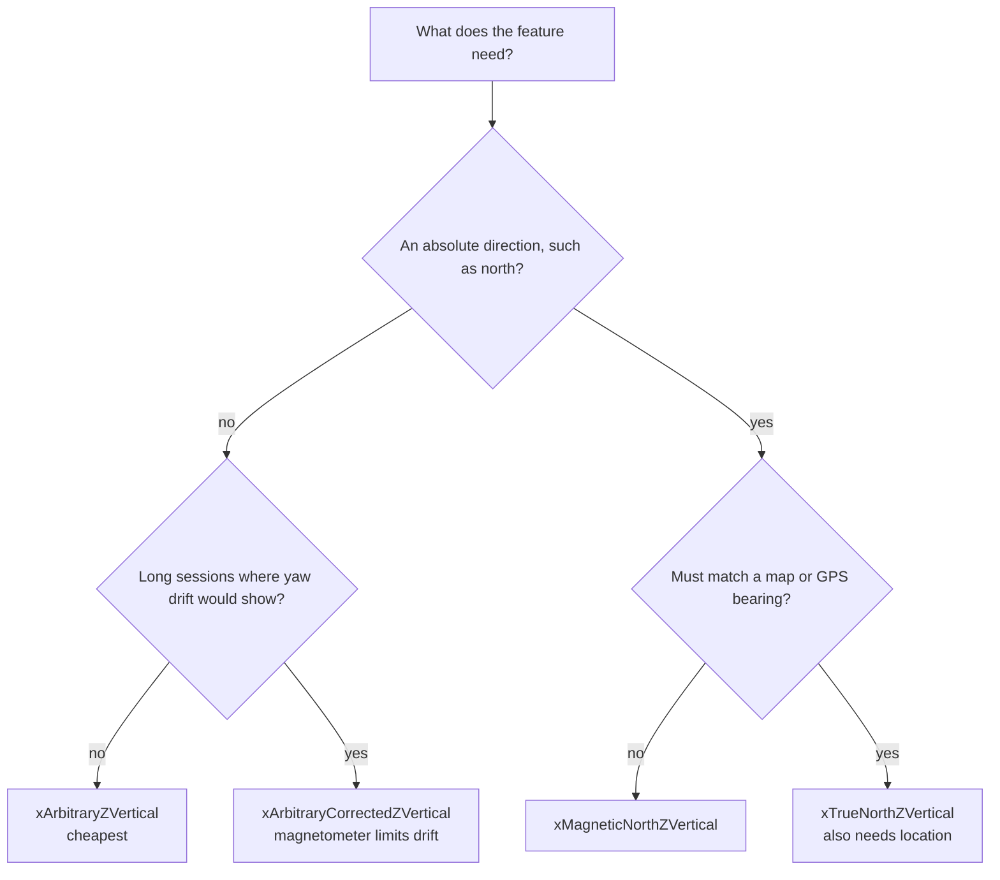

An attitude is a rotation, and a rotation is only meaningful once two things are pinned down: which frame it's measured from, and which way it maps. Core Motion pins down the first with its reference frames. It leaves the second to the reader: Apple's documentation describes `CMAttitude` as "the device's orientation relative to a known frame of reference", but nowhere says whether its quaternion turns device-frame vectors into reference-frame vectors or the other way around. Nor does it say in which order its roll, pitch, and yaw are applied. Most attitude bugs live in exactly those two gaps.

This article fills them in with math that can be checked. It covers the four reference frames and what each costs, quaternions and their double cover, a test that settles the mapping direction from the data itself, and why Euler angles fail near vertical: a 0.2° nudge moved extracted yaw by 34°. Then come the conversions an app actually needs, into compass bearings, screen coordinates, and y-up 3D scenes, plus the new iOS 27 API that lets Core Motion do the screen conversion itself.

<!--more-->

The examples use Swift 6 language mode and were compiled with the Swift 6.4 toolchain from Xcode 27.1. The plain Swift blocks ran as a macOS command-line program on macOS 26, and the iOS block ran in a unit-test bundle hosted by an app on an iPhone 17 simulator running iOS 27.0. The simulator has no motion hardware, so attitudes in this article are constructed with `simd_quatd`, whose behavior is fully specified, and the article never claims what a device would report without saying how to check it. Random test attitudes come from the seeded generator in the [permission changes article](/ios-location-permission-changes/#distance-from-snapped-positions).

<!-- check-uses: sensor-random -->
```swift
import Foundation
import simd
```

## The four reference frames

Every Core Motion reference frame is right-handed with z vertical. They differ in what x is tied to:

| Frame | x axis | Sensors | Notes from Apple's documentation |
| --- | --- | --- | --- |
| `xArbitraryZVertical` | The device's heading when updates start | Gyroscope, accelerometer | "Uses fewer sensors" and "is more power efficient" |
| `xArbitraryCorrectedZVertical` | Same | Adds the magnetometer | "Improve[s] long-term accuracy for the z axis (yaw)", but "requires more CPU usage" |
| `xMagneticNorthZVertical` | Magnetic north | Adds the magnetometer | Yaw is 0 when x points to magnetic north. May prompt for calibration |
| `xTrueNorthZVertical` | True north | Adds the magnetometer and location | Needs Location Services "to calculate the difference between magnetic and true north" |

With z up and x north, y points west. That surprises anyone who expects y to be east, as it is in the east-north-up convention of geodesy. It matters as soon as an attitude meets a map.

Choosing a frame is a question of what the feature needs to know:



The drift in the second question is real. Gravity tells the fusion which way is down, so it corrects pitch and roll, but rotation about the vertical axis leaves gravity unchanged. In the arbitrary frame, any gyroscope bias around the vertical axis turns straight into yaw drift. The illustrative gyroscope from the [accelerometer article](/ios-accelerometer-gyroscope/#a-model-of-a-real-sensor) has a 0.003 rad/s bias on z, which is 10.3° per minute of drift that nothing in that frame can see. Core Motion estimates and removes bias while the device is still, so a real phone does much better, but the asymmetry stays: the magnetometer is the only sensor that observes yaw.

## Quaternions, and two numbers for every rotation

`CMAttitude` offers three representations: a quaternion, a rotation matrix, and Euler angles. The quaternion is the one to compute with. Apple's `CMQuaternion` documentation defines it in the standard way: a rotation by $\theta$ about the unit axis $\mathbf n$ is

$$
q = \Big(\mathbf n \sin\tfrac{\theta}{2},\ \cos\tfrac{\theta}{2}\Big),
$$

stored as `x`, `y`, `z`, `w`. That maps directly onto `simd_quatd(ix: x, iy: y, iz: z, r: w)`. Because of the half angle, $q$ and $-q$ describe the same rotation. One turns by $\theta$ about $\mathbf n$, the other by $2\pi - \theta$ about $-\mathbf n$, which ends in the same place. This *double cover* means two attitudes can't be compared by their numbers:

```swift
func rotation(_ degrees: Double, about axis: SIMD3<Double>) -> simd_quatd {
    simd_quatd(angle: degrees * .pi / 180, axis: simd_normalize(axis))
}
func angleDegrees(between a: SIMD3<Double>, _ b: SIMD3<Double>) -> Double {
    acos(min(1, max(-1, simd_dot(simd_normalize(a), simd_normalize(b))))) * 180 / .pi
}
/// The angle of the rotation from `a` to `b`, in degrees. It treats q and -q as the same rotation.
func angleDegrees(between a: simd_quatd, _ b: simd_quatd) -> Double {
    let d = a.inverse * b
    return 2 * atan2(simd_length(d.imag), abs(d.real)) * 180 / .pi
}

let q = rotation(30, about: SIMD3(1, 2, 3))
let negated = simd_quatd(vector: -q.vector)
assert(q != negated, "different numbers...")
assert(angleDegrees(between: q, negated) < 1e-9, "...same rotation")
assert(simd_distance(q.act(SIMD3(1, 0, 0)), negated.act(SIMD3(1, 0, 0))) < 1e-12)
```

Code that compares quaternions for equality, averages their components, or checks for a jump between consecutive samples has to use the angle between them, or flip one quaternion onto the same hemisphere first (negate it if the dot product is negative). The helper above uses $2\operatorname{atan2}(\lvert\mathbf v\rvert, \lvert w\rvert)$ of the relative rotation, which is safe under the sign flip and numerically stable for small angles, unlike $2\arccos w$.

## Which way does the attitude map?

An attitude $q$ either turns a device-frame vector into the reference frame, $\mathbf v_{\text{ref}} = q\,\mathbf v_{\text{dev}}\,q^{-1}$, or the reverse. The two choices differ by an inverse, and picking the wrong one rotates everything the wrong way. It still produces plausible-looking numbers, so the mistake survives casual testing. Apple's documentation doesn't say which convention `CMAttitude` uses.

Device motion carries the means to find out. Each `CMDeviceMotion` holds both the attitude and the gravity vector in the device frame, and in every reference frame gravity is $(0, 0, -1)$. Map gravity with the attitude both ways. The right convention lands on straight down, up to sensor noise, and the wrong one lands somewhere else:

```swift
enum AttitudeConvention: Equatable {
    case deviceToReference   // attitude.act(v) turns a device-frame vector into the reference frame
    case referenceToDevice   // attitude.act(v) does the opposite
}

/// Decides the convention from samples that carry both an attitude and a gravity vector.
/// In every reference frame Core Motion offers, z is vertical, so gravity there is (0, 0, -1).
/// Returns the convention and the mean angle between "down" and gravity mapped each way, in degrees.
func detectConvention(_ samples: [(attitude: simd_quatd, gravity: SIMD3<Double>)])
    -> (convention: AttitudeConvention, forward: Double, backward: Double) {
    let down = SIMD3<Double>(0, 0, -1)
    let forward = samples.map { angleDegrees(between: $0.attitude.act($0.gravity), down) }.reduce(0, +) / Double(samples.count)
    let backward = samples.map { angleDegrees(between: $0.attitude.inverse.act($0.gravity), down) }.reduce(0, +) / Double(samples.count)
    return (forward < backward ? .deviceToReference : .referenceToDevice, forward, backward)
}

// Test the detector on synthetic samples in both conventions, with noisy gravity.
var random = SeededGenerator(seed: 7)
func randomAttitude(using random: inout SeededGenerator) -> simd_quatd {
    simd_normalize(simd_quatd(vector: SIMD4(random.gaussian(), random.gaussian(), random.gaussian(), random.gaussian())))
}
var deviceToWorld: [(attitude: simd_quatd, gravity: SIMD3<Double>)] = []
for _ in 0..<200 {
    let attitude = randomAttitude(using: &random)
    let noise = SIMD3(random.gaussian(), random.gaussian(), random.gaussian()) * 0.01
    deviceToWorld.append((attitude, attitude.inverse.act(SIMD3(0, 0, -1)) + noise))
}
let worldToDevice = deviceToWorld.map { (attitude: $0.attitude.inverse, gravity: $0.gravity) }
let first = detectConvention(deviceToWorld), second = detectConvention(worldToDevice)
print("detected", first, second)
assert(first.convention == .deviceToReference && second.convention == .referenceToDevice)
assert(first.forward < 1 && first.backward > 45)
```

On 200 synthetic samples with 0.01 g of noise on gravity, the right convention put gravity 0.73° from straight down on average, which is just the noise. The wrong one put it 61.8° away. The margin is huge, so a few seconds of real samples settle the question.

Run this once on a device and keep the result as an assertion in debug builds. It costs a dot product per sample, and it turns a silent sign error into a failure on the first run. The same test catches a different mistake too: a quaternion assembled with `w` in the wrong slot also fails it, by a wide margin.

## Euler angles and gimbal lock

Roll, pitch, and yaw are the attitude's most readable form and its least reliable one. Apple's documentation defines each as a rotation about one device axis: roll about the axis "from its top to bottom", pitch about the axis "from side to side", yaw about the vertical axis. It doesn't say in which order they compose. Order matters, as the [accelerometer article](/ios-accelerometer-gyroscope/#integrating-rotation-correctly) showed with two 90° turns that ended 120° apart.

Whatever the order, every three-angle description has a singularity. In the common aerospace convention, yaw $\psi$ about z, then pitch $\theta$ about the new y, then roll $\varphi$ about the newest x, the angles come out of the rotation matrix as

$$
\theta = -\arcsin R_{31}, \qquad \psi = \operatorname{atan2}(R_{21}, R_{11}), \qquad \varphi = \operatorname{atan2}(R_{32}, R_{33}) .
$$

At $\theta = \pm 90°$, the first and last rotations turn about the same axis, so only $\psi \mp \varphi$ is determined. Both atan2 calls then divide zero by zero. This is gimbal lock:

```swift
/// Aerospace convention: yaw ψ about z, then pitch θ about the new y, then roll φ about the newest x.
func fromEuler(yaw: Double, pitch: Double, roll: Double) -> simd_quatd {
    rotation(yaw, about: SIMD3(0, 0, 1)) * rotation(pitch, about: SIMD3(0, 1, 0)) * rotation(roll, about: SIMD3(1, 0, 0))
}

func toEuler(_ q: simd_quatd) -> (yaw: Double, pitch: Double, roll: Double) {
    let m = simd_matrix3x3(q)   // columns are the rotated x, y, z axes
    let pitch = asin(max(-1, min(1, -m[0][2])))
    let yaw = atan2(m[0][1], m[0][0])
    let roll = atan2(m[1][2], m[2][2])
    return (yaw * 180 / .pi, pitch * 180 / .pi, roll * 180 / .pi)
}

let ordinary = fromEuler(yaw: 40, pitch: 20, roll: -10)
let recovered = toEuler(ordinary)
assert(abs(recovered.yaw - 40) < 1e-9 && abs(recovered.pitch - 20) < 1e-9 && abs(recovered.roll + 10) < 1e-9)

// At pitch 90°, yaw and roll turn about the same axis: only their difference matters.
let lockedA = fromEuler(yaw: 40, pitch: 90, roll: 10)
let lockedB = fromEuler(yaw: 70, pitch: 90, roll: 40)
print("gimbal lock: rotations differ by", angleDegrees(between: lockedA, lockedB), "degrees; extracted", toEuler(lockedA), toEuler(lockedB))
assert(angleDegrees(between: lockedA, lockedB) < 1e-6)

// Near the lock, a tiny rotation moves yaw and roll by large amounts.
let near = fromEuler(yaw: 40, pitch: 89.9, roll: 10)
let nudged = rotation(0.2, about: SIMD3(1, 0, 0)) * near
print("0.2° nudge near the lock:", toEuler(near), "→", toEuler(nudged))
```

Yaw 40° and roll 10° gave exactly the same rotation as yaw 70° and roll 40°, to within $10^{-14}$ degrees, and the extraction returned two different triples, neither of them the input. Near the lock it's worse than ambiguous. At a pitch of 89.9°, rotating the device by 0.2° moved the extracted yaw from 40° to 73.8° and the roll from 10° to 43.8°. For a phone, pitch 90° in this convention is simply the phone stood upright, the most common way to hold a camera. An interface driven by Euler angles jitters wildly exactly when the user lifts the phone to look through it.

So use Euler angles only for display, and only in orientations far from the lock. For computation, keep the quaternion, and when a single angle is needed, ask a geometric question instead.

## Asking where an axis points

"Which way is the phone facing?" has two different answers depending on how it's held. Lying flat, the useful direction is where its top edge points. Held upright like a camera, it's where the back camera looks, along the device's −z axis. Both are the same computation: rotate a device axis into the reference frame and take the bearing of its horizontal part.

```swift
/// Where a device-frame axis points, as a compass-style angle in the reference frame's horizontal plane.
/// Returns nil when the axis is too close to vertical for its horizontal direction to mean anything.
func horizontalBearing(of axis: SIMD3<Double>, attitude: simd_quatd, minimumHorizontal: Double = 0.2) -> Double? {
    let world = attitude.act(axis)
    let horizontal = SIMD2(world.x, world.y)
    guard simd_length(horizontal) >= minimumHorizontal else { return nil }
    // Reference x is "north" in the north frames; measure clockwise from it, as a compass does (y is then west).
    let degrees = atan2(-horizontal.y, horizontal.x) * 180 / .pi
    return degrees < 0 ? degrees + 360 : degrees
}

let top = SIMD3<Double>(0, 1, 0), camera = SIMD3<Double>(0, 0, -1)
// A phone lying flat, its top edge turned 30° clockwise from reference x (north).
let flat = rotation(-30, about: SIMD3(0, 0, 1)) * rotation(-90, about: SIMD3(0, 0, 1))
// The same phone stood upright, as for taking a photo: tip it 90° about its own x axis.
let upright = flat * rotation(90, about: SIMD3(1, 0, 0))
print("flat: top", horizontalBearing(of: top, attitude: flat) as Any, "camera", horizontalBearing(of: camera, attitude: flat) as Any)
print("upright: top", horizontalBearing(of: top, attitude: upright) as Any, "camera", horizontalBearing(of: camera, attitude: upright) as Any)
assert(abs(horizontalBearing(of: top, attitude: flat)! - 30) < 1e-9)
assert(horizontalBearing(of: camera, attitude: flat) == nil && horizontalBearing(of: top, attitude: upright) == nil)
assert(abs(horizontalBearing(of: camera, attitude: upright)! - 30) < 1e-9)
```

Flat, the top edge reports 30°, and the camera axis points at the floor, so its bearing is undefined and the function says so. Upright, the roles swap. The camera axis reports 30° and the top edge points at the sky. A compass that reads the top edge freezes or spins when the user lifts the phone. One that switches to the camera axis when the top edge goes vertical keeps working, with no Euler angle anywhere. The cutoff on the horizontal component, 0.2 here, is the angle of about 78° from horizontal beyond which the bearing is declared meaningless. It's a design choice, and it shouldn't be left to atan2's behavior near zero.

The bearing here is relative to the reference frame's x axis. In the north frames that's north, and the [heading article](/ios-heading-compass/) covers where north comes from and how wrong it can be.

## Relative attitude

Many features don't care about the world, only about change since a moment: "hold the phone how you like, then tilt to steer." `CMAttitude.multiply(byInverseOf:)` exists for this. Apple's documentation says it "multiplies the inverse of the specified `CMAttitude` object by the attitude represented by the receiving object", leaving the attitude *change* relative to the saved one. With quaternions that map device to reference, the change expressed in the device's starting frame is $q_{\text{ref}}^{-1} q$:

```swift
/// "Zeroing" an attitude: the rotation from a saved reference attitude to the current one, in the device's terms.
/// With attitudes that map device to reference, this is what CMAttitude.multiply(byInverseOf:) computes.
func change(from reference: simd_quatd, to current: simd_quatd) -> simd_quatd { reference.inverse * current }

let atCalibration = rotation(50, about: SIMD3(0, 0, 1)) * rotation(15, about: SIMD3(1, 0, 0))
let later = atCalibration * rotation(25, about: SIMD3(0, 1, 0))
let delta = change(from: atCalibration, to: later)
assert(angleDegrees(between: delta, rotation(25, about: SIMD3(0, 1, 0))) < 1e-9, "the change is the 25° the user made")
```

A 25° turn about the device's own y axis after calibration comes back as exactly that rotation. This works whatever the reference frame, which is why even `xArbitraryZVertical` is enough for steering. Apple's documentation for that frame gives the same advice: "save the first reported attitude value, and compare it to new values."

## Into the screen's coordinates

The device frame is fixed to the hardware, with y pointing to the top in portrait. The interface rotates. A tilt-controlled game in landscape has to convert device-frame tilt into the content's coordinates, and the classic bug is getting the landscape direction backwards. UIKit doesn't help, because its two enums name the same hold oppositely. `UIInterfaceOrientation.landscapeRight` is documented as "the Home button on the right". `UIDeviceOrientation.landscapeLeft` is "the front-facing camera on the left side", and the camera sits at the opposite end from the Home side, so that's the same physical hold. The conversion is a rotation about z:

```swift
/// How far the interface is turned relative to the device's portrait axes, named as UIInterfaceOrientation names them.
/// landscapeRight means the Home side is on the right, so the device's top edge points left.
enum InterfaceRotation: Double, CaseIterable {
    case portrait = 0, landscapeRight = 90, portraitUpsideDown = 180, landscapeLeft = 270
}

/// Expresses a device-frame vector in screen coordinates: x to the right of the content, y toward its top.
func screenVector(_ device: SIMD3<Double>, interface: InterfaceRotation) -> SIMD3<Double> {
    rotation(interface.rawValue, about: SIMD3(0, 0, 1)).act(device)
}

/// Rounds away floating-point dust, and turns -0 into 0, so vectors print and compare cleanly.
func tidy(_ v: SIMD3<Double>) -> SIMD3<Double> { (v * 1e9).rounded(.toNearestOrEven) / 1e9 + SIMD3(repeating: 0) }

// The phone is held in landscape, home side on the right: gravity runs along device -x.
let gravityLandscape = SIMD3<Double>(-1, 0, 0)
for interface in InterfaceRotation.allCases {
    print(interface, tidy(screenVector(gravityLandscape, interface: interface)))
}
assert(tidy(screenVector(gravityLandscape, interface: .landscapeRight)) == SIMD3(0, -1, 0),
       "in the matching interface, gravity points to the bottom of the content")
assert(tidy(screenVector(gravityLandscape, interface: .portrait)) == SIMD3(-1, 0, 0),
       "a portrait interface on a landscape phone sees gravity pointing left")
```

With the phone held landscape and its Home side to the right, gravity runs along the device's −x axis. In the matching interface, `landscapeRight`, the converted gravity points straight down the content, (0, −1, 0). Rendered in a portrait interface, it would point left.

iOS 27 adds a way to let Core Motion do this: `CMMotionManager.deviceMotionBody`, and the matching `CLLocationManager.headingBody`, which replaces the deprecated `headingOrientation`. The headers describe the new properties as specifying "a body from which device motion should be referenced", and `UIView` adopts both body protocols. Passing the view that shows the content ties the reference to the interface. The headers don't document the exact semantics, and the simulator can't show them. It does confirm that the properties accept and keep a view:

<!-- ios -->
```swift
import CoreMotion
import UIKit

let motion = CMMotionManager()
assert(CMMotionManager.availableAttitudeReferenceFrames().isEmpty)
print("default reference frame on the simulator:", motion.attitudeReferenceFrame.rawValue)

// iOS 27: tell Core Motion which view its attitude should be expressed for.
let screenView = UIView(frame: CGRect(x: 0, y: 0, width: 100, height: 100))
if #available(iOS 27, *) {
    motion.deviceMotionBody = screenView
    assert(motion.deviceMotionBody === screenView)
    let locationManager = CLLocationManager()
    locationManager.headingBody = screenView
    assert(locationManager.headingBody === screenView)
}
```

The default `attitudeReferenceFrame` read back as raw value 1, `xArbitraryZVertical`, on hardware with no frames available. Apple's documentation calls the value "undefined" in that case, so don't rely on it. Until the body APIs' behavior is confirmed on a device, the explicit rotation above remains the conversion I'd trust, because it's testable without hardware.

## Into a 3D scene

SceneKit and RealityKit use a y-up world, while Core Motion's frames are z-up. Converting a whole attitude means rotating both the frame it's measured in and the frame it's measured from. With $C$ the rotation that takes z-up to y-up, $-90°$ about x, the attitude in scene terms is the conjugate $C q C^{-1}$:

```swift
/// Core Motion's reference frames are z-up. SceneKit and RealityKit scenes are y-up.
/// This maps a z-up rotation into the y-up world with the same physical meaning.
func yUp(_ attitude: simd_quatd) -> simd_quatd {
    let zUpToYUp = rotation(-90, about: SIMD3(1, 0, 0))
    return zUpToYUp * attitude * zUpToYUp.inverse
}
let zUpToYUp = rotation(-90, about: SIMD3(1, 0, 0))

let tiltedNorth = rotation(20, about: SIMD3(0, 0, 1)) * rotation(35, about: SIMD3(1, 0, 0))
let converted = yUp(tiltedNorth)
for axis in [SIMD3<Double>(1, 0, 0), SIMD3(0, 1, 0), SIMD3(0, 0, 1)] {
    let before = zUpToYUp.act(tiltedNorth.act(axis))
    let after = converted.act(zUpToYUp.act(axis))
    assert(simd_distance(before, after) < 1e-12)
}
assert(simd_distance(zUpToYUp.act(SIMD3(0, 0, 1)), SIMD3(0, 1, 0)) < 1e-12, "up stays up")
```

The check confirms the physical meaning is preserved: rotating any device axis with the original attitude and then converting gives the same vector as converting first and then rotating with the converted attitude. For a camera node, the device-to-camera difference is one more fixed rotation, since a scene camera looks down its −z axis exactly like the phone's back camera.

## Averaging angles

Smoothing a heading or an attitude is the last trap. Angles wrap, and arithmetic doesn't:

```swift
// Averaging two headings near north as numbers, and as directions.
let headings = [359.0, 3.0, 357.0, 5.0]
let naiveMean = headings.reduce(0, +) / Double(headings.count)
let vectorSum = headings.reduce(SIMD2<Double>()) { $0 + SIMD2(cos($1 * .pi / 180), sin($1 * .pi / 180)) }
var circularMean = atan2(vectorSum.y, vectorSum.x) * 180 / .pi
if circularMean < 0 { circularMean += 360 }
print("naive", naiveMean, "circular", circularMean, "resultant length", simd_length(vectorSum) / Double(headings.count))
assert(naiveMean == 181 && abs(circularMean - 1) < 1e-9)

// The same holds for whole attitudes: to smooth, slerp from the old value toward the new one.
let smoothed = simd_slerp(rotation(170, about: SIMD3(0, 0, 1)), rotation(-170, about: SIMD3(0, 0, 1)), 0.5)
print("slerp halfway between yaw 170° and -170°:", toEuler(smoothed).yaw)
assert(abs(abs(toEuler(smoothed).yaw) - 180) < 1e-9)
```

Four headings scattered around north, 359°, 3°, 357°, and 5°, average to 181° as numbers, which is due south. As unit vectors they average to 1.0°, and the length of the mean vector, 0.998, measures how tightly they agree: 1 for identical headings, 0 for headings spread evenly around the circle. For whole attitudes, `simd_slerp` interpolates along the shortest arc. Halfway between yaw 170° and yaw −170°, it lands on 180°, not on 0°. Exponential smoothing of an attitude is one slerp per sample, from the smoothed value toward the new one by a small fraction.

## Summary

- Core Motion's reference frames are right-handed with z up. x is the starting heading, the starting heading corrected by the magnetometer, magnetic north, or true north. With x north, y points west.
- Gravity corrects pitch and roll but not yaw, so only the magnetometer stops yaw drift. A 0.003 rad/s vertical bias is 10.3° per minute in the arbitrary frame.
- $q$ and $-q$ are the same rotation. Compare attitudes by the angle between them.
- Apple doesn't document whether the attitude maps device to reference or the reverse. Gravity settles it: the right convention mapped it to within 0.73° of straight down, and the wrong one missed by 61.8°.
- Euler angles lock at pitch ±90°, which for a phone is simply upright. A 0.2° nudge near the lock moved yaw by 34°. Use them only for display.
- For "which way is it facing", rotate the relevant device axis into the world and take the bearing of its horizontal part: the top edge when flat, the camera axis when upright.
- Relative attitude is $q_{\text{ref}}^{-1} q$. Screen conversion is a rotation about z, and `UIInterfaceOrientation.landscapeRight` is `UIDeviceOrientation.landscapeLeft`. y-up scenes need the conjugate $C q C^{-1}$.
- Average angles as vectors and attitudes with slerp. Naive averaging put four headings around north at due south.

## Exercise

Write `AttitudeFilter`, which smooths a stream of attitudes with a time constant given in seconds. It should compute each sample's interpolation fraction from the actual time step, $1 - e^{-\Delta t / \tau}$, rather than assuming a fixed rate, flip each incoming quaternion onto the hemisphere of the current estimate before interpolating, and reset when the angle between the estimate and a new sample exceeds 45°, so a deliberate fast turn isn't smeared. Test it with synthetic attitudes that cross yaw ±180° and with sample intervals that jitter between 8 and 12 ms.

## Further reading

- [`CMAttitude`](https://developer.apple.com/documentation/coremotion/cmattitude), [`CMQuaternion`](https://developer.apple.com/documentation/coremotion/cmquaternion), and [`CMAttitudeReferenceFrame`](https://developer.apple.com/documentation/coremotion/cmattitudereferenceframe)
- [`multiply(byInverseOf:)`](https://developer.apple.com/documentation/coremotion/cmattitude/multiply(byinverseof:)), for relative attitude
- [`UIInterfaceOrientation`](https://developer.apple.com/documentation/uikit/uiinterfaceorientation) and [`UIDeviceOrientation`](https://developer.apple.com/documentation/uikit/uideviceorientation), whose landscape cases name the same hold oppositely
- Ken Shoemake, "Animating Rotation with Quaternion Curves", *SIGGRAPH '85*, [doi:10.1145/325334.325242](https://doi.org/10.1145/325334.325242), the paper that introduced slerp to computer graphics

Previous: [Device Motion, Gravity, and User Acceleration](/ios-device-motion/)

Next: [Pedometer Data and Activity Recognition](/ios-pedometer-activity/)

Return to the [Sensors and Location roadmap](/ios-sensors/).
