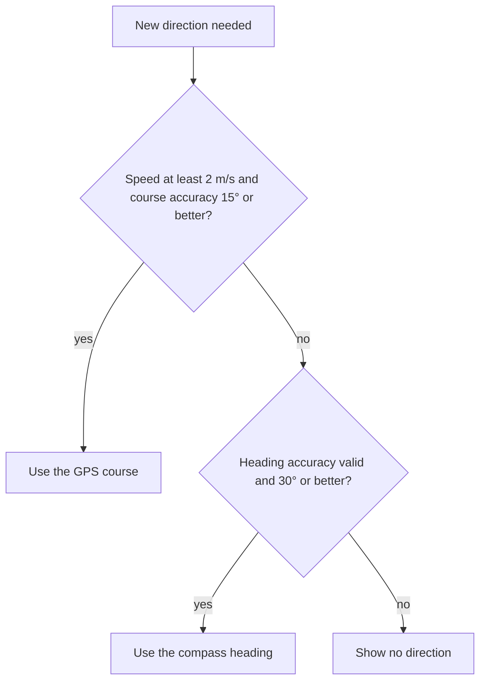

A phone's compass measures the Earth's magnetic field, a few tens of microtesla, from inside a case full of steel screws, speaker magnets, and current-carrying traces. It works because Core Location does a great deal of correction before it reports a heading: it compensates for tilt, subtracts the phone's own magnetism, and converts to true north. When any of that goes wrong, the heading is wrong by tens of degrees, and nothing in the number says so except `headingAccuracy`.

This article builds the corrections from scratch, so their failure modes are visible. It covers the three-dimensional geometry of a tilt-compensated compass, and why the shortcut that ignores tilt is off by 4.7° at a 5° tilt. It covers hard-iron calibration by fitting a sphere, which turned a median error of 56° into 1°, and the checks that detect a nearby magnet, along with the disturbance that slipped past them and shifted the heading by 24°. It ends with the practical parts: displaying a heading without spinning the needle the long way round, and choosing between the compass and GPS course.

<!--more-->

The examples use Swift 6 language mode and were compiled with the Swift 6.4 toolchain from Xcode 27.1. The plain Swift blocks ran as a macOS command-line program on macOS 26, and the iOS block ran in a unit-test bundle hosted by an app on an iPhone 17 simulator running iOS 27.0, which has no magnetometer. The field values are illustrative and stated in the code, and the simulations use the seeded generator from the [permission changes article](/ios-location-permission-changes/#distance-from-snapped-positions).

<!-- check-uses: sensor-random -->
```swift
import Foundation
import simd
```

## What Core Location reports

`CLLocationManager` delivers headings as `CLHeading` objects after `startUpdatingHeading()`. Apple's documentation defines the fields:

| Property | Meaning | Invalid when |
| --- | --- | --- |
| `magneticHeading` | Degrees clockwise from magnetic north | "Should always be valid", but unreliable when `headingAccuracy` is negative |
| `trueHeading` | Degrees clockwise from true north | negative, and valid "only if location updates are also enabled" |
| `headingAccuracy` | "The maximum deviation … between the reported heading and the true geomagnetic heading" | negative: "uncalibrated or there is strong interference" |
| `x`, `y`, `z` | The raw geomagnetic vector, µT, device frame | |
| `timestamp` | When the heading was determined | |

Two settings shape the stream. `headingFilter` is "the minimum angular change in degrees required to generate new heading events", measured "relative to the last delivered heading event", and it read back as 1.0 in the simulator, the documented default. `headingOrientation`, which says which edge of the device counts as forward, is deprecated in iOS 27 in favor of `headingBody`, which takes a view, as the [attitude article](/ios-attitude-reference-frames/#into-the-screens-coordinates) showed.

True north needs a location because the angle between true and magnetic north, the *declination*, depends on where you are and drifts from year to year. Apple's note says it directly: "Core Location needs the current location of the device to compute the value of this property." A compass app that never starts location updates will see `trueHeading` stuck at −1.

## Tilt compensation

The Earth's field isn't horizontal. It dips into the ground at an angle, the *inclination*, which is small near the magnetic equator and approaches 90° near the magnetic poles. The examples use an illustrative field of 48 µT dipping 66°. NOAA's World Magnetic Model gives the real values for any place and date. With that dip, the horizontal part, the only part that points north, is 48 × cos 66° ≈ 19.5 µT. The vertical part is more than twice as strong.

A magnetometer reports the whole vector in the device frame. Finding north means removing the vertical part, and that requires knowing which way is down, from gravity. With $\hat{\mathbf d}$ the downward unit vector and $\mathbf m$ the field, both in the device frame:

$$
\hat{\mathbf e} = \frac{\hat{\mathbf d} \times \mathbf m}{\lVert \hat{\mathbf d} \times \mathbf m \rVert}, \qquad
\hat{\mathbf n} = \hat{\mathbf e} \times \hat{\mathbf d}, \qquad
\psi = \operatorname{atan2}(\hat{\mathbf y} \cdot \hat{\mathbf e},\ \hat{\mathbf y} \cdot \hat{\mathbf n}) .
$$

The cross product with "down" removes the vertical part and gives east, and a second cross product gives north. The heading $\psi$ of the device's top edge, $\hat{\mathbf y}$, is then a two-argument arctangent. The shortcut found in many tutorials, $\operatorname{atan2}(-m_x, m_y)$, assumes the phone lies flat, so the vertical field never leaks into x and y:

```swift
/// The Earth's field in a north-east-down frame: an illustrative 48 µT dipping 66° below the horizontal.
/// Real values depend on where you are; NOAA's World Magnetic Model gives them for any place and date.
enum EarthField {
    static let strength = 48.0                    // µT
    static let inclination = 66.0 * .pi / 180     // dip below horizontal
    static let vector = SIMD3(strength * cos(inclination), 0, strength * sin(inclination))   // north, east, down
}

/// A device attitude as yaw (heading of the top edge, clockwise from north), then pitch (top edge up), then roll.
/// Returns the matrix whose columns are the device's x (right), y (top), z (out of the screen) axes in north-east-down.
func deviceAxes(heading: Double, pitch: Double, roll: Double) -> simd_double3x3 {
    let (h, p, r) = (heading * .pi / 180, pitch * .pi / 180, roll * .pi / 180)
    // Flat and face up with the top edge north: x points east, y north, z up (which is -down).
    let flat = simd_double3x3(columns: (SIMD3(0, 1, 0), SIMD3(1, 0, 0), SIMD3(0, 0, -1)))
    let yaw = simd_double3x3(simd_quatd(angle: h, axis: SIMD3(0, 0, 1)))            // turn clockwise about down
    let tiltUp = simd_double3x3(simd_quatd(angle: -p, axis: flat.columns.0))       // raise the top edge
    let tiltSide = simd_double3x3(simd_quatd(angle: r, axis: flat.columns.1))      // roll about the top edge
    return yaw * tiltUp * tiltSide * flat
}

/// What the magnetometer and accelerometer report in the device frame for a given attitude (gravity pointing down).
func readings(_ axes: simd_double3x3) -> (field: SIMD3<Double>, gravity: SIMD3<Double>) {
    (axes.transpose * EarthField.vector, axes.transpose * SIMD3(0, 0, 1))
}

/// Tilt-compensated heading of the device's top edge, from the field and gravity in the device frame.
func compassHeading(field m: SIMD3<Double>, gravity g: SIMD3<Double>) -> Double {
    let down = simd_normalize(g)
    let east = simd_normalize(simd_cross(down, m))
    let north = simd_cross(east, down)
    let top = SIMD3<Double>(0, 1, 0)
    let degrees = atan2(simd_dot(top, east), simd_dot(top, north)) * 180 / .pi
    return degrees < 0 ? degrees + 360 : degrees
}

/// The textbook shortcut that assumes the phone lies flat: heading from the field's x and y components alone.
func flatHeading(field m: SIMD3<Double>) -> Double {
    let degrees = atan2(-m.x, m.y) * 180 / .pi
    return degrees < 0 ? degrees + 360 : degrees
}

func angularDifference(_ a: Double, _ b: Double) -> Double {
    let d = (a - b).truncatingRemainder(dividingBy: 360)
    return d > 180 ? d - 360 : (d < -180 ? d + 360 : d)
}

print("pitch   flat-formula error   tilt-compensated error   (true heading 30°)")
for pitch in [0.0, 5, 10, 20, 40, 60] {
    let (field, gravity) = readings(deviceAxes(heading: 30, pitch: pitch, roll: 0))
    print(String(format: "%4.0f°   %8.2f°              %8.6f°", pitch,
                 angularDifference(flatHeading(field: field), 30), angularDifference(compassHeading(field: field, gravity: gravity), 30)))
}
for (heading, pitch, roll) in [(0.0, 0.0, 0.0), (90, 30, 0), (200, -45, 20), (315, 70, -35)] {
    let (field, gravity) = readings(deviceAxes(heading: heading, pitch: pitch, roll: roll))
    assert(abs(angularDifference(compassHeading(field: field, gravity: gravity), heading)) < 1e-9)
}
```

| Pitch | Flat formula error | Tilt-compensated error |
| --- | --- | --- |
| 0° | 0.00° | 0 |
| 5° | −4.72° | 0 |
| 10° | −8.09° | 0 |
| 20° | −12.46° | 0 |
| 40° | −16.65° | 0 |
| 60° | −18.13° | 0 |

The flat formula is exact only when the phone is exactly flat. Tilt it by 5°, about the difference between a phone on a desk and one held casually in a hand, and the heading is off by 4.7°. The dip makes the error large: $\sin 5°$ of a vertical component more than twice the horizontal one is a big fraction of the horizontal field. The tilt-compensated heading was exact, to rounding, at every attitude tested, including one pitched 70° and rolled 35°. This is what Core Location's heading and Core Motion's `xMagneticNorthZVertical` frame do for you, and the reason to use them instead of raw `magnetometerData`.

## Hard-iron calibration

The phone itself is magnetic. Permanent magnets in speakers and magnetized steel parts add a field that's fixed *in the device's frame*, so it rotates with the phone. It's called *hard iron*. Materials that bend the external field, rather than adding one of their own, are *soft iron*, and they distort it into an ellipsoid. Hard iron is usually the larger effect, and it's easy to see: as the phone rotates through every orientation, the Earth's field traces a sphere of radius $\lVert\mathbf B\rVert$ in the device frame, and the hard-iron offset $\mathbf c$ moves the sphere's center away from the origin.

Fitting a sphere to readings taken during a figure-eight motion recovers the offset. The sphere equation $\lVert\mathbf m - \mathbf c\rVert^2 = r^2$ rearranges to

$$
2\,\mathbf m \cdot \mathbf c + \big(r^2 - \lVert \mathbf c \rVert^2\big) = \lVert \mathbf m \rVert^2 ,
$$

which is *linear* in the four unknowns $c_x, c_y, c_z$ and $k = r^2 - \lVert\mathbf c\rVert^2$. So a least-squares fit is one 4×4 linear solve, with no iteration:

```swift
/// Solves a small linear system A x = b by Gaussian elimination with partial pivoting.
func solve(_ a: [[Double]], _ b: [Double]) -> [Double] {
    var m = a.enumerated().map { $0.element + [b[$0.offset]] }
    let n = b.count
    for col in 0..<n {
        let pivot = (col..<n).max { abs(m[$0][col]) < abs(m[$1][col]) }!
        m.swapAt(col, pivot)
        for row in 0..<n where row != col {
            let f = m[row][col] / m[col][col]
            for k in col...n { m[row][k] -= f * m[col][k] }
        }
    }
    return (0..<n).map { m[$0][n] / m[$0][$0] }
}

/// Hard-iron calibration: readings from many orientations lie on a sphere centered on the offset.
/// |m - c|² = r² rearranges to 2 m·c + (r² - |c|²) = |m|², which is linear in c and one more unknown.
func fitSphere(_ samples: [SIMD3<Double>]) -> (center: SIMD3<Double>, radius: Double) {
    var ata = Array(repeating: Array(repeating: 0.0, count: 4), count: 4), atb = Array(repeating: 0.0, count: 4)
    for m in samples {
        let row = [2 * m.x, 2 * m.y, 2 * m.z, 1]
        let rhs = simd_length_squared(m)
        for i in 0..<4 {
            atb[i] += row[i] * rhs
            for j in 0..<4 { ata[i][j] += row[i] * row[j] }
        }
    }
    let x = solve(ata, atb)
    let center = SIMD3(x[0], x[1], x[2])
    return (center, (x[3] + simd_length_squared(center)).squareRoot())
}

// A phone whose own magnetized parts add a constant offset of about 37.5 µT in its frame (illustrative), plus 0.5 µT of noise.
let hardIron = SIMD3<Double>(22, -27, 14)
var magRandom = SeededGenerator(seed: 17)
func measuredField(_ axes: simd_double3x3, offset: SIMD3<Double>, using random: inout SeededGenerator) -> SIMD3<Double> {
    readings(axes).field + offset + SIMD3(random.gaussian(), random.gaussian(), random.gaussian()) * 0.5
}
// The calibration motion: the user waves the phone through many orientations (a figure eight).
let calibrationSamples = (0..<300).map { i -> SIMD3<Double> in
    let t = Double(i) / 300 * 2 * .pi
    return measuredField(deviceAxes(heading: 360 * Double(i) / 300, pitch: 70 * sin(2 * t), roll: 80 * sin(3 * t)), offset: hardIron, using: &magRandom)
}
let fit = fitSphere(calibrationSamples)
print("estimated offset", fit.center, "true", hardIron, "radius", fit.radius, "true field", EarthField.strength)
assert(simd_distance(fit.center, hardIron) < 0.5)

// Heading errors over random attitudes, before and after subtracting the offset.
var before: [Double] = [], after: [Double] = []
for _ in 0..<1_000 {
    let heading = Double.random(in: 0..<360, using: &magRandom)
    let axes = deviceAxes(heading: heading, pitch: Double.random(in: -40...40, using: &magRandom),
                          roll: Double.random(in: -40...40, using: &magRandom))
    let raw = measuredField(axes, offset: hardIron, using: &magRandom), gravity = readings(axes).gravity
    before.append(abs(angularDifference(compassHeading(field: raw, gravity: gravity), heading)))
    after.append(abs(angularDifference(compassHeading(field: raw - fit.center, gravity: gravity), heading)))
}
func percentile(_ values: [Double], _ p: Double) -> Double { values.sorted()[Int(p * Double(values.count - 1))] }
print(String(format: "heading error, median / 95th percentile: before %.1f° / %.1f°, after %.2f° / %.2f°",
             percentile(before, 0.5), percentile(before, 0.95), percentile(after, 0.5), percentile(after, 0.95)))
```

From 300 readings with 0.5 µT of noise, the fit recovered the illustrative offset of about 37.5 µT to within 0.04 µT on each axis, and the sphere's radius as 47.99 µT, the field strength. Across 1,000 random attitudes tilted up to 40°, the uncalibrated heading had a median error of 56° and a 95th percentile of 156°: the offset is twice the horizontal field, so the compass points mostly at the phone's own magnet. After subtracting the fitted center, the median was 1.00° and the 95th percentile 2.96°, which is just the noise of 0.5 µT on a 19.5 µT horizontal field.

This is what the figure-eight calibration screen asks for, and why it needs varied orientations: a sphere can't be fitted to points from one side of it. Apple's delegate method `locationManagerShouldDisplayHeadingCalibration(_:)` lets an app allow or suppress the system's calibration display. Return `true` when the compass matters to the current screen, and `false` during moments when an interruption would be worse than an inaccurate heading.

## Detecting interference

A magnet *outside* the phone, a steel desk, a car's frame, or a laptop speaker, adds a field fixed in the world, which calibration can't remove, because it doesn't rotate with the phone. Two checks catch the large cases. The total field strength should match the expected strength, from the calibration fit or the geomagnetic model. And the angle between the field and gravity should match the local dip.

```swift
/// Flags readings that can't be the Earth's field alone: the wrong strength, or the wrong angle to gravity (the dip).
struct InterferenceCheck {
    var expectedStrength: Double        // µT, from the calibration fit or a geomagnetic model
    var expectedDip: Double             // degrees below horizontal
    var strengthTolerance = 0.15        // fraction
    var dipTolerance = 5.0              // degrees

    func isDisturbed(field m: SIMD3<Double>, gravity g: SIMD3<Double>) -> Bool {
        let strength = simd_length(m)
        let dip = 90 - acos(simd_dot(simd_normalize(m), simd_normalize(g))) * 180 / .pi
        return abs(strength / expectedStrength - 1) > strengthTolerance || abs(dip - expectedDip) > dipTolerance
    }
}

// A steel filing cabinet near the phone adds a field of 30 µT pointing east, in the world frame, for a while.
let check = InterferenceCheck(expectedStrength: fit.radius, expectedDip: 66)
let still = deviceAxes(heading: 30, pitch: 10, roll: 0)
let gravity = readings(still).gravity
let disturbance = still.transpose * SIMD3(0, 30, 0)
let clean = readings(still).field, disturbed = readings(still).field + disturbance
print(String(format: "clean: heading %.1f°, flagged %@; near the cabinet: heading %.1f°, flagged %@",
             compassHeading(field: clean, gravity: gravity), check.isDisturbed(field: clean, gravity: gravity) ? "yes" : "no",
             compassHeading(field: disturbed, gravity: gravity), check.isDisturbed(field: disturbed, gravity: gravity) ? "yes" : "no"))
assert(!check.isDisturbed(field: clean, gravity: gravity) && check.isDisturbed(field: disturbed, gravity: gravity))

// A weaker disturbance that happens to keep the strength and dip nearly unchanged slips through.
let sneaky = still.transpose * SIMD3(-1.5, 8, 0)
print("sneaky disturbance flagged:", check.isDisturbed(field: clean + sneaky, gravity: gravity),
      String(format: "heading %.1f°", compassHeading(field: clean + sneaky, gravity: gravity)))
```

A steel cabinet adding 30 µT, about one and a half times the horizontal field, swung the heading from 30.0° to 333.1° and was flagged by both checks. A smaller disturbance of about 8 µT, pointed so that it happened to leave the strength within 15% and the dip within 5°, moved the heading from 30.0° to 6.1° and wasn't flagged. A 24° error passed the checks. This is the honest limit of interference detection: it catches fields that are obviously wrong, and misses fields that are wrong in a plausible way. Core Location's `headingAccuracy` has the same limit. Treat it as an upper bound only when it's large, and never as a guarantee when it's small.

## Displaying a heading

A compass rose that rotates to the new heading on each update has one classic bug: going from 359° to 1°, the animation spins the rose 358° the wrong way. Track the displayed angle continuously, and apply each new heading as the shortest signed turn from the current one:

```swift
/// Keeps a displayed angle continuous: each new heading is applied as the shortest turn from the last one,
/// so a compass rose animates from 359° to 1° by +2°, not by -358°.
struct UnwrappedAngle {
    private(set) var value: Double
    init(_ initial: Double) { value = initial }
    mutating func update(to heading: Double) -> Double {
        value += angularDifference(heading, value.truncatingRemainder(dividingBy: 360))
        return value
    }
}

var rose = UnwrappedAngle(358)
let shown = [359.0, 1, 3, 2, 359, 357].map { rose.update(to: $0) }
print("unwrapped", shown)
assert(shown == [359, 361, 363, 362, 359, 357])
```

The sequence 359°, 1°, 3°, 2°, 359°, 357° became 359, 361, 363, 362, 359, 357. Each step is the turn the user actually made. The displayed value can grow without bound, but the rose's rotation only cares about the angle modulo 360. Smoothing must use the same circular arithmetic, as the [attitude article](/ios-attitude-reference-frames/#averaging-angles) showed with headings near north averaging to due south.

## Compass or course?

When the user is moving, there's a second source of direction: the GPS course, the direction of travel derived from successive fixes. It's immune to magnets and needs no calibration. But it's undefined when standing still and meaningless when the phone points one way while the user walks another. A simple rule picks the source:



```swift
/// Moving fast and straight, the GPS course is a better direction than the compass, and immune to magnets.
/// Standing still, only the compass knows. These thresholds are illustrative.
enum DirectionSource: Equatable { case course(Double), heading(Double), unknown }

func bestDirection(speed: Double, course: Double, courseAccuracy: Double,
                   heading: Double?, headingAccuracy: Double?) -> DirectionSource {
    if speed >= 2, course >= 0, courseAccuracy >= 0, courseAccuracy <= 15 { return .course(course) }
    if let heading, let accuracy = headingAccuracy, accuracy >= 0, accuracy <= 30 { return .heading(heading) }
    return .unknown
}
assert(bestDirection(speed: 8, course: 92, courseAccuracy: 4, heading: 140, headingAccuracy: 40) == .course(92))
assert(bestDirection(speed: 0.4, course: -1, courseAccuracy: -1, heading: 88, headingAccuracy: 12) == .heading(88))
assert(bestDirection(speed: 0, course: -1, courseAccuracy: -1, heading: 88, headingAccuracy: -1) == .unknown)
```

The thresholds are illustrative and belong to the feature. Note what each source answers. The course says where the user is *going*. The heading says where the phone is *pointing*. A map that rotates with the user on a bicycle wants the course. An augmented-reality label that overlays a building wants the heading, even at speed.

## Receiving headings

The heading service delivers `CLHeading` updates as a `Sendable` value. Following the [missing data](/ios-sensor-missing-data/) rule, it turns negative `trueHeading` and `headingAccuracy` values into optionals at the boundary:

<!-- ios -->
```swift
import CoreLocation
import UIKit

struct HeadingSample: Sendable, Equatable {
    var timestamp: Date
    var magnetic: Double
    var trueNorth: Double?     // nil while the device can't convert, for example without a location
    var accuracy: Double?      // degrees; nil when the heading is invalid
    var field: SIMD3<Double>   // raw geomagnetic vector, µT

    init(_ heading: CLHeading) {
        timestamp = heading.timestamp
        magnetic = heading.magneticHeading
        trueNorth = heading.trueHeading >= 0 ? heading.trueHeading : nil
        accuracy = heading.headingAccuracy >= 0 ? heading.headingAccuracy : nil
        field = SIMD3(heading.x, heading.y, heading.z)
    }
}

@MainActor final class HeadingService: NSObject, @preconcurrency CLLocationManagerDelegate {
    private let manager = CLLocationManager()
    private var continuation: AsyncStream<HeadingSample>.Continuation?
    var allowsCalibrationPrompt = true

    func headings(filter degrees: CLLocationDegrees, body: UIView?) -> AsyncStream<HeadingSample> {
        let (stream, continuation) = AsyncStream.makeStream(of: HeadingSample.self, bufferingPolicy: .bufferingNewest(1))
        guard CLLocationManager.headingAvailable() else {
            continuation.finish()
            return stream
        }
        self.continuation = continuation
        manager.delegate = self
        manager.headingFilter = degrees
        if #available(iOS 27, *), let body { manager.headingBody = body }
        manager.startUpdatingHeading()
        continuation.onTermination = { [weak self] _ in Task { @MainActor in self?.manager.stopUpdatingHeading() } }
        return stream
    }

    func locationManager(_ manager: CLLocationManager, didUpdateHeading newHeading: CLHeading) {
        continuation?.yield(HeadingSample(newHeading))
    }

    func locationManagerShouldDisplayHeadingCalibration(_ manager: CLLocationManager) -> Bool {
        allowsCalibrationPrompt
    }
}

let headingService = HeadingService()
print("default heading filter:", CLLocationManager().headingFilter)
var headingSamples = 0
for await _ in headingService.headings(filter: 2, body: nil) { headingSamples += 1 }
assert(!CLLocationManager.headingAvailable() && headingSamples == 0)
```

The simulator has no magnetometer, so `headingAvailable()` is `false` and the stream finishes immediately. On a device, start location updates too if the app needs `trueHeading`, and pass the view showing the compass as `headingBody` on iOS 27.

## Summary

- `CLHeading` gives magnetic and true headings, an accuracy that's negative when uncalibrated or disturbed, and the raw field. `trueHeading` needs location updates running. `headingFilter` defaults to 1°.
- The Earth's field dips steeply in most of the world, so a tilt-compensated heading needs gravity: east is down × field, and north is east × down. The flat-phone formula was off by 4.7° at a 5° tilt and 12.5° at 20°.
- The phone's own magnetism shifts the measured field by a constant offset in the device frame. A linear least-squares sphere fit over a figure-eight motion recovered a 37.5 µT offset to 0.04 µT, cutting the median heading error from 56° to 1°.
- External magnets can't be calibrated away. Checking field strength and dip caught a 30 µT disturbance, and missed an 8 µT one that still moved the heading by 24°. `headingAccuracy` shares that limit.
- Animate headings by the shortest signed turn, and average them as vectors.
- Prefer GPS course when moving fast and straight, and the compass when still. They answer different questions: where the user goes, and where the phone points.

## Exercise

Extend `fitSphere` to an ellipsoid fit for soft iron. Fit the general quadric $\mathbf m^\top A \mathbf m + \mathbf b^\top \mathbf m + c = 0$ by least squares, with nine unknowns once the scale is fixed. Recover the center and a matrix that maps the ellipsoid back to a sphere, and test it on simulated readings with a soft-iron matrix that scales one axis by 1.15 and couples x and y by 0.08. Compare the heading errors of the sphere fit and the ellipsoid fit on that data.

## Further reading

- [`CLHeading`](https://developer.apple.com/documentation/corelocation/clheading), [`headingAccuracy`](https://developer.apple.com/documentation/corelocation/clheading/headingaccuracy), and [`trueHeading`](https://developer.apple.com/documentation/corelocation/clheading/trueheading)
- [`headingFilter`](https://developer.apple.com/documentation/corelocation/cllocationmanager/headingfilter) and [`locationManagerShouldDisplayHeadingCalibration(_:)`](https://developer.apple.com/documentation/corelocation/cllocationmanagerdelegate/locationmanagershoulddisplayheadingcalibration(_:))
- NOAA's [World Magnetic Model](https://www.ncei.noaa.gov/products/world-magnetic-model), with calculators for declination, inclination, and field strength anywhere on Earth

Previous: [Distance Filters and Energy-Aware Tracking](/ios-location-distance-filter-energy/)

Next: [Region Monitoring and Geofencing](/ios-region-monitoring-geofencing/)

Return to the [Sensors and Location roadmap](/ios-sensors/).
