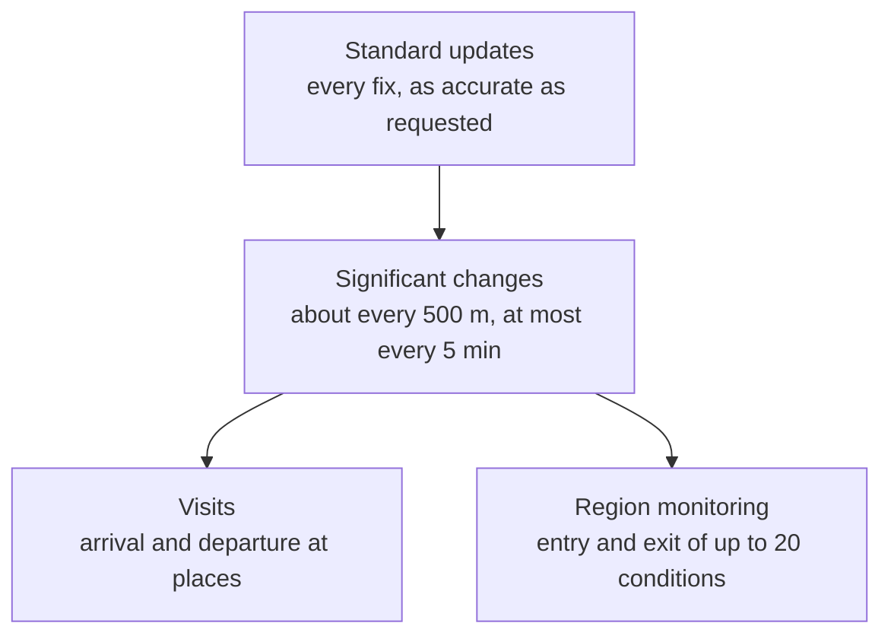

Most apps that care where their users go don't need to know where they are every second. A journal wants the places of the day, a reminder wants "when you get to the office", and a commute tracker wants departure and arrival times. Core Location has two services built for that coarser question: **significant location changes**, a fix whenever the device has moved roughly half a kilometer, and **visits**, the system's own judgment that the user arrived somewhere and later left. Both run with the screen off, both relaunch a terminated app, and both cost a fraction of continuous tracking.

This article covers what the two services deliver and how to read it safely. A visit's unknown arrival is `Date.distantPast`, so naive arithmetic gives an ongoing visit a duration of 1,974 years. A default `CLVisit` crashes on first access. And the first significant change is often a cached fix from somewhere else. It then builds the core of a visit detector from raw fixes, stay-point detection, measured on a synthetic day: it found all six stays with fixes every minute, needed a small change to survive three wild fixes, and degraded predictably as samples thinned out to the rates the low-power services provide.

<!--more-->

The examples use Swift 6 language mode and were compiled with the Swift 6.4 toolchain from Xcode 27.1. The plain Swift blocks ran as a macOS command-line program on macOS 26, and the iOS blocks ran in a unit-test bundle hosted by an app on an iPhone 17 simulator running iOS 27.0, with a route scripted by `simctl`. The synthetic day uses the seeded generator from the [permission changes article](/ios-location-permission-changes/#distance-from-snapped-positions).

<!-- check-uses: sensor-random -->
```swift
import Foundation
import CoreLocation
import simd
```

## The location services, by cost and detail

Core Location offers a ladder of services. Each step down costs less power and tells less:



Apple's documentation describes significant changes this way: apps "can expect a notification as soon as the device moves 500 meters or more from its previous notification", "should not expect notifications more frequently than once every five minutes," and "if the device is able to retrieve data from the network, the location manager is much more likely to deliver notifications in a timely manner." Visits are reported when "the system" decides the user arrived at or left a place. Both services survive termination: for significant changes, the system "automatically relaunches the app into the background if a new event arrives", and for visits it "relaunches your app when new visit events are ready to be delivered."

Visits have one more property worth knowing. The documentation for `startMonitoringVisits()` says an app "can monitor for visit events without" full accuracy, in which case "the visit events use reduced accuracy". This is the one location service that works meaningfully with approximate location, and the [permission changes article](/ios-location-permission-changes/#what-reduced-accuracy-means) quotes Apple's example of a visit at "coordinates somewhere within Cupertino but still at 10:08".

## Reading a visit

A `CLVisit` has a coordinate, a horizontal accuracy, an arrival date, and a departure date. The dates are the trap. Apple's documentation: "When the visit object does not include arrival information, this property is set to the date returned by the `distantPast` method," and missing departure information is `distantFuture`. A visit delivered on arrival has no departure, and a visit that began before monitoring started has no arrival. The documentation spells out both cases: "When the user arrives at a location, the system may send an event with only an arrival time."

So convert at the boundary, the same way the earlier articles turned invalid `CLLocation` fields into optionals:

```swift
/// A visit with Core Location's sentinel dates turned into honest optionals.
struct Visit: Sendable, Equatable {
    var coordinate: CLLocationCoordinate2D
    var horizontalAccuracy: CLLocationAccuracy
    var arrival: Date?        // nil when the system didn't see the arrival
    var departure: Date?      // nil while the user is still there

    init(coordinate: CLLocationCoordinate2D, horizontalAccuracy: CLLocationAccuracy, arrival: Date, departure: Date) {
        self.coordinate = coordinate
        self.horizontalAccuracy = horizontalAccuracy
        self.arrival = arrival == .distantPast ? nil : arrival
        self.departure = departure == .distantFuture ? nil : departure
    }

    init(_ visit: CLVisit) {
        self.init(coordinate: visit.coordinate, horizontalAccuracy: visit.horizontalAccuracy,
                  arrival: visit.arrivalDate, departure: visit.departureDate)
    }

    /// How long the visit lasted, if both ends are known.
    var duration: TimeInterval? {
        guard let arrival, let departure else { return nil }
        return departure.timeIntervalSince(arrival)
    }

    static func == (a: Visit, b: Visit) -> Bool {
        a.coordinate.latitude == b.coordinate.latitude && a.coordinate.longitude == b.coordinate.longitude &&
            a.horizontalAccuracy == b.horizontalAccuracy && a.arrival == b.arrival && a.departure == b.departure
    }
}

let office = CLLocationCoordinate2D(latitude: 51.5155, longitude: -0.0922)
let nine = Date(timeIntervalSinceReferenceDate: 805_000_000)
let arrived = Visit(coordinate: office, horizontalAccuracy: 40, arrival: nine, departure: .distantFuture)
let left = Visit(coordinate: office, horizontalAccuracy: 40, arrival: nine, departure: nine.addingTimeInterval(8 * 3600))
let joinedLate = Visit(coordinate: office, horizontalAccuracy: 40, arrival: .distantPast, departure: nine.addingTimeInterval(8 * 3600))
assert(arrived.departure == nil && arrived.duration == nil)
assert(left.duration == 8 * 3600)
assert(joinedLate.arrival == nil && joinedLate.duration == nil)

// What the sentinels do to naive arithmetic:
print("naive duration of an ongoing visit:", Date.distantFuture.timeIntervalSince(nine) / (365.25 * 86_400), "years")
print("naive duration of a visit with no arrival:", nine.timeIntervalSince(.distantPast) / (365.25 * 86_400), "years")
```

The printed numbers show why. Subtracting the arrival from an ongoing visit's `distantFuture` departure gives 1,974 years, and a visit with a `distantPast` arrival "lasted" 2,025 years. Sorted by duration, those visits go to the top of a "longest stays" list. Charted, they flatten every real bar to nothing.

The struct also makes tests possible. Apple says of `CLVisit`, "you do not create visit objects directly, nor should you subclass" them. The class does have the inherited initializer, and calling it compiles:

```swift
// Crashes: a default CLVisit has a nil arrival date, which a non-optional Date can't hold
import CoreLocation
let fake = CLVisit()
print(fake.arrivalDate)
```

On macOS 26, this stopped the process with a trap on the `print` line. Reading the default object's date through key-value coding returned `nil`: the object has no date, and Swift's bridged, non-optional `Date` can't represent that. Build tests on `Visit`, which takes the raw values, so they can include the sentinel cases.

## Detecting stays yourself

When an app records its own fixes, for a run, a delivery shift, or a field survey, it can detect stays itself, with thresholds it chooses. The classic algorithm is *stay-point detection*. From each fix, extend a window while every later fix stays within a distance $D$ of the first. If the window lasts at least a time $T$, it's a stay, with the window's centroid as the place.

The test data is a synthetic day: home until 8:00, a 25-minute commute to work 5 km east, lunch 300 m north of the office for 40 minutes, work until 17:30, a gym, and home. Fixes have 20 m of noise per axis.

```swift
/// A position in meters on a local flat map, with a time in seconds since midnight.
struct Sample { var time: Double; var position: SIMD2<Double> }

/// One stretch of the true day: standing still somewhere, or moving between two places.
enum Leg {
    case stay(at: SIMD2<Double>, until: Double)
    case travel(to: SIMD2<Double>, until: Double)
}

/// Samples a day every `interval` seconds with Gaussian position noise, from 7:00.
func day(_ legs: [Leg], interval: Double, noise: Double, seed: UInt64) -> [Sample] {
    var random = SeededGenerator(seed: seed)
    var samples: [Sample] = []
    var t = 7 * 3600.0, from = SIMD2<Double>(0, 0), legStart = t
    for leg in legs {
        switch leg {
        case .stay(let place, let end):
            while t < end {
                samples.append(Sample(time: t, position: place + SIMD2(random.gaussian(), random.gaussian()) * noise))
                t += interval
            }
            from = place
        case .travel(let to, let end):
            while t < end {
                let f = (t - legStart) / (end - legStart)
                samples.append(Sample(time: t, position: from + (to - from) * f + SIMD2(random.gaussian(), random.gaussian()) * noise))
                t += interval
            }
            from = to
        }
        legStart = t
    }
    return samples
}

let home = SIMD2<Double>(0, 0), work = SIMD2<Double>(5_000, 0), lunch = SIMD2<Double>(5_000, 300), gym = SIMD2<Double>(3_000, 1_500)
func h(_ hours: Double, _ minutes: Double = 0) -> Double { hours * 3600 + minutes * 60 }
let legs: [Leg] = [
    .stay(at: home, until: h(8)), .travel(to: work, until: h(8, 25)),
    .stay(at: work, until: h(12, 30)), .travel(to: lunch, until: h(12, 35)),
    .stay(at: lunch, until: h(13, 15)), .travel(to: work, until: h(13, 20)),
    .stay(at: work, until: h(17, 30)), .travel(to: gym, until: h(17, 45)),
    .stay(at: gym, until: h(18, 45)), .travel(to: home, until: h(19, 10)),
    .stay(at: home, until: h(22)),
]
let trueStays = [("home", h(7), h(8)), ("work", h(8, 25), h(12, 30)), ("lunch", h(12, 35), h(13, 15)),
                 ("work", h(13, 20), h(17, 30)), ("gym", h(17, 45), h(18, 45)), ("home", h(19, 10), h(22))]
```

```swift
struct Stay { var center: SIMD2<Double>; var arrival: Double; var departure: Double }

/// Stay-point detection: starting from each sample, extend the window while every later sample stays within
/// `radius` of its first sample. A window that lasts at least `minimum` seconds is a stay.
func stays(in samples: [Sample], radius: Double, minimum: Double) -> [Stay] {
    var result: [Stay] = []
    var i = 0
    while i < samples.count {
        var j = i + 1
        while j < samples.count && simd_distance(samples[j].position, samples[i].position) <= radius { j += 1 }
        if samples[j - 1].time - samples[i].time >= minimum {
            let window = samples[i..<j]
            let center = window.reduce(SIMD2<Double>()) { $0 + $1.position } / Double(window.count)
            result.append(Stay(center: center, arrival: samples[i].time, departure: samples[j - 1].time))
            i = j
        } else {
            i += 1
        }
    }
    return result
}

func clock(_ t: Double) -> String { String(format: "%02d:%02d", Int(t) / 3600, Int(t) % 3600 / 60) }

let everyMinute = day(legs, interval: 60, noise: 20, seed: 20)
let found = stays(in: everyMinute, radius: 200, minimum: 20 * 60)
print("found", found.map { "\(clock($0.arrival))–\(clock($0.departure))" })
print("truth", trueStays.map { "\($0.0) \(clock($0.1))–\(clock($0.2))" })
assert(found.count == trueStays.count)
let timingErrors = zip(found, trueStays).flatMap { [abs($0.arrival - $1.1), abs($0.departure - $1.2)] }
print("largest timing error:", timingErrors.max()! / 60, "minutes")
```

With a fix every minute, $D$ = 200 m, and $T$ = 20 minutes, the detector found exactly the six stays, including lunch, only 300 m from the office:

| Truth | Detected |
| --- | --- |
| home 07:00–08:00 | 07:00–08:00 |
| work 08:25–12:30 | 08:25–12:33 |
| lunch 12:35–13:15 | 12:34–13:19 |
| work 13:20–17:30 | 13:20–17:31 |
| gym 17:45–18:45 | 17:44–18:45 |
| home 19:10–22:00 | 19:10–21:59 |

The largest boundary error was 4 minutes, at the end of lunch: the first few minutes of walking back stayed within 200 m of the lunch spot. The two thresholds set the resolution. $D$ must exceed the noise by a margin, or a stay fragments, and it must be smaller than the distance between places that should stay separate, or lunch merges into work. $T$ decides the shortest stay worth reporting.

### Outliers split stays

Real fixes include the occasional wild one, a reflection or a mismatched Wi-Fi network. Three fixes 1 km off during the morning at work did this:

```swift
// Three wild fixes during the morning at work, each 1 km off: a reflection, a bad Wi-Fi match.
var glitchy = everyMinute
for minute in [9 * 60 + 40, 10 * 60 + 15, 11 * 60 + 5] {
    let index = glitchy.firstIndex { $0.time >= Double(minute) * 60 }!
    glitchy[index].position += SIMD2(0, 1_000)
}
print("with outliers:", stays(in: glitchy, radius: 200, minimum: 20 * 60).map { "\(clock($0.arrival))–\(clock($0.departure))" })

/// The same detection, but a window may skip up to `tolerance` consecutive samples that stray outside the radius,
/// as long as the next sample comes back.
func robustStays(in samples: [Sample], radius: Double, minimum: Double, tolerance: Int = 2) -> [Stay] {
    var result: [Stay] = []
    var i = 0
    while i < samples.count {
        var inside = [i], j = i + 1, strays = 0
        while j < samples.count {
            if simd_distance(samples[j].position, samples[i].position) <= radius {
                inside.append(j); strays = 0
            } else {
                strays += 1
                if strays > tolerance { break }
            }
            j += 1
        }
        let last = inside.last!
        if samples[last].time - samples[i].time >= minimum {
            let center = inside.reduce(SIMD2<Double>()) { $0 + samples[$1].position } / Double(inside.count)
            result.append(Stay(center: center, arrival: samples[i].time, departure: samples[last].time))
            i = last + 1
        } else {
            i += 1
        }
    }
    return result
}
let robust = robustStays(in: glitchy, radius: 200, minimum: 20 * 60)
print("robust:", robust.map { "\(clock($0.arrival))–\(clock($0.departure))" })
assert(robust.count == trueStays.count)
```

The basic detector split the morning into four stays, 08:25–09:39, 09:41–10:14, 10:16–11:04, and 11:06–12:32, because each wild fix ended a window. The robust version tolerates up to two consecutive fixes outside the radius, as long as the next one returns, and found the original six stays. The tolerance is another resolution trade-off: two minutes of tolerance can't separate a stay from a two-minute errand next door.

### How sparse can the fixes be?

Fewer fixes mean less power. The question is what the detector loses:

```swift
// How sparse can the samples be? Fewer samples cost less power, and blur the boundaries.
for interval in [60.0, 300, 600, 1_200] {
    let sparse = day(legs, interval: interval, noise: 20, seed: 21)
    let detected = robustStays(in: sparse, radius: 200, minimum: 20 * 60)
    var worst = 0.0
    for stay in detected {
        let match = trueStays.min { abs($0.1 - stay.arrival) < abs($1.1 - stay.arrival) }!
        worst = max(worst, abs(stay.arrival - match.1), abs(stay.departure - match.2))
    }
    print(String(format: "every %4.0f s: %3d samples, %d stays found, worst boundary error %3.0f min",
                 interval, sparse.count, detected.count, worst / 60))
}
```

| Fix interval | Fixes per day | Stays found | Worst boundary error |
| --- | --- | --- | --- |
| 1 minute | 900 | 6 of 6 | 4 min |
| 5 minutes | 180 | 6 of 6 | 5 min |
| 10 minutes | 90 | 6 of 6 | 10 min |
| 20 minutes | 45 | 4 of 6 | (stays confused) |

Down to one fix every 10 minutes, every stay was found, with boundaries blurred by up to the interval. At 20 minutes, with $T$ = 20 minutes, a stay needs at least two consecutive fixes inside it. The 40-minute lunch and the commute boundaries fell apart, and the matching of detected stays to true ones broke down, which is where the 310-minute error in the raw output comes from. The rule of thumb: the fix interval should be well under half the shortest stay worth detecting. Significant changes, at best one fix every five minutes and only after half a kilometer of movement, can locate the places of a day, but not lunch next door. That's the job visits were made for.

## In the simulator

The service below wraps both low-power services into one stream of `Sendable` events. The test starts it with Always authorization and drives 4.9 km east at 40 m/s:

<!-- sim-setup -->
```sh
xcrun simctl privacy booted grant location-always dev.swiftbydeya.Host
xcrun simctl location booted set 51.5007,-0.1246
```

<!-- ios -->
```swift
/// Everything the low-power services report, as Sendable values.
enum PlaceEvent: Sendable {
    case visit(Visit)
    case significantChange(CLLocation)
}

@MainActor final class LowPowerPlaces: NSObject, @preconcurrency CLLocationManagerDelegate {
    private let manager = CLLocationManager()
    private var continuation: AsyncStream<PlaceEvent>.Continuation?

    func events() -> AsyncStream<PlaceEvent> {
        let (stream, continuation) = AsyncStream.makeStream(of: PlaceEvent.self)
        self.continuation = continuation
        manager.delegate = self
        if CLLocationManager.significantLocationChangeMonitoringAvailable() {
            manager.startMonitoringSignificantLocationChanges()
        }
        manager.startMonitoringVisits()
        continuation.onTermination = { [weak self] _ in
            Task { @MainActor in
                self?.manager.stopMonitoringSignificantLocationChanges()
                self?.manager.stopMonitoringVisits()
            }
        }
        return stream
    }

    func locationManager(_ manager: CLLocationManager, didVisit visit: CLVisit) {
        continuation?.yield(.visit(Visit(visit)))
    }

    func locationManager(_ manager: CLLocationManager, didUpdateLocations locations: [CLLocation]) {
        for location in locations { continuation?.yield(.significantChange(location)) }
    }
}

let places = LowPowerPlaces()
let startedAt = Date()
var received: [(seconds: Double, age: Double, event: PlaceEvent)] = []
let listener = Task { @MainActor in
    for await event in places.events() {
        let age: Double
        switch event {
        case .significantChange(let location): age = -location.timestamp.timeIntervalSinceNow
        case .visit: age = 0
        }
        received.append((Date().timeIntervalSince(startedAt), age, event))
    }
}
try await Task.sleep(for: .seconds(3))
```

<!-- sim-run -->
```sh
xcrun simctl location booted start --speed=40 --interval=1 51.5007,-0.1246 51.5007,-0.0546
```

<!-- ios -->
```swift
try await Task.sleep(for: .seconds(100))
listener.cancel()
for (seconds, age, event) in received {
    switch event {
    case .visit(let visit): print(String(format: "%5.1f s visit", seconds), visit)
    case .significantChange(let location):
        print(String(format: "%5.1f s significant change, %.0f m east of the start, %.1f s old on arrival", seconds,
                     location.distance(from: CLLocation(latitude: 51.5007, longitude: -0.1246)), age))
    }
}
let changes = received.filter { if case .significantChange = $0.event { true } else { false } }
assert(changes.count >= 3)
assert(changes.dropFirst().allSatisfy { $0.age < 1 }, "after the first, every change is fresh")
assert(!received.contains { if case .visit = $0.event { true } else { false } })
```

Two runs, back to back:

| Event | First run: position, age on arrival | Second run: position, age on arrival |
| --- | --- | --- |
| At 0.0 s | 4,514 m east, 7.7 s old | 0 m east, 5.4 s old |
| At 22 to 26 s | 766 m east, fresh | 886 m east, fresh |
| At 53 to 56 s | 1,975 m east, fresh | 2,095 m east, fresh |
| At 83 to 86 s | 3,183 m east, fresh | 3,304 m east, fresh |

The first event of each run was a cached fix. In the first run it came from the end of the *previous* test's route, 4.5 km from where `simctl` had just placed the device, and 7.7 seconds old. In the second it happened to be the right place, 5.4 seconds old. That's documented behavior: "The first event to be delivered is usually the most recently cached location event (if any) … so be sure to check the timestamps." An app that treats the first significant change as "the user is here now" puts them wherever the device last had a fix, which could be another city. After that, events came every 30 seconds, about 1.2 km apart, all fresh. That's far more often than the five-minute minimum on a device, as the [simulator article](/ios-sensors-simulator-vs-device/#other-services) found. No visit was reported. The simulator doesn't produce them, so visit handling has to be tested with `Visit` values, as above.

## Summary

- Significant changes deliver a fix roughly every 500 m, no more often than every five minutes on a device, and relaunch a terminated app. Visits report arrivals and departures at places, work with reduced accuracy, and also relaunch the app.
- A visit's unknown arrival is `distantPast` and an ongoing visit's departure is `distantFuture`. Naive subtraction gave durations of 1,974 and 2,025 years. Convert both to `nil` at the boundary.
- Don't construct `CLVisit` in tests. The default object's dates are `nil`, and reading one trapped on macOS. Test a value type built from raw values.
- Stay-point detection with 200 m and 20 minutes found all six stays of a synthetic day from fixes every minute, with boundaries within 4 minutes.
- Three wild fixes split one stay into four. Tolerating up to two consecutive strays fixed it.
- Detection held up to a fix every 10 minutes and fell apart at 20. The fix interval must be well under half the shortest stay.
- The first significant change is often a cached fix. In one simulator run it was 4.5 km and 7.7 s stale, in the next merely 5.4 s stale. Check timestamps.

## Exercise

Turn `robustStays` into a streaming detector that consumes fixes one at a time and emits a `Visit` when a stay starts (arrival only) and again when it ends (with departure), the way the system reports visits. Use your `Visit` type for its output, with `departure` set to `nil` for the first event. Feed it the synthetic day at a 5-minute interval, and check that every stay produces exactly one open and one closed visit, and that no visit is reported for the commute.

## Further reading

- [`CLVisit`](https://developer.apple.com/documentation/corelocation/clvisit), [`arrivalDate`](https://developer.apple.com/documentation/corelocation/clvisit/arrivaldate), and [`departureDate`](https://developer.apple.com/documentation/corelocation/clvisit/departuredate)
- [`startMonitoringVisits()`](https://developer.apple.com/documentation/corelocation/cllocationmanager/startmonitoringvisits()) and [`startMonitoringSignificantLocationChanges()`](https://developer.apple.com/documentation/corelocation/cllocationmanager/startmonitoringsignificantlocationchanges())
- Quannan Li, Yu Zheng, Xing Xie, Yukun Chen, Wenyu Liu, and Wei-Ying Ma, "Mining User Similarity Based on Location History", *Proceedings of the 16th ACM SIGSPATIAL International Conference on Advances in Geographic Information Systems*, 2008, [doi:10.1145/1463434.1463477](https://doi.org/10.1145/1463434.1463477), where stay-point detection was introduced

Previous: [Region Monitoring and Geofencing](/ios-region-monitoring-geofencing/)

Next: [Geocoding, Reverse Geocoding, and Request Limits](/ios-geocoding/)

Return to the [Sensors and Location roadmap](/ios-sensors/).
