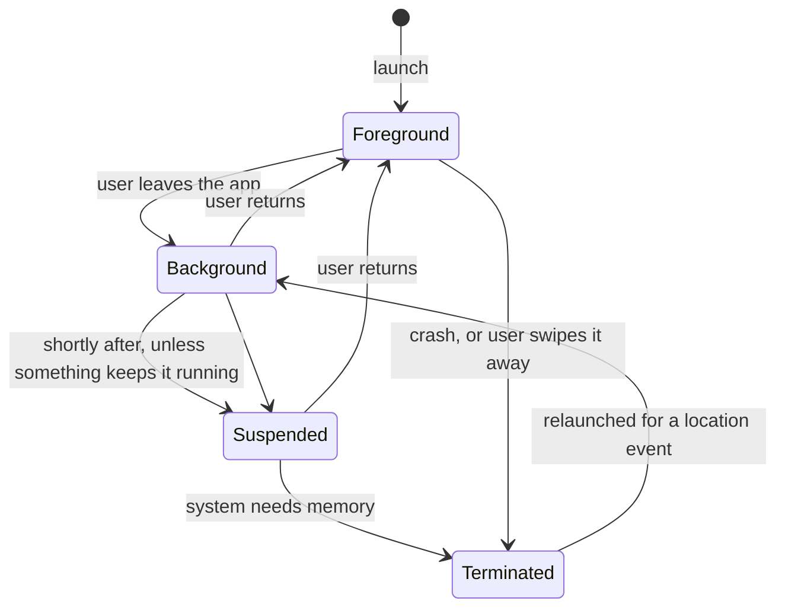

A location feature crosses the app's lifecycle boundaries constantly. The user starts a run and locks the phone. A geofence fires while the app isn't running at all. The system terminates the app to reclaim memory in the middle of a commute. At each boundary, the rules for what an app may receive change, and an app that doesn't plan for them loses data without any error to tell it so.

This article maps those boundaries and measures what happens at each one. When a When In Use app moved to the background, a plain location manager kept delivering for about 11.5 seconds, then reported "denied". `liveUpdates()` stopped at the same point *without* any signal at all. A manager allowed to run in the background, or a held `CLBackgroundActivitySession`, kept going. Setting `allowsBackgroundLocationUpdates` without the matching Info.plist entry is an assertion failure. And significant-change monitoring relaunched a terminated app 23 to 25 seconds into a drive, with no launch options to say why, while a control run with monitoring stopped launched nothing.

<!--more-->

The examples use Swift 6 language mode and were compiled with the Swift 6.4 toolchain from Xcode 27.1. The plain Swift blocks ran as a macOS command-line program on macOS 26, and the iOS blocks ran in a unit-test bundle hosted by an app on an iPhone 17 simulator running iOS 27.0, whose Info.plist declares the `location` background mode. One limitation shapes the measurements: XCTest keeps the hosted app's process running when it's in the background, so the tests show Core Location's decisions about delivery, but not app *suspension*, which they can't observe.

```swift
import Foundation
import CoreLocation
```

## The boundaries



Apple's guide [Handling location updates in the background](https://developer.apple.com/documentation/corelocation/handling-location-updates-in-the-background) describes the middle of that diagram: "the system suspends the execution of most apps shortly after they move to the background. In this suspended state, apps don't run and don't receive location updates from the system. Instead, the system enqueues location updates and delivers them when the app runs again." An app that needs updates *while* in the background has to ask the system not to suspend it, and that requires three things:

- The `location` value in the `UIBackgroundModes` Info.plist key, which Xcode adds through the Location updates background mode capability.
- Authorization. When In Use is enough while a session keeps the app running, and Always is needed for anything that starts while the app isn't in use.
- An explicit signal that updates should continue: `allowsBackgroundLocationUpdates = true` on a `CLLocationManager`, or a held `CLBackgroundActivitySession` for `CLLocationUpdate.liveUpdates()`.

## What happens when the app leaves the foreground

The test grants When In Use access, then runs four phases one after another. Each phase starts one kind of location request, drives a route at 20 m/s, sends the app to the background by opening Settings, and counts what arrives in the next 20 seconds. Settings like `allowsBackgroundLocationUpdates` affect the whole process: a first version that ran all four at once saw all of them continue, because one manager kept the app running for everyone.

<!-- sim-setup -->
```sh
xcrun simctl privacy booted grant location dev.swiftbydeya.Host
xcrun simctl location booted set 51.5007,-0.1246
```

<!-- ios -->
```swift
/// Counts fixes and failures, split by whether the app was in the foreground when they arrived.
@MainActor final class Tally: NSObject, @preconcurrency CLLocationManagerDelegate {
    let manager = CLLocationManager()
    private(set) var backgroundFixTimes: [Date] = []
    private(set) var backgroundFailures: [(code: Int, at: Date)] = []
    var backgroundFixes: Int { backgroundFixTimes.count }

    override init() { super.init(); manager.delegate = self }

    func locationManager(_ manager: CLLocationManager, didUpdateLocations locations: [CLLocation]) {
        if UIApplication.shared.applicationState == .background { backgroundFixTimes += locations.map { _ in Date() } }
    }

    func locationManager(_ manager: CLLocationManager, didFailWithError error: any Error) {
        if UIApplication.shared.applicationState == .background { backgroundFailures.append(((error as NSError).code, Date())) }
    }
}

/// Seconds from a moment to each of some later times.
func offsets(_ times: [Date], from start: Date) -> String {
    times.map { String(format: "%.1f", $0.timeIntervalSince(start)) }.joined(separator: " ")
}

print("defaults: allowsBackgroundLocationUpdates", CLLocationManager().allowsBackgroundLocationUpdates,
      "showsBackgroundLocationIndicator", CLLocationManager().showsBackgroundLocationIndicator)

/// Live updates counted in the background, for the session experiments.
@MainActor final class LiveTally {
    private(set) var backgroundFixTimes: [Date] = []
    private(set) var backgroundDenials = 0
    private var task: Task<Void, any Error>?
    var backgroundFixes: Int { backgroundFixTimes.count }
    func start() {
        task = Task { @MainActor in
            for try await update in CLLocationUpdate.liveUpdates() where UIApplication.shared.applicationState == .background {
                if update.location != nil { backgroundFixTimes.append(Date()) }
                if update.authorizationDenied { backgroundDenials += 1 }
            }
        }
    }
    func stop() { task?.cancel() }
}

// Phase 1: a plain manager with When In Use access.
let plain = Tally()
plain.manager.startUpdatingLocation()
try await Task.sleep(for: .seconds(1))
var leftAt = Date()
```

The first phase is a plain manager:

<!-- sim-run -->
```sh
xcrun simctl location booted start --speed=20 --interval=1 51.5007,-0.1246 51.5007,-0.0446
xcrun simctl launch booted com.apple.Preferences
```

<!-- ios -->
```swift
try await Task.sleep(for: .seconds(20))
plain.manager.stopUpdatingLocation()
print("plain manager, 20 s in the background:", plain.backgroundFixes, "fixes at", offsets(plain.backgroundFixTimes, from: leftAt),
      "; failures", plain.backgroundFailures.map { "\($0.code) at \(String(format: "%.1f", $0.at.timeIntervalSince(leftAt)))" })
assert(plain.backgroundFailures.map(\.code) == [CLError.denied.rawValue])
```

<!-- sim-run -->
```sh
xcrun simctl launch booted dev.swiftbydeya.Host
```

The second is a manager allowed to continue in the background:

<!-- ios -->
```swift
// Phase 2: the same, allowed to continue in the background.
try await Task.sleep(for: .seconds(2))
let continuing = Tally()
continuing.manager.allowsBackgroundLocationUpdates = true
continuing.manager.startUpdatingLocation()
try await Task.sleep(for: .seconds(1))
leftAt = Date()
```

<!-- sim-run -->
```sh
xcrun simctl location booted start --speed=20 --interval=1 51.5007,-0.1246 51.5007,-0.0446
xcrun simctl launch booted com.apple.Preferences
```

<!-- ios -->
```swift
try await Task.sleep(for: .seconds(20))
continuing.manager.stopUpdatingLocation()
print("background-enabled manager, 20 s in the background:", continuing.backgroundFixes, "fixes, last at",
      offsets(Array(continuing.backgroundFixTimes.suffix(1)), from: leftAt), "; failures", continuing.backgroundFailures.count)
assert(continuing.backgroundFailures.isEmpty && continuing.backgroundFixes > plain.backgroundFixes)
```

<!-- sim-run -->
```sh
xcrun simctl launch booted dev.swiftbydeya.Host
```

The third uses live updates without a background activity session:

<!-- ios -->
```swift
// Phase 3: live updates without a background activity session.
try await Task.sleep(for: .seconds(2))
let bare = LiveTally()
bare.start()
try await Task.sleep(for: .seconds(1))
leftAt = Date()
```

<!-- sim-run -->
```sh
xcrun simctl location booted start --speed=20 --interval=1 51.5007,-0.1246 51.5007,-0.0446
xcrun simctl launch booted com.apple.Preferences
```

<!-- ios -->
```swift
try await Task.sleep(for: .seconds(20))
bare.stop()
print("live updates without a session:", bare.backgroundFixes, "fixes, last at", offsets(Array(bare.backgroundFixTimes.suffix(1)), from: leftAt),
      ";", bare.backgroundDenials, "denied updates")
```

<!-- sim-run -->
```sh
xcrun simctl launch booted dev.swiftbydeya.Host
```

And the fourth holds a `CLBackgroundActivitySession` while iterating live updates:

<!-- ios -->
```swift
// Phase 4: live updates while a background activity session is held.
try await Task.sleep(for: .seconds(2))
let session = CLBackgroundActivitySession()
let held = LiveTally()
held.start()
try await Task.sleep(for: .seconds(1))
leftAt = Date()
```

<!-- sim-run -->
```sh
xcrun simctl location booted start --speed=20 --interval=1 51.5007,-0.1246 51.5007,-0.0446
xcrun simctl launch booted com.apple.Preferences
```

<!-- ios -->
```swift
try await Task.sleep(for: .seconds(20))
held.stop()
session.invalidate()
print("live updates with a session:", held.backgroundFixes, "fixes, last at", offsets(Array(held.backgroundFixTimes.suffix(1)), from: leftAt),
      ";", held.backgroundDenials, "denied updates")
assert(held.backgroundFixes > bare.backgroundFixes)
```

<!-- sim-run -->
```sh
xcrun simctl launch booted dev.swiftbydeya.Host
```

| Configuration | Fixes in 20 s of background | Last fix | Signal |
| --- | --- | --- | --- |
| `CLLocationManager`, plain | 10 | 11.4–11.5 s | `didFailWithError`, code 1 (`denied`), at 13.4–13.5 s |
| `CLLocationManager`, `allowsBackgroundLocationUpdates` | 19 | 20.4–20.5 s | none needed |
| `liveUpdates()`, no session | 11 | 11.4–11.6 s | **none** |
| `liveUpdates()` with `CLBackgroundActivitySession` | 20 | 20.4 s | none needed |

Times are seconds after the test started opening Settings, over two runs. The app reached the background a second or so later.

Three things stand out. First, the grace period. A When In Use app without a background configuration kept receiving fixes for about 10 seconds after leaving the foreground, then lost access. That window is undocumented and shouldn't be relied on, but it explains why short tests of "background" tracking can pass when real use fails.

Second, the two APIs end differently. The delegate API told the app: `didFailWithError` with `CLError.denied` 2 seconds after the last fix. The `liveUpdates()` sequence simply stopped producing values, with no update carrying `authorizationDenied` or any other flag. A consumer iterating the sequence can't tell "the user stopped moving" from "the app lost access". Only knowing its own state, that it's in the background without a session, tells it.

Third, both continuation mechanisms worked identically, delivering every fix for the full 20 seconds. `CLBackgroundActivitySession` is the newer, structured form: it lives as long as the object, and `invalidate()` ends it. That fits Swift's ownership far better than a flag that someone has to remember to clear. Apple's guide says to "create an instance of `CLBackgroundActivitySession` to start a background activity session so that you can receive location updates."

The defaults the test printed are worth knowing too. `allowsBackgroundLocationUpdates` is `false`, and `showsBackgroundLocationIndicator`, the blue status bar pill for apps with Always authorization, is also `false`. Apple's documentation says to "set this value to true to maintain transparency with the user." For When In Use apps, "the system changes the appearance of the status bar when the app uses location services in the background" regardless.

## The flag that needs the Info.plist

Apple's documentation for `allowsBackgroundLocationUpdates` warns that "setting the value to true but omitting the `UIBackgroundModes` key and `location` value in your app's `Info.plist` file is a fatal error that terminates the app." A second test host, built without the background mode, confirmed it:

<!-- ios -->
```swift
// Crashes in an app without UIBackgroundModes "location": Core Location asserts in the setter
let manager = CLLocationManager()
manager.allowsBackgroundLocationUpdates = true
```

The console showed "*** Assertion failure in -[CLLocationManager setAllowsBackgroundLocationUpdates:], CLLocationManager.m:1048", and the process ended with `SIGABRT`. It happens on the first set, whatever the authorization status, so it shows up as soon as the code runs. The usual way it ships is a shared module that sets the flag, included in an app extension or a second target whose Info.plist lacks the key.

## Relaunched after termination

Some location services survive the app's death. Apple's documentation says, of significant-change monitoring, that "if you start this service and your app is subsequently terminated, the system automatically relaunches the app into the background if a new event arrives." The same applies to visits and to `CLMonitor` conditions. To see it happen, the test host's app delegate records every launch to a file:

<!-- skip-check -->
```swift
func application(_ application: UIApplication, didFinishLaunchingWithOptions launchOptions: [UIApplication.LaunchOptionsKey: Any]?) -> Bool {
    let keys = launchOptions?.keys.map(\.rawValue).sorted().joined(separator: ",") ?? "none"
    let line = "\(Date().timeIntervalSince1970) state=\(application.applicationState.rawValue) options=\(keys)\n"
    // …appended to Documents/launches.txt
    return true
}
```

The experiment ran outside the article's test, in four steps. A short test started significant-change monitoring with Always access, and the app exited when the test finished. Then a route started, and two and a half minutes later the launch log was read:

```sh
xcrun simctl location booted start --speed=50 --interval=1 51.5007,-0.1246 51.5007,-0.0446
# …wait 150 s, then:
cat "$(xcrun simctl get_app_container booted dev.swiftbydeya.Host data)/Documents/launches.txt"
```

| Run | Monitoring active | Launches during the drive |
| --- | --- | --- |
| Experiment 1 | significant changes, visits, a `CLMonitor` condition | 2, at 23 s and 92 s |
| Control | none (stopped before the drive) | 0 |
| Experiment 2 | significant changes only | 1, at 25 s |

The system relaunched the terminated app for significant-change events, in the background (`applicationState` 2), and didn't when nothing was being monitored. Every relaunch had **no launch options**: the `location` key that older documentation describes wasn't there, in this scene-based app on iOS 27.0. So an app can't count on launch options to recognize a location relaunch.

What the relaunched app received is the other half. The test host creates no `CLLocationManager` at launch, so the events that woke it went nowhere. Apple's documentation is explicit that this is the app's job: "Upon relaunch, you must still configure a location manager object and call this method to continue receiving location events," and for `CLMonitor`, "recreate the monitor with the same identifier."

## Restoring on launch

Since launch options can't be trusted to say why the app launched, restore from the app's own record of what it had running. Save that record whenever a feature starts or stops, and at every launch, in any state, recreate exactly those services before doing anything slow:

```swift
/// What the app had running when it was last alive, saved whenever it changes, so a relaunch can restore it.
struct LocationFeatures: Codable, Equatable {
    var recordingWorkout = false        // continuous updates in the background
    var watchedPlaces: [String] = []    // CLMonitor condition identifiers
    var commuteDetection = false        // significant changes
}

enum Restoration: Equatable {
    case backgroundActivitySession       // keep live updates flowing in the background
    case serviceSession(always: Bool)    // declare the authorization the features need
    case monitor(name: String)           // recreate the CLMonitor and keep reading its events
    case significantChanges
}

/// What to recreate during launch, before the first event can be lost. Order matters: sessions first.
func restorations(for features: LocationFeatures, authorizedAlways: Bool) -> [Restoration] {
    var steps: [Restoration] = []
    let needsAlways = !features.watchedPlaces.isEmpty || features.commuteDetection
    if features.recordingWorkout || needsAlways {
        steps.append(.serviceSession(always: needsAlways && authorizedAlways))
    }
    if features.recordingWorkout { steps.append(.backgroundActivitySession) }
    if !features.watchedPlaces.isEmpty { steps.append(.monitor(name: "Places")) }
    if features.commuteDetection { steps.append(.significantChanges) }
    return steps
}

let saved = try JSONEncoder().encode(LocationFeatures(recordingWorkout: true, watchedPlaces: ["office"], commuteDetection: false))
let restored = try JSONDecoder().decode(LocationFeatures.self, from: saved)
assert(restorations(for: restored, authorizedAlways: true)
       == [.serviceSession(always: true), .backgroundActivitySession, .monitor(name: "Places")])
assert(restorations(for: LocationFeatures(), authorizedAlways: true).isEmpty, "nothing was running: start nothing")
```

A workout in progress and one watched place restore as a service session (with Always authorization), a background activity session, and the "Places" monitor, in that order. With nothing saved, nothing starts, which matters because Apple's guide warns: "Don't start these services at launch time if your app's authorization status is undetermined." The function is pure and runs on any platform. The real work, creating `CLServiceSession`, `CLBackgroundActivitySession`, and `CLMonitor` objects and keeping them alive, happens in an object owned by the app delegate. That ownership is the subject of the [stopping updates article](/ios-sensor-stopping-updates/).

## Summary

- Apps are suspended shortly after leaving the foreground, and suspended apps receive no location updates. The system queues them for later. Continuous background updates need the `location` background mode, authorization, and an explicit request.
- Measured with When In Use access: a plain manager kept delivering for about 10 s in the background, then failed with `denied` at 13.5 s. `liveUpdates()` stopped at the same point with **no** signal. Both `allowsBackgroundLocationUpdates` and a held `CLBackgroundActivitySession` delivered for the full 20 s.
- Background settings are process-wide. One manager allowed in the background keeps every location request in the app alive.
- Setting `allowsBackgroundLocationUpdates` without the Info.plist background mode failed an assertion in the setter and aborted the app.
- Significant changes relaunched a terminated app 23 to 25 s into a drive, in the background, with no launch options. A control run with monitoring stopped launched nothing. The relaunched app must recreate its managers, monitors, and sessions itself.
- Persist which location features are running, and restore exactly those at every launch. Never start location services at launch for an undecided authorization.
- XCTest keeps a hosted app running in the background, so app suspension itself needs a device test without the test runner.

## Exercise

Build `LocationRuntime`, the object that turns `restorations(for:authorizedAlways:)` into live objects. It should hold the `CLServiceSession`, the `CLBackgroundActivitySession`, and the `CLMonitor` for exactly as long as the saved features require them, update the saved record whenever a feature starts or stops, and expose one `AsyncStream` of events. Write a test that creates it from a saved record, as a relaunch would, and checks which sessions exist, using the session diagnostics to confirm each one is active.

## Further reading

- [Handling location updates in the background](https://developer.apple.com/documentation/corelocation/handling-location-updates-in-the-background), Apple's guide to background modes, sessions, and relaunches
- [`allowsBackgroundLocationUpdates`](https://developer.apple.com/documentation/corelocation/cllocationmanager/allowsbackgroundlocationupdates) and [`showsBackgroundLocationIndicator`](https://developer.apple.com/documentation/corelocation/cllocationmanager/showsbackgroundlocationindicator)
- [What's new in location authorization](https://developer.apple.com/videos/play/wwdc2024/10212/), the WWDC24 session that introduced service sessions alongside background activity sessions

Previous: [Geocoding, Reverse Geocoding, and Request Limits](/ios-geocoding/)

Next: [Timestamps, Stale Samples, and Out-of-Order Events](/ios-sensor-timestamps/)

Return to the [Sensors and Location roadmap](/ios-sensors/).
