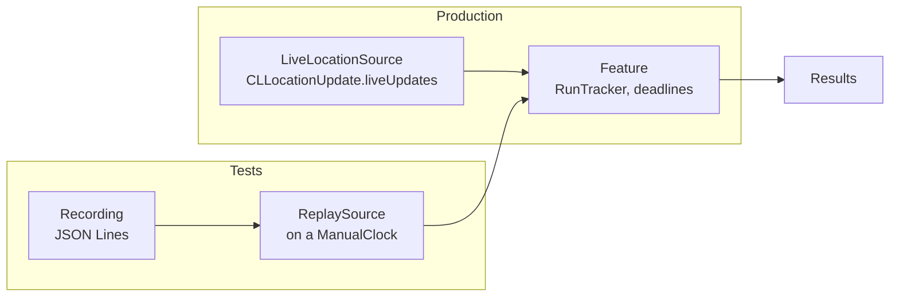

Sensor code is hard to test for two reasons that look unrelated. Its input comes from hardware: a test can't walk around a park, and the simulator, as this series has measured, has no motion sensors and scripted location. And its behavior depends on time: deadlines, debouncing, rate limits, and the spacing of samples. A test that sleeps for real is slow, and one that doesn't is usually testing something else. Recorded data solves the first problem and a controllable clock solves the second. Together they make sensor features as testable as any other code.

This article builds both as a Swift package with Swift Testing tests. Features depend on a `LocationSource` protocol. A recording is a JSON Lines file, and the one in the tests is real: 30 fixes recorded from the simulator's City Run scenario. A replay source plays it on any Swift `Clock`. A `ManualClock` moves only when a test tells it to. The eight tests (ten cases) ran in 0.026 seconds, including one that waits 30 seconds for a silent sensor and one that replays the whole recording, about half a minute of real time. Building it surfaced a bug worth knowing about, a test that hung because a start time was computed at the wrong moment, and the same mistake is waiting in naive deadline code.

<!--more-->

The package uses Swift 6 language mode and was built and tested with `swift test` from the Swift 6.4 toolchain in Xcode 27.1 on macOS 26. Each code block below is a file of the package, named just above it. The live source compiles only for iOS, so the library was also typechecked against the iOS 27.1 simulator SDK. The recording was captured from an iPhone 17 simulator running iOS 27.0.

## The shape of a testable sensor feature



The feature never sees Core Location. It sees `LocationSample` values from something that conforms to `LocationSource`. The boundary is where the earlier articles' rules apply: [convert to `Sendable` values](/ios-accelerometer-gyroscope/#receiving-samples-in-swift-6), and [turn sentinels into optionals](/ios-sensor-missing-data/#optionals-at-the-boundary). Because the sample is the only thing that crosses the boundary, it's also the only thing a recording has to store.

## Samples and recordings

`Sources/Library/LocationSample.swift`:

<!-- file: Sources/Library/LocationSample.swift -->
```swift
import Foundation
import CoreLocation

/// One recorded fix. Negative speeds and courses, Core Location's "unknown", become nil on the way in.
public struct LocationSample: Codable, Sendable, Equatable {
    public var time: TimeInterval          // seconds since 1970
    public var latitude: Double
    public var longitude: Double
    public var accuracy: Double
    public var speed: Double?
    public var course: Double?

    public init(time: TimeInterval, latitude: Double, longitude: Double, accuracy: Double, speed: Double?, course: Double?) {
        self.time = time; self.latitude = latitude; self.longitude = longitude
        self.accuracy = accuracy; self.speed = speed; self.course = course
    }

    public init(_ location: CLLocation) {
        self.init(time: location.timestamp.timeIntervalSince1970, latitude: location.coordinate.latitude,
                  longitude: location.coordinate.longitude, accuracy: location.horizontalAccuracy,
                  speed: location.speed >= 0 ? location.speed : nil, course: location.course >= 0 ? location.course : nil)
    }

    enum CodingKeys: String, CodingKey { case time = "t", latitude = "lat", longitude = "lon", accuracy = "acc", speed, course }

    public init(from decoder: any Decoder) throws {
        let c = try decoder.container(keyedBy: CodingKeys.self)
        time = try c.decode(Double.self, forKey: .time)
        latitude = try c.decode(Double.self, forKey: .latitude)
        longitude = try c.decode(Double.self, forKey: .longitude)
        accuracy = try c.decode(Double.self, forKey: .accuracy)
        speed = try c.decodeIfPresent(Double.self, forKey: .speed).flatMap { $0 >= 0 ? $0 : nil }
        course = try c.decodeIfPresent(Double.self, forKey: .course).flatMap { $0 >= 0 ? $0 : nil }
    }

    public var location: CLLocation {
        CLLocation(coordinate: CLLocationCoordinate2D(latitude: latitude, longitude: longitude), altitude: 0,
                   horizontalAccuracy: accuracy, verticalAccuracy: -1, timestamp: Date(timeIntervalSince1970: time))
    }
}
```

The sample decodes negative speeds and courses as `nil`, so a recording made from raw `CLLocation` values, which uses −1 for unknown, can't leak the sentinel into the feature. The coding keys are short, because a run recorded at one fix per second is 3,600 lines an hour.

`Sources/Library/Recording.swift`:

<!-- file: Sources/Library/Recording.swift -->
```swift
import Foundation

/// A recording is JSON Lines: one sample per line, so a recorder can append as it goes and a crash loses one line.
public enum Recording {
    public static func encode(_ samples: [LocationSample]) throws -> String {
        let encoder = JSONEncoder()
        encoder.outputFormatting = [.sortedKeys]
        return try samples.map { String(decoding: try encoder.encode($0), as: UTF8.self) }.joined(separator: "\n") + "\n"
    }

    public static func decode(_ text: String) throws -> [LocationSample] {
        let decoder = JSONDecoder()
        return try text.split(separator: "\n").filter { !$0.isEmpty }.map { try decoder.decode(LocationSample.self, from: Data($0.utf8)) }
    }
}
```

JSON Lines suits recordings: one JSON object per line, appended as samples arrive. A recorder never rewrites the file, and if the app crashes, only the last line is lost. Encoding with `.sortedKeys` makes recordings diff cleanly in code review, which matters once they're checked into the repository as fixtures.

The fixture in the tests is real data. A short test in the simulator started location updates, ran `xcrun simctl location booted run "City Run"`, and printed each fix in this format. The first three lines:

```json
{"t":1793197938.549,"lat":37.331821,"lon":-122.030386,"acc":10,"speed":1.54,"course":-1.0}
{"t":1793197939.561,"lat":37.331820,"lon":-122.030433,"acc":10,"speed":3.59,"course":-1.0}
{"t":1793197940.565,"lat":37.331815,"lon":-122.030482,"acc":10,"speed":3.74,"course":263.6}
```

Recording from devices works the same way: log `LocationSample(location)` for every fix during a real run, export the file, and keep it with the tests. A recording made on a phone in a city captures what no simulator scenario does: urban-canyon jumps, accuracy that swings between 5 and 65 m, and gaps under bridges.

## Sources and replay

`Sources/Library/Sources.swift`:

<!-- file: Sources/Library/Sources.swift -->
```swift
import Foundation
import CoreLocation

/// What every feature depends on: a stream of samples. Production passes the live source; tests pass a replay.
public protocol LocationSource: Sendable {
    func samples() -> AsyncStream<LocationSample>
}

/// Replays a recording on any clock, keeping the recorded spacing (divided by `speedUp`).
public struct ReplaySource<C: Clock>: LocationSource where C.Duration == Duration {
    public let recording: [LocationSample]
    public let clock: C
    public let speedUp: Double

    public init(_ recording: [LocationSample], clock: C, speedUp: Double = 1) {
        self.recording = recording; self.clock = clock; self.speedUp = speedUp
    }

    public func samples() -> AsyncStream<LocationSample> {
        let (stream, continuation) = AsyncStream.makeStream(of: LocationSample.self, bufferingPolicy: .unbounded)
        let recording = recording, clock = clock, speedUp = speedUp
        let start = clock.now
        let task = Task {
            guard let first = recording.first?.time else { continuation.finish(); return }
            for sample in recording {
                let offset = Duration.seconds((sample.time - first) / speedUp)
                do { try await clock.sleep(until: start.advanced(by: offset), tolerance: nil) } catch { break }
                continuation.yield(sample)
            }
            continuation.finish()
        }
        continuation.onTermination = { _ in task.cancel() }
        return stream
    }
}

#if os(iOS)
/// The production source: Core Location's live updates, converted at the boundary.
public struct LiveLocationSource: LocationSource {
    public init() {}
    public func samples() -> AsyncStream<LocationSample> {
        AsyncStream { continuation in
            let task = Task {
                for try await update in CLLocationUpdate.liveUpdates(.fitness) {
                    if let location = update.location { continuation.yield(LocationSample(location)) }
                }
                continuation.finish()
            }
            continuation.onTermination = { _ in task.cancel() }
        }
    }
}
#endif
```

`ReplaySource` sleeps on its clock until each sample's recorded offset from the first one, then yields it. On a `ContinuousClock` it reproduces the recording's real timing, which is useful for demos and for driving the app in the simulator from a device recording. On a test clock it reproduces the timing without the waiting. The live source is the same `liveUpdates()` loop the earlier articles used, converted at the boundary. Both sit behind one protocol, so the feature can't tell them apart.

Note where `start` is computed: when `samples()` is called, not inside the task. That's the first of the two timing bugs, and the test section shows what happens when the order is wrong.

## The feature under test

`Sources/Library/RunTracker.swift`:

<!-- file: Sources/Library/RunTracker.swift -->
```swift
import Foundation
import CoreLocation

/// The feature under test: total distance of a run, ignoring fixes that are too vague or imply impossible speed,
/// and spacing kept fixes by a distance filter.
public struct RunTracker {
    public var maximumAccuracy: Double = 50
    public var maximumSpeed: Double = 12
    public var minimumSpacing: Double = 10
    public private(set) var distance: Double = 0
    public private(set) var kept = 0, rejected = 0
    private var last: CLLocation?

    public init() {}

    public mutating func add(_ sample: LocationSample) {
        let location = sample.location
        guard sample.accuracy >= 0, sample.accuracy <= maximumAccuracy else { rejected += 1; return }
        guard let last else { self.last = location; kept += 1; return }
        let step = location.distance(from: last)
        let elapsed = max(location.timestamp.timeIntervalSince(last.timestamp), 0.001)
        if (step - sample.accuracy - last.horizontalAccuracy) / elapsed > maximumSpeed { rejected += 1; return }
        guard step >= minimumSpacing else { return }
        distance += step
        self.last = location
        kept += 1
    }
}
```

`RunTracker` combines three rules from earlier articles: reject fixes whose accuracy is too vague, reject [implausible jumps](/ios-location-updates-accuracy/#rejecting-impossible-jumps), and add distance only between fixes at least [10 m apart](/ios-location-distance-filter-energy/#two-errors-that-pull-in-opposite-directions). It's a plain struct with no sensor or clock dependency, which is what makes it the easy part to test.

## A clock the test controls

Time-based behavior needs a clock that only moves when the test says so. Swift's `Clock` protocol makes this possible without touching the code under test: anything written against `some Clock` accepts a test clock. The [first-sample deadline](/ios-sensor-availability/#a-deadline-for-the-first-sample) from the first article in this series, rewritten to take a clock:

`Sources/Library/Deadline.swift`:

<!-- file: Sources/Library/Deadline.swift -->
```swift
import Foundation

public struct SensorSilent: Error, Equatable {}

/// Forwards `upstream`, but fails with SensorSilent if nothing arrives within `limit` on `clock`.
/// The deadline is fixed now, when the function is called, so a test clock can't move before the watchdog sees it.
public func requiringFirstElement<Element: Sendable, C: Clock>(
    of upstream: AsyncStream<Element>, within limit: Duration, clock: C
) -> AsyncThrowingStream<Element, any Error> where C.Duration == Duration {
    let deadline = clock.now.advanced(by: limit)
    return AsyncThrowingStream { continuation in
        let forwarding = Task {
            let watchdog = Task {
                try await clock.sleep(until: deadline, tolerance: nil)
                continuation.finish(throwing: SensorSilent())
            }
            for await element in upstream {
                watchdog.cancel()
                continuation.yield(element)
            }
            watchdog.cancel()
            continuation.finish()
        }
        continuation.onTermination = { _ in forwarding.cancel() }
    }
}
```

The comment on the deadline marks the change from the first article's version, which computed the deadline inside the watchdog task: `try await Task.sleep(for: limit)`. With a real clock, that's fine. With a manual clock, it races: a test that creates the guarded stream and immediately advances time by 31 seconds can advance *before* the watchdog task starts, and the watchdog would then compute "now plus 30 seconds" from the already advanced time and sleep past the point the test ever reaches. This version was written to avoid that, so the race was never observed here, but the replay test below hit exactly the same mistake in a different place. Fixing the deadline when the function is called makes the result independent of task scheduling, which is also more correct in production. The deadline should run from the moment the caller asked, not from whenever a task got scheduled.

`Tests/LibraryTests/ManualClock.swift`:

<!-- file: Tests/LibraryTests/ManualClock.swift -->
```swift
import Foundation
import Synchronization

/// A clock that only moves when a test moves it. Sleepers wake, in deadline order, when time passes their deadline.
final class ManualClock: Clock, Sendable {
    struct Instant: InstantProtocol {
        var offset: Duration
        func advanced(by duration: Duration) -> Instant { Instant(offset: offset + duration) }
        func duration(to other: Instant) -> Duration { other.offset - offset }
        static func < (a: Instant, b: Instant) -> Bool { a.offset < b.offset }
    }

    private struct Sleeper { let id: Int; let deadline: Instant; let continuation: CheckedContinuation<Void, any Error> }
    private struct State { var now = Instant(offset: .zero); var sleepers: [Sleeper] = []; var nextID = 0 }
    private let state = Mutex(State())

    var now: Instant { state.withLock { $0.now } }
    var minimumResolution: Duration { .zero }
    var sleeperCount: Int { state.withLock { $0.sleepers.count } }

    func sleep(until deadline: Instant, tolerance: Duration?) async throws {
        let id = state.withLock { state in defer { state.nextID += 1 }; return state.nextID }
        try await withTaskCancellationHandler {
            try await withCheckedThrowingContinuation { (continuation: CheckedContinuation<Void, any Error>) in
                let resumeNow = state.withLock { state -> Bool in
                    if deadline <= state.now { return true }
                    state.sleepers.append(Sleeper(id: id, deadline: deadline, continuation: continuation))
                    return false
                }
                if resumeNow { continuation.resume() }
            }
        } onCancel: {
            let cancelled = state.withLock { state -> Sleeper? in
                guard let index = state.sleepers.firstIndex(where: { $0.id == id }) else { return nil }
                return state.sleepers.remove(at: index)
            }
            cancelled?.continuation.resume(throwing: CancellationError())
        }
    }

    /// Moves time forward and wakes every sleeper whose deadline has passed.
    func advance(by duration: Duration) {
        let due = state.withLock { state -> [Sleeper] in
            state.now = state.now.advanced(by: duration)
            let now = state.now
            let due = state.sleepers.filter { $0.deadline <= now }.sorted { $0.deadline < $1.deadline }
            state.sleepers.removeAll { $0.deadline <= now }
            return due
        }
        for sleeper in due { sleeper.continuation.resume() }
    }
}
```

The clock keeps sleepers in a mutex-protected list. `sleep(until:)` returns immediately when the deadline has already passed. Otherwise it parks a continuation until `advance(by:)` moves time past the deadline, waking sleepers in deadline order. Cancellation removes the sleeper and resumes it with `CancellationError`, so a cancelled replay doesn't leak a suspended task. There's one design choice to note: `advance` resumes continuations *after* releasing the lock, because resuming while holding it would let woken code call back into the clock and deadlock.

## The tests

`Tests/LibraryTests/Fixtures.swift`:

<!-- file: Tests/LibraryTests/Fixtures.swift -->
```swift
/// Thirty fixes recorded from the iOS 27.0 simulator's "City Run" scenario, one per line.
let cityRun = """
{"t":1793197938.549,"lat":37.331821,"lon":-122.030386,"acc":10,"speed":1.54,"course":-1.0}
{"t":1793197939.561,"lat":37.331820,"lon":-122.030433,"acc":10,"speed":3.59,"course":-1.0}
{"t":1793197940.565,"lat":37.331815,"lon":-122.030482,"acc":10,"speed":3.74,"course":263.6}
{"t":1793197941.551,"lat":37.331810,"lon":-122.030534,"acc":30,"speed":4.25,"course":262.9}
{"t":1793197942.553,"lat":37.331800,"lon":-122.030581,"acc":30,"speed":3.84,"course":258.2}
{"t":1793197943.555,"lat":37.331786,"lon":-122.030626,"acc":30,"speed":3.67,"course":250.5}
{"t":1793197944.554,"lat":37.331761,"lon":-122.030664,"acc":30,"speed":3.68,"course":228.4}
{"t":1793197945.589,"lat":37.331729,"lon":-122.030684,"acc":30,"speed":3.50,"course":199.2}
{"t":1793197946.595,"lat":37.331694,"lon":-122.030692,"acc":30,"speed":3.51,"course":181.2}
{"t":1793197947.581,"lat":37.331658,"lon":-122.030700,"acc":30,"speed":3.50,"course":182.1}
{"t":1793197948.552,"lat":37.331620,"lon":-122.030706,"acc":30,"speed":3.66,"course":179.1}
{"t":1793197949.602,"lat":37.331582,"lon":-122.030706,"acc":30,"speed":3.65,"course":171.6}
{"t":1793197950.605,"lat":37.331542,"lon":-122.030715,"acc":30,"speed":3.91,"course":184.5}
{"t":1793197951.604,"lat":37.331504,"lon":-122.030716,"acc":10,"speed":3.75,"course":174.3}
{"t":1793197952.607,"lat":37.331464,"lon":-122.030721,"acc":10,"speed":3.77,"course":180.8}
{"t":1793197953.590,"lat":37.331426,"lon":-122.030728,"acc":10,"speed":3.75,"course":185.0}
{"t":1793197954.603,"lat":37.331388,"lon":-122.030728,"acc":10,"speed":3.66,"course":175.3}
{"t":1793197955.612,"lat":37.331351,"lon":-122.030735,"acc":10,"speed":3.68,"course":185.7}
{"t":1793197956.580,"lat":37.331315,"lon":-122.030738,"acc":10,"speed":3.49,"course":181.4}
{"t":1793197957.596,"lat":37.331280,"lon":-122.030738,"acc":10,"speed":3.43,"course":178.4}
{"t":1793197958.574,"lat":37.331246,"lon":-122.030737,"acc":10,"speed":3.45,"course":177.7}
{"t":1793197959.560,"lat":37.331211,"lon":-122.030731,"acc":10,"speed":3.45,"course":172.4}
{"t":1793197960.583,"lat":37.331178,"lon":-122.030723,"acc":10,"speed":3.46,"course":169.3}
{"t":1793197961.594,"lat":37.331146,"lon":-122.030711,"acc":10,"speed":3.37,"course":162.0}
{"t":1793197962.581,"lat":37.331113,"lon":-122.030699,"acc":10,"speed":3.53,"course":164.1}
{"t":1793197963.596,"lat":37.331081,"lon":-122.030682,"acc":10,"speed":3.63,"course":159.0}
{"t":1793197964.580,"lat":37.331046,"lon":-122.030670,"acc":10,"speed":3.69,"course":166.7}
{"t":1793197965.603,"lat":37.331013,"lon":-122.030655,"acc":10,"speed":3.67,"course":162.5}
{"t":1793197966.578,"lat":37.330980,"lon":-122.030639,"acc":10,"speed":3.73,"course":162.2}
{"t":1793197967.599,"lat":37.330946,"lon":-122.030631,"acc":10,"speed":3.64,"course":173.5}
"""
```

`Tests/LibraryTests/ReplayTests.swift`:

<!-- file: Tests/LibraryTests/ReplayTests.swift -->
```swift
import Testing
import Foundation
@testable import Library

@Suite struct RecordingTests {
    @Test func decodesTheRecordingAndTurnsUnknownCoursesIntoNil() throws {
        let samples = try Recording.decode(cityRun)
        #expect(samples.count == 30)
        #expect(samples[0].course == nil && samples[0].speed == 1.54)
        #expect(samples.allSatisfy { $0.accuracy == 10 || $0.accuracy == 30 })
    }

    @Test func roundTripsWithoutLosingAnything() throws {
        let samples = try Recording.decode(cityRun)
        #expect(try Recording.decode(Recording.encode(samples)) == samples)
    }
}

@Suite struct RunTrackerTests {
    @Test func measuresTheRecordedRun() throws {
        var tracker = RunTracker()
        for sample in try Recording.decode(cityRun) { tracker.add(sample) }
        // 30 fixes at 1.5 to 4.3 m/s: about 100 m, measured between fixes at least 10 m apart.
        #expect(tracker.distance > 80 && tracker.distance < 130)
        #expect(tracker.rejected == 0)
        print("City Run: \(tracker.distance) m from \(tracker.kept) kept fixes")
    }

    @Test func rejectsAnInjectedJump() throws {
        var samples = try Recording.decode(cityRun)
        samples[15].latitude += 0.02               // 2.2 km north, one fix
        var tracker = RunTracker()
        for sample in samples { tracker.add(sample) }
        #expect(tracker.rejected == 1)
        #expect(tracker.distance < 130)
    }

    @Test(arguments: [10.0, 20.0, 40.0])
    func spacingNeverIncreasesTheDistance(spacing: Double) throws {
        var dense = RunTracker(), sparse = RunTracker()
        sparse.minimumSpacing = spacing
        dense.minimumSpacing = 0
        for sample in try Recording.decode(cityRun) { dense.add(sample); sparse.add(sample) }
        #expect(sparse.distance <= dense.distance + 0.001)
    }
}

@Suite struct ReplayTests {
    @Test func replayKeepsTheRecordedSpacingOnAManualClock() async throws {
        let clock = ManualClock()
        let recording = try Recording.decode(cityRun)
        var iterator = ReplaySource(recording, clock: clock).samples().makeAsyncIterator()
        #expect(await iterator.next() == recording[0])          // offset zero: no waiting
        clock.advance(by: .milliseconds(500))
        // Half a second isn't enough for the next fix, recorded about a second later.
        try await Task.sleep(for: .milliseconds(20))
        #expect(clock.sleeperCount == 1)
        clock.advance(by: .milliseconds(600))
        #expect(await iterator.next() == recording[1])
    }

    @Test func aWholeRecordingReplaysInstantlyOnAManualClock() async throws {
        let clock = ManualClock()
        let recording = try Recording.decode(cityRun)
        let started = ContinuousClock.now
        let replay = ReplaySource(recording, clock: clock).samples()   // the replay's start is fixed here
        clock.advance(by: .seconds(3_600))                             // then move past the whole recording
        var received: [LocationSample] = []
        for await sample in replay { received.append(sample) }
        #expect(received == recording)
        #expect(ContinuousClock.now - started < .milliseconds(200))
    }

    @Test func aSilentSensorFailsWithoutRealWaiting() async throws {
        let clock = ManualClock()
        let silent = AsyncStream<LocationSample> { _ in }
        let started = ContinuousClock.now
        let guarded = requiringFirstElement(of: silent, within: .seconds(30), clock: clock)
        clock.advance(by: .seconds(31))
        await #expect(throws: SensorSilent.self) {
            for try await _ in guarded {}
        }
        #expect(ContinuousClock.now - started < .milliseconds(200))
    }
}
```

```
✔ Test decodesTheRecordingAndTurnsUnknownCoursesIntoNil() passed after 0.001 seconds.
✔ Test aSilentSensorFailsWithoutRealWaiting() passed after 0.001 seconds.
✔ Test rejectsAnInjectedJump() passed after 0.001 seconds.
✔ Test measuresTheRecordedRun() passed after 0.001 seconds.
✔ Test spacingNeverIncreasesTheDistance(spacing:) with 3 test cases passed after 0.001 seconds.
✔ Test aWholeRecordingReplaysInstantlyOnAManualClock() passed after 0.001 seconds.
✔ Test roundTripsWithoutLosingAnything() passed after 0.001 seconds.
✔ Test replayKeepsTheRecordedSpacingOnAManualClock() passed after 0.026 seconds.
✔ Test run with 8 tests in 3 suites passed after 0.026 seconds.
```

All eight ran in 0.026 seconds, and the slowest only because it sleeps 20 ms of real time on purpose, to give the replay task a chance to reach its next sleep before checking `sleeperCount`. A few results are worth reading closely:

- **The recorded run measured 110.6 m from 10 kept fixes.** The scenario's 30 fixes move at 1.5 to 4.3 m/s, and the distance filter keeps one fix about every 10 m. The test asserts a range rather than an exact value, because the number is the *feature's* output, and a refactoring that changes it by a meter shouldn't break the build. The jump test injects a 2.2 km error into one fix, the kind a [plausibility filter](/ios-location-updates-accuracy/#rejecting-impossible-jumps) must catch, and checks that exactly one fix was rejected.
- **The parameterized spacing test** checks a property instead of a value: a larger spacing never measures more distance than no spacing, at 10, 20, and 40 m. Property tests like this survive changes to the recording.
- **The silent-sensor test** waits for a 30-second deadline and finishes in a millisecond.
- **The whole-recording replay** finished in about a millisecond too, but its first version hung. It advanced the clock by an hour and *then* created the replay, so the replay took the advanced time as its start and waited for deadlines an hour beyond it, which the test never reached. Creating the replay first, then advancing, fixed it. The same rule as the watchdog's applies: anything time-based must capture its reference time when it's created.

The test that steps through the replay shows what a manual clock is for. After the first sample, advancing 500 ms delivers nothing, and the replay is parked on its single sleep for a fix recorded about a second later. Advancing 600 ms more releases exactly that fix. Timing-dependent behavior, such as "nothing for half a second, then this", becomes an ordinary assertion.

## Summary

- Put a protocol between features and sensors, with `Sendable` samples crossing it. Production uses the live source, and tests use replays. Convert sentinels at the boundary so recordings can't reintroduce them.
- Record as JSON Lines: append-only, crash-tolerant, diff-friendly with sorted keys. The fixture here is 30 real fixes from the simulator's City Run, and device recordings are better still.
- Replay on any `Clock`. On `ContinuousClock` it reproduces real timing. On a `ManualClock` it reproduces timing instantly.
- Write time-based code against `some Clock`, and compute deadlines and start times when the operation is created, not inside a task. The replay test hung because its start time was taken late, and computing deadlines late is also subtly wrong in production.
- Assert ranges and properties on feature outputs, not exact values. The run measured 110.6 m, tested against 80 to 130 m, and a spacing property was checked at three values.
- Eight tests covering a 30-second deadline and a full replay ran in 0.026 seconds.

## Exercise

Add a `MotionSource` with the same design: a `MotionSample` with uptime timestamps, a JSON Lines recording, and a replay on a manual clock. Then write a test for the [step detector](/ios-pedometer-activity/#peaks-and-the-rhythm-of-peaks) that replays a synthetic walking recording at 50 Hz and checks the step count, and a second test that replays the same recording with every third sample removed and checks that the detector still counts within 5%. Make the replay emit both sources into one stream in timestamp order, so the [fusion engine](/ios-combining-motion-location/#two-sources-one-stream) can be tested with recordings too.

## Further reading

- [`Clock`](https://developer.apple.com/documentation/swift/clock) and [`InstantProtocol`](https://developer.apple.com/documentation/swift/instantprotocol)
- [Swift Testing](https://developer.apple.com/documentation/testing), including parameterized tests and `#expect(throws:)`
- [JSON Lines](https://jsonlines.org/), the format's one-page specification
- [`CLLocationUpdate.liveUpdates(_:)`](https://developer.apple.com/documentation/corelocation/cllocationupdate/liveupdates(_:)), the live source

Previous: [Designing Features Around Uncertainty and Accuracy](/ios-sensor-uncertainty/)

Next: [Testing Unavailable Hardware and Denied Permissions](/ios-sensor-testing-unavailable-denied/)

Return to the [Sensors and Location roadmap](/ios-sensors/).
