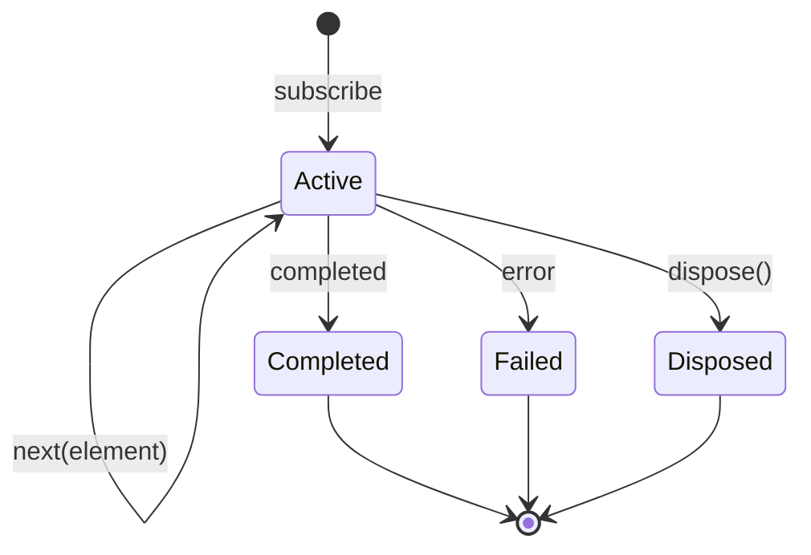
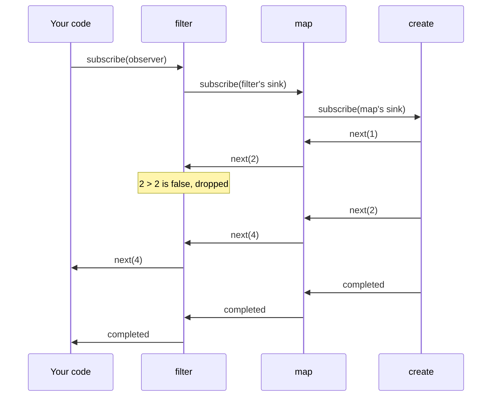

An array is a sequence you pull from: you ask for the next element, and it is there or it is not. A text field is not like that. Its contents change when the user types, and your code cannot ask "what is the next thing the user will type?" and wait for an answer. RxSwift models things like the text field as an **observable sequence**: a sequence whose elements arrive over time and are *pushed* to whoever is listening. The listener is an **observer**, and the connection between them is a **subscription**.

Everything else in RxSwift, from subjects to `flatMapLatest` to `Driver`, is built on those three ideas and on one small rule about the order in which events may arrive. This article takes them apart: where the observable model comes from, what the rule says and what RxSwift does when code breaks it, why most observables do nothing until someone subscribes, why subscribing twice usually means doing the work twice, and why RxSwift, unlike Combine, has no way for a slow observer to ask a fast producer to slow down.

<!--more-->

This article starts the [RxSwift roadmap](/rxswift/). The examples use RxSwift 6.10.2 in Swift 6 language mode and were compiled and run with the Swift 6.4 toolchain from Xcode 27.1 on macOS 26. Paste the blocks in order into the `main.swift` of an executable target that depends on the `RxSwift` package product.

## A sequence turned inside out

Swift's `Sequence` hands you an iterator, and the iterator's `next()` has three possible outcomes: it returns an element, it returns `nil` because the sequence is over, or (for a throwing `AsyncIteratorProtocol`) it throws. The consumer is in charge. Nothing happens until it calls `next()`, and it calls `next()` exactly when it is ready for another element.

Erik Meijer's observation, which became the Reactive Extensions for .NET and then the whole ReactiveX family that RxSwift belongs to, was that you can flip that relationship without losing anything. Instead of the consumer calling `next()` and getting one of three outcomes, the producer calls the consumer with one of three **events**:

| Pull (`IteratorProtocol`) | Push (`ObserverType`) |
| --- | --- |
| `next()` returns an element | the producer sends `.next(element)` |
| `next()` returns `nil` | the producer sends `.completed` |
| `next()` throws | the producer sends `.error(error)` |
| the consumer decides when | the producer decides when |

In RxSwift those three outcomes are an enum:

<!-- skip-check -->
```swift
@frozen public enum Event<Element> {
    case next(Element)
    case error(Swift.Error)
    case completed
}
```

An observer is anything that accepts events, and an observable is anything that can be subscribed to by an observer:

<!-- skip-check -->
```swift
public protocol ObserverType {
    associatedtype Element
    func on(_ event: Event<Element>)
}

public protocol ObservableType: ObservableConvertibleType {
    func subscribe<Observer: ObserverType>(_ observer: Observer) -> Disposable
        where Element == Observer.Element
}
```

Two things in those declarations matter later. First, the error is an untyped `Swift.Error`. Combine's publishers carry their failure type in their signature, and `Never` proves at compile time that a publisher cannot fail; RxSwift instead expresses "cannot fail" with separate types, the traits covered in [`Driver` and `Signal`](/rxswift-driver-signal/) and [`Single`, `Maybe`, and `Completable`](/rxswift-single-maybe-completable/). Second, `subscribe` returns a `Disposable`, the handle you use to end the subscription early. [Disposing and `DisposeBag`](/rxswift-disposebag/) is entirely about that handle.

The type you will write most often is `Observable<Element>`, an abstract class that conforms to `ObservableType`. Every operator returns an `Observable<Something>`, so RxSwift needs no `eraseToAnyPublisher()`: the type erasure is built in, and a chain of ten operators still has the type `Observable<String>`.

## The grammar

Not every stream of events is a valid observable sequence. The ReactiveX contract allows any number of `next` events followed by at most one terminal event:

$$
\text{next}^{*}\;(\text{error} \mid \text{completed})^{?}
$$

That is a regular expression, and it says three things. Elements can arrive any number of times, including zero. At most one of `error` and `completed` arrives, and never both. After a terminal event, nothing arrives at all. A sequence that never terminates, like a stream of taps, is valid, which is what the trailing `?` means.



The contract has a fourth clause that the regular expression cannot express: events are delivered **one at a time**. An observer's `on(_:)` is never called while a previous call to it is still running, either from another thread or re-entrantly from inside itself. Operators rely on it. `scan` keeps an accumulator without a lock because it knows two `next` events cannot overlap.

To see the events an observable produces, the rest of this series uses a small helper that subscribes, collects every event delivered synchronously, and returns them as strings: an element as itself, completion as `|`, and an error as `x(` followed by the error. The file starts with the imports:

```swift
import RxSwift
import Foundation
```

<!-- rx-record -->
```swift
enum DemoError: Error { case boom, timeout }

/// Subscribes to `source`, collects every event it delivers synchronously, and disposes.
/// Elements are recorded as themselves, completion as "|", and an error as "x(error)".
func record<Source: ObservableConvertibleType>(_ source: Source) -> [String] {
    var events: [String] = []
    let subscription = source.asObservable().subscribe { event in
        switch event {
        case .next(let element): events.append("\(element)")
        case .error(let error): events.append("x(\(error))")
        case .completed: events.append("|")
        }
    }
    subscription.dispose()
    return events
}
```

The simplest observables already show the grammar:

```swift
assert(record(Observable.of(1, 2, 3)) == ["1", "2", "3", "|"])
assert(record(Observable<Int>.empty()) == ["|"])
assert(record(Observable<Int>.error(DemoError.boom)) == ["x(boom)"])
assert(record(Observable<Int>.never()) == [])          // valid: no events, ever
```

### What RxSwift does when a producer breaks it

You rarely produce events by hand, but when you do, with `Observable.create`, you receive an observer and can call it however you like. Here is a producer that keeps sending after it has completed, and then sends an error as well:

```swift
var careless: [String] = []
let carelessSubscription = Observable<Int>.create { observer in
    observer.onNext(1)
    observer.onCompleted()
    observer.onNext(2)                              // after the terminal event
    observer.onError(DemoError.boom)                // a second terminal event
    return Disposables.create { careless.append("producer cleaned up") }
}
.subscribe(
    onNext: { careless.append("next \($0)") },
    onError: { careless.append("error \($0)") },
    onCompleted: { careless.append("completed") },
    onDisposed: { careless.append("subscription disposed") }
)

assert(careless == ["next 1", "completed", "subscription disposed", "producer cleaned up"])
```

The observer that `create` hands you is not your `subscribe` closure. It is an internal *sink* that enforces the grammar: once it has forwarded a terminal event, it drops everything that follows. It also disposes the subscription by itself, which is why the producer's cleanup ran even though nobody called `dispose()`. A finished subscription releases its resources automatically, a point [Disposing and `DisposeBag`](/rxswift-disposebag/) builds on. The order of the last two entries is also measured, not assumed: the subscriber's `onDisposed` ran before the producer's own cleanup.

### Re-entrancy: the clause that is not enforced

The one-at-a-time clause is not enforced, because enforcing it would mean queuing events, and queuing is exactly what synchronous delivery avoids. Here is a subject whose first subscriber reacts to a value by sending another one, and a second subscriber that only watches:

```swift
let echoes = PublishSubject<Int>()
var seenByWatcher: [Int] = []
let feeder = echoes.subscribe(onNext: { value in
    if value < 2 { echoes.onNext(value + 1) }       // sends while a send is in progress
})
let watcher = echoes.subscribe(onNext: { seenByWatcher.append($0) })

echoes.onNext(0)
assert(seenByWatcher == [2, 1, 0])                  // the watcher sees the values backwards
```

The watcher received the values in reverse. Sending `0` called the feeder first, the feeder sent `1` before the watcher had seen `0`, and the same happened again for `2`. Delivery is a depth-first walk of nested calls, so the innermost value reached the watcher first. Any subscriber that keeps state, such as "the latest value", ends up with `0` instead of `2`.

RxSwift detects this in debug builds. For the two nested sends above, the run printed this warning four times (abridged here):

```text
⚠️ Reentrancy anomaly was detected.
  > Problem: This behavior is breaking the observable sequence grammar. `next (error | completed)?`
    This behavior breaks the grammar because there is overlapping between sequence events.
    Observable sequence is trying to send an event before sending of previous event has finished.
  > Remedy: If this is the expected behavior this message can be suppressed by adding `.observe(on:MainScheduler.asyncInstance)`
    or by enqueuing sequence events in some other way.
```

It is a printed warning, not a crash, and only in builds where RxSwift itself is compiled with `DEBUG`. Swift Package Manager defines `DEBUG` for dependencies in a debug build, which is how this example was built. When two *threads* send at the same time, the same checker prints a "Synchronization anomaly" instead. The remedy it suggests, `observe(on: MainScheduler.asyncInstance)`, works by turning each nested send into a separate, later delivery, which [Schedulers](/rxswift-schedulers/) explains. Usually the better fix is to remove the feedback loop.

## Nothing happens until you subscribe

An observable is a *description* of work, not the work. Creating one runs nothing:

```swift
var producerRuns = 0
let numbers = Observable<Int>.create { observer in
    producerRuns += 1
    observer.onNext(1)
    observer.onNext(2)
    observer.onCompleted()
    return Disposables.create()
}
let doubled = numbers.map { $0 * 2 }.filter { $0 > 2 }
assert(producerRuns == 0)                           // building a chain runs nothing
```

Subscribing runs it, and in this case it runs entirely inside the call to `subscribe`. An observable that produces its elements synchronously delivers all of them, and its completion, before `subscribe` returns:

```swift
var trace: [String] = ["before subscribe"]
let traced = doubled.subscribe(
    onNext: { trace.append("got \($0)") },
    onCompleted: { trace.append("completed") }
)
trace.append("after subscribe")

assert(trace == ["before subscribe", "got 4", "completed", "after subscribe"])
assert(producerRuns == 1)
```

Nothing about RxSwift is asynchronous by itself. A chain is a set of nested function calls set up at subscription time, and events travel through it on whatever thread sent them. Asynchrony enters only when a source is asynchronous, such as a network request or a timer, or when an operator like `observe(on:)` or `delay` hands events to a scheduler.



Subscription travels *up* the chain, from your code to the source, and each operator subscribes a sink of its own to the operator above it. Events travel *down*. The two directions are why an operator like `subscribe(on:)` can change where the producer runs while `observe(on:)` changes where events are delivered.

## Cold and hot

Because the producer runs per subscription, subscribing twice runs it twice:

```swift
assert(record(numbers) == ["1", "2", "|"])
assert(record(numbers) == ["1", "2", "|"])
assert(producerRuns == 3)                           // once for `traced`, twice more here
```

An observable like this is **cold**: each subscriber gets its own private run of the producer, from the beginning. `Observable.of`, `Observable.create`, and a network request wrapped in `create` are all cold. That is what you want for "fetch the user profile" when two unrelated screens ask for it at different times, and exactly what you do not want when one screen subscribes twice to the same request, once to show the name and once to show the avatar, and the app makes two identical network requests.

A **hot** observable produces events whether or not anyone is subscribed, and subscribers share them. A subject is the standard example:

```swift
let clicks = PublishSubject<String>()
clicks.onNext("lost")                               // nobody is listening yet

var firstListener: [String] = []
var secondListener: [String] = []
let first = clicks.subscribe(onNext: { firstListener.append($0) })
clicks.onNext("a")
let second = clicks.subscribe(onNext: { secondListener.append($0) })
clicks.onNext("b")

assert(firstListener == ["a", "b"])
assert(secondListener == ["b"])                     // joined late, missed "a"
```

| | Cold | Hot |
| --- | --- | --- |
| When does production start? | at each `subscribe` | independently of subscribers |
| Do subscribers share events? | no, each gets a private run | yes |
| What does a late subscriber see? | everything, from the start | only what happens after it joins |
| Examples | `of`, `create`, a wrapped request, `interval` | subjects, relays, UI control events |

`interval` is in the cold column even though it is about time: each subscriber gets its own timer starting at zero. Turning a cold observable into a hot, shared one is the job of `share(replay:scope:)`, which [Driver and Signal](/rxswift-driver-signal/) and [`ReplaySubject`](/rxswift-replaysubject/) cover in depth.

## Writing an observer by hand

`subscribe(onNext:onError:onCompleted:onDisposed:)` is a convenience that wraps four closures into an observer. Any type conforming to `ObserverType` can subscribe directly, which is how RxSwift's own operators and RxTest's recorders work. Here is an observer that keeps a running total and remembers how the sequence ended:

```swift
final class TotalObserver: ObserverType {
    private(set) var total = 0
    private(set) var ending = "still running"

    func on(_ event: Event<Int>) {
        switch event {
        case .next(let value): total += value
        case .error(let error): ending = "failed: \(error)"
        case .completed: ending = "completed"
        }
    }
}

let totals = TotalObserver()
let totalsSubscription = Observable.from([3, 4, 5]).subscribe(totals)
assert(totals.total == 12)
assert(totals.ending == "completed")
```

When a function needs to accept "some observer of `Int`" without being generic, `AnyObserver<Int>` erases the concrete type. It is also what `Observable.create` hands to your producer closure, and its `onNext`, `onError`, and `onCompleted` methods are shorthand for `on(.next(...))` and friends:

```swift
func emitCountdown(from start: Int, to observer: AnyObserver<Int>) {
    for value in stride(from: start, through: 1, by: -1) { observer.onNext(value) }
    observer.onCompleted()
}

var countdown: [Int] = []
emitCountdown(from: 3, to: AnyObserver { event in
    if case .next(let value) = event { countdown.append(value) }
})
assert(countdown == [3, 2, 1])
```

An observer that is called directly like this gets none of the protection of the grammar-enforcing sink inside `create`. If you hand an `AnyObserver` around, the code calling it is responsible for the contract.

## No backpressure

Combine has **demand**: a subscriber tells its subscription how many values it wants, and a publisher may not send more. RxSwift has nothing like it. An observer cannot say "send me one more"; it receives every event the moment the producer sends it. That design is a deliberate trade. It keeps operators simple and fast, and it fits the sources RxSwift was built for, UI events and network responses, which cannot be slowed down anyway: a user who taps five times has tapped five times.

The only flow control an observer has is to stop. Disposing a subscription tells the producer to stop producing, and synchronous producers check for it between elements. That is enough to take three elements from a source that would otherwise produce a million:

```swift
var produced = 0
let firstThree = record(
    Observable.range(start: 1, count: 1_000_000)
        .do(onNext: { _ in produced += 1 })
        .take(3)
)
assert(firstThree == ["1", "2", "3", "|"])
assert(produced == 3)                              // the range stopped as soon as take(3) finished
```

`take(3)` completes after the third element and disposes its subscription to the source, and `range`, which schedules each element as a separate step, finds itself disposed before the fourth.

The cost of having no demand shows up when a producer is faster than a consumer on another thread. With synchronous delivery the producer cannot outrun the consumer, because sending *is* calling the consumer: a slow observer slows the producer down. Once `observe(on:)` puts a queue between them, the producer no longer waits. If it sends at a rate of $$\lambda$$ events per second and the consumer handles $$\mu$$ per second, with $$\mu < \lambda$$, the queue grows without bound:

$$
\text{queued}(t) \approx (\lambda - \mu)\,t
$$

A producer sending 1,000 events a second to a consumer that manages 800 leaves 200 more events in memory every second. RxSwift's answer is to reduce the events before they reach the queue, with operators that drop, sample, or batch, such as `throttle`, `debounce`, `sample`, and `buffer`. Those are the subject of [Time Operators](/rxswift-time-operators/).

## RxSwift and Combine side by side

The two libraries describe the same idea, and most concepts map directly:

| RxSwift | Combine | Difference |
| --- | --- | --- |
| `Observable<Element>` | `AnyPublisher<Output, Failure>` | Rx errors are untyped |
| `ObserverType` | `Subscriber` | Rx observers have no demand |
| `Event.next` / `.error` / `.completed` | `receive(_:)` / `receive(completion:)` | same grammar |
| `Disposable` | `AnyCancellable` / `Cancellable` | a `Disposable` is not cancelled on deinit |
| `PublishSubject` / `BehaviorSubject` | `PassthroughSubject` / `CurrentValueSubject` | see the subject articles |
| `share(replay:)` | `share()`, `multicast` | Rx can replay to late subscribers |
| schedulers | schedulers | similar roles, different names |

The difference in the `Disposable` row is the one that most often surprises people coming from Combine. An `AnyCancellable` cancels its subscription when it is deallocated, so forgetting to store it ends the subscription immediately. A `Disposable` does nothing on deallocation, so forgetting to store it leaves the subscription running forever. RxSwift's `DisposeBag` exists to give subscriptions the lifetime that Combine gives them automatically.

[Publishers, Subscribers, and Subscriptions](/combine-publishers-subscribers-subscriptions/) in the Combine roadmap walks through the Combine side of this table, including what demand buys you.

## Swift 6 and RxSwift

RxSwift 6.10 is compiled in Swift 5 language mode, and none of its types are `Sendable`. Using it from Swift 6 code works, and every example in this series compiles without warnings, but two consequences follow.

The first is that the compiler cannot help you move observables and observers between threads. An `Observable` is a class without `Sendable` conformance, so capturing one in a `@Sendable` closure or passing it into a `Task` is an error in Swift 6 mode. Inside an RxSwift chain, though, threads change through schedulers that the compiler knows nothing about.

The second is more serious. A closure written in main-actor code, such as top-level code in `main.swift` or a method of a `@MainActor` view model, is inferred to be isolated to the main actor. If RxSwift calls it on a background thread, which happens as soon as a source or an `observe(on:)` delivers there, Swift 6's runtime isolation check stops the process. The examples in this article run entirely on the main thread, so nothing crashes. [Schedulers](/rxswift-schedulers/) measures where the crash happens and how to write chains that avoid it.

Keep the subscriptions created above alive until the end of the file:

```swift
withExtendedLifetime((carelessSubscription, feeder, watcher, traced, first, second,
                      totalsSubscription)) {}
```

## Summary

- An observable is an iterator turned inside out: the producer pushes `.next`, `.error`, and `.completed` events to an observer instead of the consumer pulling with `next()`.
- Valid sequences follow $$\text{next}^{*}(\text{error} \mid \text{completed})^{?}$$, delivered one event at a time. `create`'s sink drops events after a terminal one and disposes itself; re-entrant sends are not prevented, only reported by a debug-build warning, and they deliver values out of order.
- Observables are lazy. Building a chain runs nothing, and a synchronous source delivers everything before `subscribe` returns.
- Most observables are cold: each subscription runs the producer again. Subjects and UI events are hot and shared.
- RxSwift has no demand. Disposing is the only way to stop a producer, and a queue between a fast producer and a slow consumer grows at $$\lambda - \mu$$ events per second.
- RxSwift is not `Sendable`-annotated; main-actor closures that receive events on a background thread crash in Swift 6.

## Exercise

Write an observer called `GrammarChecker<Element>` that conforms to `ObserverType` and records a violation whenever the sequence it observes breaks the contract: an event after a terminal event, a second terminal event, or an `on(_:)` call that starts while another is still running (track a depth counter). Then subscribe it *directly* to an `AnyObserver`-driven producer that misbehaves in each of those three ways and assert that it reports exactly three violations. Finally, subscribe it through `Observable.create` to the same producer and explain which violations disappear and why.

## Further reading

- [Getting Started](https://github.com/ReactiveX/RxSwift/blob/main/Documentation/GettingStarted.md) in the RxSwift repository, which states the sequence grammar and the rules for writing observables.
- [Observable](https://reactivex.io/documentation/observable.html) on ReactiveX.io, the language-independent description of observables, observers, and hot and cold sequences.
- Erik Meijer, [Your Mouse is a Database](https://doi.org/10.1145/2168796.2169076), ACM Queue, 2012, the paper that explains the duality between enumerables and observables.
- [Publishers, Subscribers, and Subscriptions](/combine-publishers-subscribers-subscriptions/) for the same ideas in Combine, with demand.

Next: [Creating Observables: `just`, `of`, `from`, and `create`](/rxswift-creating-observables/).

Return to the [RxSwift roadmap](/rxswift/).
