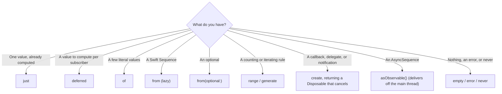

Every RxSwift chain starts with a source. Most of the time the source comes from a library: RxCocoa gives you the text of a text field, and a networking layer gives you a request. Sooner or later, though, you need to make one yourself: turn a constant into an observable for a test, turn an array into a stream of elements, or wrap a callback-based API that was written before anyone on the team had heard of RxSwift.

RxSwift has a family of factory methods for this. `just`, `of`, and `from` turn values you already have into observables. `create` turns *any* producer into one, and is the method you will use to wrap callbacks, delegates, and notifications. This article covers all of them, plus the smaller ones (`empty`, `never`, `error`, `deferred`, `range`, `generate`, `repeatElement`) and the bridge from Swift's `AsyncSequence`. It also measures the details that cause bugs: when the argument to `just` is evaluated, what `from` does with an infinite sequence, which thread a wrapped callback delivers on, and why Swift 6 rejects the textbook way of writing `create` until you change one import.

<!--more-->

The examples use RxSwift 6.10.2 in Swift 6 language mode and were compiled and run with the Swift 6.4 toolchain from Xcode 27.1 on macOS 26. Paste the blocks in order into one `main.swift` of an executable target that depends on the `RxSwift` and `RxBlocking` products. The file also needs the `record` helper from [Observables and Observers](/rxswift-observables-observers/), which subscribes, collects synchronously delivered events as strings, and disposes. This article imports RxSwift with `@preconcurrency`; [the section on wrapping callbacks](#swift-6-and-the-captured-observer) explains why.

<!-- check-uses: rx-record -->
```swift
@preconcurrency import RxSwift
import RxBlocking
import Foundation
import Synchronization
```

## `just`: one element, then completion

`Observable.just` emits a single element and completes:

```swift
assert(record(Observable.just("hello")) == ["hello", "|"])
```

It is the observable version of "return this value", and it is everywhere: as a default branch in a `flatMap`, as a stub in a test, and as the starting value of a pipeline that otherwise waits for user input.

There is one property of `just` that is easy to forget because it is a property of Swift, not of RxSwift: its argument is an ordinary function argument, so it is evaluated once, when `just` is called, not when someone subscribes. Every subscriber receives that same value:

```swift
var clockReads = 0
@MainActor func readClock() -> Int {
    clockReads += 1
    return clockReads
}

let eagerReading = Observable.just(readClock())
assert(clockReads == 1)                                // evaluated when the observable was built
assert(record(eagerReading) == ["1", "|"])
assert(record(eagerReading) == ["1", "|"])            // every subscriber gets the same reading
```

That is a real bug when the value is meant to be fresh: `Observable.just(Date())` as the timestamp of a request, `Observable.just(cache.load())` as "the current cached value", or `Observable.just(UserDefaults.standard.bool(forKey: key))` stored in a property and subscribed to every time a screen appears. **`deferred`** fixes it. It takes a closure that builds an observable, and calls the closure once per subscription:

```swift
let freshReading = Observable.deferred { Observable.just(readClock()) }
assert(clockReads == 1)                                // nothing evaluated yet
assert(record(freshReading) == ["2", "|"])
assert(record(freshReading) == ["3", "|"])            // a new reading for each subscriber
```

`deferred` is also the tool for per-subscriber state. Anything the closure creates, such as a counter, a cache, or a retry budget, belongs to that one subscription and is not shared with the next subscriber.

## `of`: a fixed list of elements

`Observable.of` takes a variadic list and emits the elements in order:

```swift
assert(record(Observable.of(1, 2, 3)) == ["1", "2", "3", "|"])
```

Because the parameter is variadic, passing an array produces an observable with *one* element, the array. It compiles, and it is almost never what was meant:

```swift
assert(record(Observable.of([1, 2, 3])) == ["[1, 2, 3]", "|"])  // one element: an array
assert(record(Observable.from([1, 2, 3])) == ["1", "2", "3", "|"])
```

## `from`: any sequence, pulled lazily

`Observable.from` turns a Swift `Sequence` into an observable that emits its elements. It does not copy the sequence into an array first. It makes an iterator and pulls one element per step, so it works with sequences that are expensive to produce or never end, as long as something downstream stops the subscription:

```swift
var generatorCalls = 0
let naturals = sequence(first: 1) { previous in
    generatorCalls += 1
    return previous + 1
}

assert(record(Observable.from(naturals).take(3)) == ["1", "2", "3", "|"])
assert(generatorCalls == 2)                            // first element is free, then two calls
```

The generator ran exactly twice: `sequence(first:next:)` returns its first element without calling the closure, and after the third element `take(3)` completed and disposed the subscription before `from` asked for a fourth.

There is also `from(optional:)`, which emits the wrapped value if there is one and completes either way. It is a tidy way to start a chain from an optional without an `if let`:

```swift
let savedQuery: String? = nil
assert(record(Observable.from(optional: savedQuery)) == ["|"])
assert(record(Observable.from(optional: "swift")) == ["swift", "|"])
```

## Generators: `range`, `generate`, and `repeatElement`

Three more factories produce elements from a rule instead of a collection:

```swift
assert(record(Observable.range(start: 5, count: 3)) == ["5", "6", "7", "|"])

let powersOfThree = Observable.generate(
    initialState: 1,
    condition: { $0 < 100 },
    iterate: { $0 * 3 }
)
assert(record(powersOfThree) == ["1", "3", "9", "27", "81", "|"])

assert(record(Observable.repeatElement("ping").take(2)) == ["ping", "ping", "|"])
```

`generate` is a `for` loop as an observable: an initial state, a condition checked before each element, and a step. `repeatElement` never completes on its own, so it is only useful with something like `take`, or as a source in tests.

## How synchronous sources avoid deep stacks

`of`, `from`, `range`, `generate`, and `repeatElement` all accept an optional `scheduler:` argument, and its default is `CurrentThreadScheduler.instance`. That default matters more than it looks. A naive implementation of `range` would emit element *n* and then call itself to emit element *n* + 1, and 10,000 elements would mean 10,000 nested stack frames. `CurrentThreadScheduler` is a **trampoline**: when a source schedules "emit the next element" while already inside a scheduled step, the step is put in a queue on the current thread and run after the current one returns, instead of being run as a nested call. The stack does not grow:

```swift
var stackDepths: [Int] = []
let depthProbe = Observable.range(start: 1, count: 10_000)
    .subscribe(onNext: { _ in stackDepths.append(Thread.callStackSymbols.count) })

assert(stackDepths.count == 10_000)
assert(Set(stackDepths).count == 1)                     // every element arrived at the same depth
```

Every one of the 10,000 elements was delivered at the same stack depth as the first.

Passing a different scheduler moves the emission onto it. With `MainScheduler.asyncInstance`, the elements are delivered later on the main queue, so the synchronous `record` helper sees nothing at all:

```swift
let later = Observable.of(1, 2, scheduler: MainScheduler.asyncInstance)
assert(record(later) == [])                             // nothing is delivered synchronously

let laterElements = try later.toBlocking().toArray()
assert(laterElements == [1, 2])
```

`toBlocking()`, from the RxBlocking library, subscribes and waits for the observable to finish, running the current thread's run loop while it waits so that work scheduled on the main queue can still execute. It is a testing tool, covered properly in [Testing with RxTest and RxBlocking](/rxswift-testing-rxtest-rxblocking/); this article uses it to wait for asynchronous sources.

## `empty`, `never`, and `error`

Three observables produce no elements at all, and each is useful exactly because of what it does instead:

```swift
assert(record(Observable<Int>.empty()) == ["|"])                     // completes immediately
assert(record(Observable<Int>.never()) == [])                        // does nothing, forever
assert(record(Observable<Int>.error(DemoError.boom)) == ["x(boom)"]) // fails immediately
```

`empty()` is the "nothing to do" branch. A search that should not hit the network for an empty query can return `.empty()` for that case, and the rest of the chain does not need a special case. `error(_:)` is the "fail before starting" branch, for input that fails validation. `never()` is mostly for tests, to stand in for a source that has not produced anything yet, and for operators that need an observable that never interrupts, such as the `other` argument of `take(until:)` when there is nothing to wait for.

```swift
func searchResults(for query: String) -> Observable<[String]> {
    let trimmed = query.trimmingCharacters(in: .whitespaces)
    if trimmed.isEmpty { return .just([]) }                          // no request for blank input
    if trimmed.count > 100 { return .error(DemoError.boom) }         // reject before starting
    return .just(["\(trimmed) 1", "\(trimmed) 2"])                   // stands in for a request
}

assert(record(searchResults(for: "   ")) == ["[]", "|"])
assert(record(searchResults(for: "rx")) == [#"["rx 1", "rx 2"]"#, "|"])
```

## `create`: wrapping anything

Every other factory is a convenience. `Observable.create` is the general one: you receive an observer, you call it with events whenever your producer has something to say, and you return a `Disposable` that undoes whatever you started. Its contract has four parts:

1. Call the observer following the grammar from the previous article: any number of `onNext` calls, then at most one of `onError` and `onCompleted`.
2. Do not call the observer from two threads at once.
3. Return a `Disposable` that releases what the subscription started: cancel the request, remove the observer, invalidate the timer. RxSwift calls it when the subscriber disposes *and* after a terminal event.
4. Expect the closure to run once per subscription. `create` is cold.

The classic use is wrapping a callback API. Here is one, a thumbnail loader that calls back on its own queue after a short delay and can be cancelled. It counts the requests it starts, the requests that are cancelled, and the callbacks it delivers:

```swift
/// A callback-based API of the kind `create` exists to wrap.
final class ThumbnailLoader: Sendable {
    final class Request: Sendable {
        private let cancelled = Mutex(false)
        private let onCancel: @Sendable () -> Void
        init(onCancel: @escaping @Sendable () -> Void) { self.onCancel = onCancel }
        var isCancelled: Bool { cancelled.withLock { $0 } }
        func cancel() {
            cancelled.withLock { $0 = true }
            onCancel()
        }
    }

    let started = Atomic(0)
    let cancelled = Atomic(0)
    let delivered = Atomic(0)
    private let queue = DispatchQueue(label: "thumbnail-loader")

    func load(_ name: String, completion: @escaping @Sendable (Result<String, any Error>) -> Void) -> Request {
        started.add(1, ordering: .relaxed)
        let request = Request { self.cancelled.add(1, ordering: .relaxed) }
        queue.asyncAfter(deadline: .now() + .milliseconds(20)) {
            guard !request.isCancelled else { return }
            self.delivered.add(1, ordering: .relaxed)
            completion(name.isEmpty ? .failure(DemoError.boom) : .success("thumbnail of \(name)"))
        }
        return request
    }
}
```

Wrapping it takes a dozen lines. Each subscription starts a request, translates the result into events, and returns a disposable that cancels the request:

```swift
extension ThumbnailLoader {
    func thumbnail(named name: String) -> Observable<String> {
        Observable.create { observer in
            let request = self.load(name) { result in
                switch result {
                case .success(let thumbnail):
                    observer.onNext(thumbnail)
                    observer.onCompleted()
                case .failure(let error):
                    observer.onError(error)
                }
            }
            return Disposables.create { request.cancel() }
        }
    }
}

let loader = ThumbnailLoader()
let cat = try loader.thumbnail(named: "cat").toBlocking().toArray()
assert(cat == ["thumbnail of cat"])
assert(loader.started.load(ordering: .relaxed) == 1)
```

Notice that the loader recorded one cancellation even though the request finished:

```swift
assert(loader.cancelled.load(ordering: .relaxed) == 1)
```

That is rule 3 at work. After `onCompleted`, RxSwift disposes the subscription, and disposing calls the closure passed to `Disposables.create`. Cancelling a request that has already finished must therefore be harmless, which is true of `URLSessionTask.cancel()` and should be true of anything you wrap. If it is not, guard the cleanup with a flag.

When the subscriber gives up before the result arrives, the same disposable stops the work:

```swift
let abandoned = loader.thumbnail(named: "dog").subscribe()
abandoned.dispose()
Thread.sleep(forTimeInterval: 0.1)                       // well past the 20 ms the load takes

assert(loader.started.load(ordering: .relaxed) == 2)
assert(loader.cancelled.load(ordering: .relaxed) == 2)
assert(loader.delivered.load(ordering: .relaxed) == 1)    // the dog thumbnail was never delivered
```

The failure path turns the `Result.failure` into an error event:

```swift
let blank = loader.thumbnail(named: "").toBlocking().materialize()
if case .failed(let elements, let error) = blank {
    assert(elements.isEmpty)
    assert(error as? DemoError == .boom)
} else {
    assertionFailure("expected the blank request to fail")
}
```

### One request per subscriber

Rule 4 is the one that shows up in production. Two subscribers to the same wrapped request make two requests, even when they subscribe at the same moment:

```swift
let owl = loader.thumbnail(named: "owl")
let pair = try Observable.zip(owl, owl).toBlocking().toArray()
assert(pair.count == 1)
assert(loader.started.load(ordering: .relaxed) == 5)     // two more requests for one owl
```

That is the cold behavior described in [Observables and Observers](/rxswift-observables-observers/#cold-and-hot), and it is usually fixed with `share(replay: 1)`, which subscribes to the source once and hands the result to every subscriber connected at the time:

```swift
let sharedOwl = loader.thumbnail(named: "owl").share(replay: 1)
let sharedPair = try Observable.zip(sharedOwl, sharedOwl).toBlocking().toArray()
assert(sharedPair.count == 1)
assert(loader.started.load(ordering: .relaxed) == 6)     // one request for both
```

"Connected at the time" is the important part. By default the sharing ends when the source completes, so a subscriber that arrives *after* the shared request has finished triggers a new one. [`ReplaySubject`](/rxswift-replaysubject/) measures the scopes of `share` and when each is appropriate.

### Swift 6 and the captured observer

With a plain `import RxSwift`, the `thumbnail(named:)` method above does not compile in Swift 6 language mode:

```text
error: capture of 'observer' with non-Sendable type 'AnyObserver<String>' in a '@Sendable' closure
warning: add '@preconcurrency' to treat 'Sendable'-related errors from module 'RxSwift' as warnings
```

The completion handler is `@Sendable`, because the loader calls it from its own queue, and the observer is an `AnyObserver`, which RxSwift does not declare `Sendable`. Apple's callback APIs mark their completion handlers `@Sendable` too, so wrapping `URLSession.dataTask`, `CLGeocoder`, or `PHImageManager` hits the same error.

The compiler is not wrong in general. It cannot know that an `AnyObserver` is safe to call from another thread. In this case it is, because calling an observer from the producer's thread is how RxSwift has always worked: the observer `create` hands you is an internal sink built to be called from whatever thread the producer uses, as long as the calls do not overlap. RxSwift 6.10 is compiled in Swift 5 mode and predates `Sendable`, so it cannot say so in its types. Importing it with `@preconcurrency` tells the compiler to treat the module as not yet audited for concurrency. In this build the change did more than downgrade the error to a warning, as the compiler's message suggests: the file compiled with no diagnostic at all.

That makes `@preconcurrency import RxSwift` a reasonable choice in files that wrap callback APIs, and a reason to keep such wrappers in a few files rather than spread through an app. The alternative, adding `nonisolated(unsafe) let observer = observer` before each callback, says the same thing more noisily.

### Which thread the events arrive on

The loader calls back on its own queue, so the wrapped observable delivers its element on that queue, not on the thread that subscribed. That is fine for RxSwift and dangerous in Swift 6. A closure written in main-actor code, such as top-level code or a `@MainActor` view model, is inferred to be isolated to the main actor, and Swift 6 inserts a runtime check into it. Subscribing to `thumbnail(named:)` from top-level code with an `onNext` closure that touches main-actor state therefore stops the process with `EXC_BREAKPOINT` when the loader's queue calls it:

<!-- skip-check -->
```swift
// Crashes: the onNext closure is main-actor isolated and runs on the loader's queue
var lastThumbnail = ""
let unsafeSubscription = loader.thumbnail(named: "fox")
    .subscribe(onNext: { lastThumbnail = $0 })
```

The fix is to move delivery to the main thread before the closure runs, with `observe(on: MainScheduler.instance)`:

```swift
var lastThumbnail = ""
let foxSubscription = loader.thumbnail(named: "fox")
    .observe(on: MainScheduler.instance)
    .subscribe(onNext: { lastThumbnail = $0 })
RunLoop.main.run(until: Date().addingTimeInterval(0.2))  // let the main queue deliver it
assert(lastThumbnail == "thumbnail of fox")
```

The `thumbnail(named:)` method itself is safe because it is declared in an extension of a non-isolated class, so the closures inside it are not main-actor closures and carry no isolation check. [Schedulers](/rxswift-schedulers/) explains the check, and which operators run your closures on which threads, in detail.

## From Swift concurrency: `AsyncSequence.asObservable()`

Since RxSwift 6.5, any `AsyncSequence` can be turned into an observable with `asObservable()`. The observable iterates the sequence in a detached task, so its elements arrive on a background thread, which this example tags with a helper declared outside main-actor code:

```swift
nonisolated func isMainThread() -> Bool { pthread_main_np() == 1 }
nonisolated func tagThreads(_ source: Observable<Int>) -> Observable<String> {
    source.map { "\($0) on \(isMainThread() ? "main" : "a background thread")" }
}

let countdown = AsyncStream<Int> { continuation in
    for value in [3, 2, 1] { continuation.yield(value) }
    continuation.finish()
}
let taggedCountdown = try tagThreads(countdown.asObservable()).toBlocking().toArray()
assert(taggedCountdown == ["3 on a background thread", "2 on a background thread",
                           "1 on a background thread"])
```

The detached task is a deliberate choice: version 6.10 changed the bridge to always use `Task.detached`, so the iteration never inherits the actor of the code that subscribed. Disposing the subscription cancels the task. The same Swift 6 rule applies as for the wrapped callback: put `observe(on: MainScheduler.instance)` before any closure that touches the main actor.

The opposite direction, consuming an observable with `for try await`, uses the `values` property. It is covered with the other async bridges in [`Single`, `Maybe`, and `Completable`](/rxswift-single-maybe-completable/).

## `Infallible`: a source that cannot fail

Since RxSwift 6, there is also `Infallible<Element>`, an observable that is guaranteed never to emit an error. It has its own versions of the factories, `Infallible.just`, `Infallible.of`, `Infallible.from`, and an `Infallible.create` whose observer has no error case:

```swift
let ticks = Infallible<Int>.create { observer in
    observer(.next(1))
    observer(.completed)                             // there is no .error case to send
    return Disposables.create()
}
assert(record(ticks.asObservable()) == ["1", "|"])
```

It is the RxSwift equivalent of Combine's `Failure == Never`, enforced by a separate type rather than a type parameter. In UI code, `Driver` and `Signal` usually play the same role, with a main-thread guarantee as well, as [Driver and Signal](/rxswift-driver-signal/) explains.

## Choosing a factory



Combine has a factory for most of these, with one difference worth knowing:

| RxSwift | Combine | Note |
| --- | --- | --- |
| `just` | `Just` | both evaluate their argument eagerly |
| `of`, `from` | `[1, 2].publisher` | |
| `deferred` | `Deferred` | |
| `empty`, `error`, `never` | `Empty()`, `Fail`, `Empty(completeImmediately: false)` | |
| `create` | no direct equivalent | the closest is `Deferred { Future { ... } }` |

`Future` is not a counterpart to `create`: a `Future` starts its work as soon as it is created, emits at most one value, and shares that value with every subscriber, which is three differences in one type. Wrapping it in `Deferred` restores the "once per subscription" behavior, which [Bridging Publishers to `async`/`await`](/combine-publisher-values-async/) and the Combine articles discuss.

```swift
withExtendedLifetime((depthProbe, abandoned, foxSubscription)) {}
```

## Summary

- `just` emits one element and completes, but its argument is evaluated when `just` is called. Use `deferred` when each subscriber should get a fresh value, measured here as readings 2 and 3 instead of 1 and 1.
- `of` takes a variadic list; `of([1, 2, 3])` emits one array. `from` emits a sequence's elements and pulls them lazily, so it works with infinite sequences when something downstream stops it.
- Synchronous sources default to `CurrentThreadScheduler`, a trampoline: 10,000 elements of `range` arrived at a constant stack depth.
- `create` wraps anything. Follow the grammar, never call the observer concurrently, return a `Disposable` that cancels, and expect one run per subscriber. The disposable also runs after completion, so cancelling must be safe after success.
- In Swift 6, capturing the observer in a `@Sendable` callback is an error with a plain import; `@preconcurrency import RxSwift` removes it. A wrapped callback delivers on the callback's thread, so main-actor closures need `observe(on: MainScheduler.instance)` first.
- `AsyncSequence.asObservable()` iterates in a detached task and delivers on a background thread.

## Exercise

Wrap `NotificationCenter` with `create`: write `func notifications(named name: Notification.Name, object: AnyObject?) -> Observable<Notification>` that adds an observer when subscribed and removes it when disposed. Count the observers that are live, and test that two subscribers register two observers, that disposing both brings the count back to zero, and that a notification posted on a background queue reaches a main-actor closure only after `observe(on: MainScheduler.instance)`. Then compare your version with RxCocoa's `NotificationCenter.default.rx.notification(_:object:)`.

## Further reading

- [Creating your own Observable](https://github.com/ReactiveX/RxSwift/blob/main/Documentation/GettingStarted.md#creating-your-own-observable-aka-observable-sequence) in RxSwift's Getting Started guide, which builds `just` and `of` from `create`.
- [Swift Concurrency](https://github.com/ReactiveX/RxSwift/blob/main/Documentation/SwiftConcurrency.md) in the RxSwift documentation, on `values` and `asObservable()`.
- [Create](https://reactivex.io/documentation/operators/create.html), [Defer](https://reactivex.io/documentation/operators/defer.html), and [From](https://reactivex.io/documentation/operators/from.html) on ReactiveX.io.
- [SE-0337: Incremental migration to concurrency checking](https://github.com/swiftlang/swift-evolution/blob/main/proposals/0337-support-incremental-migration-to-concurrency-checking.md), which introduced `@preconcurrency` imports.

Previous: [Observables and Observers](/rxswift-observables-observers/). Next: [Subscribing](/rxswift-subscribing/).

Return to the [RxSwift roadmap](/rxswift/).
