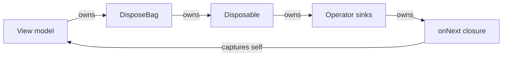
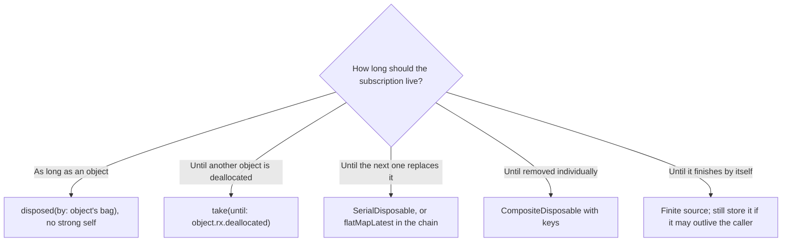

Every subscription has a lifetime, and RxSwift asks you to decide what it is. A subscription to a network request should end when the response arrives or when the screen that asked for it goes away. A subscription to a text field should last as long as the view controller. A subscription to the logged-in user might last as long as the app. The handle that ends a subscription is a `Disposable`, and the type that gives a group of them a lifetime is `DisposeBag`.

Getting this wrong produces two opposite bugs. End a subscription too early and a screen stops updating. End it too late, or never, and you get the RxSwift memory leak everyone has written once: a view model that is never deallocated because its own subscription holds it. This article measures both, along with the details that decide them: what disposal actually releases, in what order a bag disposes, why a long-lived bag grows, why a synchronous `create` cannot be cancelled halfway through, and the disposable types that handle the cases a bag cannot.

<!--more-->

The examples use RxSwift 6.10.2 in Swift 6 language mode and were compiled and run with the Swift 6.4 toolchain from Xcode 27.1 on macOS 26. Paste the blocks in order into one `main.swift` of an executable target that depends on `RxSwift` and `RxCocoa`.

```swift
import RxSwift
import RxCocoa
import Foundation
import Synchronization
```

## `Disposable`

The protocol is one method:

<!-- skip-check -->
```swift
public protocol Disposable {
    func dispose()
}
```

Disposing a subscription tells every operator in the chain, all the way up to the source, to stop and release what it holds: the closures you passed, the sinks the operators created, and whatever the source started, such as a network request or a timer. Disposing twice is harmless. The cleanup runs once:

```swift
var cleanups = 0
let cleanup = Disposables.create { cleanups += 1 }
cleanup.dispose()
cleanup.dispose()
assert(cleanups == 1)
```

### A `Disposable` does not dispose itself

Here is the difference from Combine that matters most. A Combine `AnyCancellable` cancels its subscription when it is deallocated, so forgetting to store it ends the subscription immediately. An RxSwift `Disposable` does nothing when it is deallocated. A subscription whose disposable is dropped keeps running:

```swift
let messages = PublishSubject<String>()
var received = 0

do {
    let subscription = messages.subscribe(onNext: { _ in received += 1 })
    _ = subscription                                     // dropped at the end of this scope
}

messages.onNext("still subscribed")
assert(received == 1)                                    // the subscription outlived its handle
```

For a source that finishes by itself, this is harmless: after a terminal event, a subscription disposes itself, as [Observables and Observers](/rxswift-observables-observers/#what-rxswift-does-when-a-producer-breaks-it) measured. For a source that never finishes, like this subject, there is now no way to stop it.

## `DisposeBag`: a lifetime for a group of subscriptions

A `DisposeBag` collects disposables and disposes all of them when the bag is deallocated. It brings back the "ends when its owner goes away" rule that Combine builds into `AnyCancellable`. The usual pattern is one bag per object, stored in a property, with every subscription the object makes added to it with `disposed(by:)`:

```swift
let prices = PublishSubject<Double>()
var shownPrices: [Double] = []

var priceScreenBag: DisposeBag? = DisposeBag()
prices.subscribe(onNext: { shownPrices.append($0) }).disposed(by: priceScreenBag!)

prices.onNext(9.99)
priceScreenBag = nil                                     // the owner goes away, and so does the bag
prices.onNext(19.99)
assert(shownPrices == [9.99])
```

The bag has no public `dispose()` method. To end its subscriptions early, replace it, and the old bag's deallocation disposes them:

```swift
var screenBag = DisposeBag()
var refreshes = 0
prices.subscribe(onNext: { _ in refreshes += 1 }).disposed(by: screenBag)
prices.onNext(1)
screenBag = DisposeBag()                                 // disposes everything in the old bag
prices.onNext(2)
assert(refreshes == 1)
```

A bag disposes its contents in the order they were added, and adding to a bag that has already been disposed, which can happen when a subscription is set up from a callback that arrives after the owner went away, disposes the new disposable immediately rather than leaking it:

```swift
var disposalOrder: [Int] = []
do {
    let bag = DisposeBag()
    for index in 0..<4 {
        Disposables.create { disposalOrder.append(index) }.disposed(by: bag)
    }
}
assert(disposalOrder == [0, 1, 2, 3])
```

`DisposeBag` is thread-safe: `insert` and the disposal on `deinit` are guarded by a lock, so subscriptions can be added from any thread.

## The retain cycle

The leak happens when the closures in a subscription capture the object that owns the bag. The ownership then forms a loop:



Nothing in the loop can be deallocated first, so none of it ever is. To measure it, each view model below counts its live instances with a small thread-safe counter:

```swift
final class InstanceCounter: Sendable {
    private let live = Atomic<Int>(0)
    var count: Int { live.load(ordering: .relaxed) }
    func increment() { live.add(1, ordering: .relaxed) }
    func decrement() { live.subtract(1, ordering: .relaxed) }
}

let ticks = PublishSubject<Int>()
```

**A strong capture.** The compiler requires an explicit `self.` in an escaping closure, which makes this version easy to spot in review:

```swift
final class StrongCaptureModel {
    static let instances = InstanceCounter()
    private let bag = DisposeBag()
    private(set) var total = 0

    init(ticks: Observable<Int>) {
        StrongCaptureModel.instances.increment()
        ticks.subscribe(onNext: { self.total += $0 }).disposed(by: bag)
    }
    deinit { StrongCaptureModel.instances.decrement() }
}

do { _ = StrongCaptureModel(ticks: ticks) }
assert(StrongCaptureModel.instances.count == 1)          // leaked
```

**A method reference.** This one has no `self` in it at all, and leaks just the same, because `handle` is shorthand for a closure that captures `self` strongly:

```swift
final class MethodReferenceModel {
    static let instances = InstanceCounter()
    private let bag = DisposeBag()
    private(set) var total = 0

    init(ticks: Observable<Int>) {
        MethodReferenceModel.instances.increment()
        ticks.subscribe(onNext: handle).disposed(by: bag)
    }
    private func handle(_ tick: Int) { total += tick }
    deinit { MethodReferenceModel.instances.decrement() }
}

do { _ = MethodReferenceModel(ticks: ticks) }
assert(MethodReferenceModel.instances.count == 1)        // leaked, with no `self` in sight
```

**A weak capture** breaks the loop. So does `subscribe(with:)`, which holds its object weakly and passes it to the closure:

```swift
final class WeakCaptureModel {
    static let instances = InstanceCounter()
    private let bag = DisposeBag()
    private(set) var total = 0

    init(ticks: Observable<Int>) {
        WeakCaptureModel.instances.increment()
        ticks.subscribe(onNext: { [weak self] in self?.total += $0 }).disposed(by: bag)
        ticks.subscribe(with: self, onNext: { model, tick in model.total += tick }).disposed(by: bag)
    }
    deinit { WeakCaptureModel.instances.decrement() }
}

do { _ = WeakCaptureModel(ticks: ticks) }
assert(WeakCaptureModel.instances.count == 0)            // deallocated, and its bag disposed
```

When the weak model is deallocated, its bag is deallocated with it, and the bag disposes both subscriptions. That is the reason to keep subscriptions in a bag the object owns. [Subscribing](/rxswift-subscribing/#subscribewith-a-weak-object-not-a-weak-subscription) measured the alternative: with `subscribe(with:)` and a bag owned by something longer-lived, the object is freed but the subscription keeps running.

`[unowned self]` also breaks the loop, and is safe exactly when no event can reach the closure after the object starts deallocating. A bag owned by the object guarantees that for events delivered on the object's own thread. With events delivered on another thread it does not: `observe(on:)` checks for disposal before delivering a queued event, but an event that is already being delivered on a background thread when the object is released on the main thread reaches an unowned reference to a deallocated object, and crashes. `[weak self]` is the safer default.

The leaked models are still subscribed, and still updating their totals:

```swift
ticks.onNext(5)
assert(StrongCaptureModel.instances.count == 1 && MethodReferenceModel.instances.count == 1)
```

In an app, the equivalent is a view controller that was popped, still reacting to notifications, and still holding its views in memory, once for each time the user opened the screen.

## Tying a subscription to an object's lifetime

A bag is one way to say "this subscription lives as long as that object". Another is the `take(until:)` operator, which completes the chain when a second observable emits. RxCocoa adds `rx.deallocated` to every `NSObject`, an observable that emits when the object is deallocated, and the combination ends a subscription at exactly the right moment without any bag:

```swift
final class SettingsScreen: NSObject {}

let settingsChanges = PublishSubject<String>()
var appliedSettings: [String] = []
var settingsScreen: SettingsScreen? = SettingsScreen()

let settingsSubscription = settingsChanges
    .take(until: settingsScreen!.rx.deallocated)
    .subscribe(onNext: { appliedSettings.append($0) })

settingsChanges.onNext("dark mode")
settingsScreen = nil                                     // deallocation completes the chain
settingsChanges.onNext("large text")
assert(appliedSettings == ["dark mode"])
```

It is most useful for subscriptions that one object creates *on behalf of* another, such as a coordinator observing a view controller it presented, where neither object's bag is the right owner. The closures must still avoid capturing the object strongly, or it will never be deallocated and the signal will never fire.

## What a bag keeps after a subscription finishes

When a subscription in a bag completes, it disposes itself and releases its closures right away. The bag does not wait until its own deallocation for that. Measured with an object captured by each closure:

```swift
final class Payload {
    static let instances = InstanceCounter()
    init() { Payload.instances.increment() }
    deinit { Payload.instances.decrement() }
}

let requestBag = DisposeBag()
let responses = PublishSubject<Int>()
for _ in 0..<1_000 {
    let payload = Payload()
    responses.take(1)
        .subscribe(onNext: { _ in withExtendedLifetime(payload) {} })
        .disposed(by: requestBag)
}
assert(Payload.instances.count == 1_000)                 // all waiting for a response
responses.onNext(1)
assert(Payload.instances.count == 0)                     // finished subscriptions released their closures
```

The bag *does* keep the finished disposables themselves. `DisposeBag` is an array that only grows; it never removes an entry until the bag is deallocated. A long-lived object that adds a subscription for each user action, such as one request per tap of a refresh button, accumulates one entry per action:

```swift
func liveHeapBytes() -> Int {
    var statistics = malloc_statistics_t()
    malloc_zone_statistics(nil, &statistics)
    return Int(statistics.size_in_use)
}

let beforeRefreshes = liveHeapBytes()
let longLivedBag = DisposeBag()
for _ in 0..<100_000 {
    Observable.just("refreshed").subscribe(onNext: { _ in }).disposed(by: longLivedBag)
}
let bytesPerRefresh = Double(liveHeapBytes() - beforeRefreshes) / 100_000
print("bytes retained per finished subscription:", bytesPerRefresh)
assert(bytesPerRefresh > 100)
```

In a debug build on macOS, the 100,000 finished subscriptions kept about 27 MB of heap allocated, about 270 bytes each, counted with `malloc` statistics so that only live allocations are included. That is not much for a screen that lives a few minutes, but a real leak for an object that lives as long as the app. Three fixes, in order of preference:

1. Make the chain long-lived instead of the subscriptions: model the taps as an observable and use `flatMapLatest` to start a request per tap inside one subscription, as [Subscribing](/rxswift-subscribing/#do-not-subscribe-inside-subscribe) did.
2. Keep the per-action subscription in a `SerialDisposable`, below, which holds only the latest one.
3. Give each batch of work its own bag and replace it when the batch is done.

## Disposables for the cases a bag does not fit

`Disposables.create` has several forms. `Disposables.create()` is a disposable that does nothing, useful as a return value from `create` when there is nothing to clean up. `Disposables.create(with:)` and the trailing-closure form run a closure once. `Disposables.create(first, second)` combines several into one that disposes them all. RxSwift also ships disposable types for patterns that a bag cannot express.

The examples below use a source that counts how many of its subscriptions are running, standing in for a live database query or a long-poll:

```swift
var runningQueries = 0
@MainActor func liveQuery(_ id: Int) -> Observable<Int> {
    Observable.create { observer in
        runningQueries += 1
        observer.onNext(id)
        return Disposables.create { runningQueries -= 1 }
    }
}
```

### `SerialDisposable`: only the latest

A `SerialDisposable` holds one disposable at a time. Assigning a new one disposes the previous one, and assigning after the serial disposable itself has been disposed disposes the new one immediately. It is the tool for "the current request", where starting a new one should cancel the old:

```swift
let currentQuery = SerialDisposable()
currentQuery.disposable = liveQuery(1).subscribe()
currentQuery.disposable = liveQuery(2).subscribe()      // disposes query 1
currentQuery.disposable = liveQuery(3).subscribe()      // disposes query 2
assert(runningQueries == 1)

currentQuery.dispose()
assert(runningQueries == 0)
currentQuery.disposable = liveQuery(4).subscribe()      // disposed on assignment
assert(runningQueries == 0)
```

### `CompositeDisposable`: a bag you can remove from

A `CompositeDisposable` is like a bag with two extra abilities: it can be disposed explicitly, and individual entries can be removed (and disposed) by the key returned when they were inserted. That fits a set of subscriptions keyed by something, such as one per visible table cell:

```swift
let visibleRows = CompositeDisposable()
let rowSeven = visibleRows.insert(liveQuery(7).subscribe())
let rowEight = visibleRows.insert(liveQuery(8).subscribe())
assert(runningQueries == 2 && visibleRows.count == 2)

if let rowSeven { visibleRows.remove(for: rowSeven) }   // row 7 scrolled off screen
assert(runningQueries == 1 && visibleRows.count == 1)

visibleRows.dispose()
assert(runningQueries == 0)
_ = rowEight
```

`insert` returns `nil` when the composite has already been disposed, after disposing the new entry.

### `BooleanDisposable`, and why a synchronous `create` cannot be stopped

A `BooleanDisposable` does nothing except remember that it was disposed, through its `isDisposed` property. It is meant for producers that loop, so they can check the flag between elements and stop early. There is a trap in using it with a *synchronous* producer, though. Here is a `create` that emits 1,000 elements in a loop and checks the flag, consumed with `take(3)`:

```swift
var emitted = 0
let countToAThousand = Observable<Int>.create { observer in
    let cancellation = BooleanDisposable()
    for value in 1...1_000 {
        if cancellation.isDisposed { break }
        emitted += 1
        observer.onNext(value)
    }
    observer.onCompleted()
    return cancellation
}

var firstThree: [Int] = []
let firstThreeSubscription = countToAThousand.take(3).subscribe(onNext: { firstThree.append($0) })
assert(firstThree == [1, 2, 3])
assert(emitted == 1_000)                                 // the loop ran to the end anyway
```

`take(3)` was satisfied after three elements and disposed its subscription, but the producer's `BooleanDisposable` had not been returned yet: the closure was still inside the loop. RxSwift had nothing to dispose, so it disposed the flag only after the closure returned, and the loop emitted 997 elements into a subscription that had already ended. They were dropped, but they were computed.

The fix is to let a scheduler drive the loop, so that the subscription is set up before the first element and each element is a separate step that can see the disposal. That is what `from`, `range`, and `generate` do with their trampoline scheduler, which is why [Observables and Observers](/rxswift-observables-observers/#no-backpressure) could stop a million-element `range` after three:

```swift
emitted = 0
let scheduledCount = Observable.range(start: 1, count: 1_000).do(onNext: { _ in emitted += 1 })
let scheduledThree = scheduledCount.take(3).subscribe()
assert(emitted == 3)
```

For a `create` whose loop is asynchronous, for example one that reads chunks from a file on a background queue, the `BooleanDisposable` works as intended: the closure returns it before the first chunk is read, and the loop sees the flag as soon as the subscriber disposes.

## Choosing an owner



And the Combine equivalents, for readers coming from the [Combine roadmap](/combine/):

| RxSwift | Combine |
| --- | --- |
| `Disposable` (does nothing on deinit) | `AnyCancellable` (cancels on deinit) |
| `DisposeBag` | `Set<AnyCancellable>` |
| `disposed(by: bag)` | `store(in: &cancellables)` |
| replace the bag | `cancellables.removeAll()` |
| `SerialDisposable` | a single `AnyCancellable?` property |
| `take(until: obj.rx.deallocated)` | no built-in equivalent |

Combine's `Set<AnyCancellable>` has the same growth problem as a long-lived bag: cancelled and finished cancellables stay in the set until removed. [`AnyCancellable` and Memory Management](/combine-anycancellable-memory/) measures the Combine side.

```swift
withExtendedLifetime((settingsSubscription, firstThreeSubscription, scheduledThree,
                      priceScreenBag, screenBag)) {}
```

## Summary

- `dispose()` stops a chain up to its source and releases its closures. It is idempotent.
- A `Disposable` does not dispose itself when deallocated; a dropped handle to an infinite source runs forever.
- `DisposeBag` disposes its contents, in insertion order, when deallocated. Replace it to dispose early; adding to a disposed bag disposes immediately.
- Strong `self` and method references such as `onNext: handle` both create a retain cycle with the owner's bag. `[weak self]` and `subscribe(with:)` do not.
- `take(until: object.rx.deallocated)` ends a subscription when another object goes away.
- Finished subscriptions release their closures immediately, but a bag keeps every entry until it is deallocated: about 270 bytes each, measured over 100,000.
- `SerialDisposable` keeps only the latest subscription; `CompositeDisposable` allows removal by key.
- A synchronous `create` loop cannot be stopped by its own `BooleanDisposable`; measured, `take(3)` still let all 1,000 elements be produced.

## Exercise

Write a `LifetimeBag` class with the same API as `DisposeBag` that removes finished subscriptions from its storage. One approach: wrap each inserted disposable so that it reports back to the bag when disposed, and keep entries in a dictionary keyed by an incrementing integer. Measure the resident memory after 100,000 finished subscriptions with your bag and with `DisposeBag`, and test that your bag still disposes the unfinished entries, in insertion order, when it is deallocated. Then explain why `DisposeBag` itself does not do this.

## Further reading

- [Disposing](https://github.com/ReactiveX/RxSwift/blob/main/Documentation/GettingStarted.md#disposing) and [Dispose bags](https://github.com/ReactiveX/RxSwift/blob/main/Documentation/GettingStarted.md#dispose-bags) in RxSwift's Getting Started guide.
- The [`Disposables` folder](https://github.com/ReactiveX/RxSwift/tree/main/RxSwift/Disposables) of the RxSwift source, which contains every disposable type used here.
- [Automatic Reference Counting](https://docs.swift.org/swift-book/documentation/the-swift-programming-language/automaticreferencecounting/) in The Swift Programming Language, on strong reference cycles for closures.
- [`AnyCancellable` and Memory Management](/combine-anycancellable-memory/) for the Combine side.

Previous: [Subscribing](/rxswift-subscribing/). Next: [`PublishSubject`](/rxswift-publishsubject/).

Return to the [RxSwift roadmap](/rxswift/).
