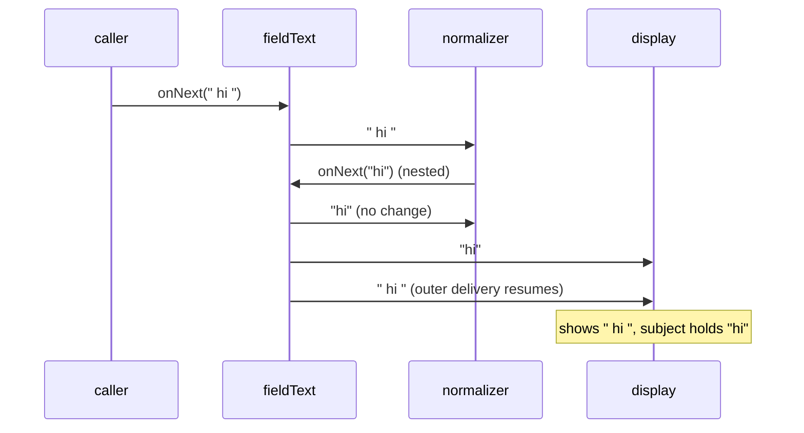
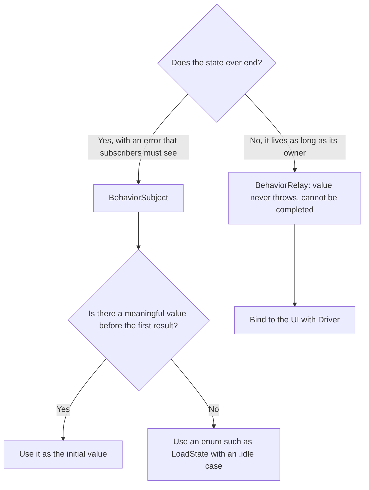

A [`PublishSubject`](/rxswift-publishsubject/) is for events: a subscriber that arrives late has missed them, and that is correct, because a tap that happened a minute ago is not news. Most of what a screen shows is not events, though. It is **state**: the signed-in user, the items in a cart, whether a request is loading. A subscriber that arrives late still needs to know the current state, immediately, without waiting for it to change.

`BehaviorSubject` is RxSwift's subject for state. It is created with an initial value, always holds a current value, gives that value to every new subscriber, and replaces it on every `onNext`. This article measures what that means in detail: when the stored value changes relative to delivery, what `value()` returns after a subject completes, fails, or is disposed, what a subscriber that arrives after completion receives, and how a subscriber that writes back into the subject can leave another subscriber showing stale state, the one bug in this article that reaches users.

<!--more-->

The examples use RxSwift 6.10.2 in Swift 6 language mode and were compiled and run with the Swift 6.4 toolchain from Xcode 27.1 on macOS 26. Paste the blocks in order into one `main.swift` of an executable target that depends on `RxSwift`, together with the `record` helper from [Observables and Observers](/rxswift-observables-observers/).

<!-- check-uses: rx-record -->
```swift
import RxSwift
import Foundation
```

## A current value for every subscriber

A `BehaviorSubject` cannot exist without a value, so its initializer takes one. Each subscriber receives the current value as soon as it subscribes, and every change after that:

```swift
let temperature = BehaviorSubject(value: 20)
var display: [Int] = []
let displaySubscription = temperature.subscribe(onNext: { display.append($0) })
temperature.onNext(21)
temperature.onNext(22)
assert(display == [20, 21, 22])

assert(record(temperature) == ["22"])                    // a late subscriber starts at the present
```

The late subscriber's record has no `|` at the end, because the subject has not completed; it received the current value synchronously during `subscribe` and nothing more before `record` disposed it.

That synchronous first value is the main reason to use a `BehaviorSubject`. A view that subscribes in `viewDidLoad` is fully configured by the time `subscribe` returns, with no flash of empty content while it waits for the first change.

### The stored value changes before delivery

`value()` returns the current value. Reading it from inside a subscriber shows that the subject stores a new value *before* calling its subscribers, so a subscriber always sees the stored value agree with the element it was given:

```swift
let counter = BehaviorSubject(value: 0)
var readsDuringDelivery: [String] = []
let counterSubscription = counter.subscribe(onNext: { delivered in
    let stored = (try? counter.value()) ?? -1
    readsDuringDelivery.append("delivered \(delivered), stored \(stored)")
})
counter.onNext(3)
assert(readsDuringDelivery == ["delivered 0, stored 0", "delivered 3, stored 3"])
```

The same holds for Combine's `CurrentValueSubject`, and it is the opposite of `@Published`, which emits before its property changes; [`@Published` Properties](/combine-published-properties/) explains why SwiftUI wants that.

## `value()` throws

Unlike Combine's `value` property, RxSwift's accessor is a throwing method, because a `BehaviorSubject` can be in a state where it has no meaningful value to give. Measured in each of the three ways a subject can end:

```swift
let completed = BehaviorSubject(value: "last")
completed.onCompleted()
completed.onNext("ignored")
let lastValue = try completed.value()
assert(lastValue == "last")                               // completion keeps the last value

let failed = BehaviorSubject(value: "last")
failed.onError(DemoError.boom)
do {
    _ = try failed.value()
    assertionFailure("a failed subject has no value")
} catch {
    assert(error as? DemoError == .boom)                   // the error is rethrown
}

let disposedSubject = BehaviorSubject(value: "last")
disposedSubject.dispose()
do {
    _ = try disposedSubject.value()
    assertionFailure("a disposed subject has no value")
} catch {
    print(error)                                           // RxError.disposed
}
```

The disposed subject threw ``Object `RxSwift.BehaviorSubject<Swift.String>` was already disposed.``. In practice, code that reads `value()` ends up writing `try?` or `try!` everywhere, which is one reason UI code usually prefers `BehaviorRelay`, whose `value` property cannot throw because a relay can never end. [Relays](/rxswift-relays/) covers it.

### After completion, late subscribers get no value

The completed subject still returns `"last"` from `value()`, but it does *not* give that value to a new subscriber. A subscriber that arrives after completion receives only the completion:

```swift
assert(record(completed) == ["|"])
assert(record(failed) == ["x(boom)"])
```

So a completed `BehaviorSubject` behaves like a completed `PublishSubject` for subscribers, while still answering `value()`. Code that mixes the two views of the subject, reading `value()` in one place and subscribing in another, can disagree about whether there is a current value.

## No deduplication

A `BehaviorSubject` emits every `onNext`, including one with the value it already holds:

```swift
let selectedTab = BehaviorSubject(value: 0)
var tabChanges: [Int] = []
let tabSubscription = selectedTab.subscribe(onNext: { tabChanges.append($0) })
selectedTab.onNext(0)
selectedTab.onNext(0)
selectedTab.onNext(1)
assert(tabChanges == [0, 0, 0, 1])
```

If "the value is the same" should mean "nothing happened", add `distinctUntilChanged()` on the subscriber's side, where the choice belongs; [Filtering Operators](/rxswift-filtering-operators/) covers it. Re-emitting is the right default for a subject, because the subject cannot know whether a repeated value is meaningful. A repeated "refresh requested" state might be exactly the signal a subscriber needs.

## Modeling state that does not exist yet

The required initial value is a design question in disguise. Before the profile has loaded, what is "the current profile"? Using an optional, `BehaviorSubject<Profile?>(value: nil)`, works but loses information: `nil` cannot say whether the profile is loading, has not been requested, or failed. An enum that names every state the screen can be in is usually better, and it gives the subject an honest initial value:

```swift
struct Profile: Equatable { let name: String }

enum LoadState<Value: Equatable>: Equatable {
    case idle
    case loading
    case loaded(Value)
    case failed(String)
}

final class ProfileStore {
    private let stateSubject = BehaviorSubject<LoadState<Profile>>(value: .idle)
    var state: Observable<LoadState<Profile>> { stateSubject.asObservable() }

    func load(using fetch: () throws -> Profile) {
        stateSubject.onNext(.loading)
        do {
            stateSubject.onNext(.loaded(try fetch()))
        } catch {
            stateSubject.onNext(.failed("\(error)"))       // a failure is a state, not the end
        }
    }
}

let store = ProfileStore()
var states: [LoadState<Profile>] = []
let stateSubscription = store.state.subscribe(onNext: { states.append($0) })
store.load { Profile(name: "Ada") }
store.load { throw DemoError.timeout }

assert(states == [.idle, .loading, .loaded(Profile(name: "Ada")), .loading, .failed("timeout")])
```

Notice that a failed load is sent as an element, `.failed`, not as `onError`. An error event would end the subject for good, and every later `load` would be ignored. For long-lived state, errors belong *in* the state.

## Feedback loops and stale subscribers

The bug in this section takes some setup to reach, and real code reaches it regularly. A subject holds the text of a form field. One subscriber normalizes it, trimming whitespace and sending the trimmed version back into the subject. Another subscriber displays it:

```swift
let fieldText = BehaviorSubject(value: "")
var displayed: [String] = []

let normalizer = fieldText.subscribe(onNext: { text in
    let trimmed = text.trimmingCharacters(in: .whitespaces)
    if trimmed != text { fieldText.onNext(trimmed) }       // write back while delivering
})
let display2 = fieldText.subscribe(onNext: { displayed.append($0) })

fieldText.onNext("  hi  ")
let fieldValue = try fieldText.value()
assert(fieldValue == "hi")
assert(displayed.last == "  hi  ")                         // the display is stale
assert(displayed == ["", "hi", "  hi  "])
```

The subject's value is `"hi"`, but the display's last update was `"  hi  "`. The normalizer received `"  hi  "` first and sent `"hi"` from inside that delivery. The nested send ran to completion, reaching the display with `"hi"`, before the outer delivery continued and handed the display the older `"  hi  "`. This is the depth-first delivery measured in [Observables and Observers](/rxswift-observables-observers/#re-entrancy-the-clause-that-is-not-enforced), and a debug build prints a "Reentrancy anomaly" warning for it. With a `BehaviorSubject` it does more damage than with a `PublishSubject`, because "the last value I received" is exactly what a state subscriber trusts.



There are two fixes. The better one removes the loop: normalize *before* the value reaches the subject, so the subject only ever holds normalized text and nothing writes back:

```swift
let rawInput = PublishSubject<String>()
let normalizedText = BehaviorSubject(value: "")
let normalization = rawInput
    .map { $0.trimmingCharacters(in: .whitespaces) }
    .subscribe(normalizedText)                            // the only writer

var cleanDisplay: [String] = []
let cleanDisplaySubscription = normalizedText.subscribe(onNext: { cleanDisplay.append($0) })
rawInput.onNext("  hi  ")
assert(cleanDisplay == ["", "hi"])
```

When the loop cannot be removed, because the write-back depends on state that only the subscriber has, make the nested send happen *after* the current delivery instead of inside it. `observe(on: MainScheduler.asyncInstance)` does that by scheduling each event as a separate, later step on the main queue:

```swift
let deferredField = BehaviorSubject(value: "")
var deferredDisplay: [String] = []
let deferredNormalizer = deferredField
    .observe(on: MainScheduler.asyncInstance)
    .subscribe(onNext: { text in
        let trimmed = text.trimmingCharacters(in: .whitespaces)
        if trimmed != text { deferredField.onNext(trimmed) }
    })
let deferredDisplaySubscription = deferredField.subscribe(onNext: { deferredDisplay.append($0) })

deferredField.onNext("  hi  ")
RunLoop.main.run(until: Date().addingTimeInterval(0.1))  // let the main queue run the normalizer
assert(deferredDisplay == ["", "  hi  ", "hi"])           // in order, ending on the current value
```

The display now briefly shows the untrimmed text before the trimmed text, which is the honest order of events, and it ends on the subject's current value. `asyncInstance` exists for exactly this; the plain `MainScheduler.instance` delivers synchronously when already on the main thread and would reproduce the bug.

## A `BehaviorSubject` keeps its value alive

Holding a current value means holding a strong reference to it. A long-lived subject that holds a large value keeps it in memory after the last subscriber has gone, until the next value replaces it:

```swift
final class LargeImage {
    nonisolated(unsafe) static var live = 0
    init() { LargeImage.live += 1 }
    deinit { LargeImage.live -= 1 }
}

let currentImage = BehaviorSubject<LargeImage?>(value: LargeImage())
assert(LargeImage.live == 1)                              // retained with no subscribers at all
currentImage.onNext(nil)
assert(LargeImage.live == 0)                              // released when replaced
```

For an app-wide store, that is a reason to send an explicit "nothing" value, here `nil`, when the screen that needed a large value goes away.

## `BehaviorSubject` and `CurrentValueSubject`

| | RxSwift `BehaviorSubject` | Combine `CurrentValueSubject` |
| --- | --- | --- |
| Reading the value | `try value()`, throws after error or disposal | `value`, never throws |
| After completion | `onNext` ignored; `value()` returns the last value | `send` ignored, but the `value` setter still changes the stored value |
| Late subscriber after completion | completion only | completion only |
| Repeated values | re-emitted | re-emitted |
| Stored before delivery | yes | yes |

The second row is a real difference. Combine's `value` setter keeps working after completion without emitting, so the stored value and what subscribers saw drift apart, which [Subjects: `PassthroughSubject` and `CurrentValueSubject`](/combine-subjects/) measured. RxSwift ignores `onNext` after completion completely, so `value()` stays at the last value any subscriber received.

## Choosing between the state types



Most UI state never legitimately ends, so most UI code holds it in a `BehaviorRelay` and exposes it as a `Driver`. A `BehaviorSubject` earns its place when the end of the state is part of the model, for example a stream of session state that completes when the user logs out, so that everything bound to it tears down at once.

```swift
withExtendedLifetime((displaySubscription, counterSubscription, tabSubscription, stateSubscription,
                      normalizer, display2, normalization, cleanDisplaySubscription,
                      deferredNormalizer, deferredDisplaySubscription)) {}
```

## Summary

- A `BehaviorSubject` holds a current value, gives it to each new subscriber synchronously, and stores each new value before delivering it.
- `value()` throws: it rethrows the error after `onError` and throws `RxError.disposed` after `dispose()`. After `onCompleted` it returns the last value, but a new subscriber receives only the completion.
- Every `onNext` is delivered, including repeats; deduplicate on the subscriber side with `distinctUntilChanged()`.
- Model missing state with an enum such as `LoadState`, and send failures as elements, because an error event ends the subject.
- A subscriber that writes back into the subject during delivery leaves later subscribers holding a stale value: measured, the display ended on `"  hi  "` while the subject held `"hi"`. Normalize upstream, or move the write-back after the delivery with `MainScheduler.asyncInstance`.
- The subject keeps its current value alive until it is replaced.

## Exercise

Write a `FormField` type that holds its text in a `BehaviorSubject<String>` and supports a list of normalization rules (trim, lowercase, limit to 20 characters) added at runtime by other components. Rules must not write back into the subject during delivery. Test that, for any sequence of inputs and rules, every subscriber's last received value equals `try value()`, and that no "Reentrancy anomaly" warning is printed. Then add a rule that depends on a second field, such as "must differ from the username", and decide where the comparison should happen.

## Further reading

- [Subjects](https://github.com/ReactiveX/RxSwift/blob/main/Documentation/Subjects.md) in the RxSwift documentation.
- [BehaviorSubject](https://reactivex.io/documentation/subject.html) on ReactiveX.io, with its marble diagram.
- The [`BehaviorSubject.swift`](https://github.com/ReactiveX/RxSwift/blob/main/RxSwift/Subjects/BehaviorSubject.swift) source, where `value()` and the order of storing and delivering are a few lines each.
- [Subjects: `PassthroughSubject` and `CurrentValueSubject`](/combine-subjects/) for the Combine side.

Previous: [`PublishSubject`](/rxswift-publishsubject/). Next: [`ReplaySubject`](/rxswift-replaysubject/).

Return to the [RxSwift roadmap](/rxswift/).
