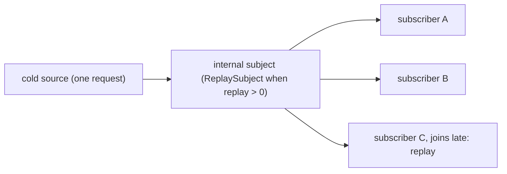

A [`PublishSubject`](/rxswift-publishsubject/) forgets everything, and a [`BehaviorSubject`](/rxswift-behaviorsubject/) remembers exactly one value. Some subscribers need more. A chat screen opened in the middle of a conversation wants the last 50 messages, not just the latest one. A log viewer wants the last few hundred lines. A second subscriber to an in-flight network request wants the response the first subscriber is about to get, without starting another request. A `ReplaySubject` remembers the last *k* elements and replays them to each new subscriber before passing on live ones.

The same idea is behind `share(replay:scope:)`, the operator that RxSwift code uses far more often than `ReplaySubject` itself, because it is how a cold observable becomes a shared one. This article measures both: what a late subscriber receives before and after the subject ends, how replay differs from `BehaviorSubject` at a buffer size of one, whether a subscriber joining during a burst of elements can see a gap or a duplicate, what an unbounded buffer costs in memory, and the scope setting that decides whether `share(replay: 1)` caches a network response, or a network failure, forever.

<!--more-->

The examples use RxSwift 6.10.2 in Swift 6 language mode and were compiled and run with the Swift 6.4 toolchain from Xcode 27.1 on macOS 26. Paste the blocks in order into one `main.swift` of an executable target that depends on `RxSwift`, together with the `record` helper from [Observables and Observers](/rxswift-observables-observers/). RxSwift is imported with `@preconcurrency` so that a subject can be shared with a background queue in the concurrency section, as explained in [Creating Observables](/rxswift-creating-observables/#swift-6-and-the-captured-observer).

<!-- check-uses: rx-record -->
```swift
@preconcurrency import RxSwift
import Foundation
import Synchronization
```

## The last *k* elements, then live ones

`ReplaySubject.create(bufferSize:)` makes a subject that keeps the last `bufferSize` elements. A subscriber receives the buffered elements synchronously during `subscribe`, oldest first, and then every live element:

```swift
let messages = ReplaySubject<String>.create(bufferSize: 2)
messages.onNext("hi")
messages.onNext("how are you?")
messages.onNext("are you there?")

var chat: [String] = []
let chatSubscription = messages.subscribe(onNext: { chat.append($0) })
assert(chat == ["how are you?", "are you there?"])      // the last two, replayed
messages.onNext("hello?")
assert(chat == ["how are you?", "are you there?", "hello?"])
```

`ReplaySubject.createUnbounded()` keeps everything, which is occasionally right for tests and almost never right in an app, as the memory section measures.

## Replay outlives the end

Unlike the other two subjects, a `ReplaySubject` keeps replaying its buffer after it has ended. A subscriber that arrives after completion receives the buffered elements *and then* the completion, and after an error, the buffered elements and then the error:

```swift
let finished = ReplaySubject<Int>.create(bufferSize: 2)
finished.onNext(1)
finished.onNext(2)
finished.onNext(3)
finished.onCompleted()
assert(record(finished) == ["2", "3", "|"])

let crashed = ReplaySubject<Int>.create(bufferSize: 2)
crashed.onNext(1)
crashed.onNext(2)
crashed.onError(DemoError.boom)
assert(record(crashed) == ["1", "2", "x(boom)"])
```

That makes a finished `ReplaySubject` a complete record of how a short operation went: what it produced and how it ended. A late subscriber to an upload's progress can see the last reported progress and the final error, which a `PublishSubject` would have reduced to just the error.

## Buffer size one is not a `BehaviorSubject`

A `ReplaySubject` with a buffer of one and a `BehaviorSubject` both give a new subscriber "the latest element", and they are easy to treat as interchangeable. They differ at both ends of their lives:

```swift
let replayOne = ReplaySubject<Int>.create(bufferSize: 1)
assert(record(replayOne) == [])                        // nothing until the first element

let behavior = BehaviorSubject(value: 0)
assert(record(behavior) == ["0"])                      // an initial value from the start

replayOne.onNext(7)
replayOne.onCompleted()
behavior.onNext(7)
behavior.onCompleted()
assert(record(replayOne) == ["7", "|"])                // still replays after completion
assert(record(behavior) == ["|"])                      // gives only the completion
```

| After... | `ReplaySubject` (buffer 1) | `BehaviorSubject` |
| --- | --- | --- |
| creation, before any element | nothing | the initial value |
| an element | that element | that element |
| completion | the last element, then completion | completion only |
| an error | the last element, then the error | the error only |
| reading the value directly | not possible | `try value()` |

A `ReplaySubject` with a buffer of one is the right type when there is no sensible initial value and a subscriber should simply wait, such as "the most recent location fix", and when the last value should stay available after the stream ends.

## No gaps and no duplicates for late subscribers

A subscriber that joins while elements are arriving is the hard case for any replaying subject. If replay and subscription were two separate steps, an element sent between them would be missing from the new subscriber's sequence, or delivered twice: once in the replay and once live. RxSwift's `ReplaySubject` replays the buffer and adds the subscriber inside the same lock that `onNext` takes to append to the buffer, so neither can happen.

To check, this test sends 200,000 consecutive integers from a background queue while 200 subscribers join at intervals. Each subscriber verifies that every element it receives, replayed or live, is exactly one more than the previous one:

```swift
final class ContiguityCheck: Sendable {
    private let state = Mutex<(last: Int?, breaks: Int)>((nil, 0))
    func receive(_ value: Int) {
        state.withLock { state in
            if let last = state.last, value != last + 1 { state.breaks += 1 }
            state.last = value
        }
    }
    var breaks: Int { state.withLock { $0.breaks } }
}

nonisolated func joinDuringBurst() -> (subscribers: Int, breaks: Int) {
    let numbers = ReplaySubject<Int>.create(bufferSize: 4)
    let producerDone = DispatchSemaphore(value: 0)
    DispatchQueue.global().async {
        for value in 0..<200_000 { numbers.onNext(value) }
        producerDone.signal()
    }

    var checks: [ContiguityCheck] = []
    var subscriptions: [Disposable] = []
    for _ in 0..<200 {
        let check = ContiguityCheck()
        checks.append(check)
        subscriptions.append(numbers.subscribe(onNext: { check.receive($0) }))
        usleep(200)
    }
    producerDone.wait()
    subscriptions.forEach { $0.dispose() }
    return (checks.count, checks.reduce(0) { $0 + $1.breaks })
}

let burst = joinDuringBurst()
assert(burst == (subscribers: 200, breaks: 0))
```

All 200 subscribers saw an unbroken run of integers. The price of that guarantee is that a subscriber's replay runs while the subject's lock is held, so `onNext` calls on other threads wait until it finishes. With a buffer of four that is nothing; with an unbounded buffer of a million elements it would stall the producer for the length of the replay.

## What a buffer costs

A bounded buffer holds at most $$k$$ elements, so its memory is constant however long the subject lives. An unbounded buffer holds every element ever sent. RxSwift stores the buffer in a ring-buffer queue backed by a `ContiguousArray<Element?>` that doubles its capacity when full. Each slot is an *optional* element, so the size that matters is $$s = $$ `MemoryLayout<Element?>.stride`, which for `Int` is 16 bytes, not 8: the optional's extra tag byte is padded to the alignment. After $$n$$ elements the storage is

$$
s \cdot 2^{\lceil \log_2 n \rceil} \text{ bytes, which is less than } 2sn.
$$

For a million `Int`s, $$2^{\lceil \log_2 10^6 \rceil} = 2^{20} = 1{,}048{,}576$$ slots of 16 bytes, about 16.8 MB. The doubling also means one extra element past a power of two doubles the storage. To measure it, this helper reads the bytes currently allocated by `malloc`, which counts live allocations only. The process's resident size is a poor measure here, because the arrays freed at each doubling are not necessarily returned to the system right away; an earlier version of this test, using resident size, reported 33.8 MB for a million `Int`s.

```swift
func liveHeapBytes() -> Int {
    var statistics = malloc_statistics_t()
    malloc_zone_statistics(nil, &statistics)
    return Int(statistics.size_in_use)
}

func megabytesRetained(by subject: ReplaySubject<Int>, sending count: Int) -> Double {
    let before = liveHeapBytes()
    for value in 0..<count { subject.onNext(value) }
    return Double(liveHeapBytes() - before) / 1_000_000
}

assert(MemoryLayout<Int?>.stride == 16)

let bounded = ReplaySubject<Int>.create(bufferSize: 100)
let unbounded = ReplaySubject<Int>.createUnbounded()
let atPowerOfTwo = ReplaySubject<Int>.createUnbounded()
let pastPowerOfTwo = ReplaySubject<Int>.createUnbounded()

let boundedMB = megabytesRetained(by: bounded, sending: 1_000_000)
let unboundedMB = megabytesRetained(by: unbounded, sending: 1_000_000)
let atPowerMB = megabytesRetained(by: atPowerOfTwo, sending: 1_048_576)
let pastPowerMB = megabytesRetained(by: pastPowerOfTwo, sending: 1_048_577)
print("bounded:", boundedMB, "unbounded:", unboundedMB, "2^20:", atPowerMB, "2^20 + 1:", pastPowerMB)

assert(boundedMB < 0.1)
assert(abs(unboundedMB - 16.8) < 0.5 && abs(atPowerMB - 16.8) < 0.5)
assert(abs(pastPowerMB - 33.6) < 0.5)                    // one more element doubled the storage
```

The bounded subject retained almost nothing for a million elements, 112 bytes in this run. The unbounded one retained 16.8 MB, exactly as the formula predicts, and so did one holding $$2^{20}$$ elements, while one holding $$2^{20} + 1$$ retained 33.6 MB. Sixteen megabytes is affordable once. It is not affordable for a subject that lives as long as the app and receives an element per location update, log line, or WebSocket message, and with larger elements, such as decoded models, the same count costs proportionally more. Choose the smallest buffer that serves the late subscribers you actually have.

## `share(replay:scope:)`: replay as a sharing mechanism

Most RxSwift code never creates a `ReplaySubject`. It writes `share(replay: 1)` and gets one behind the scenes. `share` subscribes to its source once, on behalf of all of its subscribers, and multicasts the events through a subject; `replay` is the subject's buffer size, so `share(replay: 1)` uses a `ReplaySubject` of size one and `share()` uses a `PublishSubject`.



The connection to the source opens when the first subscriber arrives and closes when the last one leaves. The `scope` argument decides what happens to the subject when it closes, and that is the decision that matters. To measure it, here is a request that counts how many times it runs and returns its run number:

```swift
var requestRuns = 0
let request = Observable<Int>.create { observer in
    requestRuns += 1
    observer.onNext(requestRuns)
    observer.onCompleted()
    return Disposables.create()
}
```

**`.whileConnected`**, the default, throws the subject away when the connection closes. Because this request completes, each sequential subscriber finds the connection closed and opens a new one:

```swift
let whileConnected = request.share(replay: 1, scope: .whileConnected)
assert(record(whileConnected) == ["1", "|"])
assert(record(whileConnected) == ["2", "|"])            // a second request
assert(requestRuns == 2)
```

So `share(replay: 1)` shares a request between subscribers that are connected *at the same time*, which is what [Creating Observables](/rxswift-creating-observables/#one-request-per-subscriber) measured with `zip`, and does nothing for a subscriber that arrives after the response. That is usually right for a request: a screen opened a minute later should get fresh data.

**`.forever`** keeps the subject for the lifetime of the `share` operator. After the source completes, every later subscriber is served from the finished subject, which replays the cached element and the completion without running the source again:

```swift
requestRuns = 0
let forever = request.share(replay: 1, scope: .forever)
assert(record(forever) == ["1", "|"])
assert(record(forever) == ["1", "|"])                   // served from the cache
assert(requestRuns == 1)
```

That is a cache, and it has the property of the replaying subject behind it: a finished `ReplaySubject` replays its error too. A request that fails once is cached as a failure forever:

```swift
var failedRuns = 0
let flakyRequest = Observable<Int>.create { observer in
    failedRuns += 1
    observer.onError(DemoError.timeout)
    return Disposables.create()
}

let cachedFailure = flakyRequest.share(replay: 1, scope: .forever)
assert(record(cachedFailure) == ["x(timeout)"])
assert(record(cachedFailure) == ["x(timeout)"])         // no retry: the failure is cached
assert(failedRuns == 1)

let retriable = flakyRequest.share(replay: 1, scope: .whileConnected)
assert(record(retriable) == ["x(timeout)"])
assert(record(retriable) == ["x(timeout)"])
assert(failedRuns == 3)                                 // each subscriber tried again
```

With `.forever`, one dropped connection while a configuration endpoint is being fetched at launch means the app never gets its configuration until it restarts. If you want a cache of successes, catch the error *before* the `share` (turning it into a value the cache can hold) or use `.whileConnected` and cache successful results somewhere you control.

| | `.whileConnected` (default) | `.forever` |
| --- | --- | --- |
| Concurrent subscribers | share one subscription | share one subscription |
| Subscriber after the source completed | runs the source again | gets the cached replay and completion |
| Subscriber after the source failed | runs the source again | gets the cached error |
| Good for | requests, UI streams | values computed once per process |

## The connectable operators underneath

`share` is a convenience over two older building blocks, which still appear in older code. `multicast(_:)` and its shorthands `publish()` (a `PublishSubject`) and `replay(_:)` (a `ReplaySubject`) turn an observable into a `ConnectableObservable`, which does not subscribe to its source until `connect()` is called:

```swift
requestRuns = 0
let connectable = request.replay(1)
var early: [String] = []
let earlySubscription = connectable.subscribe(
    onNext: { early.append("early \($0)") },
    onCompleted: { early.append("early |") }
)
assert(requestRuns == 0)                                // subscribing alone does not start it

let connection = connectable.connect()
assert(requestRuns == 1 && early == ["early 1", "early |"])
```

What happens to a subscriber that arrives *after* that connection finished is less obvious, and it differs from a `ReplaySubject` you create yourself. `replay(_:)` creates its subject lazily, one per connection, and discards it when the connection ends, which it does when the source completes. A late subscriber is attached to a new, empty subject and receives nothing until somebody connects again, which runs the source again:

```swift
assert(record(connectable) == [])                       // a fresh subject, waiting for connect()
let reconnection = connectable.connect()
assert(requestRuns == 2)                                // the source ran a second time

let explicitSubject = ReplaySubject<Int>.create(bufferSize: 1)
let multicasted = request.multicast(explicitSubject)
let explicitConnection = multicasted.connect()
assert(record(multicasted) == ["3", "|"])               // a subject you own keeps its replay
```

`multicast(_:)` with a subject you created keeps that one subject for good, so it behaves like `share(replay:scope: .forever)`: after the source finishes, later subscribers get the replay and the terminal event.

`refCount()` automates `connect()` and its disposal, so `replay(1).refCount()` behaves like `share(replay: 1)` with the default scope. Explicit `connect()` is useful when several subscribers must all be in place before the first element is produced, for example so that two consumers of a sensor stream see the same first reading.

## Choosing a subject

| Subscriber arrives late and should see... | Use |
| --- | --- |
| nothing from the past | `PublishSubject` / `PublishRelay` |
| the current value, which always exists | `BehaviorSubject` / `BehaviorRelay` |
| the latest value, once there is one | `ReplaySubject` with buffer 1, or `share(replay: 1)` |
| the last *k* values | `ReplaySubject` with buffer *k* / `ReplayRelay` |
| only the final value of a finished operation | [`AsyncSubject`](/rxswift-asyncsubject/) |

Combine has no `ReplaySubject`, and its `share()` never replays. The Combine roadmap [builds one](/combine-subjects/) and [uses it to implement `shareReplay`](/combine-share-multicasting/); the demand handling it needs there shows how much RxSwift's model, with no demand to respect, simplifies the type.

```swift
withExtendedLifetime((chatSubscription, earlySubscription, connection, reconnection,
                      explicitConnection, bounded, unbounded, atPowerOfTwo, pastPowerOfTwo)) {}
```

## Summary

- A `ReplaySubject` replays its last *k* elements to each new subscriber, then forwards live ones. After it ends, it replays the buffer followed by the completion or error.
- A buffer of one differs from `BehaviorSubject`: no initial value, and the last element is still replayed after completion or failure.
- Replay and subscription happen under one lock: 200 subscribers joining a 200,000-element burst saw no gaps or duplicates.
- An unbounded buffer grows with every element, in doublings: a million `Int`s retained 16.8 MB, as $$s \cdot 2^{\lceil \log_2 n \rceil}$$ predicts with $$s = 16$$ for `Int?`, and one element past $$2^{20}$$ doubled it to 33.6 MB.
- `share(replay:)` multicasts through a replaying subject. `.whileConnected` reruns a finished source for later subscribers; `.forever` caches the result, including a failure, for good.
- `replay(_:)` with `connect()` delays the source until every subscriber is ready, but makes a new, empty subject for each connection; `multicast` with your own subject keeps its replay after completion.

## Exercise

Write a `CachedRequest<Element>` that behaves like `share(replay: 1, scope: .forever)` for successes and like `.whileConnected` for failures: a successful result is replayed to every later subscriber without running the source again, while a failure is delivered to the subscribers connected at the time and the next subscriber retries. Count source runs to test both paths, then add a `maxAge` after which a cached success is discarded. Inject the clock as a closure so the test does not sleep.

## Further reading

- [Sharing subscription and `share` operator](https://github.com/ReactiveX/RxSwift/blob/main/Documentation/GettingStarted.md#sharing-subscription-and-share-operator) in RxSwift's Getting Started guide.
- The [`ShareReplayScope.swift`](https://github.com/ReactiveX/RxSwift/blob/main/RxSwift/Observables/ShareReplayScope.swift) source, whose comments describe `.whileConnected` and `.forever` in detail.
- [Replay](https://reactivex.io/documentation/operators/replay.html), [Publish](https://reactivex.io/documentation/operators/publish.html), and [RefCount](https://reactivex.io/documentation/operators/refcount.html) on ReactiveX.io.
- [Managing Resources: `share` and Multicasting](/combine-share-multicasting/) for the Combine side.

Previous: [`BehaviorSubject`](/rxswift-behaviorsubject/). Next: [`AsyncSubject`](/rxswift-asyncsubject/).

Return to the [RxSwift roadmap](/rxswift/).
