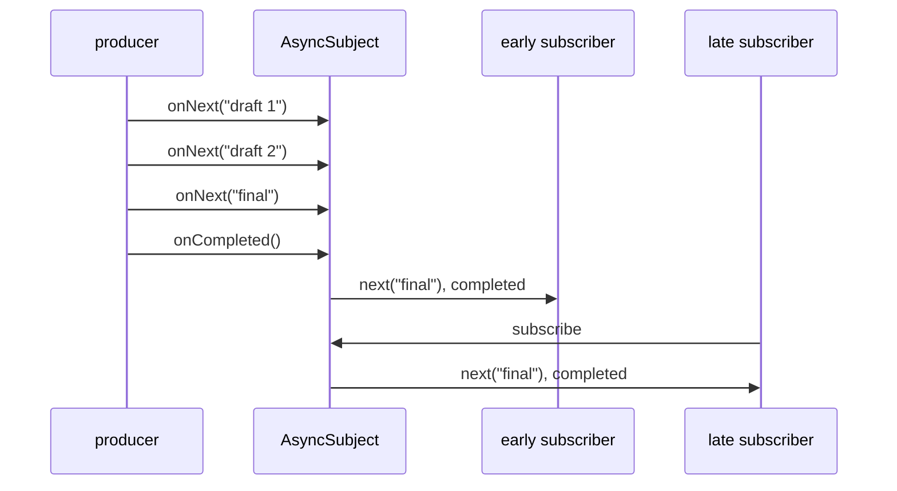

The three subjects so far differ in how much of the past they hand to a new subscriber: nothing, the current value, or the last few values. `AsyncSubject` makes a different trade. It hands out nothing at all while it is running, and when it completes, it emits **only the last element** it received, to everyone, followed by the completion. It is the observable version of a promise: a single result that is not available yet, that any number of subscribers can wait for, and that everyone who asks later gets immediately.

The name is a little misleading. Nothing about `AsyncSubject` is asynchronous; it simply holds back its result until the end. This article measures what it emits in each of the ways it can end, including the two that surprise people, an error that throws away the last element and a completion with no element at all. It then uses `AsyncSubject` to build a shared one-shot result, compares that with the alternatives RxSwift offers, `Single`, `takeLast(1)`, and `share(replay:scope:)`, and with Combine's `Future`, and shows the failure mode of a subject that never completes.

<!--more-->

The examples use RxSwift 6.10.2 in Swift 6 language mode and were compiled and run with the Swift 6.4 toolchain from Xcode 27.1 on macOS 26. Paste the blocks in order into one `main.swift` of an executable target that depends on `RxSwift` and `RxBlocking`, together with the `record` helper from [Observables and Observers](/rxswift-observables-observers/).

<!-- check-uses: rx-record -->
```swift
import RxSwift
import RxBlocking
import Foundation
```

## Only the last element, and only at the end

Subscribers of an `AsyncSubject` receive nothing while elements arrive. When the subject completes, each of them receives the last element and then the completion:

```swift
let result = AsyncSubject<String>()
var waiting: [String] = []
let waitingSubscription = result.subscribe(
    onNext: { waiting.append($0) },
    onCompleted: { waiting.append("|") }
)

result.onNext("draft 1")
result.onNext("draft 2")
assert(waiting == [])                                   // nothing yet: the subject is still running

result.onNext("final")
result.onCompleted()
assert(waiting == ["final", "|"])
```

After completion, the subject remembers its result, and a subscriber that arrives later gets the same element and completion, synchronously, during `subscribe`:

```swift
assert(record(result) == ["final", "|"])
assert(record(result) == ["final", "|"])
```



## The two endings that surprise

**An error discards the last element.** If the subject fails, its subscribers receive only the error, even if elements arrived before it. The last element is not delivered, now or to later subscribers:

```swift
let failedResult = AsyncSubject<Int>()
var failedEvents: [String] = []
let failedSubscription = failedResult.subscribe(
    onNext: { failedEvents.append("\($0)") },
    onError: { failedEvents.append("error \($0)") }
)
failedResult.onNext(41)
failedResult.onNext(42)
failedResult.onError(DemoError.timeout)

assert(failedEvents == ["error timeout"])               // 42 is gone
assert(record(failedResult) == ["x(timeout)"])
```

That is consistent with the promise reading: a promise that failed has no value. It is different from [`ReplaySubject`](/rxswift-replaysubject/), which replays its buffer *before* the error, and it matters when the elements before the failure were useful partial results. If they were, an `AsyncSubject` is the wrong type.

**A completion without elements emits no element.** If the subject completes before anything was sent, subscribers receive only the completion:

```swift
let emptyResult = AsyncSubject<Int>()
emptyResult.onCompleted()
assert(record(emptyResult) == ["|"])
```

Code that treats an `AsyncSubject` as "a value I will eventually get" therefore has three outcomes to handle, not two. Converting it to a `Single` with `asSingle()` makes the third one explicit, as an error:

```swift
let noValue = emptyResult.asSingle().toBlocking().materialize()
if case .failed(_, let error) = noValue {
    print(error)                                        // RxError.noElements
    if case RxError.noElements = error {} else { assertionFailure("expected noElements") }
} else {
    assertionFailure("an empty AsyncSubject should fail as a Single")
}
```

The run printed `Sequence doesn't contain any elements.`, the description of `RxError.noElements`. [`Single`, `Maybe`, and `Completable`](/rxswift-single-maybe-completable/) covers the conversions between observables and these traits in detail.

## A shared one-shot result

The natural use of an `AsyncSubject` is to share the result of work that should happen exactly once, no matter how many parts of the app ask for it and no matter whether they ask before or after it finishes. Remote configuration loaded at launch is a good example: the home screen, the settings screen, and an analytics service all need it, some subscribe during launch, and some subscribe minutes later.

```swift
struct RemoteConfig: Equatable {
    let featureFlags: Set<String>
}

final class ConfigLoader {
    private let resultSubject = AsyncSubject<RemoteConfig>()
    private(set) var loadsStarted = 0

    /// Emits the configuration once it has loaded, to every subscriber, however late.
    var config: Observable<RemoteConfig> { resultSubject.asObservable() }

    func start(fetch: () throws -> RemoteConfig) {
        guard loadsStarted == 0 else { return }          // the work happens once
        loadsStarted += 1
        do {
            resultSubject.onNext(try fetch())
            resultSubject.onCompleted()
        } catch {
            resultSubject.onError(error)
        }
    }
}

let loader = ConfigLoader()
var homeScreen: [String] = []
let homeSubscription = loader.config.subscribe(onNext: { homeScreen.append("home: \($0.featureFlags.sorted())") })

loader.start { RemoteConfig(featureFlags: ["newOnboarding"]) }
loader.start { RemoteConfig(featureFlags: ["ignored"]) }  // a second start does nothing

assert(homeScreen == [#"home: ["newOnboarding"]"#])
assert(record(loader.config) == [#"RemoteConfig(featureFlags: Set(["newOnboarding"]))"#, "|"])
assert(loader.loadsStarted == 1)
```

The early subscriber, the home screen, received the configuration when it arrived. The late subscriber, standing in for a settings screen opened later, received it immediately on subscribing. The fetch ran once.

The error behavior measured above applies here too, and it is the design decision to think about. A failed load is remembered as a failure for the life of the loader, so every later subscriber gets the error and the loader never retries. That is the same trap as `share(replay: 1, scope: .forever)`, measured in the previous article, and it has the same fix: decide whether failure is final. If it is not, keep the subject only for successes, or replace it with a fresh `AsyncSubject` when a retry starts.

## The alternatives

`AsyncSubject` is rarely the first tool RxSwift code reaches for, because three other constructs overlap with it. They differ in whether the work is shared and in what a late subscriber sees:

```swift
var computeRuns = 0
let expensive = Observable<Int>.create { observer in
    computeRuns += 1
    observer.onNext(1)
    observer.onNext(2)
    observer.onNext(3)
    observer.onCompleted()
    return Disposables.create()
}
```

**`takeLast(1)`** keeps only the last element of a sequence, like `AsyncSubject`, but it is an operator on a cold observable, so each subscriber runs the work again:

```swift
let lastOnly = expensive.takeLast(1)
assert(record(lastOnly) == ["3", "|"])
assert(record(lastOnly) == ["3", "|"])
assert(computeRuns == 2)
```

**`share(replay: 1, scope: .forever)`** after `takeLast(1)` shares the work and caches the result, which is `AsyncSubject` behavior built from operators, including the cached failure:

```swift
computeRuns = 0
let computedOnce = expensive.takeLast(1).share(replay: 1, scope: .forever)
assert(record(computedOnce) == ["3", "|"])
assert(record(computedOnce) == ["3", "|"])
assert(computeRuns == 1)
```

**`Single`** expresses "exactly one element or an error" in the type, but like any `create`-based observable it is cold, so it does not share anything by itself.

| | `AsyncSubject` | `takeLast(1)` | `takeLast(1).share(replay: 1, scope: .forever)` | `Single` |
| --- | --- | --- | --- | --- |
| Hot or cold | hot | cold | shared | cold |
| Work runs | when you call `onNext` | per subscriber | once | per subscriber |
| Late subscriber after success | last element, completion | runs again | cached element, completion | runs again |
| Late subscriber after failure | the error | runs again | the cached error | runs again |
| "No element" in the type | no | no | no | yes, it is an error |

The subject is the right choice when the work is driven by imperative code, such as a delegate callback that eventually reports a result. When the work is already an observable, the operator chain says the same thing without a subject to manage.

## Combine's `Future` is an `AsyncSubject` with a producer

Readers coming from Combine will recognize the shape. A Combine `Future` runs its closure as soon as it is created, emits at most one value, and gives that value to every subscriber, including late ones. That is an `AsyncSubject` fed by a producer that starts immediately:

```swift
func future<Value>(_ work: (@escaping (Result<Value, any Error>) -> Void) -> Void) -> Observable<Value> {
    let subject = AsyncSubject<Value>()
    work { result in
        switch result {
        case .success(let value):
            subject.onNext(value)
            subject.onCompleted()
        case .failure(let error):
            subject.onError(error)
        }
    }
    return subject.asObservable()
}

var futureRuns = 0
let answer = future { (promise: @escaping (Result<Int, any Error>) -> Void) in
    futureRuns += 1
    promise(.success(42))
}
assert(futureRuns == 1)                                 // eager: ran before anyone subscribed
assert(record(answer) == ["42", "|"])
assert(record(answer) == ["42", "|"])
assert(futureRuns == 1)                                 // and never again
```

The eagerness is the property that catches people in Combine, where `Future` is often used to wrap a request and then surprises its author by starting the request at creation time. In RxSwift the idiomatic way to wrap a one-shot request is `Single.create`, which is lazy and per-subscriber, and adding `share` when the result should be shared, which keeps both decisions visible.

## A subject that never completes

Because an `AsyncSubject` emits nothing until it completes, connecting it to a source that never completes means its subscribers wait forever, silently. Binding a text field, a timer, or any UI stream into one is a bug that produces no error and no output. In tests, it shows up as a hang:

```swift
let neverFinishes = AsyncSubject<String>()
var ticksSent = 0
let feed = Observable<Int>.interval(.milliseconds(10), scheduler: MainScheduler.instance)
    .map { "tick \($0)" }
    .do(onNext: { _ in ticksSent += 1 })
    .subscribe(neverFinishes)

let waited = neverFinishes
    .timeout(.milliseconds(300), scheduler: MainScheduler.instance)
    .toBlocking()
    .materialize()
if case .failed(let elements, let error) = waited {
    assert(elements.isEmpty)                            // ticks arrived, none was delivered
    assert(error is RxError)                            // RxError.timeout
    print("ticks sent into the subject:", ticksSent)
    assert(ticksSent > 10)
} else {
    assertionFailure("expected a timeout")
}
feed.dispose()
```

Thirty ticks went into the subject in those 300 milliseconds, in two runs out of two, and none came out. A `timeout`, covered in [Time Operators](/rxswift-time-operators/), is a reasonable guard when an `AsyncSubject` is fed by something outside your control, and a hint that the source should have been finite in the first place.

```swift
withExtendedLifetime((waitingSubscription, failedSubscription, homeSubscription)) {}
```

## Summary

- An `AsyncSubject` emits nothing until it completes, then emits its last element and the completion to current and future subscribers.
- An error discards the last element: subscribers receive only the error. A completion with no elements emits only the completion, which `asSingle()` turns into `RxError.noElements`.
- It is a natural container for a one-shot result shared across the app, but it remembers failures forever, just like `share(replay: 1, scope: .forever)`.
- `takeLast(1)` is the cold, per-subscriber version; adding `share(replay: 1, scope: .forever)` reproduces `AsyncSubject` with operators.
- Combine's `Future` behaves like an `AsyncSubject` fed by an eagerly started producer.
- Fed by a source that never completes, an `AsyncSubject` never emits; measured, 30 ticks produced no output before a `timeout`.

## Exercise

Write a `Promise<Value>` type backed by an `AsyncSubject` with three methods: `fulfill(_:)`, `reject(_:)`, and `reset()`, where `reset()` replaces a rejected promise's subject with a fresh one so that later subscribers wait for a new result, while subscribers of the old subject still receive the old error. Test that fulfilling twice keeps the first value, that a subscriber added after `reset()` receives the second result, and that `reset()` after a successful fulfillment does nothing. Then explain why an `AsyncSubject` alone cannot support `reset()`.

## Further reading

- [AsyncSubject](https://reactivex.io/documentation/subject.html) on ReactiveX.io, with its marble diagrams for the normal and error cases.
- The [`AsyncSubject.swift`](https://github.com/ReactiveX/RxSwift/blob/main/RxSwift/Subjects/AsyncSubject.swift) source.
- [TakeLast](https://reactivex.io/documentation/operators/takelast.html) on ReactiveX.io.
- Apple's documentation for Combine's [`Future`](https://developer.apple.com/documentation/combine/future).

Previous: [`ReplaySubject`](/rxswift-replaysubject/). Next: [Relays: `PublishRelay` and `BehaviorRelay`](/rxswift-relays/).

Return to the [RxSwift roadmap](/rxswift/).
