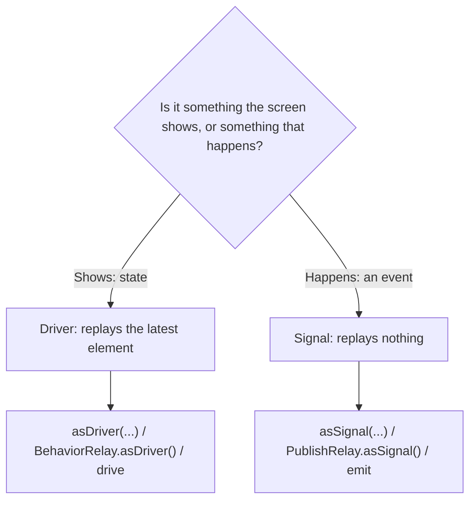

Binding an observable to the UI has three requirements that ordinary observables do not meet. The UI must be updated on the main thread. The binding must not end because of an error, because a label that stops updating after one failed request is broken, and nobody will see an error event. And when several views are bound to the same data, the work behind it should run once, not once per view.

RxCocoa's **`Driver`** and **`Signal`** are traits that encode all three. Both are guaranteed never to fail, both deliver on the main thread, and both share one subscription among all their subscribers. They differ only in what a late subscriber sees: a `Driver` replays the latest element, like state, and a `Signal` replays nothing, like an event. This article measures each guarantee, including the one that most often surprises people: a `Driver` created with `asDriver(onErrorJustReturn:)` does not fail, but it *completes*, and after that, a search box bound to it never shows results again.

<!--more-->

The examples use RxSwift 6.10.2 in Swift 6 language mode and were compiled and run with the Swift 6.4 toolchain from Xcode 27.1 on macOS 26. RxCocoa's traits work the same on macOS and iOS, so nothing here needs UIKit. Paste the blocks in order into one `main.swift` of an executable target that depends on `RxSwift` and `RxCocoa`, together with the `record` helper from [Observables and Observers](/rxswift-observables-observers/).

<!-- check-uses: rx-record -->
```swift
import RxSwift
import RxCocoa
import Foundation
```

## Three guarantees in a type

A `Driver<Element>` is a `SharedSequence<DriverSharingStrategy, Element>`, and a `Signal<Element>` is a `SharedSequence<SignalSharingStrategy, Element>`. A `SharedSequence` wraps an observable that has been prepared in three ways:

| Guarantee | `Driver` | `Signal` |
| --- | --- | --- |
| Never emits an error | yes | yes |
| Delivers on the main thread | `observe(on: MainScheduler)` | `observe(on: MainScheduler)` |
| Shares one subscription | `share(replay: 1, scope: .whileConnected)` | `share(scope: .whileConnected)` |
| A late subscriber receives | the latest element | nothing from the past |

You do not build that by hand. Any observable converts with one of the `asDriver` methods, each of which must say what to do with an error, because the result cannot have one:

```swift
let titles = Observable.of("Inbox", "Inbox (1)")
let titleDriver: Driver<String> = titles.asDriver(onErrorJustReturn: "")
let alternative: Driver<String> = titles.asDriver(onErrorDriveWith: .empty())
let recovering: Driver<String> = titles.asDriver(onErrorRecover: { error in .just("failed: \(error)") })

var titleLog: [String] = []
let titleSubscription = titleDriver.drive(onNext: { titleLog.append($0) })
assert(titleLog == ["Inbox", "Inbox (1)"])
```

Relays, which cannot fail in the first place, convert without an error argument: `BehaviorRelay.asDriver()` and `PublishRelay.asSignal()`.

You consume a `Driver` with `drive` and a `Signal` with `emit`. Both come in the same forms as `subscribe` and `bind`: with closures, as above, or with a relay or other observer, as in `driver.drive(label.rx.text)`, which [RxCocoa: Binding Observables to UIKit](/rxswift-rxcocoa-uikit/) covers.

## Main-thread delivery, and why Swift 6 cares

A `Driver` built from work on a background thread delivers on the main thread. To show it, the work below runs on a background scheduler and records where it ran; it is declared in a nonisolated function, because closures written in this file's top-level code are isolated to the main actor and would crash if run in the background:

```swift
nonisolated func isMainThread() -> Bool { pthread_main_np() == 1 }

nonisolated func loadTitleInBackground() -> Observable<String> {
    Observable.just("Inbox")
        .observe(on: ConcurrentDispatchQueueScheduler(qos: .userInitiated))
        .map { "\($0), computed on \(isMainThread() ? "main" : "a background thread")" }
}

var deliveries: [String] = []
let backgroundTitle = loadTitleInBackground()
    .asDriver(onErrorJustReturn: "")
    .drive(onNext: { deliveries.append("\($0), delivered on \(isMainThread() ? "main" : "background")") })

RunLoop.main.run(until: Date().addingTimeInterval(0.2))
assert(deliveries == ["Inbox, computed on a background thread, delivered on main"])
```

That `drive(onNext:)` closure is written in main-actor code. With a plain `subscribe(onNext:)` on the same background chain, Swift 6's runtime isolation check would have stopped the process, as [Creating Observables](/rxswift-creating-observables/#which-thread-the-events-arrive-on) measured. With a `Driver`, it is safe by construction, which makes `Driver` and `Signal` the simplest answer to Swift 6's isolation checks in RxSwift UI code: if everything the view consumes is a `Driver` or a `Signal`, every closure the view writes runs on the main thread.

The guarantee has a second half. `drive` and `emit` must themselves be called on the main thread, and RxCocoa checks:

<!-- skip-check -->
```swift
// Crashes: drive must be called on the main thread, in debug and release builds alike
let backgroundSubscriber = Thread { _ = Driver.just("title").drive() }
backgroundSubscriber.start()
```

The check uses `rxFatalError`, not the debug-only variant, so it stops release builds too, with the message "`drive*` family of methods can be only called from `MainThread`. This is required to ensure that the last replayed `Driver` element is delivered on `MainThread`."

### The first element can be synchronous

`MainScheduler` has an optimization: when it is asked to deliver an element while already on the main thread, with nothing queued, it delivers immediately instead of dispatching. So a `Driver` built from a synchronous source and driven on the main thread delivers its first element before `drive` returns:

```swift
let selectedName = BehaviorRelay(value: "Ada")
var shownNames: [String] = []
let nameSubscription = selectedName.asDriver().drive(onNext: { shownNames.append($0) })
assert(shownNames == ["Ada"])                            // already delivered, no run loop needed
```

That is what makes a view configured from Drivers in `viewDidLoad` correct on its first frame. It also means "on the main thread" does not mean "asynchronously": code after `drive` runs after the first update, not before.

## Sharing

A `Driver` shares its source among all subscribers. A cold source, such as a request, runs once for any number of views bound to it:

```swift
var requestRuns = 0
let profileRequest = Observable<String>.create { observer in
    requestRuns += 1
    observer.onNext("profile #\(requestRuns)")
    return Disposables.create()
}
let profileDriver = profileRequest.asDriver(onErrorJustReturn: "")

var header: [String] = []
var sidebar: [String] = []
let headerSubscription = profileDriver.drive(onNext: { header.append($0) })
let sidebarSubscription = profileDriver.drive(onNext: { sidebar.append($0) })

assert(requestRuns == 1)
assert(header == ["profile #1"] && sidebar == ["profile #1"])
```

The sidebar subscribed after the request had already produced its element, and the `Driver`'s replay of one element gave it the same profile without a second request. The scope is `.whileConnected`, the default described in [`ReplaySubject`](/rxswift-replaysubject/#sharereplayscope-replay-as-a-sharing-mechanism): when every subscriber is gone, the shared subscription is disposed, and the next subscriber starts the source again.

## Driver or Signal: state or event

Replaying the latest element is right for state and wrong for events. Here is the difference with taps on a button, modeled as a `PublishRelay`:

```swift
let alertTaps = PublishRelay<Void>()

let tapSignal = alertTaps.asSignal()
var signalEarly = 0
var signalLate = 0
let signalEarlySubscription = tapSignal.emit(onNext: { signalEarly += 1 })
alertTaps.accept(())
let signalLateSubscription = tapSignal.emit(onNext: { signalLate += 1 })
assert(signalEarly == 1 && signalLate == 0)              // the late subscriber saw no old tap

let tapDriver = alertTaps.asDriver(onErrorJustReturn: ())
var driverEarly = 0
var driverLate = 0
let driverEarlySubscription = tapDriver.drive(onNext: { driverEarly += 1 })
alertTaps.accept(())
let driverLateSubscription = tapDriver.drive(onNext: { driverLate += 1 })
assert(driverEarly == 1 && driverLate == 1)              // the late subscriber replayed an old tap
```

With the `Driver`, a subscriber that arrived after the tap received it anyway. If that subscriber shows an alert, it shows an alert for a tap that happened before it existed. In real code that happens when a view controller re-subscribes, for instance after rotating or reappearing, and the alert pops up again. The rule follows the subjects: use `Driver` for what the screen *is* (a title, a list, whether a button is enabled), and `Signal` for what *happens* (show an alert, navigate, play a sound).



## A `Driver` that cannot fail can still end

The `onErrorJustReturn` in `asDriver(onErrorJustReturn:)` replaces an error with a value. It does not keep the source alive: an error has already ended the source, so the `Driver` emits the replacement and then *completes*. In a search screen, that means one failed request ends searching for good:

```swift
func search(_ query: String) -> Observable<String> {
    query == "bad request" ? .error(DemoError.boom) : .just("results for \(query)")
}

let searchQueries = PublishSubject<String>()
var searchScreen: [String] = []
let brokenSearch = searchQueries
    .flatMapLatest { search($0) }
    .asDriver(onErrorJustReturn: "Something went wrong")
    .drive(onNext: { searchScreen.append($0) }, onCompleted: { searchScreen.append("completed") })

searchQueries.onNext("swift")
searchQueries.onNext("bad request")
searchQueries.onNext("rxswift")                          // nobody is listening any more
assert(searchScreen == ["results for swift", "Something went wrong", "completed"])
```

The third query produced nothing. The inner request's error escaped `flatMapLatest`, ended the outer chain, and the `Driver`'s fallback value was the last thing the screen ever showed. Nothing crashed and nothing was logged.

The fix is to handle the error *inside* the `flatMapLatest`, per request, so that only that request ends and the chain of queries lives on:

```swift
let workingQueries = PublishSubject<String>()
var workingScreen: [String] = []
let workingSearch = workingQueries
    .flatMapLatest { query in
        search(query).asDriver(onErrorJustReturn: "Search for \(query) failed")
    }
    .asDriver(onErrorDriveWith: .empty())                // cannot happen any more, but the type needs it
    .drive(onNext: { workingScreen.append($0) }, onCompleted: { workingScreen.append("completed") })

workingQueries.onNext("swift")
workingQueries.onNext("bad request")
workingQueries.onNext("rxswift")
assert(workingScreen == ["results for swift", "Search for bad request failed", "results for rxswift"])
```

Each request becomes a `Driver` of its own, which may end, while the outer chain only ever sees elements. The same rule applies to any long-lived chain, with or without `Driver`: catch errors at the level where ending is acceptable. [Error Handling](/rxswift-error-handling/) covers the operators in detail.

## Operators on `Driver`

`Driver` and `Signal` have their own versions of the common operators, which keep the trait: `map`, `filter`, `distinctUntilChanged`, `flatMapLatest` (whose closure must return a `Driver`), `scan`, `startWith`, `withLatestFrom`, `combineLatest`, `merge`, and others. Since the trait guarantees are preserved, a chain of them stays a `Driver`:

```swift
let typed = BehaviorRelay(value: "")
let validation: Driver<String> = typed.asDriver()
    .map { $0.trimmingCharacters(in: .whitespaces) }
    .map { $0.count >= 3 ? "valid" : "too short" }
    .distinctUntilChanged()

var validationLog: [String] = []
let validationSubscription = validation.drive(onNext: { validationLog.append($0) })
for text in ["a", "ab", "abc", "abcd", " ab "] { typed.accept(text) }
assert(validationLog == ["too short", "valid", "too short"])
```

Operators that could introduce an error, or a thread hop, do not exist on `SharedSequence`. To use one, convert with `asObservable()`, apply it, and convert back with an `asDriver` that handles the error again. That friction is intentional: every place where a UI stream could fail or leave the main thread is visible in the code.

## `Driver` and Combine

Combine has no `Driver`, but the same three guarantees are a common chain in Combine UI code:

| RxCocoa | Combine |
| --- | --- |
| `asDriver(onErrorJustReturn: x)` | `.replaceError(with: x)` (also completes after the error) |
| main-thread delivery | `.receive(on: DispatchQueue.main)` or `RunLoop.main` |
| `share(replay: 1)` | no built-in replay; `share()` does not replay |
| `drive` | `sink` or `assign`; no main-thread check |
| `Signal` | `.receive(on:)` + `.share()` |

`replaceError(with:)` has exactly the same completion behavior as `asDriver(onErrorJustReturn:)`, and the same fix applies: handle errors inside the `flatMap`. [Error Handling: `catch`, `retry`, and `replaceError`](/combine-error-handling-catch-retry/) measures it on the Combine side.

```swift
withExtendedLifetime((alternative, recovering, titleSubscription, backgroundTitle, nameSubscription,
                      headerSubscription, sidebarSubscription, signalEarlySubscription,
                      signalLateSubscription, driverEarlySubscription, driverLateSubscription,
                      brokenSearch, workingSearch, validationSubscription)) {}
```

## Summary

- `Driver` and `Signal` never error, deliver on the main thread, and share one subscription. A `Driver` replays the latest element; a `Signal` replays nothing.
- Main-thread delivery makes `drive` closures written in main-actor code safe in Swift 6, where the same closure in `subscribe` crashes on a background thread.
- `drive` and `emit` must be called on the main thread; RxCocoa stops the process otherwise, in release builds too.
- The first element of a synchronous source is delivered before `drive` returns.
- Sharing ran a request once for two subscribers.
- Use `Driver` for state and `Signal` for events: a `Driver` replayed an old tap to a late subscriber.
- `asDriver(onErrorJustReturn:)` completes after the error. Handle errors inside `flatMapLatest` to keep the outer chain alive.

## Exercise

Write a search screen's view model with an input `query: PublishRelay<String>` and three outputs: `results: Driver<[String]>`, `isLoading: Driver<Bool>`, and `errorMessage: Signal<String>`. A failed request should show its message once through the `Signal`, keep the previous results visible, and leave searching working. Test it with requests whose outcomes you control, and check that subscribing to `errorMessage` after a failure does not show the old error, while subscribing to `results` after a success does show the results.

## Further reading

- [Traits (formerly Units)](https://github.com/ReactiveX/RxSwift/blob/main/Documentation/Traits.md#rxcocoa-traits) in the RxSwift documentation, on `Driver`, `Signal`, and `ControlProperty`.
- The [`Driver.swift`](https://github.com/ReactiveX/RxSwift/blob/main/RxCocoa/Traits/Driver/Driver.swift) and [`Signal.swift`](https://github.com/ReactiveX/RxSwift/blob/main/RxCocoa/Traits/Signal/Signal.swift) sources, where each sharing strategy is a few lines.
- [Error Handling: `catch`, `retry`, and `replaceError`](/combine-error-handling-catch-retry/) for Combine's equivalent of the completion trap.

Previous: [`Single`, `Maybe`, and `Completable`](/rxswift-single-maybe-completable/). Next: [Filtering Operators](/rxswift-filtering-operators/).

Return to the [RxSwift roadmap](/rxswift/).
