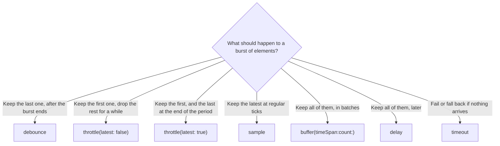

Time is where reactive code earns its keep. Waiting until the user stops typing before searching, ignoring the second tap of an impatient double tap, polling every 30 seconds, giving up on a request after 10: each is a dozen lines of timers, flags, and cancellation with callbacks, and one operator with RxSwift. Each operator also makes a precise choice about *which* elements survive and *when* they are delivered, and those choices decide whether a feature feels right.

This article measures `debounce`, `throttle`, `delay`, `delaySubscription`, `interval`, `timer`, and `timeout`, plus `sample` and `buffer`, on a virtual clock where every timeline is exact. It predicts how many search requests `debounce` saves for a typist with a known rhythm and checks the prediction by simulation. And it documents a behavior of RxSwift 6.10 that is easy to hit and hard to notice: `throttle` and `delay` round their remaining time in the unit you wrote the interval in, so `throttle(.seconds(1))` let a second element through after about 600 milliseconds on a real clock, and `delay(.seconds(1))` delivered two elements sent 300 milliseconds apart at the same instant. Writing the same intervals in milliseconds avoids it.

<!--more-->

The examples use RxSwift 6.10.2 in Swift 6 language mode and were compiled and run with the Swift 6.4 toolchain from Xcode 27.1 on macOS 26. Paste the blocks in order into one `main.swift` of an executable target that depends on `RxSwift` and `RxTest`. The file also needs three helpers from earlier articles: `record` from [Observables and Observers](/rxswift-observables-observers/), and `timeline`, `millisecondScheduler`, and the seeded random generator from [Filtering Operators](/rxswift-filtering-operators/#a-clock-you-control). RxSwift is imported with `@preconcurrency` for the real-time measurements, which share a subject with a background queue.

<!-- check-uses: rx-record -->
<!-- check-uses: rx-timeline -->
<!-- check-uses: rx-random -->
```swift
@preconcurrency import RxSwift
import RxTest
import Foundation
```

The examples share one more helper, which runs an operator against a hot test source on a fresh millisecond clock and returns the timeline:

```swift
func run<Result>(
    _ events: [Recorded<Event<String>>],
    until end: TestTime = 10_000,
    _ operation: @escaping (Observable<String>, TestScheduler) -> Observable<Result>
) -> [String] {
    let scheduler = millisecondScheduler()
    let source = scheduler.createHotObservable(events)
    let observer = scheduler.start(created: 0, subscribed: 0, disposed: end) {
        operation(source.asObservable(), scheduler)
    }
    return timeline(observer.events)
}
```

## `interval` and `timer`: sources made of time

`Observable.interval(_:scheduler:)` emits 0, 1, 2, and so on, once per period. The first element arrives after one period, not immediately:

```swift
let ticks = run([]) { _, scheduler in
    Observable<Int>.interval(.milliseconds(300), scheduler: scheduler).take(3).map { "\($0)" }
}
assert(ticks == ["0@300", "1@600", "2@900", "|@900"])
```

`Observable.timer(_:period:scheduler:)` separates the first delay from the period, and without a period it emits a single 0 and completes, which makes it RxSwift's "do something once, later":

```swift
let delayedStart = run([]) { _, scheduler in
    Observable<Int>.timer(.milliseconds(500), period: .milliseconds(200), scheduler: scheduler)
        .take(3).map { "\($0)" }
}
assert(delayedStart == ["0@500", "1@700", "2@900", "|@900"])

let once = run([]) { _, scheduler in
    Observable<Int>.timer(.milliseconds(500), scheduler: scheduler).map { "\($0)" }
}
assert(once == ["0@500", "|@500"])
```

Both are cold, so each subscriber gets its own timer starting from its own subscription, and disposing the subscription stops the timer. To make several subscribers share one clock, use `share()`. To poll, `interval` combined with `flatMapLatest` is the usual shape: `Observable<Int>.timer(.seconds(0), period: .seconds(30), scheduler: MainScheduler.instance).flatMapLatest { _ in fetch() }` fetches immediately and every 30 seconds, and cancels a fetch still running when the next one starts.

## `debounce`: wait for a pause

`debounce(_:scheduler:)` emits an element only after the source has been quiet for the given time. Every new element restarts the wait and replaces the pending one. It is the operator for search-as-you-type: query the server when the user pauses, not on every keystroke:

```swift
let typing: [Recorded<Event<String>>] = [
    .next(100, "s"), .next(150, "sw"), .next(230, "swi"), .next(290, "swif"),
    .next(800, "swift"), .next(1_400, "swift u"), .next(1_450, "swift ui"),
]
let debounced = run(typing) { $0.debounce(.milliseconds(300), scheduler: $1) }
assert(debounced == ["swif@590", "swift@1100", "swift ui@1750"])
```

Three queries out of seven keystrokes, each delivered 300 milliseconds after the last keystroke of its burst.

The two endings differ, and the first differs from Combine. When the source *completes* with an element pending, RxSwift's `debounce` emits it immediately and then completes. When the source *fails*, the pending element is dropped and the error is forwarded at once:

```swift
let completesWhilePending = run([.next(100, "draft"), .completed(150)]) {
    $0.debounce(.milliseconds(300), scheduler: $1)
}
assert(completesWhilePending == ["draft@150", "|@150"])        // flushed on completion

let failsWhilePending = run([.next(100, "draft"), .error(150, DemoError.boom)]) {
    $0.debounce(.milliseconds(300), scheduler: $1)
}
assert(failsWhilePending == ["x(boom)@150"])                   // dropped on error
```

Combine's `debounce` drops the pending value on completion, which [Time: `debounce`, `throttle`, `delay`](/combine-debounce-throttle-delay/) measured, and which loses the last edit of an autosave chain whose source completes when the editor closes. RxSwift's flush is the safer behavior for that case.

### How many requests does `debounce` save?

The answer depends on the rhythm of the typing, and it can be predicted. Model the time between keystrokes as exponentially distributed with mean $$1/\lambda$$, which is a reasonable first approximation for typing. `debounce` with a quiet time $$d$$ emits once for each gap longer than $$d$$, plus once after the last keystroke. A gap exceeds $$d$$ with probability $$P(\text{gap} > d) = e^{-\lambda d}$$, so for a query of $$n$$ keystrokes the expected number of requests is

$$
\mathbb{E}[\text{requests}] = 1 + (n - 1)\, e^{-\lambda d} .
$$

For a typist averaging 180 milliseconds between keystrokes, a debounce of 300 milliseconds, and 20-keystroke queries, $$e^{-300/180} = 0.189$$ and the prediction is $$1 + 19 \times 0.189 = 4.59$$ requests per query instead of 20. The simulation below types 1,000 such queries, separated by long pauses, into a real `debounce` on the virtual clock:

```swift
var keyboard = SeededGenerator(seed: 7)
var keystrokes: [Recorded<Event<String>>] = []
var clock = 0
for query in 0..<1_000 {
    clock += 5_000                                           // a long pause between queries
    for key in 0..<20 {
        let uniform = Double.random(in: Double.ulpOfOne...1, using: &keyboard)
        clock += Int((-log(uniform) * 180).rounded())        // exponential gap, mean 180 ms
        keystrokes.append(.next(clock, "query \(query), key \(key)"))
    }
}

let requests = run(keystrokes, until: clock + 10_000) { $0.debounce(.milliseconds(300), scheduler: $1) }
let predictedRequests = 1_000 * (1 + 19 * exp(-300.0 / 180))
print("requests:", requests.count, "predicted:", predictedRequests)
assert(abs(Double(requests.count) - predictedRequests) / predictedRequests < 0.05)
```

The run made 4,553 requests against a prediction of 4,589, within 0.8%, for 20,000 keystrokes. Raising $$d$$ to 500 milliseconds would cut the prediction to $$1 + 19e^{-500/180} = 2.18$$ requests per query, at the price of 200 milliseconds more latency before every search; the formula makes that trade-off a calculation instead of a guess.

## `throttle`: at most one per period

`throttle(_:latest:scheduler:)` limits how often elements pass. The first element passes immediately. After that, elements arriving within the period are held back or dropped, depending on `latest`:

- `latest: true`, the default, keeps the most recent held-back element and delivers it when the period ends.
- `latest: false` drops elements that arrive within the period.

The difference shows on the classic double tap. A user taps "Pay" at 100 ms and, impatient, again at 250 ms:

```swift
let doubleTap: [Recorded<Event<String>>] = [.next(100, "tap 1"), .next(250, "tap 2")]

let leadingAndTrailing = run(doubleTap) { $0.throttle(.milliseconds(1_000), scheduler: $1) }
assert(leadingAndTrailing == ["tap 1@100", "tap 2@1100"])     // the second payment, a second later

let leadingOnly = run(doubleTap) { $0.throttle(.milliseconds(1_000), latest: false, scheduler: $1) }
assert(leadingOnly == ["tap 1@100"])                           // the second tap is dropped
```

With the default, the second tap was not prevented, only postponed, and a second payment would start a second after the first. For buttons, `latest: false` is what "ignore repeated taps" means. `latest: true` is for continuous streams where the final value matters, such as a slider whose last position must be applied.

Over any window of length $$T$$, a throttle with period $$p$$ lets through at most $$\lfloor T/p \rfloor + 1$$ elements. That bound is what makes it a rate limit. As the next section shows, RxSwift only keeps it when the period is written in a fine enough unit.

### The unit you write the period in changes the result

Here is the same double tap, throttled with `.seconds(1)` instead of `.milliseconds(1_000)`, for several gaps between the taps:

```swift
for gap in [150, 400, 600, 900] {
    let taps: [Recorded<Event<String>>] = [.next(100, "tap 1"), .next(100 + gap, "tap 2")]
    let inSeconds = run(taps) { $0.throttle(.seconds(1), scheduler: $1) }
    let inMilliseconds = run(taps) { $0.throttle(.milliseconds(1_000), scheduler: $1) }
    print("gap \(gap) ms: .seconds(1) \(inSeconds), .milliseconds(1_000) \(inMilliseconds)")
    assert(inMilliseconds == ["tap 1@100", "tap 2@1100"])
}
```

The run printed:

```text
gap 150 ms: .seconds(1) ["tap 1@100", "tap 2@1250"], .milliseconds(1_000) ["tap 1@100", "tap 2@1100"]
gap 400 ms: .seconds(1) ["tap 1@100", "tap 2@1500"], .milliseconds(1_000) ["tap 1@100", "tap 2@1100"]
gap 600 ms: .seconds(1) ["tap 1@100", "tap 2@700"], .milliseconds(1_000) ["tap 1@100", "tap 2@1100"]
gap 900 ms: .seconds(1) ["tap 1@100", "tap 2@1000"], .milliseconds(1_000) ["tap 1@100", "tap 2@1100"]
```

With milliseconds, the second tap was delivered at 1100 every time, exactly one period after the first. With seconds, it arrived at four different times, and for a gap of 600 milliseconds it passed *immediately*, 600 milliseconds after the first: the one-second throttle let two elements through in 0.6 seconds.

The cause is a helper that computes the time remaining in the period, `dueTime.reduceWithSpanBetween(earlierDate:laterDate:)`. It subtracts the elapsed time from the period in the period's own unit and rounds the result to a whole number of that unit. With `.seconds(1)`, a remainder of 0.85 seconds rounds to one second, so the held-back tap waits a full second from *its* arrival; a remainder below 0.5 seconds rounds to zero, which the operator treats as "send now". With `.milliseconds(1_000)`, the rounding is to the nearest millisecond and harmless.

The virtual clock does not cause it. On a real `SerialDispatchQueueScheduler`, with the second element sent 600 milliseconds after the first:

```swift
nonisolated func realThrottle(_ period: RxTimeInterval) -> [String] {
    let start = Date()
    let presses = PublishSubject<String>()
    let delivered = DispatchSemaphore(value: 0)
    let log = NSLock()
    var arrivals: [String] = []
    let subscription = presses
        .throttle(period, scheduler: SerialDispatchQueueScheduler(qos: .userInitiated))
        .subscribe(onNext: { press in
            log.lock()
            arrivals.append("\(press)@\(Int(Date().timeIntervalSince(start) * 1_000))")
            log.unlock()
            if press == "second" { delivered.signal() }
        })
    presses.onNext("first")
    Thread.sleep(forTimeInterval: 0.6)
    presses.onNext("second")
    _ = delivered.wait(timeout: .now() + 3)
    subscription.dispose()
    return arrivals
}

let realSeconds = realThrottle(.seconds(1))
let realMilliseconds = realThrottle(.milliseconds(1_000))
print("real clock:", realSeconds, realMilliseconds)
```

Two runs printed `["first@0", "second@603"]` and `["first@0", "second@610"]` for `.seconds(1)`, and `["first@0", "second@1004"]` and `["first@0", "second@1006"]` for `.milliseconds(1_000)`. The rounding has been in RxSwift since the scheduler API moved to `DispatchTimeInterval` in 2019. Until it changes, write throttle periods in milliseconds.

## `delay` and `delaySubscription`

`delay(_:scheduler:)` shifts every element and the completion later by a fixed time, keeping the gaps between them. An error is *not* delayed; it is forwarded immediately and discards any elements still waiting:

```swift
let shifted = run([.next(100, "a"), .next(400, "b"), .completed(500)]) {
    $0.delay(.milliseconds(1_000), scheduler: $1)
}
assert(shifted == ["a@1100", "b@1400", "|@1500"])

let failedEarly = run([.next(100, "a"), .error(200, DemoError.boom)]) {
    $0.delay(.milliseconds(1_000), scheduler: $1)
}
assert(failedEarly == ["x(boom)@200"])                         // "a" never arrives
```

`delay` uses the same rounding helper for elements that queue up behind one another, and with an interval written in seconds the gaps between them collapse:

```swift
let queued: [Recorded<Event<String>>] = [.next(100, "a"), .next(400, "b"), .next(700, "c"), .next(1_000, "d")]
let delayedInSeconds = run(queued) { $0.delay(.seconds(1), scheduler: $1) }
let delayedInMilliseconds = run(queued) { $0.delay(.milliseconds(1_000), scheduler: $1) }
assert(delayedInMilliseconds == ["a@1100", "b@1400", "c@1700", "d@2000"])
assert(delayedInSeconds == ["a@1100", "b@1101", "c@2101", "d@2102"])
```

Elements sent 300 milliseconds apart arrived one millisecond apart, in pairs. On a real clock with a serial dispatch scheduler, elements sent at 0, 300, and 600 milliseconds through `delay(.seconds(1))` arrived at 1,011, 1,011, and 2,020 milliseconds, and through `delay(.milliseconds(1_000))` at 1,007, 1,312, and 1,619.

`delaySubscription(_:scheduler:)` is different: it delays the *subscription*, not the elements. With a hot source, anything emitted before the subscription is missed:

```swift
let lateStart = run([.next(100, "missed"), .next(600, "seen"), .completed(700)]) {
    $0.delaySubscription(.milliseconds(500), scheduler: $1)
}
assert(lateStart == ["seen@600", "|@700"])
```

With a cold source, such as a request, it postpones the work itself, which is how to retry after a pause, as [Error Handling](/rxswift-error-handling/) does.

## `timeout`: give up on silence

`timeout(_:scheduler:)` fails with `RxError.timeout` if the time between subscription and the first element, or between any two elements, exceeds the limit:

```swift
let stalled = run([.next(100, "a"), .next(200, "b"), .next(900, "c")]) {
    $0.timeout(.milliseconds(500), scheduler: $1)
}
assert(stalled == ["a@100", "b@200", "x(Sequence timeout.)@700"])

let neverStarted = run([.next(700, "late")]) { $0.timeout(.milliseconds(500), scheduler: $1) }
assert(neverStarted == ["x(Sequence timeout.)@500"])
```

The limit applies to *gaps*, not to the total duration: a stream that delivers an element every 400 milliseconds forever never times out with a 500-millisecond limit. To bound the whole operation, put the `timeout` on something that emits once, such as a `Single`, or combine `take(for:)` from [Filtering Operators](/rxswift-filtering-operators/#the-take-family) with a check for completion.

`timeout(_:other:scheduler:)` switches to a fallback observable instead of failing, for example a cached value when the network is slow:

```swift
let withFallback = run([.next(100, "fresh"), .next(900, "too late")]) {
    $0.timeout(.milliseconds(500), other: Observable.just("cached"), scheduler: $1)
}
assert(withFallback == ["fresh@100", "cached@600", "|@600"])
```

## `sample` and `buffer`

Two more time operators reduce a fast stream. `sample(_:)` emits the latest element whenever a second observable ticks, and only if a new element has arrived since the last tick. `buffer(timeSpan:count:scheduler:)` collects elements into arrays, emitting when the time span elapses or the count is reached, whichever comes first:

```swift
let sampled = run([.next(100, "a"), .next(150, "b"), .next(450, "c")]) { source, scheduler in
    source.sample(Observable<Int>.interval(.milliseconds(200), scheduler: scheduler).take(3))
}
assert(sampled == ["b@200", "c@600"])                          // nothing new at 400

let burst: [Recorded<Event<String>>] = (0..<7).map { .next(100 + $0 * 100, "e\($0)") } + [.completed(750)]
let batched = run(burst) { source, scheduler in
    source.buffer(timeSpan: .milliseconds(400), count: 3, scheduler: scheduler).map { $0.joined(separator: ",") }
}
assert(batched == ["e0,e1,e2@300", "e3,e4,e5@600", "e6@750", "|@750"])
```

`buffer` is the right tool for batching writes, such as sending analytics events to a server at most three at a time or every 400 milliseconds.

## Choosing a time operator



| RxSwift | Combine | Difference |
| --- | --- | --- |
| `debounce` | `debounce` | RxSwift flushes the pending element on completion; Combine drops it |
| `throttle(latest:)` | `throttle(for:scheduler:latest:)` | RxSwift's `latest: true` delivers the held element at the end of the period |
| `delay` | `delay(for:scheduler:)` | RxSwift forwards errors immediately |
| `interval`, `timer` | `Timer.publish`, `Just` + `delay` | Rx timers are cold, per subscriber |
| `timeout` | `timeout(_:scheduler:customError:)` | Combine finishes without an error unless given one |
| `buffer(timeSpan:count:)` | `collect(.byTimeOrCount(...))` | |

[Time: `debounce`, `throttle`, `delay`](/combine-debounce-throttle-delay/) covers the Combine operators, with its own measurements of what each does at the edges.

## Summary

- `interval` first fires after one period; `timer` separates the first delay from the period and fires once without one. Both are cold.
- `debounce` emits after a quiet period. RxSwift flushes the pending element on completion and drops it on error. With exponential typing gaps, $$\mathbb{E}[\text{requests}] = 1 + (n-1)e^{-\lambda d}$$: predicted 4,589 requests for 20,000 keystrokes, measured 4,553.
- `throttle(latest: true)` postpones a double tap instead of dropping it; use `latest: false` for buttons.
- RxSwift 6.10 rounds `throttle`'s and `delay`'s remaining time to whole units of the interval: `throttle(.seconds(1))` passed a second element after about 600 ms on a real clock, and `delay(.seconds(1))` collapsed elements 300 ms apart. Write these intervals in milliseconds.
- `delay` forwards errors immediately; `delaySubscription` delays the subscription, so a hot source's earlier elements are missed.
- `timeout` limits gaps between elements, not total duration; `timeout(_:other:)` falls back instead of failing.
- `sample` takes the latest element per tick; `buffer(timeSpan:count:)` batches.

## Exercise

Write `throttleFirst(_:scheduler:)`, a throttle with leading-edge behavior only that computes its window from the scheduler's clock in nanoseconds, so it is immune to the rounding described above. Test it with the four tap gaps from this article using both `.seconds(1)` and `.milliseconds(1_000)` and show the results are identical. Then extend the debounce simulation to a mixture of two typists, one averaging 120 ms between keystrokes and one averaging 300 ms, and work out from the formula which debounce time minimizes "requests plus 10 times the average extra latency in seconds".

## Further reading

- [Debounce](https://reactivex.io/documentation/operators/debounce.html), [Sample](https://reactivex.io/documentation/operators/sample.html), [Delay](https://reactivex.io/documentation/operators/delay.html), and [Timeout](https://reactivex.io/documentation/operators/timeout.html) on ReactiveX.io.
- The RxSwift sources for [`Throttle.swift`](https://github.com/ReactiveX/RxSwift/blob/main/RxSwift/Observables/Throttle.swift) and [`Date+Dispatch.swift`](https://github.com/ReactiveX/RxSwift/blob/main/RxSwift/Date%2BDispatch.swift), where the remaining-time rounding lives.
- [Time: `debounce`, `throttle`, `delay`](/combine-debounce-throttle-delay/) for the Combine side.

Previous: [Filtering Operators](/rxswift-filtering-operators/). Next: [Transforming Operators: `map`, `flatMap`, `flatMapLatest`, `concatMap`](/rxswift-transforming-operators/).

Return to the [RxSwift roadmap](/rxswift/).
