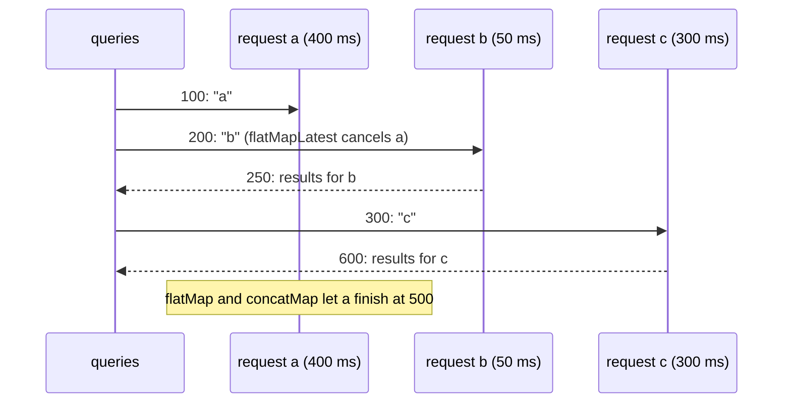

`map` turns each element into another element. That covers formatting a date, extracting a field, or computing a total, and it is the operator everyone learns first. The interesting transformations are the ones where each element turns into *more work*: a search query that becomes a network request, a user ID that becomes a profile fetch, a file URL that becomes an upload. The result of each is itself an observable, and the question is what to do when the next element arrives while the previous one's work is still running.

RxSwift gives four answers, and choosing the wrong one is behind a whole family of bugs: search results from an old query overwriting results for the new one, a double-tapped "Save" button saving twice, uploads that should run one at a time running all at once. This article measures all four, `flatMap`, `flatMapLatest`, `concatMap`, and `flatMapFirst`, on the same input in virtual time, including exactly when each inner request is subscribed and cancelled. It also derives the completion time of each strategy, covers `merge(maxConcurrent:)` for bounded concurrency, and finishes with `scan`, the operator that turns a stream of events into a stream of state.

<!--more-->

The examples use RxSwift 6.10.2 in Swift 6 language mode and were compiled and run with the Swift 6.4 toolchain from Xcode 27.1 on macOS 26. Paste the blocks in order into one `main.swift` of an executable target that depends on `RxSwift` and `RxTest`, together with `record` from [Observables and Observers](/rxswift-observables-observers/) and `timeline` and `millisecondScheduler` from [Filtering Operators](/rxswift-filtering-operators/#a-clock-you-control).

<!-- check-uses: rx-record -->
<!-- check-uses: rx-timeline -->
```swift
import RxSwift
import RxTest
import Foundation
```

## `map`, `compactMap`, and key paths

`map` applies a function to each element. It keeps no state, never delays, and passes completion and errors through. A throwing closure turns its error into an error event, as [Subscribing](/rxswift-subscribing/#unhandled-errors) measured:

```swift
struct User { let name: String; let age: Int }
let users = Observable.of(User(name: "Ada", age: 36), User(name: "Alan", age: 41))

assert(record(users.map { $0.name.uppercased() }) == ["ADA", "ALAN", "|"])
assert(record(users.map(\.age)) == ["36", "41", "|"])                    // a key path works as a function
assert(record(Observable.of("1", "x", "3").compactMap(Int.init)) == ["1", "3", "|"])
```

## The four ways to flatten

Each of the operators in this section takes a closure that returns an observable for each source element, subscribes to those *inner* observables, and merges their elements into one output. They differ only in what happens when a new source element arrives while an earlier inner observable is still running:

| Operator | When a new element arrives while inner work is running |
| --- | --- |
| `flatMap` | starts new work alongside the old; results arrive in completion order |
| `flatMapLatest` | cancels the old work and starts the new |
| `concatMap` | queues the new element until the old work completes |
| `flatMapFirst` | ignores the new element |

To compare them precisely, here is one input for all four: three search queries, typed at 100, 200, and 300 milliseconds, each turned into a request with its own latency. The request for `"a"` is slow (400 ms), the one for `"b"` is fast (50 ms), and the one for `"c"` takes 300 ms. Each request is a cold test observable, which RxTest makes from a list of events relative to subscription time, and which records every subscription and unsubscription:

```swift
struct SearchRun {
    let output: [String]
    let requests: [String: [Subscription]]
}

func search(
    _ flatten: @escaping (Observable<String>, @escaping (String) -> Observable<String>) -> Observable<String>
) -> SearchRun {
    let scheduler = millisecondScheduler()
    let queries = scheduler.createHotObservable([
        .next(100, "a"), .next(200, "b"), .next(300, "c"), .completed(1_000),
    ])
    let latency: [String: Int] = ["a": 400, "b": 50, "c": 300]
    var requests: [String: TestableObservable<String>] = [:]
    for (query, delay) in latency {
        requests[query] = scheduler.createColdObservable([
            .next(delay, "results for \(query)"), .completed(delay),
        ])
    }
    let observer = scheduler.start(created: 0, subscribed: 0, disposed: 5_000) {
        flatten(queries.asObservable()) { query in requests[query]!.asObservable() }
    }
    return SearchRun(
        output: timeline(observer.events),
        requests: requests.mapValues { $0.subscriptions }
    )
}
```

A `Subscription` records the virtual time a request was subscribed and the time it was disposed, whether because it completed or because something cancelled it.

### `flatMap`: everything, in completion order

```swift
let merged = search { queries, request in queries.flatMap(request) }
assert(merged.output == ["results for b@250", "results for a@500", "results for c@600", "|@1000"])
assert(merged.requests["a"] == [Subscription(100, 500)])
assert(merged.requests["b"] == [Subscription(200, 250)])
assert(merged.requests["c"] == [Subscription(300, 600)])
```

All three requests ran to completion, concurrently. The results arrived in the order the requests *finished*, not the order the queries were typed, so the screen showed `b`'s results, then `a`'s, then `c`'s. For a search box, the middle step is the bug: for 100 milliseconds the user sees results for `"a"` after having typed `"c"`, and if `"a"` had been slower than `"c"`, the stale results would have stayed on screen for good. `flatMap` is right when every inner result matters and order does not, such as uploading several photos.

### `flatMapLatest`: only the newest

```swift
let latest = search { queries, request in queries.flatMapLatest(request) }
assert(latest.output == ["results for b@250", "results for c@600", "|@1000"])
assert(latest.requests["a"] == [Subscription(100, 200)])   // cancelled when "b" arrived
assert(latest.requests["b"] == [Subscription(200, 250)])   // finished before "c" arrived
assert(latest.requests["c"] == [Subscription(300, 600)])
```

The request for `"a"` was disposed at 200 ms, the moment `"b"` arrived, so its results never appeared and, if it was a real network request wrapped in `create`, the request itself was cancelled. The request for `"b"` happened to finish before `"c"` arrived, so its results were shown briefly. The output can never go backwards: whatever is on screen belongs to the newest query that has produced anything. That is why search and any "show details for the current selection" chain should use `flatMapLatest`. It is RxSwift's version of Combine's `map` + `switchToLatest`.

### `concatMap`: one at a time, in order

```swift
let ordered = search { queries, request in queries.concatMap(request) }
assert(ordered.output == ["results for a@500", "results for b@550", "results for c@850", "|@1000"])
assert(ordered.requests["a"] == [Subscription(100, 500)])
assert(ordered.requests["b"] == [Subscription(500, 550)])   // waited for "a" to finish
assert(ordered.requests["c"] == [Subscription(550, 850)])
```

`concatMap` subscribed to each request only after the previous one completed, so the results are in input order, and the total time grew to the sum of the latencies. That is right for work that must not overlap or must stay ordered: writes to the same record, messages in a chat, steps of a migration.

The queued elements are held in memory until their turn. If the source produces faster than the inner work completes, the queue grows without limit, by the same arithmetic as [Observables and Observers](/rxswift-observables-observers/#no-backpressure): at a rate of $$\lambda - \mu$$ elements per second, where $$\lambda$$ is the arrival rate and $$\mu$$ the rate at which the inner work completes.

### `flatMapFirst`: ignore while busy

```swift
let first = search { queries, request in queries.flatMapFirst(request) }
assert(first.output == ["results for a@500", "|@1000"])
assert(first.requests["a"] == [Subscription(100, 500)])
assert(first.requests["b"] == [])                           // never subscribed
assert(first.requests["c"] == [])
```

`b` and `c` arrived while `a` was running and were dropped; their requests never started. For search that is wrong, but it is exactly right for a "Pay" or "Log in" button: the first tap starts the work, and every tap until it finishes is ignored, without the time-based guesswork of `throttle` from [Time Operators](/rxswift-time-operators/#throttle-at-most-one-per-period).



### When does each strategy finish?

The completion times follow from simple recurrences. Let element $$i$$ arrive at $$t_i$$ and its inner work take $$d_i$$. With `flatMap`, the work for each element starts on arrival, so it finishes at

$$
f_i = t_i + d_i .
$$

With `concatMap`, work for element $$i$$ starts when it arrives *and* the previous work has finished:

$$
f_i = \max(f_{i-1},\, t_i) + d_i, \qquad f_0 = 0 .
$$

For the queries above, $$f = (500, 250, 600)$$ for `flatMap` and $$f_1 = 100 + 400 = 500$$, $$f_2 = \max(500, 200) + 50 = 550$$, $$f_3 = \max(550, 300) + 300 = 850$$ for `concatMap`, matching the measured timelines. When work arrives in a burst, `concatMap`'s last result arrives after the sum of all the durations, and `flatMap`'s after the longest one.

## Bounded concurrency with `merge(maxConcurrent:)`

Between `flatMap`'s "all at once" and `concatMap`'s "one at a time" lies the common requirement "at most *k* at a time", for example downloading thumbnails without opening fifty connections. RxSwift expresses it by mapping each element to its inner observable and merging with a limit:

```swift
let downloads = millisecondScheduler()
let thumbnails = (1...6).map { index in
    downloads.createColdObservable([.next(100, "thumbnail \(index)"), .completed(100)])
}
let limited = downloads.start(created: 0, subscribed: 0, disposed: 5_000) {
    Observable.from(thumbnails.map { $0.asObservable() }).merge(maxConcurrent: 2)
}
assert(timeline(limited.events).filter { !$0.hasPrefix("|") }.map { $0.components(separatedBy: "@")[1] }
       == ["100", "100", "200", "200", "300", "300"])
assert(thumbnails[5].subscriptions == [Subscription(200, 300)])  // the sixth waited for a free slot
```

Six downloads of 100 milliseconds each, at most two at a time, finished in pairs at 100, 200, and 300 milliseconds. In general, $$n$$ equal tasks of duration $$d$$ with a limit of $$k$$ finish after $$\lceil n/k \rceil\, d$$, which is $$\lceil 6/2 \rceil \times 100 = 300$$ milliseconds here. `concatMap` is the special case $$k = 1$$, and `flatMap` the case $$k = \infty$$.

## Errors inside a flattening operator

An error from any inner observable ends the whole output, including the outer chain and every other inner observable still running:

```swift
let requestErrors = millisecondScheduler()
let healthy = requestErrors.createColdObservable([.next(300, "slow result"), .completed(300)])
let failing = requestErrors.createColdObservable([Recorded<Event<String>>.error(50, DemoError.boom)])
let triggers = requestErrors.createHotObservable([.next(100, "healthy"), .next(200, "failing")])
let erroring = requestErrors.start(created: 0, subscribed: 0, disposed: 5_000) {
    triggers.flatMap { $0 == "healthy" ? healthy.asObservable() : failing.asObservable() }
}
assert(timeline(erroring.events) == ["x(boom)@250"])
assert(healthy.subscriptions == [Subscription(100, 250)])      // cancelled by the other request's error
```

The healthy request was cancelled at 250 milliseconds because a different request failed. For a search box that means one failed search ends searching, the problem [Driver and Signal](/rxswift-driver-signal/#a-driver-that-cannot-fail-can-still-end) measured. The fix is to catch errors *inside* the closure, so that each inner observable ends on its own terms; [Error Handling](/rxswift-error-handling/) covers the operators.

## `scan`: from events to state

`scan` is the transforming operator that keeps state. It starts with a seed, combines the seed with each element using a closure, and emits every intermediate result. With `scan(into:)`, the accumulator is mutated in place, which avoids copying collections:

```swift
assert(record(Observable.of(1, 2, 3, 4).scan(0, accumulator: +)) == ["1", "3", "6", "10", "|"])

enum TodoAction {
    case add(String)
    case complete(String)
}

let actions = Observable<TodoAction>.of(.add("milk"), .add("eggs"), .complete("milk"), .add("bread"))
let remaining = actions.scan(into: [String]()) { todos, action in
    switch action {
    case .add(let item): todos.append(item)
    case .complete(let item): todos.removeAll { $0 == item }
    }
}
assert(record(remaining.map { $0.joined(separator: ",") }) == ["milk", "milk,eggs", "eggs", "eggs,bread", "|"])
```

That is a reducer: a stream of actions in, a stream of states out, with the only state in the accumulator. [Relays](/rxswift-relays/#a-single-writer) used it, with a serial scheduler in front, to make a thread-safe store. `scan` gives each subscriber its own accumulator, starting from the seed, because the closure runs inside each subscription; to share one state among several subscribers, add `share(replay: 1)` after it.

## Transforming in RxSwift and Combine

| RxSwift | Combine |
| --- | --- |
| `map`, `compactMap` | `map`, `compactMap`, `tryMap` |
| `flatMap` | `flatMap(maxPublishers: .unlimited)` |
| `flatMapLatest` | `map` + `switchToLatest()` |
| `concatMap` | `flatMap(maxPublishers: .max(1))` |
| `merge(maxConcurrent: k)` | `flatMap(maxPublishers: .max(k))` |
| `flatMapFirst` | no built-in equivalent |
| `scan`, `scan(into:)` | `scan`, `tryScan` |

Combine expresses all the concurrency choices through demand, with `maxPublishers`, which is more uniform; RxSwift has no demand, so it needs a separate operator for each. [Transforming: `map`, `flatMap`, `scan`](/combine-map-flatmap-scan/) covers the Combine side.

## Summary

- `map` and `compactMap` transform each element without state; key paths work as transform functions.
- On the same input, `flatMap` delivered results in completion order, `flatMapLatest` cancelled the stale request at the moment the next query arrived, `concatMap` ran requests one after another in input order, and `flatMapFirst` ignored queries while a request was running.
- Completion times: $$f_i = t_i + d_i$$ for `flatMap` and $$f_i = \max(f_{i-1}, t_i) + d_i$$ for `concatMap`; measured 600 and 850 ms for the last query.
- `merge(maxConcurrent: k)` runs at most $$k$$ inner observables at once; six 100 ms tasks with $$k = 2$$ finished at $$\lceil n/k \rceil d = 300$$ ms.
- An error from any inner observable ends the output and cancels the others; catch inside the closure.
- `scan` and `scan(into:)` fold events into state, one accumulator per subscription.

## Exercise

Write `flatMapLatest(debounce:scheduler:)`, which waits for a pause before starting each inner observable and still cancels the running one when a new element arrives. Test it with the three queries from this article and a debounce of 120 ms, recording the subscriptions of each request, and show which requests start at all. Then write a version of `flatMapFirst` that, instead of dropping elements that arrive while busy, remembers only the *last* one and starts it when the current work finishes, and compare its timeline with `concatMap`'s.

## Further reading

- [FlatMap](https://reactivex.io/documentation/operators/flatmap.html), [Switch](https://reactivex.io/documentation/operators/switch.html), and [Scan](https://reactivex.io/documentation/operators/scan.html) on ReactiveX.io.
- [Testing](https://github.com/ReactiveX/RxSwift/blob/main/Documentation/UnitTests.md) in the RxSwift documentation, on cold observables and recorded subscriptions.
- [Transforming: `map`, `flatMap`, `scan`](/combine-map-flatmap-scan/) for the Combine operators.

Previous: [Time Operators](/rxswift-time-operators/). Next: [Combining Operators: `combineLatest`, `zip`, `merge`, `concat`, `withLatestFrom`](/rxswift-combining-operators/).

Return to the [RxSwift roadmap](/rxswift/).
