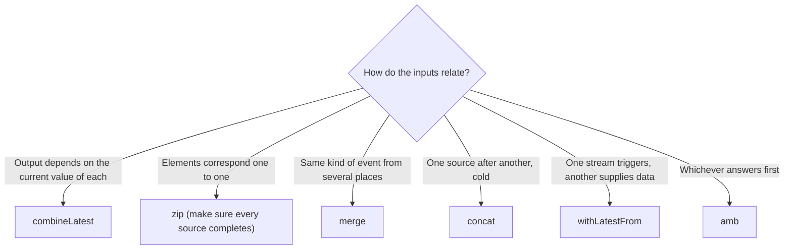

Screens rarely depend on one stream. A sign-up button is enabled when the email is valid *and* the password is long enough *and* the terms are accepted. A dashboard shows a profile *and* a list of orders, fetched in parallel. A feed shows new posts from the server *and* drafts from the device. A "Submit" tap sends whatever the form contains *at that moment*. Each of those is a different way of combining streams, and RxSwift has an operator for each.

This article measures `combineLatest`, `zip`, `merge`, `concat`, and `withLatestFrom`, plus `startWith` and `amb`, on a virtual clock. It shows when each one emits, when each one completes, and what each does with elements it cannot use yet. Two of the answers are not what the ReactiveX documentation leads you to expect: RxSwift's `zip` completes only when *every* source has completed, so zipping a finite source with an infinite one never ends (synchronously, it hangs), and `concat` with a hot second source silently loses whatever that source emitted while the first was still running.

<!--more-->

The examples use RxSwift 6.10.2 in Swift 6 language mode and were compiled and run with the Swift 6.4 toolchain from Xcode 27.1 on macOS 26. Paste the blocks in order into one `main.swift` of an executable target that depends on `RxSwift` and `RxTest`, together with `record` from [Observables and Observers](/rxswift-observables-observers/) and `timeline` and `millisecondScheduler` from [Filtering Operators](/rxswift-filtering-operators/#a-clock-you-control).

<!-- check-uses: rx-record -->
<!-- check-uses: rx-timeline -->
```swift
import RxSwift
import RxTest
import Foundation
```

Every example combines two hot test sources on a fresh millisecond clock, through this helper:

```swift
func combine<A, B, Result>(
    _ first: [Recorded<Event<A>>],
    _ second: [Recorded<Event<B>>],
    _ operation: @escaping (Observable<A>, Observable<B>) -> Observable<Result>
) -> [String] {
    let scheduler = millisecondScheduler()
    let a = scheduler.createHotObservable(first)
    let b = scheduler.createHotObservable(second)
    let observer = scheduler.start(created: 0, subscribed: 0, disposed: 10_000) {
        operation(a.asObservable(), b.asObservable())
    }
    return timeline(observer.events)
}
```

## `combineLatest`: the latest of each, whenever any changes

`combineLatest` waits until every source has emitted at least once, then emits a combination of the latest element from each source every time any of them emits. It is the operator for derived state, where the output should always reflect the current value of every input:

```swift
let validation = combine(
    [.next(100, "a@"), .next(300, "ada@example.com"), .completed(1_000)],
    [.next(200, "pass"), .next(400, "password123"), .completed(1_000)]
) { email, password in
    Observable.combineLatest(email, password) { email, password in
        email.contains(".") && password.count >= 8 ? "enabled" : "disabled"
    }
}
assert(validation == ["disabled@200", "disabled@300", "enabled@400", "|@1000"])
```

Nothing came out at 100 ms, because the password field had not produced anything yet. In a form, that is the classic reason a "Sign up" button never updates until the user touches every field. The fix is to give each input an initial value, which UI sources usually have already (RxCocoa's `rx.text` emits the field's current text on subscription), or to add one with `startWith`:

```swift
let withInitialValues = combine(
    [.next(100, "a@"), .completed(1_000)],
    [Recorded<Event<String>>.completed(1_000)]
) { email, password in
    Observable.combineLatest(email, password.startWith("")) { "\($0)|\($1)" }
}
assert(withInitialValues == ["a@|@100", "|@1000"])
```

### How many elements `combineLatest` emits

Once every source has a value, each element from any source produces exactly one output. If source $$A$$ emits $$n_A$$ elements and $$B$$ emits $$n_B$$, and the "warm-up" ends when the last source to start emits its first element, after $$a_0$$ elements from $$A$$ and $$b_0$$ from $$B$$, then

$$
\text{outputs} = (n_A - a_0) + (n_B - b_0) + 1 .
$$

In the validation example, the warm-up ended at 200 ms with $$a_0 = 1$$ and $$b_0 = 1$$, so the formula gives $$(2 - 1) + (2 - 1) + 1 = 3$$ outputs, the three measured. Every element after the warm-up costs one evaluation of the combining closure, which is why expensive work belongs after a `distinctUntilChanged()` on the output, not inside the closure.

### When it completes

`combineLatest` completes when all of its sources have completed, as above. A source that completes *without ever emitting* makes any output impossible, and RxSwift does notice, but lazily:

```swift
let emptyPartner = combine(
    [.next(100, "a1"), .next(300, "a2"), .completed(400)],
    [Recorded<Event<String>>.completed(200)]
) { a, b in Observable.combineLatest(a, b) { $0 + $1 } }
assert(emptyPartner == ["|@300"])
```

The empty source completed at 200 ms, but the output completed at 300 ms, when the *other* source emitted next and RxSwift checked whether all the sources without a value were finished. If the other source had never emitted again, the output would have completed only when it did.

## `zip`: pairs, by position

`zip` pairs the first element of each source, then the second of each, and so on. Elements wait in a buffer until their partner arrives. It is the operator for combining results that correspond one to one, such as two requests that must both finish:

```swift
let dashboard = combine(
    [.next(300, "profile"), .completed(300)],
    [.next(100, "orders"), .completed(100)]
) { profile, orders in
    Observable.zip(profile, orders) { "\($0) + \($1)" }
}
assert(dashboard == ["profile + orders@300", "|@300"])
```

For requests, the trait version `Single.zip` from [`Single`, `Maybe`, and `Completable`](/rxswift-single-maybe-completable/#composing-traits) states the one-result shape in the type.

### `zip` waits for every source to complete

Here the second source produces one element and completes at 250 ms. No second pair is possible after that, because the second source is finished. Yet the output does not complete until the *first* source completes, 100 milliseconds later:

```swift
let lingering = combine(
    [.next(100, 1), .next(200, 2), .next(300, 3), .completed(350)],
    [.next(150, "x"), .completed(250)]
) { numbers, letters in Observable.zip(numbers, letters) { "\($0)\($1)" } }
assert(lingering == ["1x@150", "|@350"])
```

RxSwift's `zip` marks each source as done when it completes and completes its output only when every source is done. With a finite source zipped against one that never completes, such as a timer, a stream of UI events, or a subject, the output never completes, the subscription stays alive, and every element of the infinite source is buffered for a partner that will never come. At a rate of $$\lambda$$ elements per second from the infinite source, the buffer holds $$\lambda t$$ elements after $$t$$ seconds.

With a *synchronous* infinite source, it is worse. The source runs on the current thread, so the subscription never returns:

```swift
var generated = 0
let numbers = sequence(first: 1) { previous in
    generated += 1
    return previous < 2_000_000 ? previous + 1 : nil       // capped, so this example terminates
}
let zipped = record(Observable.zip(Observable.from(numbers), Observable.of("a", "b", "c")) { "\($0)\($1)" })
assert(zipped == ["1a", "2b", "3c", "|"])
assert(generated == 2_000_000)                              // the generator ran to its end anyway
```

The three pairs were right, and they were emitted early, but the completion arrived only after all two million numbers had been generated and buffered. Without the cap, the same line never returns. When one source is the authoritative length, say so: `zip` with `numbers.take(3)` or `take(until:)` on the infinite side ends the output when it should.

## `merge`: everything, as it happens

`merge` subscribes to all sources at once and forwards every element as it arrives. It completes when all sources have completed, and fails as soon as any source fails. It is the operator for several sources of the same kind of event, such as refresh requests from a pull-to-refresh, a timer, and an app-became-active notification:

```swift
let refreshes = combine(
    [.next(100, "pulled"), .next(400, "pulled"), .completed(500)],
    [.next(250, "timer"), .completed(600)]
) { pulls, timer in Observable.merge(pulls, timer) }
assert(refreshes == ["pulled@100", "timer@250", "pulled@400", "|@600"])

let failingSource = combine(
    [.next(100, "a"), .next(400, "b")],
    [Recorded<Event<String>>.error(200, DemoError.boom)]
) { a, b in Observable.merge(a, b) }
assert(failingSource == ["a@100", "x(boom)@200"])           // "b" is lost with the rest of the stream
```

With synchronous sources, `merge` does *not* concatenate them. Each source schedules its elements on the current-thread trampoline described in [Creating Observables](/rxswift-creating-observables/#how-synchronous-sources-avoid-deep-stacks), and the trampoline interleaves their steps:

```swift
assert(record(Observable.merge(Observable.of(1, 2), Observable.of(3))) == ["1", "3", "2", "|"])
```

Code that relies on "all of the first source, then all of the second" needs `concat`.

## `concat`: one source after another

`concat` subscribes to the first source, forwards everything until it completes, and only then subscribes to the next. With cold sources, which do their work per subscription, that gives sequencing: a cached value first, then the network:

```swift
let cachedThenFresh = Observable.concat(Observable.just("cached profile"), Observable.just("fresh profile"))
assert(record(cachedThenFresh) == ["cached profile", "fresh profile", "|"])
```

With a *hot* second source, the same subscription-time behavior loses data. Here the second source emits at 200 ms, while the first is still running:

```swift
let lostToConcat = combine(
    [.next(100, "first 1"), .completed(300)],
    [.next(200, "second 1"), .next(400, "second 2"), .completed(500)]
) { first, second in Observable.concat(first, second) }
assert(lostToConcat == ["first 1@100", "second 2@400", "|@500"])
```

`"second 1"` was emitted to nobody, because `concat` did not subscribe to the second source until 300 ms. A hot source has to be buffered to be concatenated, for example by subscribing a `ReplaySubject` to it in advance, and usually the honest fix is `merge`, accepting that the elements interleave.

## `withLatestFrom`: sample on a trigger

`withLatestFrom` emits when the *first* source emits, combining its element with the latest element of the second source. Elements of the second source alone emit nothing. That is the operator for "when the user taps Submit, send what the form contains", where `combineLatest` would wrongly submit on every keystroke:

```swift
let submissions = combine(
    [.next(100, "tap"), .next(300, "tap"), .next(500, "tap")],
    [.next(200, "hello"), .next(250, "hello!"), .completed(260)]
) { taps, text in taps.withLatestFrom(text) }
assert(submissions == ["hello!@300", "hello!@500"])
```

Three details are visible in that timeline. The tap at 100 ms produced nothing, because the text had no value yet; a submit button that does nothing on the first tap usually has this cause. Two keystrokes between taps produced one submission, with the latest text. And the tap at 500 ms still used `"hello!"` even though the text source had completed at 260 ms: the latest value outlives its source.

The overload `withLatestFrom(_:resultSelector:)` combines both elements, for when the trigger carries information too, such as which button was tapped.

## `startWith` and `amb`

`startWith` emits the given elements synchronously on subscription, before anything from the source. It gives `combineLatest` its initial values, as above, and gives a loading state a first frame:

```swift
assert(record(Observable.of("results").startWith("loading")) == ["loading", "results", "|"])
```

`amb` (short for "ambiguous") subscribes to two sources and mirrors whichever emits first, disposing the other. It races a request against a mirror, or a fresh value against a timeout fallback:

```swift
let raceScheduler = millisecondScheduler()
let primary = raceScheduler.createColdObservable([.next(300, "primary"), .completed(300)])
let mirror = raceScheduler.createColdObservable([.next(120, "mirror"), .completed(120)])
let raced = raceScheduler.start(created: 0, subscribed: 0, disposed: 1_000) { primary.amb(mirror) }
assert(timeline(raced.events) == ["mirror@120", "|@120"])
assert(primary.subscriptions == [Subscription(0, 120)])     // the loser was cancelled when the winner emitted
```

## Choosing a combining operator



| RxSwift | Combine | Difference |
| --- | --- | --- |
| `combineLatest` | `combineLatest` | same warm-up behavior |
| `zip` | `zip` | RxSwift completes only when every source completes |
| `merge` | `merge` | |
| `concat` | `append`, `prepend` | |
| `withLatestFrom` | no built-in equivalent | |
| `startWith` | `prepend` | |
| `amb` | no built-in equivalent | |

[Combining: `combineLatest`, `zip`, `merge`](/combine-combinelatest-zip-merge/) covers the Combine operators, where `zip` has its own infinite-source problem caused by demand.

```swift
withExtendedLifetime(numbers) {}
```

## Summary

- `combineLatest` emits nothing until every source has emitted, then once per element; outputs $$= (n_A - a_0) + (n_B - b_0) + 1$$. Give UI inputs initial values with `startWith`. An empty source completes the output only when another source next emits.
- `zip` pairs by position and completes only when every source has completed: with a source that completed at 250 ms, the output completed at 350. Zipped with a synchronous infinite source, it never returns; with an asynchronous one, it buffers forever.
- `merge` forwards everything as it happens and fails on the first error; synchronous sources interleave through the trampoline.
- `concat` subscribes to each source only after the previous completes, so a hot source loses what it emitted in the meantime.
- `withLatestFrom` emits on the trigger with the latest data, ignores triggers before the data has a value, and keeps the last value after the data source completes.
- `amb` mirrors the first source to emit and cancels the other.

## Exercise

Write `zipShortest`, a two-source `zip` that completes as soon as one source has completed and its buffer is empty, so that zipping a finite source with an infinite one completes. Test it in virtual time with the `lingering` example (it should complete at 250 ms) and with a synchronous infinite sequence, which should now return. Then measure the largest buffer either version holds when zipping a source that emits every 10 ms with one that emits every 30 ms for 10 seconds, and compare it with $$(\lambda_A - \lambda_B)\,t$$.

## Further reading

- [CombineLatest](https://reactivex.io/documentation/operators/combinelatest.html), [Zip](https://reactivex.io/documentation/operators/zip.html), [Merge](https://reactivex.io/documentation/operators/merge.html), [Concat](https://reactivex.io/documentation/operators/concat.html), and [Amb](https://reactivex.io/documentation/operators/amb.html) on ReactiveX.io.
- The RxSwift source for [`Zip.swift`](https://github.com/ReactiveX/RxSwift/blob/main/RxSwift/Observables/Zip.swift), where the completion rule measured here is the `done(_:)` method.
- [Combining: `combineLatest`, `zip`, `merge`](/combine-combinelatest-zip-merge/) for the Combine side.

Previous: [Transforming Operators](/rxswift-transforming-operators/). Next: [Error Handling: `catch`, `catchAndReturn`, and `retry`](/rxswift-error-handling/).

Return to the [RxSwift roadmap](/rxswift/).
